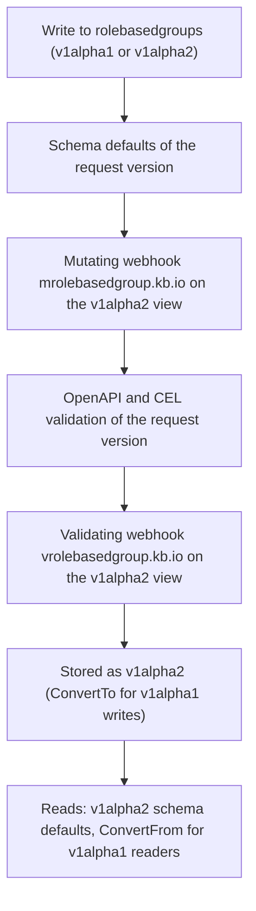

# API layer

> Last verified against `main` at `1fc69f70`. Pointers name files and symbols, not line
> numbers; if a symbol moved, search for it and update this page.

This page explains how the `workloads.x-k8s.io` API is built: the Go types under `api/workloads`, the label and annotation contract, the helpers that controllers call, admission (schema rules, defaulters, validators), v1alpha1 conversion, and the generated artifacts. The rules for changing any of this live in [api-and-admission.md](../../../.agents/skills/rbg-conventions/references/api-and-admission.md) and [upgrade-compatibility.md](../../../.agents/skills/rbg-conventions/references/upgrade-compatibility.md); this page links to them instead of restating them.

## Where the code lives

| Path | Responsibility |
|---|---|
| `api/workloads/v1alpha2/` | Current API: types of the eight v1alpha2 kinds, Go defaulters and validators, webhook setup, conversion hub, helpers |
| `api/workloads/v1alpha1/` | Deprecated API: types, conversion spokes, legacy `rolebasedgroup.workloads.x-k8s.io/` constants and helpers |
| `api/workloads/constants/` | Label, annotation, env var and workload-type constants |
| `api/workloads/ordinals/` | KEP-499 ordinal ranges: `Parse`, `Ranges`, `Select`, `Record` |
| `api/workloads/pub/inplace_update/` | In-place update state types and annotation accessors used by `pkg/inplace` |
| `cmd/rbgs/main.go` | `--enable-webhooks` and `--enable-deprecated-workload-types`; `bootstrapWebhookCerts` registers every webhook |
| `pkg/webhook/` | `CertManager`: self-signed serving certificate and `caBundle` patching; no admission logic |
| `config/crd/` | Generated CRDs in `config/crd/bases/`, hand-written conversion patches in `config/crd/patches/` |
| `config/webhook/` | Generated webhook configurations and the webhook Service |
| `config/rbac/role.yaml` | Generated controller ClusterRole |
| `deploy/helm/rbgs/templates/webhook/manifests.yaml` | Chart webhook configurations, hand-maintained |
| `deploy/helm/rbgs/templates/rbac/clusterrole.yaml` | Chart ClusterRole, generated by `hack/gen-helm-rbac` |
| `deploy/helm/rbgs/templates/crd-upgrade/crd-upgrade.yaml`, `tools/crd-upgrade/` | Helm hook Job that installs the CRDs and patches `spec.conversion` |
| `deploy/kubectl/manifests.yaml` | Output of `kustomize build config/default` |
| `client-go/` | Generated clientset, listers, informers and applyconfigurations |
| `hack/update-codegen.sh` | Runs kube_codegen to produce `client-go/` |
| `hack/gen-helm-rbac/` | Renders the chart ClusterRole from `config/rbac/role.yaml` |
| `internal/controller/workloads/coordinatedpolicy_migration_controller.go` | `EnsureV1alpha1CoordinatedPolicy`: turns the v1alpha1 coordination annotation into a CoordinatedPolicy |

## Package layout

One file, `api/workloads/v1alpha2/rolebasedgroup_webhook.go`, sets up the webhooks of every kind. Validators live in the files ending in `_admission.go`; the checks they call live in the files ending in `_validation.go`, so the controller can call them too.

| File | Contents |
|---|---|
| `api/workloads/v1alpha2/rolebasedgroup_types.go` | `RoleBasedGroup`, `RoleSpec`, `Pattern`, `TemplateSource`, `RoleTemplate`, rollout and restart types, status, `GetWorkloadType`, `GetWorkloadSpec`, `NormalizeUpdateStrategyType` |
| `api/workloads/v1alpha2/rolebasedgroupset_types.go`, `api/workloads/v1alpha2/rolebasedgroupscalingadapter_types.go`, `api/workloads/v1alpha2/roleinstanceset_types.go`, `api/workloads/v1alpha2/roleinstance_types.go`, `api/workloads/v1alpha2/coordinatedpolicy_types.go`, `api/workloads/v1alpha2/clusterengineruntimeprofile_types.go`, `api/workloads/v1alpha2/rolebasedgroupwarmup_types.go` | One kind each |
| `api/workloads/v1alpha2/rolebasedgroup_webhook.go` | All `+kubebuilder:webhook` markers and every `SetupWebhookWithManager` |
| `api/workloads/v1alpha2/rolebasedgroup_default.go`, `api/workloads/v1alpha2/rolebasedgroupset_default.go`, `api/workloads/v1alpha2/roleinstanceset_default.go` | `RoleBasedGroupDefaulter`, `RoleBasedGroupSetDefaulter`, `RoleInstanceSetDefaulter` |
| `api/workloads/v1alpha2/rolebasedgroup_admission.go`, `api/workloads/v1alpha2/rolebasedgroupset_admission.go`, `api/workloads/v1alpha2/coordinatedpolicy_admission.go` | `RoleBasedGroupValidator`, `RoleBasedGroupSetValidator`, `CoordinatedPolicyValidator` |
| `api/workloads/v1alpha2/rolebasedgroup_validation.go`, `api/workloads/v1alpha2/coordinatedpolicy_validation.go`, `api/workloads/v1alpha2/roletemplate_validation.go`, `api/workloads/v1alpha2/excluded_ordinals.go` | Validation functions, the deprecated-type gate, `RoleInstanceSet.CommittedOrdinals` |
| `api/workloads/v1alpha2/rolebasedgroup_conversion.go` | `Hub()` for RoleBasedGroup and RoleBasedGroupSet |
| `api/workloads/v1alpha2/helper.go` | Naming, label, pattern, template and restart-policy helpers |
| `api/workloads/v1alpha2/groupversion_info.go`, `api/workloads/v1alpha2/register.go`, `api/workloads/v1alpha2/doc.go` | `GroupVersion`, `SchemeBuilder`, `AddToScheme`, `SchemeGroupVersion`, `Resource` |
| `api/workloads/v1alpha2/zz_generated.deepcopy.go` | Generated deepcopy |
| `api/workloads/v1alpha1/rolebasedgroup_types.go` | v1alpha1 RoleBasedGroup: `workload`, `template`, `templateRef`, `templatePatch`, `leaderWorkerSet`, `components`, `podGroupPolicy`, `coordination` |
| `api/workloads/v1alpha1/rolebasedgroupset_types.go`, `api/workloads/v1alpha1/rolebasedgroupscalingadapter_types.go`, `api/workloads/v1alpha1/clusterengineruntimeprofile_types.go` | The other kinds that have both versions |
| `api/workloads/v1alpha1/instance_types.go`, `api/workloads/v1alpha1/instanceset_types.go` | v1alpha1-only `Instance` and `InstanceSet` |
| `api/workloads/v1alpha1/rolebasedgroup_conversion.go`, `api/workloads/v1alpha1/rolebasedgroupset_conversion.go` | Spokes: `ConvertTo` and `ConvertFrom` |
| `api/workloads/v1alpha1/constant.go` | Legacy keys under `rolebasedgroup.workloads.x-k8s.io/` and v1alpha1 enums |
| `api/workloads/v1alpha1/helper.go`, `api/workloads/v1alpha1/roletemplate_validation.go` | v1alpha1 helpers used by the v1alpha1 e2e framework; the validation file has no caller outside its test |

## Kinds, versions and subresources

Short names come from the `+kubebuilder:resource` markers. Every v1alpha1 version carries a `deprecationWarning` announcing removal in 0.10.0.

| Kind | Versions | Scope, short name | Subresources | Conversion | Typed client |
|---|---|---|---|---|---|
| RoleBasedGroup | v1alpha1, v1alpha2 (storage) | Namespaced, `rbg` | status | Webhook | yes |
| RoleBasedGroupSet | v1alpha1, v1alpha2 (storage) | Namespaced, `rbgs` | status; scale on `.spec.replicas` and `.status.replicas`, no selector path | Webhook | yes |
| RoleBasedGroupScalingAdapter | v1alpha1, v1alpha2 (storage) | Namespaced, `rbgsa` | status; scale on `.spec.replicas`, `.status.replicas`, selector `.status.selector` | `None`; the two Go types are field-identical | yes |
| ClusterEngineRuntimeProfile | v1alpha1, v1alpha2 (storage) | Cluster | status (empty struct) | `None`; field-identical | yes |
| RoleInstanceSet | v1alpha2 | Namespaced, `ris` | status; scale on `.spec.replicas`, `.status.replicas`, selector `.status.labelSelector` | single version | yes, plus `GetScale` and `UpdateScale` |
| RoleInstance | v1alpha2 | Namespaced, `rins` | status | single version | yes |
| CoordinatedPolicy | v1alpha2 | Namespaced, `cpolicy` | status | single version | yes |
| RoleBasedGroupWarmup | v1alpha2 | Namespaced, `rbgwarmup` | status | single version | no: the type has no `+genclient` marker |
| Instance, InstanceSet | v1alpha1 | Namespaced, `ins` and `is` | status; InstanceSet also scale | single version | yes |

`Instance` and `InstanceSet` CRDs are generated into `config/crd/bases/` and installed by the Helm CRD-upgrade hook, but `config/crd/kustomization.yaml` and `deploy/kubectl/manifests.yaml` leave them out, and no controller reconciles them.

## The v1alpha2 role model

### Group spec and role fields

`RoleBasedGroupSpec` has two fields: `roles` (required, at least one, list map keyed by `name`, strategic-merge key `name`) and `roleTemplates` (list map keyed by `name`). Group-wide switches are RBG annotations (gang scheduling, exclusive topology, discovery config mode). `RoleSpec` fields:

| Field | Shape and schema default | Notes |
|---|---|---|
| `name` | string, required | List-map key; part of every derived name |
| `replicas` | `*int32`, default 1, minimum 0 | With `scalingAdapter.enable`, an edit that disagrees with the adapter's `spec.replicas` is rejected (`ValidateScalingAdapterReplicas`) |
| `labels`, `annotations` | maps | Merged onto the role's workload metadata; many annotation keys are directives, see the catalogue |
| `dependencies` | `[]string` | `ValidateRoleDependencies`: known roles, no self-reference, no cycle |
| `standalonePattern`, `leaderWorkerPattern`, `customComponentsPattern` | inline `Pattern` | See the next section |
| `rolloutStrategy` | `*RolloutStrategy` | `type` (only `RollingUpdate`, the default) and `rollingUpdate`: `type`, `partition` (default 0), `maxUnavailable` (default 1), `maxSurge` (default 0), `paused`, `inPlaceUpdateStrategy.gracePeriodSeconds` |
| `minReadySeconds` | `int32`, default 0 | |
| `podManagementPolicy` | `Parallel` (default) or `OrderedReady` | Enum declared on `constants.PodManagementPolicyType` |
| `scalingAdapter` | `enable` (default false), `labels` | The RBG controller creates, relabels or deletes the RoleBasedGroupScalingAdapter named by `GenerateScalingAdapterName` |
| `servicePorts` | `[]corev1.ServicePort` | |
| `engineRuntimes` | `profileName`, `injectContainers`, `containers` | References a ClusterEngineRuntimeProfile; `injectContainers` has no reader in `pkg/` or `internal/` |

Restart fields live in the patterns: the deprecated `restartPolicy` string and `restartPolicyConfig` (`type`, `activateAfter` with no schema default, `baseDelaySeconds` default 30, `maxDelaySeconds` default 600). This field pair is the worked example in [upgrade-compatibility.md](../../../.agents/skills/rbg-conventions/references/upgrade-compatibility.md).

### Patterns

| Pattern | Fields | Pods per replica (`ComputeSubGroupSize`) | Default restart type |
|---|---|---|---|
| `standalonePattern` | template source | 1 | `None`; the pattern has no restart fields |
| `leaderWorkerPattern` | `size` (default 1), template source, `leaderTemplatePatch`, `workerTemplatePatch`, `sharedServiceSelection` (`All` or `LeaderOnly`), `restartPolicy`, `restartPolicyConfig` | `size` | `RecreateRoleInstanceOnPodRestart` |
| `customComponentsPattern` | `components[]` (`name`, `size`, `serviceName`, `labels`, `annotations`, `template`), `restartPolicy`, `restartPolicyConfig` | Sum of component sizes, an unset size counts 1 | `RecreateRoleInstanceOnPodRestart` |

"Exactly one pattern" is only partly enforced:

- A CEL rule on `RoleSpec` rejects `standalonePattern` together with `leaderWorkerPattern`. A second rule allows `sharedServiceSelection: LeaderOnly` only when the role's `role-workload-type` annotation is absent or names RoleInstanceSet.
- Nothing rejects `customComponentsPattern` next to another pattern, or a role with no pattern, and `RoleInstanceSetReconciler.Validate` returns nil.
- `constructRoleInstanceSetApplyConfiguration` (`pkg/reconciler/roleinstanceset_reconciler.go`) renders standalone, then leader/worker, then custom components, and fails with `no valid pattern found for role` when none is set. `ComputeSubGroupSize` and `GetRestartPolicyConfig` check leader/worker before custom components, so a role with two patterns can be rendered from one and sized or restarted by the other.

### Template sources and role templates

- `StandalonePattern` and `LeaderWorkerPattern` inline a `TemplateSource`: `template` (an inline `PodTemplateSpec`) or `templateRef` (`name` and an optional schemaless `patch`). A CEL rule on `TemplateSource` makes them mutually exclusive. Custom components only take inline component templates.
- `spec.roleTemplates[]` (`RoleTemplate`: DNS-label `name`, `template`) hold shared bases. `RoleSpec.GetResolvedTemplate` deep-copies the template found by `FindRoleTemplate` and applies `templateRef.patch` as a strategic merge patch against `corev1.PodTemplateSpec` (`applyStrategicMergePatch`), or deep-copies the inline template. Leader and worker patches are applied later by the workload reconcilers.
- Admission enforces only the CRD rules here. Whether `templateRef.name` exists and whether each template has a container are checked by the RBG controller's `preCheck` through `ValidateRoleTemplates` and `ValidateRoleTemplateReferences`, which also reject `templateRef` on LeaderWorkerSet and InstanceSet workload kinds. The role revision hash covers the referenced template; see [upgrade-compatibility.md](../../../.agents/skills/rbg-conventions/references/upgrade-compatibility.md).

### Effective workload type

v1alpha2 `RoleSpec` has no `workload` field. `RoleSpec.GetWorkloadType` returns the role annotation `rbg.workloads.x-k8s.io/role-workload-type` when it is non-empty and `constants.RoleInstanceSetWorkloadType` otherwise. `GetWorkloadSpec` splits that string at the last `/`, because API versions contain `/`, into `WorkloadSpec{APIVersion, Kind}`; a value without `/` falls back to RoleInstanceSet. The RBG controller passes `GetWorkloadSpec()` to `NewWorkloadReconciler` (`pkg/reconciler/workload_reconciler.go`), which accepts exactly these values and returns `unsupported workload type` for anything else, including the v1alpha1 `workloads.x-k8s.io/v1alpha1/InstanceSet`:

| Annotation value | Constant in `api/workloads/constants/external.go` | Status |
|---|---|---|
| absent, or `workloads.x-k8s.io/v1alpha2/RoleInstanceSet` | `RoleInstanceSetWorkloadType` | Default; the only type that gets new features |
| `apps/v1/StatefulSet` | `StatefulSetWorkloadType` | Deprecated |
| `apps/v1/Deployment` | `DeploymentWorkloadType` | Deprecated |
| `leaderworkerset.x-k8s.io/v1/LeaderWorkerSet` | `LeaderWorkerSetWorkloadType` | Deprecated |

v1alpha1 conversion writes the annotation. On a v1alpha2 object it is the only way to ask for a deprecated type, and the admission gate restricts that.

## Other v1alpha2 kinds

| Kind | Spec fields to know | Status fields to know |
|---|---|---|
| RoleBasedGroup | See the role model | `observedGeneration`, `roleStatuses[]` (`name`, `readyReplicas`, `replicas`, `updatedReplicas`), `conditions`: `Ready`, `Progressing`, `RollingUpdateInProgress` and `GangConfigured` are declared; the controller writes `Ready` and `GangConfigured` only |
| RoleBasedGroupSet | `replicas` (default 1); `groupTemplate` with `labels`, `annotations` and a full RBG `spec` | `replicas`, `readyReplicas`, `conditions` (`Ready`), `observedGeneration` |
| RoleInstanceSet | `replicas`, `selector`, schemaless `roleInstanceTemplate`, `podManagementPolicy`, `scaleStrategy` (`roleInstanceToDelete`, `maxUnavailable`), `updateStrategy` (`type`, `partition`, `maxUnavailable`, `maxSurge`, `paused`, `inPlaceUpdateStrategy`), `revisionHistoryLimit` (default 10), `minReadySeconds`, `lifecycle` hooks | Replica counters, `currentRevision`, `updateRevision`, `rolloutReplacementState`, `collisionCount`, `conditions` (`FailedScale`, `FailedUpdate`), `labelSelector` |
| RoleInstance | `components[]` (`name`, `size`, `serviceName`, `labels`, `annotations`, schemaless `template`), `readyPolicy` (`AllPodReady` default, `None`), `restartPolicy`, `restartPolicyConfig`, `readinessGates` | `conditions` (`RoleInstanceReady`, `RoleInstanceAllPodsReady`, `RoleInstanceInPlaceUpdateReady`, `RoleInstanceCustomReady`, `FailedScale`, `FailedUpdate`, `Restarting`), `componentStatuses`, revisions, `restartCount`, `lastRestartTime`, `lastReadyGeneration`, `inPlaceUpdateContainerBaselines` |
| RoleBasedGroupScalingAdapter | `replicas`, `scaleTargetRef` (`name`, `role`) | `phase` (`NotBound`, `Bound`), `replicas`, `readyReplicas`, `selector`, `lastScaleTime` |
| CoordinatedPolicy | `policies[]` (`name`, `roles`, `strategy`): `rollingUpdate` (`maxSkew`, `partition`, `maxUnavailable`), `scaling` (`maxSkew`, `progression`), `scheduling.gang.minReplicas`. No target field: a policy applies to the RBG with the same namespace and name | `observedGeneration`, `conditions` |
| ClusterEngineRuntimeProfile | `initContainers`, `containers`, `volumes`, `updateStrategy` (`NoUpdate` default or `RollingUpdate`; no reader on `main`) | None |
| RoleBasedGroupWarmup | Exactly one of `targetNodes` (`nodeNames` or `nodeSelector`, plus actions) and `targetRoleBasedGroup` (`name`, map of role to actions); actions `imagePreload` and `customizedAction`; `policies`, `paused`, `tolerations` | `phase`, `desired`, `active`, `succeeded`, `failed`, `conditions`, `customizedActionResults` (at most 1024) and `customizedActionResultsTruncated` |

Proposed in KEP-531; not implemented on main: `containerPatches` on profiles, `component` and `targetContainers` on `engineRuntimes` entries, and immutable profiles. Proposed in KEP-502; not implemented on main: a condition model with stable reasons and an optional RoleInstance `status.phase`.

## Labels and annotations

Current keys are built from `constants.RBGPrefix` (`rbg.workloads.x-k8s.io/`). The legacy `rolebasedgroup.workloads.x-k8s.io/` prefix survives in v1alpha1 constants and in three directive annotations. When equality checks ignore system keys, `FilterSystemLabels` and `FilterSystemAnnotations` (`pkg/utils/utils.go`) drop keys with the legacy prefix and with `app.kubernetes.io/`, and `FilterSystemAnnotations` also drops `deployment.kubernetes.io/revision`; keys with the current `rbg.workloads.x-k8s.io/` prefix are not dropped. `GetCommonLabelsFromRole` builds the labels that feed selectors; see the helper table. Constants without a path are in `api/workloads/constants/`.

### Identity, selection and revisions

| Key (string value) | Go constant | Set on | Written by | Read by / used for |
|---|---|---|---|---|
| `rbg.workloads.x-k8s.io/group-name` | `GroupNameLabelKey` | Workloads, Pods, Services, RBG ControllerRevisions | `GetCommonLabelsFromRole`, `NewRevision` (`pkg/utils/revision_utils.go`) | Workload and Service selectors; cache filter in `cacheOptions` (`cmd/rbgs/main.go`); `checkWorkloadClaimable` (`pkg/reconciler/common.go`) |
| `rbg.workloads.x-k8s.io/role-name` | `RoleNameLabelKey` | Workloads, Pods, Services | `GetCommonLabelsFromRole` | Workload selectors; Service selector (`pkg/reconciler/svc_reconciler.go`) |
| `rbg.workloads.x-k8s.io/group-uid` | `GroupUIDLabelKey` | Workloads, Pods | `GetCommonLabelsFromRole`, value `GenGroupUniqueKey` | Part of the workload selectors |
| `rbg.workloads.x-k8s.io/rbg-owner-uid` | `RBGOwnerUIDLabelKey` | RoleInstanceSet, copied to RoleInstances | `constructRoleInstanceSetApplyConfiguration`, only when `role-inplace-scheduling` is set | Node binding keys (`pkg/reconciler/roleinstance/sync/node_binding.go`) |
| `rbg.workloads.x-k8s.io/group-revision` | `GroupRevisionLabelKey` | RBG ControllerRevision | `NewRevision` | No reader on `main` |
| `rbg.workloads.x-k8s.io/role-revision-<role>` | `RoleRevisionLabelKeyFmt` | Workload metadata, not the Pod template | Every workload reconciler | The same reconcilers, to detect a role change |
| `rbg.workloads.x-k8s.io/groupset-name` | `GroupSetNameLabelKey` | Child RBGs | `newRBGForSet` (`internal/controller/workloads/rolebasedgroupset_controller.go`) | Listing an RBGSet's children |
| `rbg.workloads.x-k8s.io/groupset-index` | `GroupSetIndexLabelKey` | Child RBGs | `newRBGForSet` | Child ordinal |

### Instances and components

| Key (string value) | Go constant | Set on | Written by | Read by / used for |
|---|---|---|---|---|
| `rbg.workloads.x-k8s.io/role-type` | `RoleTypeLabelKey` | RoleInstanceSet, copied to RoleInstances | `constructRoleInstanceSetApplyConfiguration`: `PodTemplate`, `LeaderWorkerSet` or `Components` | `RoleInstance.GetRoleTemplateType` |
| `rbg.workloads.x-k8s.io/role-instance-owner` | `RoleInstanceOwnerLabelKey` | RoleInstances, stateless mode only | `pkg/reconciler/roleinstanceset/statelessmode/core/implement.go`, value is the RoleInstanceSet UID | Stateless selector `commonControl.Selector`; `instanceBelongsToPattern` |
| `rbg.workloads.x-k8s.io/role-instance-id` | `RoleInstanceIDLabelKey` | RoleInstances, stateless mode | `pkg/reconciler/roleinstanceset/statelessmode/core/implement.go` | `pkg/reconciler/roleinstanceset/statelessmode/sync/scale.go` |
| `rbg.workloads.x-k8s.io/role-instance-name` | `RoleInstanceNameLabelKey` | Pods | `InitComponentPodLabels` (`pkg/reconciler/roleinstance/utils/instance_utils.go`) | RoleInstance Pod selector `GetSelectorMatchLabels`; env `RBG_ROLE_INSTANCE_NAME` (`pkg/discovery/env_builder.go`) |
| `rbg.workloads.x-k8s.io/role-instance-index` | `RoleInstanceIndexLabelKey` | RoleInstances and their Pods, stateful mode | `updateIdentity` (`pkg/reconciler/roleinstanceset/statefulmode/stateful_instance_set_utils.go`) | Env `RBG_ROLE_INDEX`; node binding |
| `rbg.workloads.x-k8s.io/role-instance-delete` | `RoleInstanceDeleteLabelKey` | RoleInstances | Users or tools | `pkg/inplace/instance/specifieddelete/specified_delete.go` |
| `rbg.workloads.x-k8s.io/component-name` | `ComponentNameLabelKey` | Pods | `InitComponentPodLabels`; leader and worker templates in the RoleInstanceSet | Env `RBG_COMPONENT_NAME`; `LeaderOnly` Service selector |
| `rbg.workloads.x-k8s.io/component-id` | `ComponentIDLabelKey` | Pods | `InitComponentPodLabels` | Env `RBG_COMPONENT_INDEX` |
| `rbg.workloads.x-k8s.io/component-index` | `ComponentIndexLabelKey` | Leader/worker Pods | `InitComponentPodLabels`: leader 0, worker id plus 1 | Env `RBG_LWP_WORKER_INDEX`; ScalingAdapter selector suffix in `internal/controller/workloads/rolebasedgroupscalingadapter_controller.go` |
| `rbg.workloads.x-k8s.io/component-size` | `ComponentSizeLabelKey` | Component Pod templates in the RoleInstanceSet template | `pkg/reconciler/roleinstanceset_reconciler.go` | Env `RBG_LWP_GROUP_SIZE` |

### Role behavior and scheduling

| Key (string value) | Go constant | Set on | Written by | Read by / used for |
|---|---|---|---|---|
| `rbg.workloads.x-k8s.io/role-workload-type` | `RoleWorkloadTypeAnnotationKey` | Role annotations | `convertRoleV1alpha1ToV2`; users | `RoleSpec.GetWorkloadType`; CEL rule on `RoleSpec` |
| `rbg.workloads.x-k8s.io/role-size` | `RoleSizeAnnotationKey` | Workloads, Services | `GetCommonAnnotationsFromRole`, value is role replicas | `pkg/reconciler/sts_reconciler.go` |
| `rbg.workloads.x-k8s.io/role-instance-pattern` | `RoleInstancePatternKey` | Role annotations, RoleInstanceSet | Users; `constructRoleInstanceSetApplyConfiguration` defaults it to `Stateful` | RoleInstanceSet mode choice; `IsStatefulRole`; excluded-ordinals validation |
| `rbg.workloads.x-k8s.io/excluded-ordinals` | `ExcludedOrdinalsAnnotationKey` | Role annotations, mirrored to the RoleInstanceSet | Users | `ValidateExcludedOrdinals`; stateful scale-down; removed from the revision input |
| `rbg.workloads.x-k8s.io/committed-skip-ordinals` | `CommittedSkipOrdinalsAnnotationKey` | RoleInstanceSet | `pkg/reconciler/selective_membership.go` | `RoleInstanceSet.CommittedOrdinals`; forbidden on roles at admission |
| `rbg.workloads.x-k8s.io/group-gang-scheduling` | `GangSchedulingAnnotationKey` | RBG | Users; `preserveV1alpha1Fields` from `podGroupPolicy` | Legacy fallback in `getGangStrategy` (`pkg/scheduler/common/gang_strategy.go`) |
| `rbg.workloads.x-k8s.io/group-gang-scheduling-timeout` | `GangSchedulingScheduleTimeoutSecondsKey` | RBG | Users; conversion | `pkg/scheduler/k8s-scheduler-plugin/scheduler.go` |
| `rbg.workloads.x-k8s.io/group-gang-scheduling-volcano-queue`, `rbg.workloads.x-k8s.io/group-gang-scheduling-volcano-priority` | `GangSchedulingVolcanoQueueKey`, `GangSchedulingVolcanoPriorityClassKey` | RBG | Users; conversion | `pkg/scheduler/volcano/scheduler.go` |
| `rbg.workloads.x-k8s.io/role-instance-gang-scheduling` | `RoleInstanceGangSchedulingAnnotationKey` | Role annotations, RoleInstanceSet, RoleInstance | Users; derived by `constructRoleInstanceSetApplyConfiguration` for roles in the gang | `pkg/reconciler/roleinstance/sync/instance_scale.go` |
| `rbg.workloads.x-k8s.io/group-exclusive-topology` | `GroupExclusiveTopologyKey` | RBG, Pod templates | Users; conversion; `ConstructPodTemplateSpecApplyConfiguration` copies it to Pod templates | `GetExclusiveKey`, then affinity injection in `pkg/reconciler/pod_reconciler.go` |
| `rbg.workloads.x-k8s.io/role-disable-exclusive` | `DisableExclusiveKeyAnnotationKey`; `RoleDisableExclusiveKey` has the same value and no reader | Pod template annotations | Users | `ConstructPodTemplateSpecApplyConfiguration`: any non-empty value skips injection |
| `rbg.workloads.x-k8s.io/group-unique-hash` | `GroupUniqueHashLabelKey` | Pod affinity terms | `setExclusiveAffinities` | Label key of the exclusive-topology affinity; no code sets it on Pods |
| `rbg.workloads.x-k8s.io/role-inplace-scheduling` and its `-granularity` and `-avoid` variants | `RoleInplaceSchedulingAnnotationKey`, `RoleInplaceSchedulingGranularityAnnotationKey`, `RoleInplaceSchedulingAvoidAnnotationKey` | Role annotations, propagated to RoleInstanceSet and RoleInstance | Users | `pkg/reconciler/roleinstance/sync/node_binding.go` |
| `rbg.workloads.x-k8s.io/restart-trigger-policy` | `RestartTriggerPolicyAnnotationKey` | Component Pod templates | Users | `pkg/reconciler/roleinstance/sync/instance_scale.go`: `Ignore` keeps the component out of the restart policy |
| `rbg.workloads.x-k8s.io/discovery-config-mode` | `DiscoveryConfigModeAnnotationKey` | RBG | `ensureDiscoveryConfigMode` (`internal/controller/workloads/rolebasedgroup_controller.go`), merge patch on first reconcile | RBG controller: `legacy` or `refine` ConfigMap handling |

### In-place update and lifecycle

| Key (string value) | Go constant | Set on | Written by | Read by / used for |
|---|---|---|---|---|
| `rbg.workloads.x-k8s.io/inplace-update-state` | `InPlaceUpdateStateKey` | Pods, RoleInstances | `pkg/inplace/pod/inplaceupdate/`, `pkg/inplace/instance/inplaceupdate/` | `GetInPlaceUpdateState` (`api/workloads/pub/inplace_update/helper.go`) |
| `rbg.workloads.x-k8s.io/inplace-update-grace` | `InPlaceUpdateGraceKey` | Pods | `pkg/inplace/pod/inplaceupdate/inplace_update.go` | `GetInPlaceUpdateGrace` |
| `rbg.workloads.x-k8s.io/inplace-update-grace-period-seconds` | `RoleInplaceUpdateGracePeriodSecondsKey` | RoleInstanceSet, RoleInstance | `constructRoleInstanceSetApplyConfiguration` from `inPlaceUpdateStrategy.gracePeriodSeconds` | `pkg/reconciler/roleinstance/core/instance_core.go` |
| `workloads.x-k8s.io/runtime-containers-meta` | `RuntimeContainerMetaKey` | Pods | Nothing in this repository | `GetRuntimeContainerMetaSet` |
| `rbg.workloads.x-k8s.io/role-instance-lifecycle-state` | `RoleInstanceSetLifecycleStateKey` | RoleInstance labels, although declared in `api/workloads/constants/annotation.go` | `pkg/inplace/instance/lifecycle/lifecycle_utils.go` | Same package |
| `rbg.workloads.x-k8s.io/role-instance-lifecycle-timestamp` | `RoleInstanceSetLifecycleTimestampKey` | RoleInstance annotations | `pkg/inplace/instance/lifecycle/lifecycle_utils.go` | Same package |

### Conversion and external keys

| Key (string value) | Go constant | Set on | Written by | Read by / used for |
|---|---|---|---|---|
| `conversion.workloads.x-k8s.io/v1alpha1-pod-group-policy` | `annotationV1alpha1PodGroupPolicy` (`api/workloads/v1alpha1/rolebasedgroup_conversion.go`) | RBG, RBGSet | `preserveV1alpha1Fields` | `restoreV1alpha1Fields` |
| `conversion.workloads.x-k8s.io/v1alpha1-coordination` | `annotationV1alpha1Coordination`; `annotationCoordMigration` in the migration controller | RBG; RBGSet and its `groupTemplate.annotations` | `preserveV1alpha1Fields`; RBGSet `ConvertTo` | `restoreV1alpha1Fields`; `EnsureV1alpha1CoordinatedPolicy` |
| `rolebasedgroup.workloads.x-k8s.io/port-allocator` | `PortAllocatorAnnotationKey` (`pkg/port-allocator/manager.go`) | Component annotations and Pod templates | Users | `pkg/port-allocator/parser.go` |
| `rolebasedgroup.workloads.x-k8s.io/component-discovery` | `ComponentDiscoveryAnnotationKey` (`pkg/component-discovery/component_discovery.go`) | Component Pod templates | Users | Same file |
| `rolebasedgroup.workloads.x-k8s.io/component-depends-on` | `ComponentDependsOnAnnotationKey` (`pkg/component-discovery/component_lifecycle.go`) | Component annotations | Users | Same file; start and delete ordering |
| `workloads.x-k8s.io/warmup-name`, `workloads.x-k8s.io/warmup-uid`, `workloads.x-k8s.io/node-name` | `LabelWarmupName`, `LabelWarmupUID`, `LabelNodeName` (`internal/controller/workloads/rolebasedgroupwarmup_controller.go`) | Warmup Pods | Warmup controller | Warmup Pod listing |

The behavior behind most of these keys is on [scheduling-and-networking.md](scheduling-and-networking.md) and [instance-workloads.md](instance-workloads.md).

## Helpers

Unless noted, helpers are in `api/workloads/v1alpha2/helper.go`.

| Helper | Returns | Gotcha |
|---|---|---|
| `RoleBasedGroup.GetCommonLabelsFromRole` | `group-name`, `role-name`, `group-uid` | Selector and Pod template labels of RoleInstanceSet, StatefulSet and Deployment. StatefulSet selectors are immutable, so changing this set breaks existing roles; the StatefulSet and Deployment reconcilers reuse an existing object's selector |
| `RoleBasedGroup.GetCommonAnnotationsFromRole` | `role-size` plus role annotations minus `constants.SystemManagedRoleAnnotations` | Workload reconcilers also merge the raw `role.Annotations`; on the RoleInstanceSet path `filteredRoleAnnotations` removes only the two ordinal keys, so `role-workload-type` still reaches workload metadata |
| `ComputeSubGroupSize` | Pods per role replica | Leader/worker `size` (at least 1); component sizes summed (unset 1, negative 0); else 1. Feeds gang `minMember` and Volcano sub-group sizes |
| `RoleBasedGroup.GetGroupSize` | Total Pods | No caller outside tests; gang code sums `ComputeSubGroupSize` itself |
| `RoleBasedGroup.GetWorkloadName` | `<rbg>-<role>`, cut to 63 characters, trailing `-` trimmed | Long names can collide after the cut |
| `RoleBasedGroup.GetServiceName` | `s-<rbg>-<role>`, cut to 63 characters | `GetCompatibleHeadlessServiceName` (`pkg/utils/service_utils.go`) keeps an existing Service named after `GetWorkloadName` |
| `GenerateScalingAdapterName` | `<rbg>-<role>` | Not truncated |
| `RoleBasedGroup.GenGroupUniqueKey` | 40-character SHA-1 hex of `<namespace>/<name>` | Unchanged when an RBG is deleted and recreated; `rbg-owner-uid` carries the real UID |
| `RoleBasedGroup.FindRoleTemplate` | Deep copy of a `RoleTemplate` | Error when the name is missing |
| `RoleSpec.GetResolvedTemplate` | Resolved `PodTemplateSpec`, deep-copied | Errors for custom-components roles; leader and worker patches are not applied |
| `RoleSpec.GetTemplate`, `GetTemplateRef`, `GetTemplatePatch`, `UsesRoleTemplate`, `HasTemplate`, `GetEffectiveTemplateName` | The role's template source | Look only at the standalone and leader/worker patterns |
| `RoleSpec.IsStandalonePattern`, `IsLeaderWorkerPattern`, `GetStandalonePattern`, `GetLeaderWorkerPattern`, `GetCustomComponentsPattern`, `GetLeaderTemplatePatch`, `GetWorkerTemplatePatch`, `GetLeaderWorkerSize` | Pattern pointers and fields | No exclusivity check |
| `RoleSpec.GetWorkloadType`, `GetWorkloadSpec` | Effective workload type | Disagree for a value without `/`: the raw string versus RoleInstanceSet |
| `RoleSpec.GetSharedServiceSelection` | `All` or `LeaderOnly` | `All` for any role that is not RoleInstanceSet with leader/worker, even if `LeaderOnly` is stored; otherwise the stored value or `LeaderOnly` |
| `RoleSpec.GetRestartPolicyConfig`, `GetRestartPolicy` | Effective restart configuration | Folds in the deprecated string; default type by pattern |
| `RoleSpec.GetRawRestartPolicyType`, `GetRawRestartPolicyConfig` | What the user set | No defaults; used by conversion and the RoleInstanceSet renderer |
| `RoleSpec.GetBaseDelaySeconds`, `GetMaxDelaySeconds`, `RestartPolicyConfig.GetActivateAfter` | 30, 600 and `Ready` when unset | `activateAfter` is defaulted only here |
| `RoleInstanceSpec.GetRestartPolicyConfig` (`api/workloads/v1alpha2/roleinstance_types.go`) | Instance restart configuration | No default type: empty means no instance-level restart |
| `IsStatefulRole`, `RoleBasedGroup.HasStatefulRole` | Whether a role is ordered | Deployment false; RoleInstanceSet true unless `role-instance-pattern` is `Stateless`; unknown types true. `constants.IsStatefulRole` is a different, kind-only function with no caller |
| `RoleInstance.GetRoleTemplateType` | `role-type` label value | Defaults to `Components` |
| `NormalizeUpdateStrategyType` (`api/workloads/v1alpha2/rolebasedgroup_types.go`) | `InPlaceIfPossible` for empty, `RecreatePod` for `Recreate` | Also called by the RBGSet controller and the RoleInstanceSet renderer |
| `RoleBasedGroup.GetDiscoveryConfigMode`, `SetDiscoveryConfigMode` | `discovery-config-mode` value | |
| `RoleBasedGroupScalingAdapter.ContainsRBGOwner` | Owner check | Compares UIDs only |
| `RoleBasedGroup.GetRole`, `GetRoleStatus`, `GetExclusiveKey`, `GetKey` | Lookups | |

## Defaulting and validation

### Admission path

The order below is the API server's; RBG names are shown, and RoleBasedGroupSet follows the same path.



The webhooks name v1alpha2 only and leave `matchPolicy` unset, so the API server's default `Equivalent` routes v1alpha1 requests to them through `/convert`. Rules for both directions: [api-and-admission.md](../../../.agents/skills/rbg-conventions/references/api-and-admission.md).

### Schema rules

controller-gen turns markers into OpenAPI (`+kubebuilder:default`, `Enum`, `Minimum`, `Pattern`, `MinItems`, `+listType=map` keys) and CEL (`+kubebuilder:validation:XValidation`). CEL rules on `main`:

- `RoleSpec`: the two pattern and `sharedServiceSelection` rules above.
- `TemplateSource`: `template` and `templateRef` are mutually exclusive.
- `RestartPolicyConfig`: `maxDelaySeconds` is at least `baseDelaySeconds`.
- `RoleBasedGroupWarmupSpec`, `TargetNodes`, `WarmupActions` and `WarmupPolicies`: one-of and requires rules.
- v1alpha1 `RoleSpec`: three `workload` and template rules; the third rejects custom-components roles written through v1alpha1 (VC-5).

`scheduling.gang.minReplicas` is checked in Go, not CEL, because of the CEL cost budget (field comment on `GangSchedulingStrategy.MinReplicas`). Component templates, `templateRef.patch`, `leaderTemplatePatch`, `workerTemplatePatch` and `roleInstanceTemplate` are `Schemaless` with `PreserveUnknownFields`, so the API server neither validates nor prunes them.

### Webhook inventory

Every admission webhook handles CREATE and UPDATE with `failurePolicy: Fail` and `sideEffects: None`, and lists only the main resource, so `/status` and `/scale` writes skip it. All `SetupWebhookWithManager` methods are in `api/workloads/v1alpha2/rolebasedgroup_webhook.go` and are called from `bootstrapWebhookCerts`, which runs only with `--enable-webhooks=all`.

| Kind and version | Mutating | Validating | Conversion | failurePolicy | matchPolicy | Registered in |
|---|---|---|---|---|---|---|
| RoleBasedGroup v1alpha2 | `mrolebasedgroup.kb.io`, `RoleBasedGroupDefaulter` | `vrolebasedgroup.kb.io`, `RoleBasedGroupValidator` | Hub, `/convert` | `Fail` | Default `Equivalent` | `RoleBasedGroup.SetupWebhookWithManager` |
| RoleBasedGroupSet v1alpha2 | `mrolebasedgroupset.kb.io`, `RoleBasedGroupSetDefaulter` | `vrolebasedgroupset.kb.io`, `RoleBasedGroupSetValidator` | Hub, `/convert` | `Fail` | Default `Equivalent` | `RoleBasedGroupSet.SetupWebhookWithManager` |
| RoleInstanceSet v1alpha2 | `mroleinstanceset.kb.io`, `RoleInstanceSetDefaulter` | None | Single version | `Fail` | Default `Equivalent` | `RoleInstanceSet.SetupWebhookWithManager` |
| CoordinatedPolicy v1alpha2 | None | `vcoordinatedpolicy.kb.io`, `CoordinatedPolicyValidator` | Single version | `Fail` | Default `Equivalent` | `CoordinatedPolicy.SetupWebhookWithManager` |
| RoleBasedGroup and RoleBasedGroupSet v1alpha1 | None since #556 | None since #556 | Spoke, `ConvertTo` and `ConvertFrom` | n/a | n/a | Conversion only |
| Other kinds, either version | None | None | `None` or single version | n/a | n/a | n/a |

`config/webhook/manifests.yaml` is generated from the markers. The chart's `deploy/helm/rbgs/templates/webhook/manifests.yaml` is a hand-maintained copy of the same six webhooks, named `rbgs-validating-webhook-configuration` and `rbgs-mutating-webhook-configuration` to match what `CertManager` patches. The envtest suites keep a third copy in `test/envtest/testutil/webhook/`.

### Go validators and defaulters

| Type | Create | Update |
|---|---|---|
| `RoleBasedGroupValidator` | `ValidateExcludedOrdinals` (returns first), `ValidateRoleBasedGroupName`, `ValidateRollingUpdate`, `ValidateRoleDependencies`, deprecated-type gate | `validateExcludedOrdinals` (RBGSet-managed if the old or new object has an RBGSet owner), `ValidateRollingUpdate`, `ValidateRoleDependencies`, `ValidateScalingAdapterReplicas`, deprecated-type gate |
| `RoleBasedGroupSetValidator` | `validateRBGSetExcludedOrdinals`, `validateRoleDependencies` on `spec.groupTemplate.spec.roles`, deprecated-type gate | Same checks; the gate compares with the old template |
| `CoordinatedPolicyValidator` | `ValidateCoordinatedPolicyGang`: `minReplicas` needs `--scheduler-name=volcano`, names a listed role, and is at least 1 | Same, on the new object |
| The three defaulters | `NormalizeUpdateStrategyType` on `rolloutStrategy.rollingUpdate.type`, the RBGSet template's roles, or the RoleInstanceSet `updateStrategy.type` | Same |

Validators return no warnings. `ValidateRollingUpdate` skips roles with zero replicas and rejects `maxSurge` and `maxUnavailable` both resolving to 0 and a `partition` not below `replicas`. Rule for update checks: [api-and-admission.md](../../../.agents/skills/rbg-conventions/references/api-and-admission.md).

### Controller-side checks

Admission can be bypassed, so the RBG controller re-checks: `preCheck` (`internal/controller/workloads/rolebasedgroup_controller.go`) rejects `group-gang-scheduling` together with `role-instance-gang-scheduling` on the RBG, runs `ValidateRoleTemplates` and `ValidateRoleTemplateReferences`, and builds a workload reconciler per role, emitting `InvalidGangSchedulingAnnotations`, `InvalidRoleTemplates`, `InvalidTemplateRef` or `FailedReconcileWorkload` events. `updateRBGStatus` re-runs `ValidateExcludedOrdinals` and sets `Ready=False` with reason `InvalidExcludedOrdinals`. `validateRolloutStrategy` (`pkg/reconciler/sts_reconciler.go`) gives an unset strategy `maxUnavailable` 1, `maxSurge` 0 and `partition` 0. Details are on [rbg-controller.md](rbg-controller.md).

## Deprecated workload type gate

The 0.9.0 compatibility gate (#524) is part of the RBG and RBGSet validators. `isDeprecatedWorkloadType` (`api/workloads/v1alpha2/rolebasedgroup_validation.go`) matches the Deployment, StatefulSet and LeaderWorkerSet constants against `GetWorkloadType()`.

1. `--enable-deprecated-workload-types` defaults to `true` (`cmd/rbgs/main.go`). The chart value `controller.deprecatedWorkloadTypes.enabled` (default `true`; unset counts as enabled) renders the flag in `deploy/helm/rbgs/templates/manager/manager.yaml`, and `hack/gen-helm-rbac` wraps the deprecated workloads' RBAC rules in the same condition.
2. `bootstrapWebhookCerts` passes the value to `RoleBasedGroup.SetupWebhookWithManager` and `RoleBasedGroupSet.SetupWebhookWithManager`, which store it in `EnableDeprecatedWorkloadTypes` on each validator. The RBG controller also receives it for its watches and orphan cleanup; see [controller-manager.md](controller-manager.md).
3. The validators pick a function by mode:

| Mode | Function | RoleBasedGroup | RoleBasedGroupSet |
|---|---|---|---|
| Flag `true` (compatibility) | `validateNoNewDeprecatedWorkloadTypes` | Create: rejects every deprecated role, except in a child whose controller is an RBGSet whose live template has a role with the same name and type (`legacySetTemplateRoles`). Update: rejects a deprecated role unless the old object had a role with the same name and exactly the same type | Create: rejects every deprecated role. Update: same rule as the RBG update, against the old template |
| Flag `false` (cutoff) | `validateNoDeprecatedWorkloadTypes` | Rejects every deprecated role, including existing ones | Same |

- Errors end with `deprecatedWorkloadTypeHint` or `deprecatedWorkloadTypeCompatHint`. The hint exists because the v1alpha1 schema defaults `workload` to `apps/v1` StatefulSet, so a v1alpha1 create without `workload` becomes a new deprecated use after conversion.
- `legacySetTemplateRoles` reads the parent through the uncached `APIReader` and requires the owner UID to match; its comment states that it does not authenticate the writer.
- The gate exists only in admission, and the reconciler does not check again (comment on `dynamicWatchCustomCRD`). When no validating webhook handles a request, for example in a local `--enable-webhooks=none` run with no webhook configurations installed, nothing rejects a deprecated type.

## Conversion

RoleBasedGroup and RoleBasedGroupSet convert through a webhook; the v1alpha2 types are hubs (`Hub()` in `api/workloads/v1alpha2/rolebasedgroup_conversion.go`) and the v1alpha1 types are spokes. `RoleBasedGroupSet.ConvertTo` and `ConvertFrom` (`api/workloads/v1alpha1/rolebasedgroupset_conversion.go`) reuse the RBG helpers on the group template.

- **Serving.** controller-runtime registers `/convert` when `SetupWebhookWithManager` builds a webhook for a convertible type; `cmd/rbgs/main.go` adds both versions to the scheme.
- **CRD stanza.** kustomize applies `config/crd/patches/webhook_in_rolebasedgroups.yaml` and `config/crd/patches/webhook_in_rolebasedgroupsets.yaml`. The Helm hook runs `tools/crd-upgrade/ensure-crds-up-to-date.sh`, which replaces or creates every CRD and then merge-patches `spec.conversion` on the same two.
- **CA bundle.** `CertManager.PatchCRDCABundle` writes `caBundle` for `ConversionWebhookCRDs()` at startup, and `WebhookCertReconciler` keeps it current; see [other-controllers.md](other-controllers.md).

### Field mapping

| v1alpha1 | v1alpha2 | Carried by |
|---|---|---|
| `roles[].workload` | Role annotation `rbg.workloads.x-k8s.io/role-workload-type` | `convertRoleV1alpha1ToV2` writes it whenever `workload` is set; `convertRoleV2ToV1alpha1` reads it back or fills `workload` from `GetWorkloadSpec` |
| `roles[].template`, `templateRef`, `templatePatch` | The pattern's `TemplateSource`, `templateRef.patch` | Direct |
| `roles[].leaderWorkerSet` | `leaderWorkerPattern`, with `restartPolicyConfig` always set | `convertRoleV1alpha1ToV2` |
| `roles[].components` | `customComponentsPattern`, with `restartPolicyConfig` always set | `convertRoleV1alpha1ToV2` |
| `roles[].restartPolicy` | `restartPolicyConfig.type` on leader/worker and custom-components roles; dropped for standalone roles | Back through `GetRawRestartPolicyType` |
| `rollingUpdate.type: Recreate` | `RecreatePod` | `convertUpdateStrategyTypeV1alpha1ToV2` and its inverse |
| `spec.podGroupPolicy` | `conversion.workloads.x-k8s.io/v1alpha1-pod-group-policy` plus the `group-gang-scheduling` annotations | `preserveV1alpha1Fields`, `restoreV1alpha1Fields` |
| `spec.coordination` | `conversion.workloads.x-k8s.io/v1alpha1-coordination` | Same; the RBG controller then creates a CoordinatedPolicy (`EnsureV1alpha1CoordinatedPolicy`) |
| Annotation `rolebasedgroup.workloads.x-k8s.io/exclusive-topology` | Also `rbg.workloads.x-k8s.io/group-exclusive-topology` | `preserveV1alpha1Fields` |

`ConvertFrom` restores `podGroupPolicy` and `coordination`, then `removeConversionAnnotations` deletes the two conversion annotations, the four `group-gang-scheduling` keys and `group-exclusive-topology` from the v1alpha1 view.

### Fields that v1alpha1 cannot carry

These v1alpha2 fields have no v1alpha1 field and no preserving annotation, so a write through v1alpha1 drops them (read from the conversion code; VC-5 measured the restart-policy ones): `podManagementPolicy`, `leaderWorkerPattern.sharedServiceSelection`, `restartPolicyConfig.activateAfter`, `baseDelaySeconds` and `maxDelaySeconds`, `scalingAdapter.labels`, `components[].labels` and `annotations`, and the RBGSet `groupTemplate.labels` and `annotations`. The measured effect of a no-op round trip, including the annotation added to every role and the rejected custom-components write, is VC-5 in [verification-cases.md](../../../.agents/skills/rbg-conventions/references/verification-cases.md) (#580). The round-trip rules are in [api-and-admission.md](../../../.agents/skills/rbg-conventions/references/api-and-admission.md).

## Generated artifacts

| Artifact | Generated from | Command | Location | Committed |
|---|---|---|---|---|
| Deepcopy | Types under `+kubebuilder:object:generate=true` | `make generate` (`controller-gen object`) | `api/workloads/v1alpha1/zz_generated.deepcopy.go`, `api/workloads/v1alpha2/zz_generated.deepcopy.go` | Yes |
| Clientset, listers, informers, applyconfigurations | `+genclient` markers | `make generate`, which runs `hack/update-codegen.sh` (`gen_client` with watch and applyconfig) | `client-go/` | Yes |
| CRDs | Types and markers | `make manifests` (`controller-gen crd`, flags in the `Makefile`) | `config/crd/bases/` | Yes |
| Conversion stanza | Hand-written | Applied by kustomize or the Helm hook | `config/crd/patches/` | Yes |
| Controller ClusterRole | `+kubebuilder:rbac` markers | `make manifests` | `config/rbac/role.yaml` | Yes |
| Chart ClusterRole | `config/rbac/role.yaml` | `make manifests` runs `go run ./hack/gen-helm-rbac` | `deploy/helm/rbgs/templates/rbac/clusterrole.yaml` | Yes |
| Webhook configurations | `+kubebuilder:webhook` markers | `make manifests` | `config/webhook/manifests.yaml` | Yes |
| Chart webhook configurations | Hand-maintained | None | `deploy/helm/rbgs/templates/webhook/manifests.yaml` | Yes |
| kubectl bundle | `config/default` | `make manifests`; `make build-installer` first pins the controller image tag with `kustomize edit set image` in `config/manager` | `deploy/kubectl/manifests.yaml` | Yes |
| CRD-upgrade image `rbgs-upgrade-crd` | `config/crd/bases/` and `tools/crd-upgrade/ensure-crds-up-to-date.sh`, built by `tools/crd-upgrade/Dockerfile` | `make docker-build-crd-upgrader` | Container registry | No |
| OpenAPI definitions | `+k8s:openapi-gen` markers exist | No generator is wired up | None | n/a |

Project Check fails on any diff after `make manifests` and `make generate`. The workflow rules are in [build-test-release.md](../../../.agents/skills/rbg-conventions/references/build-test-release.md).

## Behaviors worth knowing

- Admission accepts a role with no pattern, a `templateRef.name` that matches no role template, and a role template without containers; they fail at reconcile (`preCheck`, `constructRoleInstanceSetApplyConfiguration`). Rule: [api-and-admission.md](../../../.agents/skills/rbg-conventions/references/api-and-admission.md).
- `role-workload-type` is in `SystemManagedRoleAnnotations`, yet it reaches workload metadata, because the reconcilers merge the raw role annotations (`filteredRoleAnnotations` in `pkg/reconciler/selective_membership.go`). VC-5 saw it on the RoleInstanceSet.
- The exclusive-topology affinity selects on `group-unique-hash`, but no code puts that label on Pods; Pods carry the same hash under `group-uid` (`setExclusiveAffinities`, `GetCommonLabelsFromRole`).
- `role-disable-exclusive` is read from the Pod template annotations, not the role annotations, and any non-empty value disables injection, `false` included (`ConstructPodTemplateSpecApplyConfiguration`).
- The RBG controller writes only the `Ready` and `GangConfigured` conditions; `Progressing` and `RollingUpdateInProgress` are declared constants with no writer.
- `ConvertFrom` strips `group-gang-scheduling`, its three companions and `group-exclusive-topology` from the v1alpha1 view, and `ConvertTo` restores them only from `podGroupPolicy` or the v1alpha1 exclusive-topology key, so an RBG that set them in v1alpha2 loses them on a v1alpha1 read-modify-write. This is from code reading; the VC-5 fixtures set none of them.
- `ValidateScalingAdapterReplicas` reads the adapter through the cached client, while `legacySetTemplateRoles` uses `APIReader`.
- On update, `RoleBasedGroupValidator` re-runs `ValidateRollingUpdate` and `ValidateRoleDependencies`, and `CoordinatedPolicyValidator` re-runs `ValidateCoordinatedPolicyGang`, on the whole new object without looking at the old one. An object that already fails them, for example one stored while webhooks were off, has every main-resource update rejected, metadata-only ones included. The deprecated-type gate and `ValidateScalingAdapterReplicas` do compare old and new. Rule: [api-and-admission.md](../../../.agents/skills/rbg-conventions/references/api-and-admission.md).
- A CoordinatedPolicy has no target reference; the controller and `getGangStrategy` look it up by the RBG's namespace and name.
- `GetWorkloadType` and `GetWorkloadSpec` disagree on a malformed annotation, so the gate, `IsStatefulRole` and `GetSharedServiceSelection` see the raw string while the RoleInstanceSet reconciler runs.
- The comments in `config/crd/patches/webhook_in_rolebasedgroups.yaml` and `config/crd/patches/webhook_in_rolebasedgroupsets.yaml` mention a `crd-conversion-patch.yaml` Helm hook that does not exist; `tools/crd-upgrade/ensure-crds-up-to-date.sh` does that job.

## Tests

- `api/workloads/v1alpha2/helper_test.go` (resolution, workload type, sizes, shared service selection), `api/workloads/v1alpha2/restartpolicy_test.go`, `api/workloads/v1alpha2/rolebasedgroup_default_test.go`, `api/workloads/v1alpha2/rolebasedgroup_validation_test.go` (dependencies, deprecated-type gate, legacy-set exemption), `api/workloads/v1alpha2/excluded_ordinals_test.go`, `api/workloads/v1alpha2/coordinatedpolicy_validation_test.go`, and `api/workloads/v1alpha2/rolebasedgroupwarmup_crd_test.go`, which reads the generated CRD, so run `make manifests` first.
- `api/workloads/v1alpha1/rolebasedgroup_conversion_test.go` and `api/workloads/v1alpha1/rolebasedgroupset_conversion_test.go` cover each direction and the round trips that start from v1alpha1.
- `api/workloads/ordinals/ordinals_test.go` and `hack/gen-helm-rbac/main_test.go`.
- Envtest against a real API server: `test/envtest/testcase/webhook/` (defaulters, excluded-ordinal admission), `test/envtest/testcase/v1a1gate/` (v1alpha1 writes through conversion into the v1alpha2 validators, deprecation warning), `test/envtest/testcase/deprecation/` (compatibility gate, RBGSet replacement children).
- e2e: `test/e2e/testcase/v1alpha2/webhook_validation.go`, `test/e2e/testcase/v1alpha1/`, and `test/e2e/apicompat/` (`make test-e2e-deprecated-disabled`).

```shell
go test ./api/... ./hack/gen-helm-rbac/
go test ./api/workloads/v1alpha1/ -run 'ConvertTo|ConvertFrom|RoundTrip'
go test ./api/workloads/v1alpha2/ -run 'Validator|Defaulter|DeprecatedWorkloadTypes'
make setup-envtest
KUBEBUILDER_ASSETS="$(bin/setup-envtest use 1.31.0 --bin-dir bin -p path)" \
  go test ./test/envtest/testcase/webhook/ ./test/envtest/testcase/v1a1gate/ ./test/envtest/testcase/deprecation/
```

`make test-envtest` runs every envtest suite. For the version floor and the cluster round-trip script, see [api-and-admission.md](../../../.agents/skills/rbg-conventions/references/api-and-admission.md) and [verification-cases.md](../../../.agents/skills/rbg-conventions/references/verification-cases.md). Layers and helpers are on [testing.md](testing.md).

## Related

- Rules: [api-and-admission.md](../../../.agents/skills/rbg-conventions/references/api-and-admission.md), [upgrade-compatibility.md](../../../.agents/skills/rbg-conventions/references/upgrade-compatibility.md), [build-test-release.md](../../../.agents/skills/rbg-conventions/references/build-test-release.md), [controller-patterns.md](../../../.agents/skills/rbg-conventions/references/controller-patterns.md), [verification-cases.md](../../../.agents/skills/rbg-conventions/references/verification-cases.md).
- KEPs: [KEP-8 reduce YAML duplication](../../../keps/8-reduce-yaml-duplication/README.md), [workload compatibility mode](../../../keps/workload-compatibility-mode/README.md), [KEP-173 enhanced custom components](../../../keps/173-enhanced-custom-components-pattern/README.md), [KEP-260 LeaderOnly Service](../../../keps/260-leaderonly-service/README.md), [KEP-430 gang scheduling](../../../keps/430-gang-scheduling/README.md), [KEP-499 selective scale-down](../../../keps/499-stateful-selective-scale-down/README.md), [KEP-502 status model](../../../keps/502-workload-status-model/README.md), [KEP-531 engine runtime profiles](../../../keps/531-engine-runtime-profile-injection/README.md).
- User docs: [API reference](../../reference/api.md), [labels, annotations and env vars](../../reference/variables.md), [patterns](../../features/patterns.md), [role templates](../../features/role-templates.md), [update strategy](../../features/update-strategy.md), [role dependencies](../../features/role-dependencies.md), [selective scale-down](../../features/selective-scale-down.md), [Helm chart and deprecation gate](../../../deploy/helm/rbgs/README.md).
- Sibling pages: [overview](overview.md), [controller manager](controller-manager.md), [RoleBasedGroup controller](rbg-controller.md), [other controllers](other-controllers.md), [instance workloads](instance-workloads.md), [scheduling and networking](scheduling-and-networking.md), [testing](testing.md), [feature index](feature-index.md).
