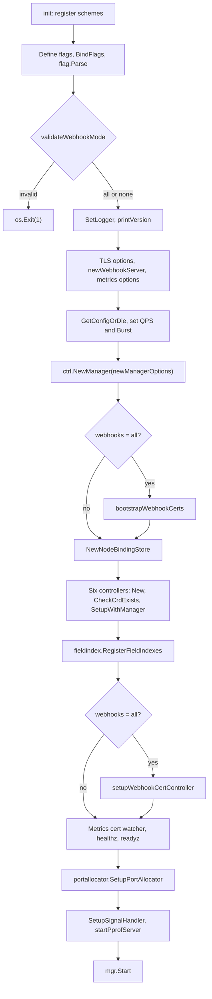

# Controller manager

> Last verified against `main` at `1fc69f70`. Pointers name files and symbols, not line
> numbers; if a symbol moved, search for it and update this page.

This page covers the `rbgs` controller-manager binary built from `cmd/rbgs`: flags, client and
cache setup, webhook certificate bootstrap, and the controllers, watches and field indexes it
registers. What each controller does inside `Reconcile` is described on the subsystem pages.

## Where the code lives

| Path | Responsibility |
|---|---|
| `cmd/rbgs/main.go` | Flags, scheme registration, `cacheOptions`, `newManagerOptions`, `bootstrapWebhookCerts`, `setupWebhookCertController`, `startPprofServer`, controller wiring |
| `cmd/rbgs/main_test.go` | Scheme registration and `printVersion` tests |
| `internal/controller/workloads/` | Controller constructors (`New...Reconciler`), `CheckCrdExists` probes and `SetupWithManager` watch wiring |
| `internal/controller/workloads/webhook_cert_controller.go` | `WebhookCertReconciler`, which keeps CA bundles patched |
| `pkg/utils/fieldindex/register.go` | `RegisterFieldIndexes`: the Pod owner-UID index |
| `pkg/utils/crds.go` | `CheckCrdExists`: the CRD exists and is Established |
| `pkg/utils/client/client.go` | Per-controller API clients (`NewClientWithUserAgent`, `NewClientFromManager`) |
| `pkg/webhook/certmanager.go` | `CertManager`: certificate provisioning and CA bundle patching; fixed names `WebhookServiceName`, `WebhookCertSecretName`, `WebhookCertDir` |
| `pkg/webhook/cert/generator/` | Self-signed CA and serving certificate (`SelfSignedCertGenerator`) |
| `pkg/webhook/cert/writer/` | Secret-backed storage (`NewSecretCertWriter`), validity check (`validCert`), `WriteCertsToDir` |
| `api/workloads/v1alpha2/rolebasedgroup_webhook.go` | `SetupWebhookWithManager` for the conversion and admission webhooks |
| `deploy/helm/rbgs/templates/manager/manager.yaml` | Chart Deployment: flags, probes, `POD_NAMESPACE` |
| `deploy/helm/rbgs/values.yaml` | Chart values that map to flags |
| `deploy/helm/rbgs/templates/webhook/` | Webhook configurations and the `rbgs-webhook-service` Service |
| `deploy/helm/rbgs/templates/rbac/` | ClusterRole generated by `hack/gen-helm-rbac`, cert Secret Role |
| `config/manager/manager.yaml` | Kustomize Deployment, also rendered into `deploy/kubectl/manifests.yaml` |

## Startup sequence

Every setup error below logs and calls `os.Exit(1)`.

1. Package `init` functions run first. The one in `cmd/rbgs/main.go` registers into the local
   `scheme`: client-go built-ins, `apiextensions.k8s.io/v1`, `leaderworkerset.x-k8s.io/v1`,
   `scheduling.x-k8s.io/v1alpha1` (scheduler-plugins), `scheduling.volcano.sh/v1beta1` (Volcano),
   and workloads `v1alpha2` and `v1alpha1`. It also adds `v1alpha2` to client-go's global
   `scheme.Scheme`. Imported packages register extra flags and the `random` port allocation strategy.
2. `main` defines its flags, binds the controller-runtime zap flags (`opts.BindFlags`), calls
   `flag.Parse`, and rejects any `--enable-webhooks` value other than `all` or `none`
   (`validateWebhookMode`).
3. `ctrl.SetLogger(zap.New(zap.UseFlagOptions(&opts)))` installs the logger (ISO-8601 time,
   capitalized level, short caller), then `printVersion` logs the version, commit and build date.
4. TLS options disable HTTP/2 unless `--enable-http2`. `newWebhookServer` builds the webhook server,
   or returns nil for `none`. The metrics options get the authn/authz filter when secure, and a
   `certwatcher` when `--metrics-cert-path` is set.
5. `ctrl.GetConfigOrDie` loads the REST config; `QPS` and `Burst` come from the flags.
6. `ctrl.NewManager` gets `newManagerOptions`: scheme, metrics, webhook server, health probe address,
   leader election with ID `constants.ControllerName` (`rbg-controller`), and `Cache: cacheOptions()`.
   For `none` it clears the webhook server, leader election, secure metrics and the filter.
7. `controller.Options` with `MaxConcurrentReconciles` and `CacheSyncTimeout` is shared by every
   controller. No controller sets its own rate limiter.
8. With webhooks enabled, `bootstrapWebhookCerts` provisions the certificate, patches CA bundles and
   registers the webhook handlers (see the webhook section below).
9. `instancesync.NewNodeBindingStore` creates the in-place scheduling binding store shared by the
   RoleBasedGroup and RoleInstance controllers.
10. Six controllers are built in this order: RoleBasedGroup, RoleBasedGroupScalingAdapter,
    RoleBasedGroupSet, RoleInstance, RoleInstanceSet, RoleBasedGroupWarmup. Each runs its
    constructor, `CheckCrdExists`, then `SetupWithManager`. `NewRoleBasedGroupReconciler` builds the
    gang scheduler from `--scheduler-name` and `--scheduler-profile-name`.
11. `fieldindex.RegisterFieldIndexes` adds the field indexes to the manager cache.
12. With webhooks enabled, `setupWebhookCertController` registers `WebhookCertReconciler`.
13. The metrics certificate watcher, if any, is added with `mgr.Add`; `healthz` and `readyz` checks
    are added.
14. `portallocator.SetupPortAllocator` configures the global port allocator when enabled.
15. `ctrl.SetupSignalHandler` creates the context; `startPprofServer` starts when `--enable-pprof`.
16. `mgr.Start` starts the HTTP servers (metrics, probes), then the webhook server, then the caches,
    then leader election; controllers run only on the leader.



## Flags

Defaults are the Go defaults in `main`. The Helm column shows what
`deploy/helm/rbgs/templates/manager/manager.yaml` passes; `config/manager/manager.yaml` passes only
`--metrics-bind-address=:8443`, `--leader-elect` and `--health-probe-bind-address=:8081`.

| Flag | Default | Effect | Helm value |
|---|---|---|---|
| `--metrics-bind-address` | `0` (off) | Metrics server address | hardcoded `:8443` |
| `--metrics-secure` | `true` | HTTPS with `filters.WithAuthenticationAndAuthorization`; forced off by `--enable-webhooks=none` | not passed |
| `--metrics-cert-path`, `--metrics-cert-name`, `--metrics-cert-key` | `""`, `tls.crt`, `tls.key` | Serve metrics with a watched certificate instead of a self-signed one | not passed |
| `--enable-http2` | `false` | HTTP/2 stays off for the metrics and webhook servers unless set | not passed |
| `--health-probe-bind-address` | `:8082` | Serves `/healthz` and `/readyz` | hardcoded `:8081` |
| `--leader-elect` | `false` | Lease `rbg-controller`; forced off by `--enable-webhooks=none` | always passed |
| `--development` | `false` | No effect; see the behaviors below | not passed |
| `--enable-webhooks` | `all` | `all` or `none`; other values exit | not passed |
| `--max-concurrent-reconciles` | `10` | Workers per controller | `controller.tuning.maxConcurrentReconciles` |
| `--cache-sync-timeout` | `120s` | How long each controller waits for its watch sources to sync; a timeout stops the manager | not passed |
| `--kube-api-qps` | `20` | `rest.Config.QPS` | `controller.tuning.kubeApiQPS` |
| `--kube-api-burst` | `30` | `rest.Config.Burst` | `controller.tuning.kubeApiBurst` |
| `--enable-port-allocator` | `false` | `SetupPortAllocator` configures the allocator only when true | `controller.features.portAllocator.enabled` |
| `--port-allocate-strategy` | `random` | Must name a registered strategy; only `random` is registered | `controller.features.portAllocator.strategy` |
| `--start-port` | `30000` | First allocatable port | `controller.features.portAllocator.startPort` |
| `--port-range` | `5000` | Size of the allocatable range | `controller.features.portAllocator.portRange` |
| `--scheduler-name` | `scheduler-plugins` | Gang scheduler implementation (`scheduler.NewGangScheduler`); other values than `scheduler-plugins` and `volcano` exit; `volcano` also allows per-role gang minimums in CoordinatedPolicy validation | `controller.features.gangScheduling.schedulerName` |
| `--scheduler-profile-name` | `""` | scheduler-plugins only: set as `pod.spec.schedulerName` on every role of a gang-scheduled RoleBasedGroup; empty leaves it untouched | `controller.features.gangScheduling.schedulerProfileName` |
| `--enable-pprof` | `false` | Starts `startPprofServer` | `controller.pprof.enabled` |
| `--pprof-bind-address` | `:6060` | pprof listen address | `controller.pprof.bindAddress` |
| `--enable-deprecated-workload-types` | `true` | Deprecated workload watches, orphan cleanup and admission exemptions (see conditional registration) | `controller.deprecatedWorkloadTypes.enabled`; unset counts as `true` |
| `--zap-devel`, `--zap-encoder`, `--zap-log-level`, `--zap-stacktrace-level`, `--zap-time-encoding` | controller-runtime defaults | Logger options bound by `opts.BindFlags` | not passed |

The chart passes the tuning flags whenever `controller.tuning` is set (it is in `values.yaml`), the
port allocator flags only when it is enabled, the pprof flags only when pprof is enabled (plus a
`pprof` container port from `controller.pprof.containerPort`), `--scheduler-name` always, and
`--scheduler-profile-name` only when non-empty. Rule: see
[build-test-release.md](../../../.agents/skills/rbg-conventions/references/build-test-release.md).

Imported packages register more flags on the same global flag set:

- `--kubeconfig`: `vendor/sigs.k8s.io/controller-runtime/pkg/client/config/config.go`
  (`RegisterFlags`), read by `ctrl.GetConfigOrDie`.
- `--expectation-timeout` (default `5m`): `vendor/github.com/openkruise/kruise/pkg/util/expectations/init.go`;
  its `ExpectationTimeout` is read only by the RoleInstance controller
  (`pkg/reconciler/roleinstance/instance_reconciler.go`). The stateless RoleInstanceSet reconciler
  (`pkg/reconciler/roleinstanceset/statelessmode/reconciler.go`) uses the repository's own
  `ExpectationTimeout`, a fixed five minutes in `pkg/utils/expectations/config.go` that the flag
  does not change.
- `--stateful-instanceset-workers` (default `3`):
  `pkg/reconciler/roleinstanceset/statefulmode/stateful_instance_set_controller.go`. Nothing reads
  `concurrentReconciles`, so it has no effect; RoleInstanceSet workers come from
  `--max-concurrent-reconciles`.
- `--disable-no-deepcopy`: `pkg/utils/client/cache.go`. Only the cache built by `NewCache` reads
  it, and the manager doesn't use `NewCache`, so it has no effect.

## Cache configuration

`cacheOptions` in `cmd/rbgs/main.go` is the only cache configuration; `newManagerOptions` passes it
as `ctrl.Options.Cache`:

```go
ByObject: map[client.Object]cache.ByObject{
    &corev1.Service{}:     {Label: keyExistsSelector},
    &appsv1.StatefulSet{}: {Label: keyExistsSelector},
    &appsv1.Deployment{}:  {Label: keyExistsSelector},
},
```

- `keyExistsSelector` requires the `rbg.workloads.x-k8s.io/group-name` label
  (`constants.GroupNameLabelKey`) with the `Exists` operator, so any value passes.
- There are no default namespaces, default label selectors, field selectors or transforms. Every
  other type is cached cluster-wide as full objects, including `managedFields`.
- A `ByObject` entry doesn't create an informer. controller-runtime starts one on the first watch or
  cached read of a type, so the StatefulSet and Deployment entries stay even when deprecated
  workload types are off, to keep the label bound if an informer ever starts (comment on
  `cacheOptions`).
- `mgr.GetClient()` and the per-controller clients read from this cache. `mgr.GetAPIReader()` reads
  live; it backs the CRD probes and each reconciler's `apiReader` field.
- A Service, StatefulSet or Deployment created without the label is invisible to cached reads and
  to `Owns` watches. Rule: see
  [controller-patterns.md](../../../.agents/skills/rbg-conventions/references/controller-patterns.md).
- A namespace-restricted cache isn't supported: `statefulmode` type-asserts its informers to
  `SharedIndexInformer` (`newReconciler` in
  `pkg/reconciler/roleinstanceset/statefulmode/stateful_instance_set_controller.go`). Rule: see the
  cache section of controller-patterns.md.

### Pod cache and KEP-284

- On `main`, Pods have no `ByObject` entry. The RoleInstance controller watches Pods and the Warmup
  controller owns them, so the manager caches every Pod in the cluster with spec and status.
- KEP-284 (status `provisional` in `keps/284-pod-cache-filter/kep.yaml`) proposes a `cache.ByObject`
  `Transform` for Pods: Pods RBG manages stay whole (minus `managedFields`) and every other Pod
  becomes a stub with name, namespace, UID, resourceVersion, deletionTimestamp, labels and
  ownerReferences. It would be enabled by `--pod-cache-scope=filtered` (default `all` in alpha), with
  a separate `--watch-list-client` option and a `rbg.workloads.x-k8s.io/managed=true` marker label.
  Proposed in KEP-284; not implemented on main: none of these flags, the transform or the label
  exist in the code.
- #530 merged only the KEP documents. The prototype measurement harness from #545 lives on the
  `kep-284-e2e-test` branch, not on `main`.

## Field indexes

`fieldindex.RegisterFieldIndexes` runs once (`sync.Once`) after the controllers are set up and
before `mgr.Start`.

| Index name | Object type | Indexed value | Used by |
|---|---|---|---|
| `ownerRefUID` (`fieldindex.IndexNameForOwnerRefUID`) | `corev1.Pod` | UID of every ownerReference, controller or not | `getOwnedPods` in `pkg/reconciler/roleinstance/instance_reconciler.go`, which then drops Pods the RoleInstance doesn't control |

Envtest registers the same index itself in `test/envtest/testutil/setup.go` (`SetupTestEnv`).

## Conditional registration

| Condition | What it registers or changes | Code |
|---|---|---|
| Each controller's CRDs are Established | Required: a missing or unestablished CRD exits. RoleBasedGroup checks `rolebasedgroups`, `clusterengineruntimeprofiles` and `coordinatedpolicies`; the others check their own CRD | `CheckCrdExists` on each reconciler; `pkg/utils/crds.go` |
| `--enable-deprecated-workload-types=true` | RoleBasedGroup `Owns` StatefulSet and Deployment; `deleteOrphanRoles` cleans orphaned Deployments, StatefulSets and LeaderWorkerSets; the admission validators accept existing deprecated roles | `RoleBasedGroupReconciler.SetupWithManager`, `deleteOrphanRoles` |
| Deprecated types on and the LeaderWorkerSet CRD Established at startup | `Owns(&lwsv1.LeaderWorkerSet{})` | `RoleBasedGroupReconciler.SetupWithManager` |
| `podgroups.scheduling.x-k8s.io` Established at startup | `Owns` the scheduler-plugins PodGroup, whatever `--scheduler-name` says | same |
| `podgroups.scheduling.volcano.sh` Established at startup | `Owns` the Volcano PodGroup, whatever `--scheduler-name` says | same |
| `rolebasedgroups` CRD exists | Warmup watches RoleBasedGroups; always true under `cmd/rbgs`, because the RoleBasedGroup probe runs first | `shouldWatchTargetRBGs` |
| `--enable-webhooks=all` | Webhook server, certificate bootstrap, `/convert` and admission handlers, `WebhookCertReconciler` | `bootstrapWebhookCerts`, `setupWebhookCertController` |
| `--scheduler-name` | `scheduler-plugins` or `volcano` gang scheduler; `volcano` sets `PerRoleGangMinimumsSupported` on the CoordinatedPolicy validator (`api/workloads/v1alpha2/rolebasedgroup_webhook.go`) | `scheduler.NewGangScheduler`, `bootstrapWebhookCerts` |
| `--enable-port-allocator`, `--enable-pprof`, `--metrics-cert-path` | Port allocator, pprof server, metrics certificate watcher | `main` |

In the chart, `deploy/helm/rbgs/templates/rbac/clusterrole.yaml` is generated by `hack/gen-helm-rbac`
from `config/rbac/role.yaml` during `make manifests`. It wraps the rules for `deployments`,
`statefulsets` and `leaderworkersets`, subresources included, in a conditional that reads
`controller.deprecatedWorkloadTypes.enabled` exactly as the manager template does, so the RBAC and
the flag can't disagree. `deploy/kubectl/manifests.yaml` is built from `config/default` and always
grants them. Rule: see
[build-test-release.md](../../../.agents/skills/rbg-conventions/references/build-test-release.md).

## Webhook server and certificates

The webhook server (`newWebhookServer`) serves TLS from `rbgwebhook.WebhookCertDir`
(`/tmp/k8s-webhook-server/certs`) on controller-runtime's default port 9443; the
`rbgs-webhook-service` Service maps 443 to 9443. It runs on every replica, leader or not.

`bootstrapWebhookCerts` runs before any controller is set up. It creates a 30-second context for
steps 2 to 4, but only the caBundle patches in steps 3 and 4 honor it: `CertManager.BuildOrSync`
doesn't pass it to `EnsureCert`, and the Secret writer uses `context.TODO()`.

1. It reads `POD_NAMESPACE` (set from `metadata.namespace` in every manifest; only a warning when
   empty) and creates a direct, uncached client, because the manager cache isn't started yet.
2. `CertManager.BuildOrSync` calls `EnsureCert` for `rbgs-webhook-service.<namespace>.svc`: it reads
   the Secret `rbgs-webhook-cert`, creates it when missing (re-reading on `AlreadyExists`, for
   replicas racing at startup), and overwrites it when `validCert` fails. Then `WriteCertsToDir`
   writes the files.
3. `PatchCRDCABundle` merge-patches `spec.conversion.webhook.clientConfig.caBundle` on
   `ConversionWebhookCRDs` (`rolebasedgroups` and `rolebasedgroupsets`), skipping a CRD without a
   conversion `clientConfig`.
4. `PatchValidatingWebhookCABundle` and `PatchMutatingWebhookCABundle` patch every webhook in
   `rbgs-validating-webhook-configuration` and `rbgs-mutating-webhook-configuration`. In steps 3
   and 4 each object gets five attempts with exponential backoff from 500 ms; a failure exits.
5. `SetupWebhookWithManager` registers the handlers. RoleBasedGroup and RoleBasedGroupSet are
   conversion hubs, so controller-runtime adds `/convert` once, plus validate and mutate paths for
   both. CoordinatedPolicy gets a validator and RoleInstanceSet a defaulter.

Certificate facts:

- The Secret holds `ca-key.pem`, `ca-cert.pem`, `key.pem`, `cert.pem`, `tls.key` and `tls.crt`
  (`certsToSecret`); the same files land in `WebhookCertDir`. Its RBAC is a namespaced Role
  (`deploy/helm/rbgs/templates/rbac/cert-role.yaml`, `config/rbac/cert_role.yaml`) that allows
  creating Secrets and getting or updating only `rbgs-webhook-cert`.
- `SelfSignedCertGenerator.Generate` issues RSA-2048 certificates valid for ten years. It reuses the
  stored CA while that CA stays valid for at least another year (`validCACert`); `validCert`
  rejects a serving certificate that would expire within six months.
- The validity check runs only at startup. Nothing rotates certificates in a running process.
- The CRD conversion Service reference comes from `config/crd/patches/` (kustomize) or from the Helm
  CRD upgrade Job (`tools/crd-upgrade/ensure-crds-up-to-date.sh`); the webhook configurations ship
  with an empty `caBundle` (`deploy/helm/rbgs/templates/webhook/manifests.yaml`). Only the controller
  writes CA bundles.

`WebhookCertReconciler` (controller `webhook-cert`) runs on the leader only:

- It watches CustomResourceDefinitions with `For`, and both webhook configuration kinds with a
  handler that maps every event to the key `webhook-cert-sync`. `nameFilterPredicate` passes create,
  update and generic events for the configured names and drops deletes.
- `Reconcile` ignores the key and re-patches all CRDs and configurations with the CA captured at
  startup. It requeues after 10 minutes, or 30 seconds after an error.
- Patches go through the bootstrap `CertManager` and its direct client. The `webhook-cert` client
  that `setupWebhookCertController` assigns to `Client` isn't used by `Reconcile`, and
  `EnqueueCRDs` has no caller.

With `--enable-webhooks=none` nothing in this section runs: no certificate, no CA bundle patches, no
conversion or admission handlers, no webhook server and no `webhook-cert` controller. Admission
rules: see
[api-and-admission.md](../../../.agents/skills/rbg-conventions/references/api-and-admission.md).

## Health, metrics, profiling and leader election

- **Probes.** `healthz` and `readyz` are both `healthz.Ping`, so they report OK whenever the probe
  server answers; neither checks the webhook server or informer sync. Since #575 the chart,
  `config/manager/manager.yaml` and `deploy/kubectl/manifests.yaml` define a liveness probe on
  `/healthz` (delay 15 s, period 20 s) and a readiness probe on `/readyz` (delay 5 s, period 10 s),
  both on port 8081. Without them a rollout could replace both replicas before either new Pod
  served the webhooks.
- **Metrics.** The controller-runtime metrics server exposes only controller-runtime's own metrics;
  RBG registers no collectors. It runs on every replica. The manifests serve HTTPS on `:8443` behind
  `filters.WithAuthenticationAndAuthorization`, but ship no metrics Service (the kustomize entries
  in `config/default/kustomization.yaml` are commented out), and neither the chart nor
  `config/rbac` grants `tokenreviews` or `subjectaccessreviews`, which that filter calls. With
  `--enable-webhooks=none` metrics are plain HTTP without the filter; `make run-local` uses `:8080`.
- **pprof.** `startPprofServer` is a separate `http.Server`, not the manager's built-in pprof
  option. It serves `/debug/pprof/` (named profiles such as `heap` and `goroutine` through the index
  handler), `cmdline`, `profile`, `symbol` and `trace`, runs on every replica, and shuts down with
  a 60-second grace period when the signal context ends.
- **Leader election.** The Lease is named `rbg-controller` (`constants.ControllerName`). Without
  `LeaderElectionNamespace`, controller-runtime puts it in the Pod's own namespace. All manifests
  run two replicas with `--leader-elect`. Webhooks, metrics, probes, pprof and the startup
  certificate bootstrap run on every replica; the controllers, `webhook-cert` included, run on the
  leader. The Lease RBAC comes from a `+kubebuilder:rbac` marker in
  `internal/controller/workloads/rolebasedgroup_controller.go`.

## Controller inventory

Every controller runs on the leader with `--max-concurrent-reconciles` workers.

| Controller (name) | Reconciles | Owns | Watches (handler, predicate) | Setup function and file | Notes |
|---|---|---|---|---|---|
| `workloads-rolebasedgroup` | RoleBasedGroup (`RBGPredicate`) | RoleInstanceSet (`WorkloadPredicate`); Service; RoleBasedGroupScalingAdapter (`MatchEveryOwner`, `RBGScalingAdapterPredicate`); conditionally StatefulSet, Deployment and LeaderWorkerSet (`WorkloadPredicate`) and both PodGroup kinds | RoleBasedGroup with `handler.Funcs` that has only a `DeleteFunc` calling `NodeBindings.EvictByUID`; CoordinatedPolicy mapped to the RoleBasedGroup of the same namespace and name (`GenerationChangedPredicate`) | `RoleBasedGroupReconciler.SetupWithManager`, `internal/controller/workloads/rolebasedgroup_controller.go` | Conditions in the table above |
| `workloads-rolebasedgroup-scalingadapter` | RoleBasedGroupScalingAdapter (`RBGScalingAdapterPredicate`) | none | RoleBasedGroup mapped to adapters with its `group-name` label (`mapRBGToScalingAdapters`, `RBGRoleStatusPredicate`) | `RoleBasedGroupScalingAdapterReconciler.SetupWithManager`, `internal/controller/workloads/rolebasedgroupscalingadapter_controller.go` | |
| `rbgset-controller` | RoleBasedGroupSet | RoleBasedGroup | none | `RoleBasedGroupSetReconciler.SetupWithManager`, `internal/controller/workloads/rolebasedgroupset_controller.go` | |
| `roleinstance` | RoleInstance | none | Pod mapped to its controlling RoleInstance (`roleinstance.NewPodEventHandler`) | `RoleInstanceReconciler.SetupWithManager`, `internal/controller/workloads/roleinstance_controller.go` | Name derived from the kind; logic in `pkg/reconciler/roleinstance/` |
| `roleinstanceset` | RoleInstanceSet | RoleInstance | RoleInstance (`statelessmode.NewRoleInstanceEventHandler`) | `RoleInstanceSetReconciler.SetupWithManager`, `internal/controller/workloads/roleinstanceset_controller.go` | Name derived from the kind; dispatches to `statelessmode` or `statefulmode`; the latter also adds an informer `DeleteFunc` (`forgetRolloutStatusExpectation` in `pkg/reconciler/roleinstanceset/statefulmode/stateful_instance_set_controller.go`) |
| `rbgwarmup-controller` | RoleBasedGroupWarmup | Pod | RoleBasedGroup mapped to Warmups that target it (`warmupsForTargetRBG`) | `RoleBasedGroupWarmupReconciler.SetupWithManager`, `internal/controller/workloads/rolebasedgroupwarmup_controller.go` | |
| `webhook-cert` | CustomResourceDefinition (`nameFilterPredicate`) | none | ValidatingWebhookConfiguration and MutatingWebhookConfiguration mapped to `webhook-cert-sync` (`nameFilterPredicate`) | `setupWebhookCertController` in `cmd/rbgs/main.go`; `WebhookCertReconciler.SetupWithManager`, `internal/controller/workloads/webhook_cert_controller.go` | Only with `--enable-webhooks=all` |

## Behaviors worth knowing

- **`--development` does nothing.** `main` copies it into `zap.Options.Development` before
  `flag.Parse`, so the parsed value is never read; use `--zap-devel` (`cmd/rbgs/main.go`, `main`).
- **`--enable-webhooks=none` also drops leader election and metrics security**
  (`newManagerOptions`). A process in this mode never takes the Lease, so it reconciles next to any
  controller already running in the cluster; [AGENTS.md](../../../AGENTS.md) says never to start
  one there. The process also serves no webhooks, but webhook configurations installed in the
  cluster keep routing requests to the webhook Service, so admission is skipped only where no
  webhook configurations exist. Rule: see
  [api-and-admission.md](../../../.agents/skills/rbg-conventions/references/api-and-admission.md).
- **Webhook-enabled startup needs the objects it patches.** If the `rolebasedgroups` or
  `rolebasedgroupsets` CRD, or either webhook configuration, can't be read after five attempts, the
  process exits (`pkg/webhook/certmanager.go`, `CertManager.PatchCRDCABundle`, `CertManager.retry`).
  A local run with webhooks on also reads `POD_NAMESPACE` for the Secret namespace and the Service
  DNS name.
- **CRDs installed after startup aren't watched until a restart.** `dynamicWatchCustomCRD` and the
  gang schedulers' `ReconcilePodGroup` call `Owns` on `runtimeController`, a builder that
  `SetupWithManager` already completed (`internal/controller/workloads/rolebasedgroup_controller.go`).
  The builder reads `Owns` inputs only while building
  (`vendor/sigs.k8s.io/controller-runtime/pkg/builder/controller.go`, `TypedBuilder.doWatch`), so
  these calls add no watch; `watchedWorkload` only records which CRDs were seen.
- **CRDs and webhook configurations are cached cluster-wide, like Pods.** The `webhook-cert`
  controller's `For(&apiextv1.CustomResourceDefinition{})` caches every CRD in the cluster; its name
  predicate filters events, not the cache.
- **API rate limits apply per client and resource type, not per process.** client-go creates a
  token bucket for each REST client when `rest.Config.RateLimiter` is nil
  (`vendor/k8s.io/client-go/rest/config.go`, `RESTClientForConfigAndClient`). controller-runtime
  creates one REST client per resource type inside each `client.Client`, and RBG builds a client per
  controller (`pkg/utils/client/client.go`, `NewClientWithUserAgent`). Total traffic can exceed
  `--kube-api-qps`; measure with the stress-test skill.
- **Clients differ by controller** (`pkg/utils/client/client.go`). `NewClientWithUserAgent` sets a
  user agent like `rolebasedgroup/<version> (<os>/<arch>) rbg-controller/<commit>` (`buildUserAgent`)
  for the RoleBasedGroup, ScalingAdapter, RoleBasedGroupSet, RoleInstance and stateless
  RoleInstanceSet code.
  `NewClientFromManager` (stateful RoleInstanceSet) sets `instanceset-manager/<name>` and no scheme,
  so `client.New` falls back to client-go's global scheme, the one `init` also adds `v1alpha2` to.
  The Warmup controller and the RoleInstanceSet dispatcher use `mgr.GetClient()`.
- **The certificate directory must be writable.** The chart mounts no volume at `WebhookCertDir`,
  so the `readOnlyRootFilesystem: true` example commented out in `deploy/helm/rbgs/values.yaml`
  would make `WriteCertsToDir` (`pkg/webhook/cert/writer/fs.go`) fail at startup.
- **One flag reaches three places.** `--enable-deprecated-workload-types` feeds the RoleBasedGroup
  and RoleBasedGroupSet validators, the RoleBasedGroup watches and `deleteOrphanRoles`; with webhooks
  off only the last two apply. Turning it off before old workloads are gone stops their cleanup
  (`deploy/helm/rbgs/README.md`).

## Tests

| Area | Tests |
|---|---|
| Scheme registration, `printVersion` | `cmd/rbgs/main_test.go` |
| CA bundle patching of webhook configurations | `pkg/webhook/certmanager_test.go` |
| Certificate creation, races, renewal and validity | `pkg/webhook/cert/writer/certwriter_test.go` (Ginkgo suite in `pkg/webhook/cert/writer/writer_suite_test.go`) |
| Chart ClusterRole generation | `hack/gen-helm-rbac/main_test.go` |
| Chart flag and RBAC toggle, manager probes | `test/chart/deprecated_workload_types_test.go`, `test/chart/manager_probes_test.go` |
| RBAC objects, cert Secret and CA bundle injection on a live cluster | `test/e2e/testcase/v1alpha2/rbac_webhook_bootstrap.go` (labels `rbac`, `install`) |
| Load at given QPS and worker settings | `test/stress/`, driven by the stress-test skill |

`cacheOptions`, `newManagerOptions`, `validateWebhookMode`, `startPprofServer` and
`WebhookCertReconciler` have no direct unit tests. Envtest doesn't run `main`. `SetupManager` in
`test/envtest/testutil/setup.go` builds a manager without webhooks, the Warmup controller or
`webhook-cert`; the webhook suites (`SetupWebhookTestEnv` in `test/envtest/testutil/webhook_setup.go`
and the gate setups next to it) register handlers on envtest's own serving certificates. No envtest
manager uses `cacheOptions`, so envtest can't show a child hidden by the cache filter.

```shell
go test ./cmd/rbgs/ ./pkg/webhook/... ./hack/gen-helm-rbac/
make test-chart                          # needs helm, no cluster
make test-e2e E2E_LABEL_FILTER=rbac      # needs a cluster with the chart installed
```

## Related

- [KEP-284: Pod cache filtering](../../../keps/284-pod-cache-filter/README.md) and its
  [performance notes](../../../keps/284-pod-cache-filter/performance.md)
- [Installation](../../install.md) and the [Helm chart README](../../../deploy/helm/rbgs/README.md)
- [Developer guide](../how_to_develop.md): local runs and pprof
- [Gang scheduling](../../features/gang-scheduling.md): `--scheduler-name` and
  `--scheduler-profile-name`
- [Monitoring](../../features/monitoring.md): inference engine metrics, not controller metrics
- [Stress-test skill](../../../.claude/skills/stress-test/SKILL.md): QPS, burst and worker tuning
- Rules: [controller-patterns.md](../../../.agents/skills/rbg-conventions/references/controller-patterns.md),
  [build-test-release.md](../../../.agents/skills/rbg-conventions/references/build-test-release.md),
  [api-and-admission.md](../../../.agents/skills/rbg-conventions/references/api-and-admission.md)
- Sibling pages: [overview](overview.md), [API layer](api-layer.md),
  [RoleBasedGroup controller](rbg-controller.md), [other controllers](other-controllers.md),
  [instance workloads](instance-workloads.md),
  [scheduling and networking](scheduling-and-networking.md), [testing](testing.md)
