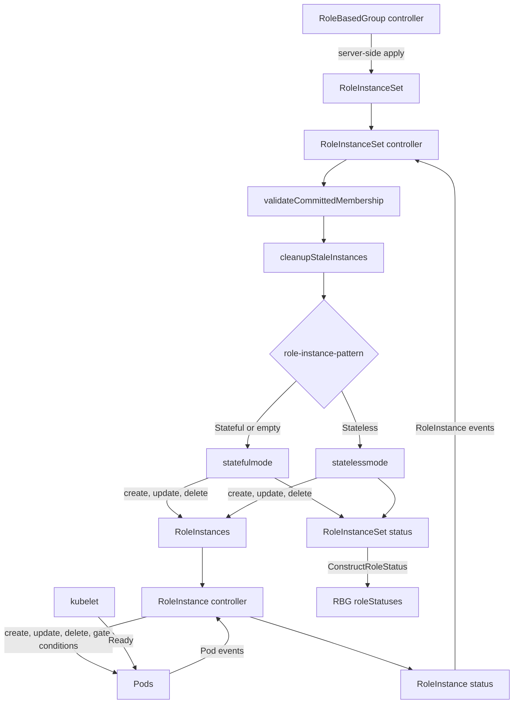

# RoleInstanceSet and RoleInstance

> Last verified against `main` at `1fc69f70`. Pointers name files and symbols, not line
> numbers; if a symbol moved, search for it and update this page.

This page covers the two native workload controllers below every RoleInstanceSet role: the RoleInstanceSet controller, which manages RoleInstances in stateful or stateless mode, and the RoleInstance controller, which manages the Pods of one instance. How the RoleBasedGroup controller renders the RoleInstanceSet is in [RoleBasedGroup controller](rbg-controller.md).

## Where the code lives

| Path | Responsibility |
|---|---|
| `internal/controller/workloads/roleinstanceset_controller.go` | RoleInstanceSet controller: committed-membership check, stale-pattern cleanup, mode dispatch, watches |
| `internal/controller/workloads/roleinstance_controller.go` | RoleInstance controller registration; watches Pods through `NewPodEventHandler` |
| `pkg/reconciler/roleinstanceset/statefulmode/` | Stateful mode: ordinal identity, four-phase sync, surge topology, replacement state, status writer, adoption |
| `pkg/reconciler/roleinstanceset/statelessmode/` | Stateless reconciler and status writer, plus the RoleInstance event handler that both modes use |
| `pkg/reconciler/roleinstanceset/statelessmode/sync/` | Stateless scale and update algorithm |
| `pkg/reconciler/roleinstanceset/statelessmode/core/` | Stateless instance construction (name, owner label, selector) and update options |
| `pkg/reconciler/roleinstanceset/statelessmode/revision/` | Stateless ControllerRevision patch, apply and drift check |
| `pkg/reconciler/roleinstanceset/statelessmode/utils/` | Stateless expectations, short-hash revision adapter, scale-in ranking, ref manager |
| `pkg/reconciler/roleinstance/` | RoleInstance reconcile loop, status writer, Pod event handler |
| `pkg/reconciler/roleinstance/sync/` | Pod creation and deletion, restart policy and backoff, Pod update, in-place scheduling bindings |
| `pkg/reconciler/roleinstance/core/` | Component topology, Pod construction and naming, revision template |
| `pkg/reconciler/roleinstance/inplaceupdate/` | Splits RoleInstance revisions per component for Pod in-place updates |
| `pkg/reconciler/roleinstance/lifecycle/` | Writes the `InstancePodReady` Pod condition |
| `pkg/reconciler/roleinstance/revision/` | RoleInstance ControllerRevisions |
| `pkg/reconciler/roleinstance/utils/` | Pod names and labels, active/inactive split, Pod resource-version expectations |
| `pkg/inplace/instance/` | RoleInstance in-place update, lifecycle states and hooks, `RoleInstanceCustomReady` writer, specified-delete label |
| `pkg/inplace/pod/` | Pod in-place update (images and metadata), grace period, Pod readiness-gate writers |
| `pkg/reconciler/utils/revisionadapter/`, `pkg/utils/revisionadapter/` | Two identical full-name revision adapters: stateful mode and `UpdateExpectations` use the first, the in-place packages the second |
| `pkg/utils/expectations/` | Scale, update and resource-version expectations of the RoleInstanceSet modes |
| `pkg/utils/history/` | ControllerRevision client (`NewHistory`) and `TruncateControllerRevisions` |
| `pkg/utils/requeueduration/` | `DurationStore`, the shortest requested requeue per key |
| `api/workloads/ordinals/` | KEP-499 ordinal intervals, member selection and records |
| `vendor/github.com/openkruise/kruise/pkg/util/` | OpenKruise `expectations`, `history` and `requeueduration` packages used by the RoleInstance controller |

The types live in `api/workloads/v1alpha2/roleinstanceset_types.go` and `api/workloads/v1alpha2/roleinstance_types.go`; see [API layer](api-layer.md).

## Pipeline and writers



- The RoleBasedGroup controller creates the RoleInstanceSet with a typed create, updates it with server-side apply (`pkg/reconciler/roleinstanceset_reconciler.go`, `constructRoleInstanceSetApplyConfiguration`), and writes selective scale-down membership changes with a merge patch guarded by the `resourceVersion` (`pkg/reconciler/selective_membership.go`, `buildSelectivePatch`). Only `spec.roleInstanceTemplate` enters the RoleInstanceSet revision. Rule: see [upgrade-compatibility.md](../../../.agents/skills/rbg-conventions/references/upgrade-compatibility.md).
- Both RoleInstanceSet modes write RoleInstances with typed create, update, patch and delete, and their own status with `Status().Update`; the replacement state and the membership condition are written with status patches. Rule: see [controller-patterns.md](../../../.agents/skills/rbg-conventions/references/controller-patterns.md).
- The RoleInstanceSet controller watches RoleInstanceSets, owned RoleInstances, and all RoleInstances through `NewRoleInstanceEventHandler` (`pkg/reconciler/roleinstanceset/statelessmode/event_handler.go`), which also observes the stateless scale expectations. Neither controller watches ControllerRevisions.
- The RoleInstance controller watches RoleInstances and Pods; `NewPodEventHandler` (`pkg/reconciler/roleinstance/instance_event_handler.go`) maps every Pod event to the controlling RoleInstance, without a predicate.
- RoleInstanceSet status reaches the RoleBasedGroup through `ConstructRoleStatus`. Since #533 the RoleBasedGroup writer copies each role status on every update, so `updatedReplicas` no longer lags (`internal/controller/workloads/rolebasedgroup_controller.go`, `updateRBGStatus`).

## Mode selection

`RoleInstanceSetReconciler.Reconcile` (`internal/controller/workloads/roleinstanceset_controller.go`) runs three steps before any mode logic:

1. `validateCommittedMembership` rejects an unparsable `rbg.workloads.x-k8s.io/committed-skip-ordinals` annotation, and any committed record on a Stateless set. It patches a `FailedScale` condition with reason `InvalidCommittedOrdinals`, emits a Warning event when that condition first appears, and returns the error.
2. `cleanupStaleInstances` deletes RoleInstances controlled by the set that belong to the other pattern (`instanceBelongsToPattern`: stateless instances carry `rbg.workloads.x-k8s.io/role-instance-owner` set to the set UID, stateful names match `<set>-<ordinal>`), then requeues after one second.
3. Dispatch on the annotation `rbg.workloads.x-k8s.io/role-instance-pattern`: `Stateless` goes to `statelessmode`, `Stateful` or no value to `statefulmode`; anything else emits `UnknownRoleInstancePattern` and returns an error.

The RoleBasedGroup controller writes `Stateful` unless the role's own annotations set the pattern, so a role opts into stateless mode with that role annotation.

## Stateless mode

### Stateless reconcile

`ReconcileInstanceSet.doReconcile` (`pkg/reconciler/roleinstanceset/statelessmode/reconciler.go`):

1. Wait for `ScaleExpectations` (creations and deletions by name): requeue after the remaining part of `ExpectationTimeout` (five minutes, `pkg/utils/expectations/config.go`); once it has passed, return without requeue.
2. List active instances with `GetActiveInstance`: matching `role-instance-owner`, not terminating, controlled by this set. Terminating instances are invisible, so replacements are created while they terminate.
3. `getActiveRevisions`: reuse the latest equal revision, renumber an older equal one (rollback), absorb serialization drift with `SetMatchesRevision`, or create a new revision.
4. Wait for `ResourceVersionExpectations` on every instance, with the same timeout rule.
5. `syncInstanceSet` runs `Scale`, and `Update` only when `Scale` changed nothing. Their errors become `FailedScale` or `FailedUpdate` conditions in the new status.
6. Write status, `truncateInstancesToDelete`, `truncateHistory` (`revisionHistoryLimit`, default 10), and requeue after `minReadySeconds` while available and ready counts differ.

New instances (`pkg/reconciler/roleinstanceset/statelessmode/core/implement.go`, `GenInstanceFromTemplate`, `injectNewVersionedInstances`) are named `<set>-<id>` with a random five-character id; `generateInstanceName` keeps names within 63 characters. They carry the set's labels and finalizers, `rbg.workloads.x-k8s.io/role-instance-id`, the owner label, the short revision hash in `controller-revision-hash`, the `RoleInstanceInPlaceUpdateReady` readiness gate, lifecycle state `Normal`, ports from `AllocatePortsForInstance`, and these set annotations: gang scheduling, the three in-place scheduling keys and the in-place update grace period.

### Stateless diff formulas

`calculateDiffsWithExpectation` (`pkg/reconciler/roleinstanceset/statelessmode/sync/helper.go`) drives scaling and updating. Every instance counts in a revision total (`newRevisionCount` or `oldRevisionCount`), split by whether its short hash matches the update revision. An instance in lifecycle state `PreparingDelete` also counts in `preDeletingCount` and in no active count. Every other instance counts as active for its revision (`newRevisionActiveCount` or `oldRevisionActiveCount`), and in addition either in `toDeleteNewRevisionCount` or `toDeleteOldRevisionCount` (together `toDeleteCount`) when marked for deletion, or in `unavailableNewRevisionCount` or `unavailableOldRevisionCount` when not available. Only the deletion and unavailability buckets exclude each other; the revision totals and active counts overlap them.

| Quantity | Formula |
|---|---|
| `partition` | `CalculatePartitionReplicas` (`pkg/utils/utils.go`): percentages round up, a value below `100%` leaves at least one instance to update, clamped to `[0, replicas]` |
| `maxSurge` | scaled against `replicas`, rounded up; 0 when unset |
| `maxUnavailable` | `maxUnavailable` or `10%`, rounded up only when `maxSurge == 0` |
| `scaleMaxUnavailable` | `scaleStrategy.maxUnavailable`, rounded up; unlimited when unset |
| `updateOldDiff` | `oldRevisionActiveCount - partition`; at least 0 when the current and update revisions are equal |
| `updateNewDiff` | `newRevisionActiveCount - (replicas - partition)`; at most 0 when the revisions are equal |
| `totalUnavailable` | `preDeletingCount + unavailableNewRevisionCount + unavailableOldRevisionCount` |
| `useSurge` | `min(maxSurge, max(scaleSurge, updateSurge))`, 0 when `maxSurge == 0` or paused, with `scaleSurge = min(max(unavailableNewRevisionCount + unavailableOldRevisionCount + toDeleteCount + preDeletingCount - maxUnavailable, 0), toDeleteCount)` and `updateSurge = min(abs(updateOldDiff), abs(updateNewDiff))` when the two diffs have opposite signs; `useSurgeOldRevision` is the part of `useSurge` for old-revision instances |
| `scaleNum` | `replicas + useSurge - len(instances)` |
| `scaleNumOldRevision` | `partition + useSurgeOldRevision - oldRevisionCount`, clamped to the sign of `scaleNum` |
| `scaleUpLimit` | `min(scaleNum, max(scaleMaxUnavailable - totalUnavailable, 0))` |
| `deleteReadyLimit` | `max(maxUnavailable + len(instances) - replicas - totalUnavailable, 0)`, set when deleting |
| `updateNum` | `updateOldDiff` if `abs(updateOldDiff) <= abs(updateNewDiff)`, else `-updateNewDiff`; negative values roll instances back to the current revision |
| `updateMaxUnavailable` | `maxUnavailable + len(instances) - replicas` |

### Stateless scaling and update

`realControl.Scale` (`pkg/reconciler/roleinstanceset/statelessmode/sync/scale.go`) returns after the first step that changes something:

1. `managePreparingDelete` returns `PreparingDelete` instances to `Normal` while replicas need them, unless a lifecycle hook sets `markPodNotReady`.
2. Scale out by `scaleUpLimit` instances, up to `scaleNumOldRevision` of them from the current revision, in slow-start batches. A `ScaleUpLimited` Warning fires on every pass where `scaleNum > scaleUpLimit`.
3. Delete instances already in `PreparingDelete`.
4. Delete specified instances: unready ones freely, ready ones up to `deleteReadyLimit`.
5. Scale in, only when nothing is specified or pre-deleting (`chooseInstancesToDelete`): up to the computed old-revision reduction (`-scaleNumOldRevision`) comes from instances not at the update revision and the rest from updated instances, so updated instances can go while old ones that the partition still needs stay. Each group is ranked by `ActiveInstancesAvailableRank` (fewer component statuses, not ready, not available, lower `controller.kubernetes.io/instance-deletion-cost`, newer), and ready ones are deleted up to `deleteReadyLimit`.

Deleting an instance that matches the `spec.lifecycle.preDelete` hook moves it to `PreparingDelete` instead.

`realControl.Update` (`pkg/reconciler/roleinstanceset/statelessmode/sync/update.go`) first moves lifecycle states forward (`Updating` to `Updated` or `Normal`) and returns if any changed. When not paused and `updateNum != 0`, it takes instances not at the target revision (skipping `PreparingDelete`), orders them with `SortUpdateIndexes` and caps them with `limitUpdateIndexes` at `abs(updateNum)` and `updateMaxUnavailable`. `updateInstance` updates in place when the strategy type is not `RecreatePod` and `CanUpdateInPlace` allows it; otherwise it adds the label `rbg.workloads.x-k8s.io/role-instance-delete`, and `Scale` replaces the instance.

## Stateful mode

### Identity and phases

Stateful instances are named `<set>-<ordinal>` (`getInstanceName`). `newVersionedInstance` (`pkg/reconciler/roleinstanceset/statefulmode/stateful_instance_set_utils.go`) copies the set's labels and selector labels, adds `statefulset.kubernetes.io/pod-name` and `rbg.workloads.x-k8s.io/role-instance-index`, and stores the full revision name in `controller-revision-hash`: the current revision for positions below the partition, otherwise the update revision. `InjectIdentityLabelsIntoComponents` copies the two identity labels into every component's Pod template. The same set annotations as in stateless mode are propagated. RoleInstanceSet has no volume claim templates, and neither mode creates PVCs.

`ReconcileStatefulInstanceSet.Reconcile` (`pkg/reconciler/roleinstanceset/statefulmode/stateful_instance_set_controller.go`) reads through listers, requeues every second until its last replacement-state write is visible (`rolloutStatusExpectations`), adopts orphan ControllerRevisions, and claims instances whose names parse to this set (`getInstancesForInstanceSet`, `ClaimInstances`). `UpdateStatefulInstanceSet` (`pkg/reconciler/roleinstanceset/statefulmode/stateful_instance_set_control.go`) then picks revisions with the stateless rules (`getInstanceSetRevisions`), runs the four phases of `updateStatefulInstanceSet`, writes status and truncates history:

1. **Observe**: apply the current and update revisions, compute the topology (`computeTopologyForReconcile`), record instance health (`observeInstanceHealth`).
2. **Scale and identity**: put instances into slots `[0, endOrdinal)` by member position and condemn the rest, highest ordinal first. `processReplica` creates missing slots, all at once with `Parallel`, one per pass with `OrderedReady`, which also stops at the first unhealthy slot. `processCondemned` then deletes condemned instances; with `OrderedReady` only once every slot is created and healthy.
3. **Progress update**: `progressUpdate`, only while `inRollout`.
4. **Status and advance**: recount, and set `currentRevision` to the update revision when `shouldAdvanceCurrentRevision` agrees.

`allowsBurst` treats only the explicit value `Parallel` as parallel. The CRD defaults `podManagementPolicy` to `Parallel`; an empty value behaves as `OrderedReady`.

### Topology and surge

`computeTopology` (`pkg/reconciler/roleinstanceset/statefulmode/stateful_instance_set_utils.go`) sizes the slot range for all phases. Ranges are positions in the committed member list, not ordinals.

| Quantity | Rule | Symbol |
|---|---|---|
| members | the first `replicas` ordinals not listed in `committed-skip-ordinals` | `CommittedOrdinals`, `Members` |
| `partition` | percentages round down, clamped to `[0, replicas]` | `computePartition` |
| `maxSurge` | rounded up; 0 when unset | `computeMaxSurge` |
| `maxUnavailable` | default `10%`; rounded up and at least 1 when `maxSurge == 0`, rounded down otherwise | `computeMaxUnavailable` |
| `inRollout` | not paused, and the revisions differ, or a base member in `[partition, replicas)` is at another revision, or a replacement state for the update revision is active | `hasStaleBaseInstance`, `rolloutReplacementStateActive` |
| `activeSurge` | in rollout `min(maxSurge, max(healthyOld - maxUnavailable, 0))`, where `healthyOld` counts healthy, non-terminating members in `[partition, replicas)` not at the update revision, raised to the existing valid surge while a base member is unfinished; paused: existing valid surge only; otherwise 0 | `countHealthyOldInBase`, `existingValidSurgeOrdinals` |
| `endOrdinal` | `replicas + activeSurge`; new surge ordinals follow the last member and skip committed gaps and `excluded-ordinals` | `materializeSurge`, `nextSurgeOrdinal` |

### Rolling update budget

`progressUpdate` (`pkg/reconciler/roleinstanceset/statefulmode/stateful_instance_set_control.go`) skips the pass while an in-place update is unconfirmed (`updateExpectations`), and refreshes the in-place readiness condition of every instance (`refreshAllInstanceStates`). Then:

- `effectiveBudget = maxUnavailable + availableSurge`, where available surge is surge at the update revision that has been Ready for `minReadySeconds` (`countAvailableSurge`).
- Base instances that are unhealthy, mid in-place update or not yet available already count as unavailable (`collectBaseUnavailable`).
- Targets are positions `[partition, endOrdinal)` not at the update revision, highest ordinal first, so stale surge is recycled before base (`buildUpdateTargets`).
- A target is free when it is a surge slot, terminating, or stably unhealthy: not Ready in consecutive observations for `stableUnhealthyDuration` (10 seconds, `isStablyUnhealthy`). A costly target is skipped once `initialBaseUnavail + newlyUnavail >= effectiveBudget`; lower targets are still examined.
- `applyTargetUpdate` tries an in-place update unless the type is `RecreatePod`, and deletes the instance when that does not apply; phase 2 recreates it at the same ordinal after the old object is gone.

### Replacement state and current revision

An early rollback (A to B to A before B finished) leaves the current and update revisions equal while base instances still run B. Before replacing such a base instance with `maxSurge > 0`, `persistRolloutReplacementState` (`pkg/reconciler/roleinstanceset/statefulmode/stateful_instance_set_control.go`) writes `status.rolloutReplacementState` (update revision, replicas, partition) with a merge patch preconditioned on UID and resource version (#508); `PersistRolloutReplacementState` (`pkg/reconciler/roleinstanceset/statefulmode/stateful_instance_set_status_updater.go`) fails if an outdated CRD prunes the field. `persistTerminatingRolloutReplacement` records replacements started outside the controller. While that state exists for the update revision, surge is kept until every base member in the current range is at the update revision, Ready, not terminating and generation-observed (`rolloutReplacementStateActive`); after that the state is left out of the next status write. A conflict on the write (`errRolloutSpecChanged`) ends the pass and retries after one second.

`shouldAdvanceCurrentRevision` advances `currentRevision` only when all of these hold: in rollout; partition 0; the previously persisted status names the update revision with `updatedReplicas >= replicas - partition`; update expectations are satisfied; and every base slot is created, healthy, not terminating, at the update revision and generation-observed.

### Stall recovery

Since #484, rollouts do not wait for unrelated events (`pkg/reconciler/roleinstanceset/statefulmode/stateful_instance_set_control.go`). Unhealthy instances that hold the budget or block `OrderedReady` request a requeue at the end of their health window (`pushUnhealthyRetry`), and `progressOrderedReadyUnhealthyTarget` replaces the first blocking `OrderedReady` instance once it is stably unhealthy and not at the update revision (`orderedReadyCleanupTarget`). Health observations are kept in memory per set UID and pruned at most once a minute (`pkg/reconciler/roleinstanceset/statefulmode/stateful_instance_set_controller.go`, `pruneInstanceHealth`).

### Selective scale-down

KEP-499 is implemented (#538). The user input is the role annotation `rbg.workloads.x-k8s.io/excluded-ordinals`, checked by `ValidateExcludedOrdinals` and `ValidateRoleExcludedOrdinals` (`api/workloads/v1alpha2/excluded_ordinals.go`): comma-separated ordinals and inclusive ranges (`api/workloads/ordinals/ordinals.go`, `Parse`), allowed only on Stateful RoleInstanceSet roles of RBGs that no RBGSet manages; roles may not set `committed-skip-ordinals`. The RoleBasedGroup controller picks members with `Select` and commits `spec.replicas` together with the record `rbg.workloads.x-k8s.io/committed-skip-ordinals` (`Record`) in one conditional patch (`pkg/reconciler/selective_membership.go`, `reconcileSelectiveMembership`); it also mirrors `excluded-ordinals` onto the RoleInstanceSet for surge allocation. In stateful mode an instance whose ordinal is not a member gets no slot and is condemned, and partition counts member positions. `newRevision` (`pkg/reconciler/roleinstanceset/statefulmode/stateful_instance_set_helper.go`) leaves both annotations out of the ControllerRevision.

### Fields each mode ignores

Stateful mode ignores `scaleStrategy.roleInstanceToDelete`, the specified-delete label, `scaleStrategy.maxUnavailable` (`getScaleMaxUnavailable` in `pkg/reconciler/roleinstanceset/statefulmode/stateful_instance_set_helper.go` computes it, `processReplica` in `pkg/reconciler/roleinstanceset/statefulmode/stateful_instance_set_control.go` drops it) and the `spec.lifecycle` hooks. Stateless mode ignores `podManagementPolicy`.

## RoleInstanceSet status

| Field | Stateful | Stateless |
|---|---|---|
| `replicas` | every slot in `[0, endOrdinal)`, created or not, plus condemned instances | active owned instances |
| `readyReplicas` | `RoleInstanceReady` is True | Ready, every instance readiness gate True, every component fully ready (`IsRunningAndReady` in `pkg/reconciler/roleinstanceset/statelessmode/utils/utils.go`) |
| `availableReplicas` | Ready for `minReadySeconds` | ready as above for `minReadySeconds`, with lifecycle state `Normal` or none |
| `updatedReplicas` | label equals the update revision name | short hash equals the update revision's |
| `currentRevision` | advanced by `shouldAdvanceCurrentRevision` | set to the update revision once `updatedReplicas == replicas`, ready or not |
| `expectedUpdatedReplicas` | `replicas - partition` | `replicas` when the revisions match, else `replicas - partition` |
| `labelSelector` | `spec.selector` | `role-instance-owner` set to the set UID |
| `rolloutReplacementState` | see above | never set |
| `conditions` | none written; the whole-status update drops existing ones | `FailedScale` and `FailedUpdate` from this pass |
| Writer | `Status().Update` on every pass; conflicts retried only while UID, generation and replacement state are unchanged | `Status().Update` after re-reading the RoleInstance through the cached client, only when `inconsistentStatus` sees a compared field change; conditions are not compared |

Stateful counts come from `updateStatus` (`pkg/reconciler/roleinstanceset/statefulmode/stateful_instance_set_helper.go`) and the revision advance from `shouldAdvanceCurrentRevision` (`pkg/reconciler/roleinstanceset/statefulmode/stateful_instance_set_control.go`); stateless counts come from `calculateStatus` (`pkg/reconciler/roleinstanceset/statelessmode/status.go`).

## RoleInstance reconcile

`reconciler.Reconcile` (`pkg/reconciler/roleinstance/instance_reconciler.go`):

1. Get the RoleInstance. If it is gone or deleting, clear the in-memory restart marker (`ClearRestarting`) and stop.
2. `getOwnedPods` lists Pods through the `ownerRefUID` field index (`pkg/utils/fieldindex/register.go`), keeps the Pods the instance controls and splits them with `GetActiveAndInactivePods`: `Failed`, `Succeeded` and terminating Pods are inactive.
3. List revisions selected by `rbg.workloads.x-k8s.io/role-instance-name` and pick the current and update revisions (`getActiveRevisions`). The revision hashes `spec.components` without `size` (`pkg/reconciler/roleinstance/core/instance_core.go`, `SetRevisionTemplate`).
4. Check Pod resource-version expectations (see Expectations and requeues).
5. Seed the new status with the live restart tracking, in-place baselines and `lastReadyGeneration`.
6. `syncInstance`: apply the update revision, run `Scale`, carry the `Restarting` condition and restart tracking into the new status, and stop when `Scale` acted or a backoff is pending; otherwise run `Update`. Errors become `FailedScale` or `FailedUpdate` conditions.
7. `UpdateInstanceStatus` (`pkg/reconciler/roleinstance/instance_status.go`) computes component statuses and conditions, writes status when a compared field changed, then sets the `InstancePodReady` condition on every Pod (`updatePodsLifeCycle`).
8. Clear the restart marker when Ready with no wave in progress; `truncateHistory` keeps five non-live revisions.

### Components and Pod naming

The RoleInstanceSet label `rbg.workloads.x-k8s.io/role-type`, copied to each RoleInstance, selects the naming scheme in `FormatComponentPodName` (`pkg/reconciler/roleinstance/utils/instance_utils.go`):

| Role pattern | Components | Pod names |
|---|---|---|
| `standalonePattern` (`PodTemplate`) | one component named after the role, size 1 | `<instance>` |
| `leaderWorkerPattern` (`LeaderWorkerSet`) | `leader` (size 1) and `worker` (size `size - 1`) | `<instance>-0` for the leader, `<instance>-<id+1>` for workers |
| `customComponentsPattern` (`Components`, also without the label) | the role's components | `<instance>-<component>-<id>` |

`NewUpdatePods` builds each new Pod from the update revision with a controller reference to the RoleInstance, the short revision hash, `role-instance-name`, `component-name`, `component-id` (and `component-index` for leader/worker), hostname and subdomain when the component sets `serviceName`, and the `InPlaceUpdateReady` and `InstancePodReady` readiness gates. `createPods` (`pkg/reconciler/roleinstance/sync/instance_scale.go`) adds allocated ports, component discovery and in-place scheduling affinity (`InjectInPlaceScheduling`; see [Scheduling and networking](scheduling-and-networking.md)) and creates Pods in slow-start batches. A same-name Pod that the instance does not control, such as one awaiting garbage collection, produces a `FailedCreate` event and an error, so controller-runtime retries with backoff (#512); the other Pods are still created unless gang scheduling is on.

### Pod scaling decisions

`calculateDiffsWithExpectation` (`pkg/reconciler/roleinstance/sync/instance_scale.go`) yields at most one kind of action per pass, and deletion wins over creation:

1. Complete a finished restart wave, then return a pending backoff as a requeue.
2. Start a restart wave: delete every Pod.
3. Re-issue the deletions of an unfinished wave (`pendingWaveDeletions`).
4. With `rbg.workloads.x-k8s.io/role-instance-gang-scheduling: "true"`, delete every active Pod when one of them cannot be updated in place.
5. Delete inactive `Failed` Pods.
6. Per component (`GetComponentsTopology`): delete Pods whose id is at or above `size`, and create missing ids. A Pod whose id does not parse joins the component's delete list but is deleted only when that component also has ids to delete, so such a Pod on its own stays. Component dependencies gate creation on the dependencies' ready counts and deletion on the dependents (`ParseAllComponentDependencies`); a cycle falls back to parallel.

### Expectations and requeues

| Controller | Mechanism | Effect |
|---|---|---|
| Stateless RoleInstanceSet | `ScaleExpectations` | skip the pass until created and deleted instances are observed |
| Stateless RoleInstanceSet | `ResourceVersionExpectations` | wait until lifecycle patches, in-place updates and delete labels reach the cache |
| Stateful RoleInstanceSet | `updateExpectations` | hold phase 3 and revision advancement until in-place-updated instances show the new revision |
| Stateful RoleInstanceSet | `rolloutStatusExpectations` | requeue every second until a replacement-state write is visible; no timeout |
| Stateful RoleInstanceSet | none for create and delete | `CreateStatefulInstance` ignores `AlreadyExists` |
| RoleInstance | vendored OpenKruise `ResourceVersionExpectations` on Pods | set after Pod condition writes and in-place updates; the pass proceeds anyway and only stops once one has been unsatisfied longer than OpenKruise's `ExpectationTimeout` (flag `--expectation-timeout`, default five minutes) |

The stateless expectations live in `pkg/reconciler/roleinstanceset/statelessmode/utils/utils.go`, the stateful ones in `pkg/reconciler/roleinstanceset/statefulmode/stateful_instance_set_controller.go`, `CreateStatefulInstance` in `pkg/reconciler/roleinstanceset/statefulmode/stateful_instance_control.go`, and the RoleInstance ones in `pkg/reconciler/roleinstance/utils/instance_utils.go`, with OpenKruise's timeout in `vendor/github.com/openkruise/kruise/pkg/util/expectations/init.go`. The RoleInstance controller has no create or delete expectations. A pass that runs before the Pod informer delivers its own creations sees a partial Pod set: it computes status from it and can try to create the missing names again, which fails with `AlreadyExists` and shows up as a `FailedCreate` event.

## Restart policies

`RestartPolicyType` (`api/workloads/v1alpha2/rolebasedgroup_types.go`) has two values:

| Value | Behavior |
|---|---|
| `None` | No instance-level action. A `Failed` Pod is deleted and recreated under the same name on a later pass. |
| `RecreateRoleInstanceOnPodRestart` | When an armed trigger fires, every Pod of the instance, active or inactive, is deleted (event `ReCreateInstance`). The RoleInstance keeps its name and UID; normal scaling recreates the Pods. |

The RoleInstance reads the type with `GetRestartPolicy` (`api/workloads/v1alpha2/roleinstance_types.go`), which applies no default. The RoleBasedGroup controller renders the role's resolved policy: leader/worker and custom components default to recreate, standalone is always `None`. Rule: see [upgrade-compatibility.md](../../../.agents/skills/rbg-conventions/references/upgrade-compatibility.md). The controller functions below are in `pkg/reconciler/roleinstance/sync/instance_scale.go`; the getters are in the two API files above.

- **Triggers** (`shouldRecreateInstance`): a desired member Pod observed terminating (`isDesiredMember`, #559), a `Failed` Pod, or a container restart that in-place baselines do not explain (`isContainerRestartExpected`), ignored while that Pod's `InPlaceUpdateReady` is False. Pods annotated `rbg.workloads.x-k8s.io/restart-trigger-policy: Ignore` never trigger. Nothing triggers without Pods or while `status.currentRevision` differs from `status.updateRevision`.
- **Arming** (`restartTriggersArmed`) requires `status.observedGeneration == generation`. With `activateAfter: Created` that is enough. With `Ready` (the `GetActivateAfter` default) the instance must also be Ready in its previous status, have `lastReadyGeneration == generation`, or have restarted within the stable threshold. Status is written after `Scale` in the same pass, so the Ready condition read here is the previous pass's. `lastReadyGeneration` latches when the instance is Ready at a converged revision and never decreases (#559).
- **Wave guard** (#573): `rememberRestartWave` stores the pre-restart Pod UIDs in memory and sets `Restarting=True`. `isAlreadyRestarting` suppresses new waves while a pre-restart desired member exists. `releaseCompletedRestartWave` ends the wave (`Restarting=False`, reason `RestartCompleted`) as soon as those Pods are gone, before Ready, so a rebuilt group that fails before Ready is recreated again. After a controller restart, the persisted condition and Pod creation times (`hasPreRestartPods`, one-second granularity) replace the marker. `pendingWaveDeletions` re-issues failed deletions without incrementing `restartCount`.
- **Backoff** (`checkRestartBackoff`, `calculateRestartDelay`): `delay = min(baseDelaySeconds * 2^(restartCount-1), maxDelaySeconds)`, with defaults 30 and 600 (`GetBaseDelaySeconds`, `GetMaxDelaySeconds`); the first recreation is immediate. The check runs before any Pod work, so during the delay nothing is scaled and failed Pods stay for inspection. It is skipped during a wave and while a spec change or rollout is pending. `updateRestartTracking` resets `restartCount` after `max(2 * maxDelaySeconds, 10 minutes)` without restarts (`stableThreshold`); setting both delays to 0 disables backoff. Restart tracking for the restart decision is re-read through the API reader (`syncRestartTrackingFromAPI`); the status writer re-reads the RoleInstance through the cached client and keeps the stored tracking values unless this pass started a wave.

## Readiness and lifecycle

### Pod readiness gates

Every Pod has the `InPlaceUpdateReady` and `InstancePodReady` readiness gates. The controller writes only those conditions and kubelet derives Pod `Ready` from them and `ContainersReady` (#461; `pkg/inplace/pod/readiness/pod_readiness_utils.go`, `addNotReadyKey`).

- `InPlaceUpdateReady` turns True through `Refresh` (`pkg/inplace/pod/inplaceupdate/inplace_update.go`) once no in-place update is pending, and False when one starts.
- `InstancePodReady` is held False on every Pod (`pkg/reconciler/roleinstance/lifecycle/lifecycle_utils.go`, `UpdatePodLifecycle`) while the instance has the `RoleInstanceInPlaceUpdateReady` gate and that condition is not True, or, with `readyPolicy: AllPodReady`, while any existing Pod is not runtime-ready (Running, with `ContainersReady` and `InPlaceUpdateReady` True; `IsPodRuntimeReady` in `pkg/reconciler/roleinstance/utils/instance_utils.go`). Pods of one instance therefore turn Ready together.
- The in-place update paths still set Pod `Ready` to False when they flip a gate to False (`pkg/inplace/pod/pod_util.go`, `UpdatePodReadyCondition`).

### RoleInstance conditions

- `RoleInstanceAllPodsReady` (`getAllReadyCondition` in `pkg/reconciler/roleinstance/instance_status.go`) reads every expected Pod name; each Pod must exist, be controlled by this RoleInstance, not be terminating (#497), and be Running and Ready with `InPlaceUpdateReady` not False.
- `RoleInstanceReady` (`getInstanceReadyCondition`) is False when the instance has the `RoleInstanceInPlaceUpdateReady` gate and that condition is False or missing, False when `RoleInstanceAllPodsReady` is False, and True otherwise; with `readyPolicy: None` no Pod is checked.
- `controllerOwnedConditionTypes` lists the computed types; other conditions are carried over from the RoleInstance re-read through the cached client. `FailedScale` and `FailedUpdate` disappear when the pass reports no failure. Once the instance is Ready, a completed `Restarting` condition is dropped, while an in-progress one (`Restarting=True`) is kept so that a wave that just started is not lost.

### Lifecycle states and hooks

Stateless mode keeps a lifecycle state in the label `rbg.workloads.x-k8s.io/role-instance-lifecycle-state` (`Normal`, `PreparingUpdate`, `Updating`, `Updated`, `PreparingDelete`) plus a timestamp annotation (`pkg/inplace/instance/lifecycle/lifecycle_utils.go`). The `spec.lifecycle.preDelete` and `inPlaceUpdate` hooks match instances by `labelsHandler` or `finalizersHandler`. `markPodNotReady` writes `RoleInstanceCustomReady` False, which only acts if the RoleInstance lists that condition in `spec.readinessGates`; no controller adds it.

### Specified delete and inactive Pods

- Specified delete is stateless only: the label `rbg.workloads.x-k8s.io/role-instance-delete` (any value) or a name in `spec.scaleStrategy.roleInstanceToDelete`. `truncateInstancesToDelete` (`pkg/reconciler/roleinstanceset/statelessmode/reconciler.go`) removes names of instances that no longer exist with a typed `Update` of the set.
- Inactive Pods follow the inactive-pod-handling KEP: every policy deletes `Failed` Pods that are not terminating, and an armed recreate policy rebuilds the whole instance instead. `Succeeded` Pods are neither deleted nor replaced, and their names block re-creation. The detection helpers the KEP lists for `pkg/utils/pod_utils.go` are not on main.

## In-place update

| Level | Decided by | In place when | Otherwise |
|---|---|---|---|
| RoleInstanceSet to RoleInstance | `CanUpdateInPlace` (`pkg/inplace/instance/inplaceupdate/inplace_update.go`) with `canNotInPlaceUpdate` (`pkg/inplace/instance/inplaceupdate/inplace_update_defaults.go`) | the type is not `RecreatePod` and component names and sizes are unchanged | stateful deletes the instance and recreates it at the same ordinal; stateless sets the delete label |
| RoleInstance to Pod | `CanUpdateInPlace` and `Update` (`pkg/reconciler/roleinstance/inplaceupdate/inplaceupdate.go`) with `defaultCalculateInPlaceUpdateSpec` (`pkg/inplace/pod/inplaceupdate/inplace_update_defaults.go`) | the component's `serviceName` is unchanged and its template diff only replaces container images or changes metadata | `updatePod` (`pkg/reconciler/roleinstance/sync/instance_update.go`) deletes the Pod and `Scale` recreates it |

- At the instance level the controller first sets `RoleInstanceInPlaceUpdateReady` and `RoleInstanceReady` False when the instance has that gate, then replaces the spec, the revision label and the `rbg.workloads.x-k8s.io/inplace-update-state` annotation (`updateRoleInstanceInPlace`). The update is complete when the generation is observed and every component reports `updatedReplicas == size` (`pkg/inplace/instance/inplaceupdate/inplace_update_defaults.go`, `DefaultCheckInPlaceUpdateCompleted`); `Refresh` then sets the condition True. Stateful-created instances only get the gate with their first in-place update (`InjectVersionedRoleInstanceSpec`).
- At the Pod level, Pods of unchanged components keep their spec and only get the new revision label (`onlyUpdateRevision`), but first `updateInstanceReadyCondition` sets their `InstancePodReady` readiness gate False, which can also turn the Pod's Ready condition False, so relabeling is not readiness-neutral. Image changes set `InPlaceUpdateReady` False, record the old image IDs in `inplace-update-state`, and patch the images at once or after the grace period, which waits in `rbg.workloads.x-k8s.io/inplace-update-grace` (`pkg/inplace/pod/inplaceupdate/inplace_update.go`, `finishGracePeriod`). A changed image ID completes the update (`pkg/inplace/pod/inplaceupdate/inplace_update_defaults.go`, `DefaultCheckInPlaceUpdateCompleted`). `recordInPlaceUpdateBaselines` (`pkg/reconciler/roleinstance/sync/instance_update.go`) stores restart counts and image IDs for the restart-policy exemption.
- The RoleInstance controller's `Update` has no unavailability budget: every Pod of the instance that is not at the update revision is updated in the same pass.
- The Pod grace period is the role's `inPlaceUpdateStrategy.gracePeriodSeconds`, rendered as the RoleInstanceSet annotation `rbg.workloads.x-k8s.io/inplace-update-grace-period-seconds` and copied to a RoleInstance only when it is created (`pkg/reconciler/roleinstance/core/instance_core.go`, `GetUpdateOptions`). The RoleInstanceSet's own `inPlaceUpdateStrategy.gracePeriodSeconds` reaches the instance-level updater, which ignores it.
- `InPlaceOnly` is deprecated (#472). The code only distinguishes `RecreatePod`, so `InPlaceOnly` behaves as `InPlaceIfPossible`, fallback to recreation included.
- In a stateful rollout an in-place target consumes budget like a deletion, an unfinished in-place update counts as unavailable, and `updateExpectations` (`pkg/reconciler/roleinstanceset/statefulmode/stateful_instance_set_controller.go`) holds the next pass until the new revision label is observed. Stateless mode marks the instance `Updating` and waits on its resource version.

## Workload status model

KEP-502 (#528) is a provisional design and none of it is implemented on main. RoleInstanceSet and RoleInstance have no `Progressing` condition, RoleInstance has no `status.phase`, and both still write the `FailedScale` and `FailedUpdate` conditions described above.

## Lineage

- The non-test files in `pkg/reconciler/roleinstanceset/statefulmode/` carry RBG, OpenKruise (2019) and Kubernetes copyright headers. OpenKruise headers also mark `pkg/reconciler/roleinstanceset/statelessmode/utils/utils.go`, `pkg/reconciler/roleinstanceset/statelessmode/utils/sorter.go`, `pkg/reconciler/utils/revisionadapter/revision_adapter.go`, `pkg/utils/requeueduration/duration.go`, `pkg/utils/history/controller_history.go`, and the resource-version and update expectations in `pkg/utils/expectations/`. KEP-30 says the update strategy "is generally aligned with OpenKruise CloneSet".
- The RoleInstance controller imports the vendored OpenKruise v1.8.3 `expectations`, `history` and `requeueduration` packages, while the RoleInstanceSet modes use RBG's copies in `pkg/utils/`. The two resource-version expectation implementations are identical; their timeouts are separate variables.
- No code comment or document requires these files to stay in sync with OpenKruise.

## Behaviors worth knowing

- Stateful `status.replicas`, `currentReplicas` and `updatedReplicas` count slots whose RoleInstance is not created yet: right after an `OrderedReady` set of three creates its first instance, status reports three replicas (`pkg/reconciler/roleinstanceset/statefulmode/stateful_instance_set_helper.go`, `updateStatus`). `readyReplicas` counts only Ready instances.
- Partition rounding differs by mode: stateful rounds percentages down (`pkg/reconciler/roleinstanceset/statefulmode/stateful_instance_set_utils.go`, `computePartition`), and stateless rounds up but, for a percentage below `100%` and at least one replica, leaves at least one instance to update; `100%` or an integer equal to the replicas holds every instance (`pkg/utils/utils.go`, `CalculatePartitionReplicas`).
- With `partition > 0`, stateful `currentRevision` never advances; stateless advances it as soon as every instance carries the update revision, ready or not.
- A terminating stateful instance keeps its slot and the replacement waits until the old object is gone; a stateless replacement starts immediately.
- Stateless instance ids are always random: despite its comments about reusing PVC ids, `getOrGenAvailableIDs` (`pkg/reconciler/roleinstanceset/statelessmode/sync/scale.go`) never reuses one.
- Stateful mode writes RoleInstanceSet status on every pass and drops conditions; stateless mode persists a new `FailedScale` or `FailedUpdate` condition only together with another changed field. Rule: see [controller-patterns.md](../../../.agents/skills/rbg-conventions/references/controller-patterns.md).
- `RoleInstanceReady.lastTransitionTime` is reset by every RoleInstance status write, even when Ready stays True: `getInstanceReadyCondition` (`pkg/reconciler/roleinstance/instance_status.go`) stamps the current time and `inconsistentCondition` ignores timestamps. Both RoleInstanceSet modes measure `minReadySeconds` from it.
- A restart-policy recreation replaces Pods, not the RoleInstance. KEP-30 (`keps/30-instanceset/README.md`) describes renamed instances and a `RestartRoleInstanceOnPodRestart` value; neither exists on main.
- Changing a role's in-place grace period only affects RoleInstances created afterwards.
- `--stateful-instanceset-workers` is registered but unused (`pkg/reconciler/roleinstanceset/statefulmode/stateful_instance_set_controller.go`, `concurrentReconciles`); both controllers use the shared controller options. `--expectation-timeout` comes from vendored OpenKruise and only affects the RoleInstance controller.
- Stateful mode asserts that its informers are `SharedIndexInformer`s, which a namespace-restricted cache breaks (#581). Rule: see [controller-patterns.md](../../../.agents/skills/rbg-conventions/references/controller-patterns.md).
- The stateful health window and the RoleInstance restart marker live in memory; a controller restart starts a fresh 10-second window and falls back to persisted restart state.

## Tests

| Location | Covers |
|---|---|
| `pkg/reconciler/roleinstanceset/statefulmode/stateful_instance_set_control_test.go` | topology, budget, `OrderedReady` recovery, advancement guard, health window |
| `pkg/reconciler/roleinstanceset/statefulmode/stateful_rollout_regression_test.go` | early-rollback replacement state (#508) |
| `pkg/reconciler/roleinstanceset/statefulmode/selective_membership_test.go` | sparse membership, surge identities, partition by position (#538) |
| `pkg/reconciler/roleinstanceset/statefulmode/stateful_instance_set_status_updater_test.go` | status conflict handling, replacement-state persistence |
| `pkg/reconciler/roleinstanceset/statelessmode/sync/update_test.go` | stateless update with `RecreatePod` |
| `internal/controller/workloads/roleinstanceset_controller_test.go`, `internal/controller/workloads/selective_membership_test.go` | pattern cleanup, committed-record validation |
| `pkg/reconciler/roleinstance/sync/instance_scale_test.go`, `pkg/reconciler/roleinstance/sync/recreate_policy_test.go` | restart triggers, wave guard, backoff, orphan Pod collisions, deletions |
| `pkg/reconciler/roleinstance/instance_status_test.go`, `pkg/reconciler/roleinstance/instance_status_readiness_test.go` | status, latch, readiness with owned Pods (#497) |
| `pkg/inplace/instance/inplaceupdate/`, `pkg/inplace/pod/inplaceupdate/` | in-place decisions and completion |
| `test/envtest/testcase/stateful/` | rollout recovery and orphan GC recovery on a real API server |
| `test/envtest/testcase/restart_policy/` | restart policies through the real controller chain |
| `test/envtest/testcase/selective_commit/` | conditional membership writer |
| `test/e2e/testcase/v1alpha2/ris.go`, `test/e2e/testcase/v1alpha2/inactive_pod.go` | Kind e2e, labels `update`, `rollout`, `serial` |

```shell
go test ./pkg/reconciler/roleinstanceset/... ./pkg/reconciler/roleinstance/... ./pkg/inplace/...
go test ./pkg/reconciler/roleinstanceset/statefulmode/ -run 'EarlyRollback|Sparse|ProgressUpdate|ShouldAdvance' -v
go test ./pkg/reconciler/roleinstance/sync/ -run 'Restart|Recreate|Wave' -v
go test ./internal/controller/workloads/ -run 'CleanupStaleInstances|InstanceBelongsToPattern|CommittedRecord' -v
make setup-envtest
KUBEBUILDER_ASSETS="$(bin/setup-envtest use 1.31.0 --bin-dir bin -p path)" \
  go test -v ./test/envtest/testcase/stateful/ ./test/envtest/testcase/restart_policy/
make test-e2e E2E_LABEL_FILTER=rollout
```

See [Testing](testing.md) for the frameworks and helpers.

## Related

- User docs: [Instance](../../features/instance.md) (written for the v1alpha1 `Instance` API, which no controller on main reconciles), [Failure handling](../../features/failure-handling.md), [Update strategy](../../features/update-strategy.md), [Selective scale-down](../../features/selective-scale-down.md), [In-place update and scheduling best practice](../../best-practice/en/04-configuring-inplace-update-and-scheduling-policies.md).
- KEPs: [KEP-30 InstanceSet](../../../keps/30-instanceset/README.md), [KEP-499 stateful selective scale-down](../../../keps/499-stateful-selective-scale-down/README.md), [Inactive Pod handling](../../../keps/inactive-pod-handling/README.md), [KEP-502 workload status model](../../../keps/502-workload-status-model/README.md).
- Rules: [upgrade-compatibility.md](../../../.agents/skills/rbg-conventions/references/upgrade-compatibility.md), [controller-patterns.md](../../../.agents/skills/rbg-conventions/references/controller-patterns.md), [api-and-admission.md](../../../.agents/skills/rbg-conventions/references/api-and-admission.md), [build-test-release.md](../../../.agents/skills/rbg-conventions/references/build-test-release.md).
- Sibling pages: [Overview](overview.md), [RoleBasedGroup controller](rbg-controller.md), [Controller manager](controller-manager.md), [Scheduling and networking](scheduling-and-networking.md), [API layer](api-layer.md), [Testing](testing.md).
