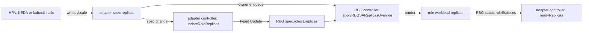
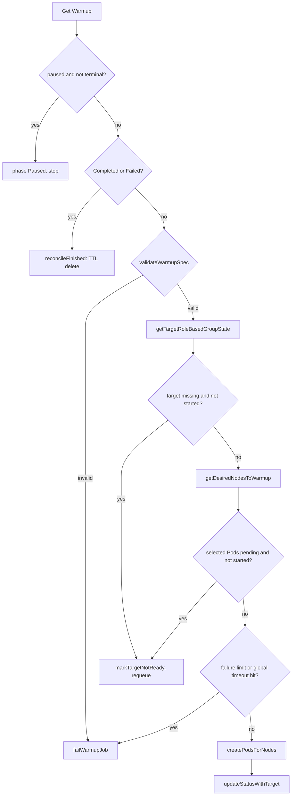

# Other controllers and injection paths

> Last verified against `main` at `1fc69f70`. Pointers name files and symbols, not line
> numbers; if a symbol moved, search for it and update this page.

This page covers the controllers in `internal/controller/workloads` besides the RoleBasedGroup,
RoleInstanceSet and RoleInstance controllers, plus two paths that run inside the RoleBasedGroup
reconcile: ClusterEngineRuntimeProfile injection and the v1alpha1 coordination migration.

## Where the code lives

| Path | Responsibility |
|---|---|
| `internal/controller/workloads/rolebasedgroupset_controller.go` | `RoleBasedGroupSetReconciler`: child RBG create, update, delete, adoption, status |
| `api/workloads/v1alpha2/rolebasedgroupset_types.go` | RoleBasedGroupSet API, scale subresource, `Ready` condition type |
| `api/workloads/v1alpha2/rolebasedgroupset_default.go`, `api/workloads/v1alpha2/rolebasedgroupset_admission.go` | `RoleBasedGroupSetDefaulter` and `RoleBasedGroupSetValidator` |
| `api/workloads/v1alpha1/rolebasedgroupset_conversion.go` | `ConvertTo` copies the v1alpha1 coordination annotation into `groupTemplate.annotations` |
| `api/workloads/constants/label.go` | `GroupSetNameLabelKey`, `GroupSetIndexLabelKey` |
| `internal/controller/workloads/rolebasedgroupscalingadapter_controller.go` | `RoleBasedGroupScalingAdapterReconciler`: binding, adapter status, role replica writes |
| `internal/controller/workloads/rolebasedgroup_controller.go` | Adapter lifecycle on the RBG side: `ReconcileScalingAdapter`, `CleanupOrphanedScalingAdapters`, `applyRBGSAReplicasOverride` |
| `pkg/scale/scaling_adapter.go` | `GenerateScalingAdapterName`, `IsScalingAdapterManagedByRBG`, `IsScalingAdapterEnable` |
| `api/workloads/v1alpha2/rolebasedgroupscalingadapter_types.go` | Adapter API; scale subresource with a selector path |
| `api/workloads/v1alpha2/rolebasedgroup_validation.go` | `ValidateScalingAdapterReplicas`: RBG webhook check on role replica edits |
| `internal/controller/workloads/rolebasedgroupwarmup_controller.go` | `RoleBasedGroupWarmupReconciler`: targets, Pod construction, timeouts, phases, status |
| `internal/controller/workloads/rolebasedgroupwarmup_customized_action.go` | Customized action results, bounded status, conditions and events |
| `api/workloads/v1alpha2/rolebasedgroupwarmup_types.go` | Warmup API (v1alpha2 only) |
| `internal/controller/workloads/webhook_cert_controller.go` | `WebhookCertReconciler`: keeps CA bundles patched |
| `pkg/webhook/certmanager.go` | `CertManager`: certificate Secret, CA bundle patches with retries |
| `pkg/discovery/sidecar_builder.go` | `SidecarBuilder`: merges ClusterEngineRuntimeProfile content into a pod template |
| `pkg/discovery/injector.go` | `InjectSidecar` and the other injectors |
| `pkg/reconciler/pod_reconciler.go` | `ConstructPodTemplateSpecApplyConfiguration`: injector order |
| `pkg/reconciler/roleinstanceset_reconciler.go` | Injector set per component on the RoleInstanceSet path |
| `api/workloads/v1alpha2/clusterengineruntimeprofile_types.go` | ClusterEngineRuntimeProfile API |
| `internal/controller/workloads/coordinatedpolicy_migration_controller.go` | `EnsureV1alpha1CoordinatedPolicy`, a helper the RBG controller calls |
| `internal/controller/workloads/event.go` | Event reasons of the RBG and adapter controllers |
| `cmd/rbgs/main.go` | Registers every controller; `setupWebhookCertController` |

## RoleBasedGroupSet

A RoleBasedGroupSet (short name `rbgs`) creates `spec.replicas` RoleBasedGroups from
`spec.groupTemplate`. `RoleBasedGroupSetReconciler` (controller `rbgset-controller`) watches sets
(`For`) and the RBGs they control (`Owns`, no predicates). It records no events.

### Child identity and reconcile order

Children are named `<set>-<index>`, carry the labels `rbg.workloads.x-k8s.io/groupset-name` and
`rbg.workloads.x-k8s.io/groupset-index`, and have the set as controller, so garbage collection
removes them with it. `Reconcile`:

1. Returns if the set is gone or terminating.
2. Lists RBGs by the `groupset-name` label and keeps those `isOwnedOrAdoptable` accepts: controlled
   by this set's UID, or with no controller and this set's name label. Children of another UID are
   ignored, so a recreated set never manages a predecessor's leftovers (#500).
3. Marks children without a numeric index label for deletion and adopts orphans
   (`SetControllerReference`, then a typed `Update`).
4. Runs `scaleDown` for indexes at or above `spec.replicas`, `updateExistingRBGs` for children that
   `needsUpdate`, and `scaleUp` (`newRBGForSet`) for missing indexes. Each step aggregates its
   per-child errors and returns them before the next step starts. `scaleUp` skips a name that
   already exists, even under a foreign controller.
5. Lists again, drops foreign children (`filterOwnedItems`) and calls `updateStatus`.

### Template propagation to children

`needsUpdate` flags a child whose `spec.roles` differ (`rolesEqual` sorts by name and normalizes
legacy update-strategy spellings with `normalizeRolloutUpdateTypes`) or whose labels or annotations
differ from the template (`needsTemplateLabelUpdate` ignores the two system labels;
`needsTemplateAnnotationUpdate`). `updateExistingRBGs` re-reads each such child, sets `spec.roles`
to `normalizedGroupTemplateRoles`, applies `syncRBGMetadata` and writes a typed `Update` inside
`retry.RetryOnConflict`. `syncRBGMetadata` makes the labels the template labels plus the system
labels, and the annotations exactly the template annotations. All outdated children are written in
one pass, without ordering or an availability budget; each child's controller then rolls its roles
by their own `rolloutStrategy` (see [RoleBasedGroup controller](rbg-controller.md)).

`groupTemplate.spec.roleTemplates` is never copied or compared. Group-level settings travel as
annotations, such as exclusive topology or the `conversion.workloads.x-k8s.io/v1alpha1-coordination`
annotation that `ConvertTo` copies into `groupTemplate.annotations`. In admission,
`RoleBasedGroupSetDefaulter` heals legacy update-strategy spellings in the stored template (#463),
and selective scale-down annotations are rejected in the template (`validateRBGSetExcludedOrdinals`)
and on set-owned children (`isRBGSetManaged` in `api/workloads/v1alpha2/excluded_ordinals.go`).

### Set status and scale subresource

`updateStatus` writes with `Status().Update` inside `retry.RetryOnConflict`, only when the status
changed.

| Field | Value on main |
|---|---|
| `status.replicas` | number of owned or adoptable children listed, not `spec.replicas` |
| `status.readyReplicas` | children whose `Ready` condition is `True` |
| `status.conditions` | `Ready`: `True`/`AllReplicasReady` when `readyReplicas >= spec.replicas`, else `False`/`ReplicasNotReady` |
| `status.observedGeneration` | in the API, never set by the controller |

The scale subresource maps `.spec.replicas` and `.status.replicas` and has no selector path. A
`/scale` write is handled like any `spec.replicas` edit: missing indexes are created, the highest
deleted. The RBGSet webhooks match `rolebasedgroupsets` only, so `/scale` writes skip them, and the
controller adds no clamping. Rule: see
[api-and-admission.md](../../../.agents/skills/rbg-conventions/references/api-and-admission.md).

### Rolling update proposal (KEP-455)

KEP-455 was merged as a design in #491 (status `provisional`). Proposed in KEP-455; not
implemented on main: `RoleBasedGroupSetSpec` has only `replicas` and `groupTemplate`.

| Proposed piece | What the KEP describes |
|---|---|
| `spec.rolloutStrategy` | `type` (`InPlaceUpdate` by default, or `Recreate`), `partition`, `maxUnavailable`, and `maxSurge` for `Recreate` only |
| Revisions | set-owned ControllerRevisions, a `rbg.workloads.x-k8s.io/groupset-revision` child label, `status.currentRevision` and `status.updateRevision` |
| Child rollout barrier | a `rbg.workloads.x-k8s.io/rollout-request` annotation on the child, acknowledged by RBG `status.observedRolloutRequest` |
| Status | `currentReplicas`, `updatedReplicas`, `updatedReadyReplicas`, `expectedUpdatedReplicas`, a `Rolling` condition |
| Propagation | the whole `groupTemplate.spec`, including `roleTemplates`, keeping system annotations on children |

## RoleBasedGroupScalingAdapter

A RoleBasedGroupScalingAdapter (short name `rbgsa`) gives one role a scale subresource with a
selector (`.spec.replicas`, `.status.replicas`, `.status.selector`) for HPA, KEDA or
`kubectl scale`. The RBG controller manages its lifecycle; `RoleBasedGroupScalingAdapterReconciler`
(controller `workloads-rolebasedgroup-scalingadapter`) binds it and moves replica values.

### Auto-creation and ownership (KEP-29)

KEP-29 is implemented. After a role's workload reconciles, `reconcileSingleRole` calls
`ReconcileScalingAdapter`:

- Enabled (`scalingAdapter.enable`) and absent: create `<rbg>-<role>` (`GenerateScalingAdapterName`)
  with a non-controller owner reference to the RBG, labels from `buildScalingAdapterLabels`
  (`group-name` and `role-name` win over `scalingAdapter.labels`), `spec.scaleTargetRef` and no
  `spec.replicas`.
- Enabled and owned by this RBG's UID: fix drifted labels with a typed `Update`.
- Enabled but orphaned or owned by another UID: delete with a UID precondition, then recreate (#500).
- Disabled: delete, whoever owns it. `CleanupOrphanedScalingAdapters` deletes owned adapters whose
  role is gone.

### Adapter binding and scaling

`RoleBasedGroupScalingAdapterReconciler.Reconcile`:

1. Reads the target RBG and role. If `IsScalingAdapterManagedByRBG` is false (RBG missing, or no
   owner reference with its UID), it logs and returns.
2. Role missing: emits `FailedGetRBGRole`, sets phase `NotBound`, requeues after 10 seconds.
3. Phase not `Bound`: applies `spec.replicas` from the role, computes the selector with
   `extractLabelSelectorDefault`, patches `phase: Bound`, `replicas`, `readyReplicas` and
   `selector`, and emits `SuccessfulBound`.
4. Copies the role's `readyReplicas` from the RBG's `status.roleStatuses`.
5. If `spec.replicas` differs from the role, `updateRoleReplicas` writes `spec.roles[].replicas` on
   the RBG with a typed `Update`, then patches `status.replicas` and `lastScaleTime` and emits
   `SuccessfulScale` or `FailedScale`.

`patchAdapterStatus` applies status built from the latest status read through the API reader, so
untouched fields survive. The selector is the workload's `status.labelSelector`
(`status.hpaPodSelector` for LeaderWorkerSet); for a RoleInstanceSet leader/worker role,
`rbg.workloads.x-k8s.io/component-index=0` is appended so metrics come from leader Pods. Watches:
adapters through `RBGScalingAdapterPredicate` (create, delete, spec changes), and RBGs through
`mapRBGToScalingAdapters` when `RBGRoleStatusPredicate` sees `status.roleStatuses` change.

### Replica flow from the scale subresource



The RBG controller `Owns` adapters (`builder.MatchEveryOwner`), so a `/scale` write enqueues the RBG
too, and `applyRBGSAReplicasOverride` uses a bound, owned adapter's `spec.replicas` in memory, with
a `ReplicasOverriddenByAdapter` event when that changes a value (see
[RoleBasedGroup controller](rbg-controller.md)). With webhooks on, `ValidateScalingAdapterReplicas`
rejects RBG updates that set an adapter-enabled role's replicas to another value, and the warmup
controller applies the same override (`applyTargetScalingAdapterReplicas`).

## RoleBasedGroupWarmup

A RoleBasedGroupWarmup (short name `rbgwarmup`, v1alpha2 only) runs one Pod per target node to pull
images and run user containers, typically before an upgrade (KEP-129).
`RoleBasedGroupWarmupReconciler` (controller `rbgwarmup-controller`) watches Warmups, their Pods,
and RBGs mapped to the Warmups that name them (`warmupsForTargetRBG`). The RBG watch is skipped
when the RBG CRD is absent (`shouldWatchTargetRBGs`), which `cmd/rbgs` never allows.

### Warmup reconcile flow



A Warmup has started once one of its Pods exists or `status.startTime` is set. Before that, a
missing target (`RoleBasedGroupNotFound`) or a missing or unscheduled Pod in a selected role
(`TargetPodsNotScheduled`, counted per role by `countTargetPodsNotReady`) keeps it `Running` with
`TargetReady=False` and no Pods, polling every 10 seconds or sooner near the global deadline
(#478). After the start, pending target Pods gate completion only while no node is desired, and a
deleted target sets `TargetReady=Unknown`.

### Target selection and per-node Pods

- `targetNodes`: `nodeNames` as given, or the Nodes matching `nodeSelector`, all with one action set.
- `targetRoleBasedGroup`: Pods in the Warmup's namespace labeled
  `rbg.workloads.x-k8s.io/group-name=<name>`, grouped by `role-name`. Only live scheduled Pods
  count (`isLiveScheduledTargetPod`) and only roles listed in `roles` get actions; a node shared by
  roles gets all their actions. The node set is recomputed every reconcile, so a target scale-out
  adds nodes to a running Warmup.

`buildWarmupPod` merges a node's actions into one Pod:

| Part | Merge rule |
|---|---|
| Image preload | one container `image-preload-<n>` per distinct image, command `sh -c "exit 0"`, `IfNotPresent` |
| Pull secrets | Pod-level `imagePullSecrets`, deduplicated by name |
| Customized containers | deduplicated by `utils.HashContainer` with the name cleared, renamed `custom-<n>`; the original names go into the `workloads.x-k8s.io/customized-action-containers` annotation |
| Volumes | first definition per name wins; a conflicting one emits a `VolumeConflict` event and sets a `VolumeConflict` condition |
| Pod settings | `generateName: <warmup>-`, `restartPolicy: Never`, `spec.tolerations`, `nodeSelector` `kubernetes.io/hostname: <node>`, `activeDeadlineSeconds` from `minimumCustomizedActionTimeout` |

Pods carry the labels `workloads.x-k8s.io/warmup-name`, `warmup-uid`, `node-name` and
`warmup-attempt` (`nextWarmupAttempts`, #488) and the Warmup as controller. `createPodsForNodes`
creates Pods for pending nodes in name order, keeping at most `policies.parallelism` active.

### Timeouts and failure policies

| Knob | Behavior |
|---|---|
| `customizedAction.timeoutSeconds` | the smallest value on a node becomes the Pod's `activeDeadlineSeconds`, which also bounds image pulls and preload containers; expiry gives reason `Timeout` |
| `policies.globalTimeoutSeconds` | counted from `metadata.creationTimestamp` over the target wait and the run; on expiry the Warmup fails with `GlobalTimeoutExceeded`, or `InvalidTarget` if the target never appeared. A job whose nodes are all terminal completes instead |
| `policies.backoffLimitPerNode` | a node is permanently failed when its failed Pod count exceeds the limit (`computePermanentlyFailedNodes`); unset means retry forever |
| `policies.maxFailedNodes` | fails the Warmup with `MaxFailedNodesExceeded` above this many permanently failed nodes; CEL requires `backoffLimitPerNode` |
| `policies.ttlSecondsAfterFinished` | `reconcileFinished` deletes the Warmup this long after `completionTime`; requeues are capped at `MaxRequeueDelay` (10 minutes) |
| `spec.paused` | phase `Paused`, no new Pods; the global timeout keeps running |

`failWarmupJob` handles every early failure: it deletes active Pods and sets phase `Failed`,
`completionTime`, node counters, a `Failed` condition and a Warning event with the same reason.
Invalid specs fail there too (`InvalidWarmupSpec` from `validateWarmupSpec`): there is no Warmup
webhook, and the CRD deliberately does not validate customized container images (#478).

### Warmup status, conditions and events

| Field | Meaning |
|---|---|
| `phase` | empty, `Running`, `Paused`, `Completed` or `Failed` |
| `desired`, `active`, `succeeded`, `failed` | node counts, not Pod counts |
| `startTime`, `completionTime` | first Pod creation; terminal transition |
| `customizedActionResults` | latest attempt per node, bounded by `limitCustomizedActionResults` to 1024 entries and `customizedActionResultsStatusBudget` (512 KiB); failures and compact summaries first, details while budget remains |
| `customizedActionResultsTruncated` | `true` when entries or details were dropped |
| `conditions` | `TargetReady` (`RoleBasedGroupReady`, `RoleBasedGroupNotFound`, `TargetPodsNotScheduled`), `Complete` (`WarmupCompleted`, `NoNodesMatched`), `Failed` (`InvalidWarmupSpec`, `InvalidTarget`, `GlobalTimeoutExceeded`, `MaxFailedNodesExceeded`), `CustomizedActionComplete`, `CustomizedActionFailed`, `VolumeConflict` |

`evaluateCustomizedActionPod` derives each result's state and reason (`ImagePullFailed`,
`ContainerStartFailed`, `ContainerExitCode`, `Timeout`, `NodeNotSchedulable`, `PodFailed`) from Pod
and container status. `recordCustomizedActionEvents` emits `CustomizedActionCompleted` for a
success and a Warning named after the reason for a failure, only when a node's Pod, state or reason
changes. Other events:
`WarmupStarted`, `WarmupCompleted`, `WarmupFailed`, `CreatedPod`, `FailedCreatePod`, `Paused`,
`Resumed`, `TTLExpired`. `updateStatusWithTarget` writes status with `Status().Update` only when it
differs from the status read at the start of the reconcile.

## Webhook certificate controller

`WebhookCertReconciler` (controller `webhook-cert`) keeps the CA bundle where the API server reads
it. `setupWebhookCertController` registers it only when webhooks are enabled (`webhooksEnabled`),
after `bootstrapWebhookCerts` created or loaded the certificate; see
[Controller manager](controller-manager.md).

- It reuses the bootstrap's `CertManager` and CA bytes. The CA is fixed for the life of the process;
  the controller never issues or rotates certificates.
- It watches the CRDs in `ConversionWebhookCRDs` (`rolebasedgroups.workloads.x-k8s.io`,
  `rolebasedgroupsets.workloads.x-k8s.io`), `rbgs-validating-webhook-configuration` and
  `rbgs-mutating-webhook-configuration`. `nameFilterPredicate` drops deletes and other names, but
  the informers still cache every CRD and webhook configuration in the cluster.
- `Reconcile` ignores the request key and re-patches every target: the CRDs'
  `spec.conversion.webhook.clientConfig.caBundle` (`PatchCRDCABundle`) and every
  `webhooks[].clientConfig.caBundle` (`PatchValidatingWebhookCABundle`,
  `PatchMutatingWebhookCABundle`). It merge-patches only differing bundles, through the
  `CertManager`'s uncached client, with up to `patchRetryAttempts` (5) tries per object.
- It requeues after 30 seconds on failure (logged, not returned) and after 10 minutes on success.

## Engine runtime profile injection

A role references profiles in `spec.roles[].engineRuntimes[]` (`EngineRuntime`: `profileName`,
`injectContainers`, `containers`). A ClusterEngineRuntimeProfile is cluster-scoped, with
`initContainers`, `containers`, `volumes` and `updateStrategy`. No controller reconciles profiles:
the RBG controller reads them while rendering pod templates.

### Profile render path

1. `ConstructPodTemplateSpecApplyConfiguration` runs the enabled injectors in a fixed order:
   config, sidecar, common env, leader/worker env; exclusive topology and gang fields follow.
2. The sidecar injector (`InjectSidecar`) runs `SidecarBuilder.Build`, which calls `injectRuntime`
   for each `engineRuntimes` entry in order. `injectRuntime` reads the profile through the cached
   client; a missing profile fails the role's render, reported as `FailedReconcileWorkload`.
3. Profile `initContainers`, `containers` and `volumes` are appended unless an item with that name
   exists; the role's own item, or an earlier profile's, wins.
4. The entry's `containers` appends `env` and `args` to the pod container of the same name when this
   profile declares that name. Only `spec.containers` is searched; other override fields are ignored.
5. The common-env injector then runs `mergeEnvVars` over every container, sidecars included, keeping
   the last entry per name. Profile init containers get no RBG env vars, and containers appended
   after `InjectConfig` do not get its `/etc/rbg` mount.

The render path never reads `injectContainers` or `updateStrategy`.

| Render path | Templates that receive profile content |
|---|---|
| RoleInstanceSet, standalonePattern | the role's component (`constructRoleInstanceTemplateFromStandalonePattern`) |
| RoleInstanceSet, leaderWorkerPattern | leader only; the worker's injectors omit `sidecar` (`constructRoleInstanceTemplateByLeaderWorkerPattern`) |
| RoleInstanceSet, customComponentsPattern | every component (`constructRoleInstanceTemplateByCustomComponentsPattern`) |
| Deprecated Deployment and StatefulSet | the pod template |
| Deprecated LeaderWorkerSet | the leader template only (`constructLWSApplyConfiguration` in `pkg/reconciler/lws_reconciler.go`) |

### Profile edits and revisions

The RBG revision (`getRBGPatch` in `pkg/utils/revision_utils.go`) and the role hash cover the
`engineRuntimes` reference, not the profile content. The content lands in
`spec.roleInstanceTemplate`, the RoleInstanceSet revision input, or in the native pod template on
deprecated paths. Nothing watches, snapshots or hashes profiles, so an edit takes effect at the
next reconcile of each referencing RBG for an unrelated reason, a controller restart included, and
then rolls that role. Rule: see rule 5 in [SKILL.md](../../../.agents/skills/rbg-conventions/SKILL.md)
and cause 6 in
[upgrade-compatibility.md](../../../.agents/skills/rbg-conventions/references/upgrade-compatibility.md).

### Profile injection proposal (KEP-531)

KEP-531 was merged as a design in #548 (status `provisional`) with no code change. Proposed in
KEP-531; not implemented on main: per-reference `component` and `targetContainers` with role
`extraPatches`; profile `containerPatches` limited to RFC 6902 `add`; a validating webhook that
freezes a referenced profile's spec, backed by a profile watch, `status.referenceCount`,
`status.referencedGeneration` and a `Frozen` condition; deprecation of `updateStrategy` and
`injectContainers`; render warnings as events such as `EngineRuntimeRenderFailed`.

## Other paths in the workloads package

- `EnsureV1alpha1CoordinatedPolicy` (`internal/controller/workloads/coordinatedpolicy_migration_controller.go`)
  is not a registered controller; the RBG `Reconcile` calls it before computing coordination. For
  an RBG carrying `conversion.workloads.x-k8s.io/v1alpha1-coordination`, it server-side applies a
  CoordinatedPolicy of the same name, owned by the RBG. The annotation is never removed, and
  v1alpha1 `OrderReady` progression is dropped (`convertCoordinationStrategyApplyConfiguration`).
- `internal/controller/workloads/event.go` defines the RBG and adapter event reasons; the warmup
  controller uses string literals. The RoleInstanceSet and RoleInstance controllers are covered in
  [Instance workloads](instance-workloads.md).

## Behaviors worth knowing

- A set child gets only `spec.roles`, so a group template using `roleTemplates` yields children
  whose `templateRef` cannot resolve (`newRBGForSet`, `updateExistingRBGs`).
- `syncRBGMetadata` removes every child annotation that is not in the template, including the
  `rbg.workloads.x-k8s.io/discovery-config-mode` annotation that `ensureDiscoveryConfigMode` in
  `internal/controller/workloads/rolebasedgroup_controller.go` writes. The next RBG reconcile writes
  it again, and because the child has status by then, `shouldUseLegacyDiscoveryConfig` picks `legacy`.
- One failing child update ends the set reconcile before `scaleUp` and `updateStatus`
  (`RoleBasedGroupSetReconciler.Reconcile`). Rule: see failure isolation in
  [controller-patterns.md](../../../.agents/skills/rbg-conventions/references/controller-patterns.md).
- A scaling adapter enabled in a set template fights the set once the adapter's value moves:
  `updateExistingRBGs` writes the template replicas back, and with webhooks on
  `ValidateScalingAdapterReplicas` rejects that write. `updateExistingRBGs` still tries the other
  children and then returns the aggregated error, so the set reconcile skips `scaleUp` and
  `updateStatus` for as long as the conflict lasts.
- The adapter controller skips adapters without an owner reference to their target RBG's UID, so a
  hand-created adapter is ignored; `UpdateAdapterOwnerReference` is unreachable from `Reconcile`.
- `ReconcileScalingAdapter` replaces any adapter it does not own under the derived name without
  checking `scaleTargetRef`. RBG `a` with role `b-c` and RBG `a-b` with role `c` both derive
  `a-b-c`, and each replacement restarts from the role's replicas. Rule: see ownership and adoption
  in [controller-patterns.md](../../../.agents/skills/rbg-conventions/references/controller-patterns.md).
- The adapter's `status.selector` is computed once, at binding (`extractLabelSelectorDefault`).
- Warmup preload containers run `sh -c "exit 0"` (`buildWarmupPod`): an image without `sh` is
  pulled, but its container cannot start and that node's attempt fails.
- Warmup Pods are pinned by the `kubernetes.io/hostname` node selector, not `spec.nodeName`, run
  under the namespace's default ServiceAccount, and carry no `rbg.workloads.x-k8s.io/group-name`.
  The global timeout starts at `creationTimestamp` and keeps running while paused
  (`globalTimeoutDeadline`).
- A ClusterEngineRuntimeProfile edit reaches each referencing role at its next unrelated reconcile,
  whatever `updateStrategy` says, and rolls the role when it changes the rendered pod template. The
  deprecated StatefulSet path compares volumes by name only (`volumesEqual`), so it can skip an edit
  that changes only a volume source. `injectContainers` mounts nothing (`injectRuntime`).
  Profile content reaches only the leader of a leader/worker role.

## Tests

| Area | Unit, API and envtest tests | E2E specs (Describe, labels) |
|---|---|---|
| RoleBasedGroupSet | `internal/controller/workloads/rolebasedgroupset_controller_test.go`, `internal/controller/workloads/rolebasedgroupset_uid_test.go`; admission in `test/envtest/testcase/webhook/default_test.go`, `test/envtest/testcase/webhook/excluded_ordinals_test.go` | `test/e2e/testcase/v1alpha2/rbgs.go`, `test/e2e/testcase/v1alpha1/rbgs.go` (`rbgset controller`, `lifecycle`) |
| Scaling adapter | `internal/controller/workloads/rolebasedgroupscalingadapter_controller_test.go`, `internal/controller/workloads/scalingadapter_uid_test.go`, adapter cases in `internal/controller/workloads/rolebasedgroup_controller_test.go`, `pkg/scale/scaling_adapter_test.go` | `test/e2e/testcase/v1alpha2/scaling_adapter.go`, `test/e2e/testcase/v1alpha1/scaling_adapter.go` (`rbg scaling adapter controller`, `feature`) |
| Warmup | `internal/controller/workloads/rolebasedgroupwarmup_controller_test.go`, `internal/controller/workloads/rolebasedgroupwarmup_customized_action_test.go`, `api/workloads/v1alpha2/rolebasedgroupwarmup_crd_test.go` | `test/e2e/testcase/v1alpha2/warmup.go` (`warmup`, `feature` and `serial`; `customized-action` on some specs) |
| Webhook certificates | `pkg/webhook/certmanager_test.go`; none for `WebhookCertReconciler` | `test/e2e/testcase/v1alpha2/rbac_webhook_bootstrap.go` (`rbac`, `install`) |
| Engine runtime | `pkg/discovery/sidecar_builder_test.go`, `pkg/discovery/injector_test.go` | profiles attached in `test/e2e/testcase/v1alpha2/rbg.go`, `test/e2e/testcase/v1alpha2/leader_worker_role.go`, `test/e2e/testcase/v1alpha2/revision.go` |
| Coordination migration | `internal/controller/workloads/coordinatedpolicy_migration_controller_test.go` | none |

```shell
go test ./internal/controller/workloads/ ./pkg/discovery/ ./pkg/webhook/ ./pkg/scale/
go test ./internal/controller/workloads/ -run 'RoleBasedGroupSet|RolesEqual|NewRBGForSet|SyncRBGMetadata'
go test ./internal/controller/workloads/ -run 'ScalingAdapter|ReadyReplicasSync|RBGRoleStatusPredicate|RBGSAReplicasOverride|ScaleStatusPatch'
go test ./api/workloads/v1alpha2/ -run Warmup
make test-envtest
make test-e2e E2E_LABEL_FILTER='customized-action'
go test ./test/e2e/ -v -timeout 45m -ginkgo.v -ginkgo.focus='rbgset controller'
```

Warmup unit tests share no name prefix, so run the whole package (seconds). E2E needs a Kind cluster
with the controller and preloaded images (`doc/dev/how_to_develop.md`); see [Testing](testing.md).

## Related

- KEPs: [KEP-455 RoleBasedGroupSet rolling update](../../../keps/455-rbgs-rolling-update/README.md), [KEP-29 auto-create ScalingAdapter](../../../keps/29-auto-create-scaling-adapter/README.md), [KEP-129 warmup](../../../keps/129-rbg-warmup/README.md), [KEP-531 engine runtime profile injection](../../../keps/531-engine-runtime-profile-injection/README.md)
- User docs: [Autoscaling](../../features/autoscaler.md), [Engine runtime profile](../../features/engine-runtime.md), [Exclusive topology](../../features/exclusive-topology.md), [Selective scale-down](../../features/selective-scale-down.md)
- Rules: [SKILL.md](../../../.agents/skills/rbg-conventions/SKILL.md), [controller-patterns.md](../../../.agents/skills/rbg-conventions/references/controller-patterns.md), [upgrade-compatibility.md](../../../.agents/skills/rbg-conventions/references/upgrade-compatibility.md), [api-and-admission.md](../../../.agents/skills/rbg-conventions/references/api-and-admission.md)
- Sibling pages: [Overview](overview.md), [RoleBasedGroup controller](rbg-controller.md), [Controller manager](controller-manager.md), [API layer](api-layer.md), [Instance workloads](instance-workloads.md), [Scheduling and networking](scheduling-and-networking.md), [Testing](testing.md)
