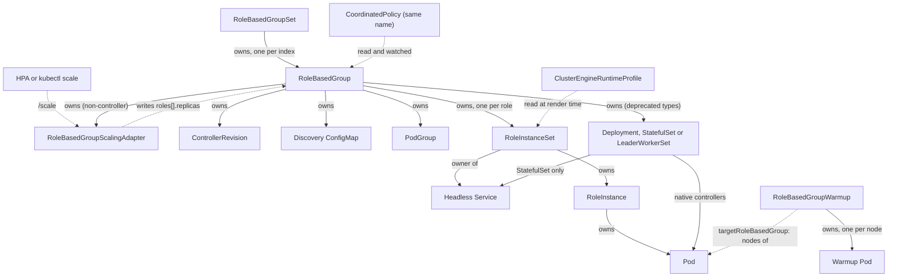
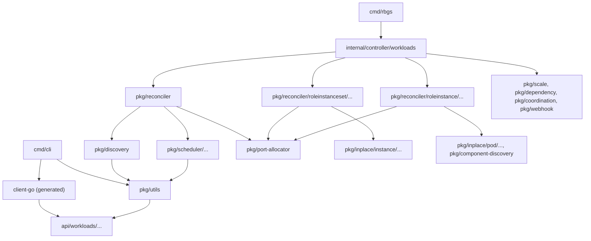

# RBG architecture overview

> Last verified against `main` at `1fc69f70`. Pointers name files and symbols, not line
> numbers; if a symbol moved, search for it and update this page.

This page is the first map of the RBG (RoleBasedGroup) operator: its vocabulary, the custom resources and who owns what, the processes that run, the repository and package layout, and where the code came from. It stays broad; the sibling pages hold the reconcile details.

## Where the code lives

Top-level directories:

| Path | Responsibility |
|---|---|
| `api/workloads` | Go API of group `workloads.x-k8s.io`: `v1alpha2` (current), `v1alpha1` (deprecated), label, annotation and env keys in `constants`, KEP-499 ordinal ranges in `ordinals`, in-place update state types in `pub/inplace_update`. See [API layer](api-layer.md). |
| `client-go` | Generated clientset, listers, informers and apply configurations, produced by `hack/update-codegen.sh`. |
| `cmd/rbgs` | Controller-manager entry point: flags, cache options, webhook bootstrap, controller registration. See [Controller manager](controller-manager.md). |
| `cmd/cli` | The `kubectl-rbg` plugin; cobra commands live in `cmd/cli/cmd`. |
| `config` | Kustomize install: generated CRDs (`crd/bases`), conversion-webhook patches (`crd/patches`), RBAC, manager Deployment, webhook manifests. |
| `deploy` | Helm chart `deploy/helm/rbgs` (CRDs are applied by its pre-install and pre-upgrade Job) and the single-file `deploy/kubectl/manifests.yaml`. |
| `doc` | User docs (`features`, `reference`, `best-practice`), install guide, developer docs (`dev`). |
| `examples` | Sample manifests in `basic`, `inference` and `deprecated/v1alpha1`. |
| `hack` | Codegen script and license boilerplate, `gen-helm-rbac` (renders the chart ClusterRole from `config/rbac/role.yaml`), code-generator pin, e2e image preload. |
| `internal/controller/workloads` | Every controller the manager registers, the v1alpha1 coordination migration and the event reasons. |
| `keps` | Design proposals, one directory per KEP; the template is `NNNN-kep-template`. |
| `pkg` | Reconcile logic and helpers behind the controllers (next table). |
| `test` | envtest, Kind e2e and upgrade suites, chart rendering tests, stress tool, shared object wrappers. See [Testing](testing.md). |
| `tools` | Copyright scripts, the CRD upgrader image that the chart Job runs (`crd-upgrade`), release helper. |
| `vendor` | Vendored Go modules. |
| `version` | `Version`, `GitCommit` and `BuildDate`, set through ldflags and printed by both binaries. |
| `.agents` | `skills/rbg-conventions`: development and review rules, references and verification scripts. |
| `.claude` | `skills/stress-test`: KWOK-based controller stress test. |
| `.github` | CI workflows, the `setup-e2e-cluster` action, issue forms and the PR template. |

Packages under `pkg`:

| Package | Responsibility |
|---|---|
| `pkg/reconciler` | RBG-side workload layer: the `WorkloadReconciler` interface and `NewWorkloadReconciler` factory, the RoleInstanceSet writer (`roleinstanceset_reconciler.go`), the deprecated Deployment, StatefulSet and LeaderWorkerSet writers, pod template rendering (`pod_reconciler.go`), the role headless Service (`svc_reconciler.go`), stateful selective scale-down (`selective_membership.go`), adoption and orphan cleanup (`common.go`). See [RoleBasedGroup controller](rbg-controller.md). |
| `pkg/reconciler/roleinstanceset/statefulmode` | Ordinal (Stateful) RoleInstanceSet logic. See [Instance workloads](instance-workloads.md). |
| `pkg/reconciler/roleinstanceset/statelessmode` with `core`, `revision`, `sync`, `utils` | Unordered (Stateless) RoleInstanceSet logic: revisions, scaling, updates, RoleInstance event handler. |
| `pkg/reconciler/roleinstance` with `core`, `inplaceupdate`, `lifecycle`, `revision`, `sync`, `utils` | RoleInstance logic: Pods per component, revisions, in-place update, restart policy, in-place scheduling node bindings (`sync/node_binding.go`). |
| `pkg/reconciler/utils/revisionadapter` | Revision-label adapter for the stateful RoleInstanceSet code and `pkg/utils/expectations`. |
| `pkg/reconciler/testdata` | Upgrade fixtures emitted by released code (`restart-policy-upgrade`). |
| `pkg/inplace/pod` with `clientadapter`, `inplaceupdate`, `readiness` | Pod-level in-place update and readiness-gate helpers used by the RoleInstance code. |
| `pkg/inplace/instance` with `clientdapter`, `inplaceupdate`, `lifecycle`, `readiness`, `specifieddelete` | RoleInstance-level counterparts used by the RoleInstanceSet code. |
| `pkg/discovery` | Pod template injection: discovery config content and mount (`config_builder.go`, `injector.go`), `RBG_*` env vars (`env_builder.go`), engine runtime containers (`sidecar_builder.go`). See [Scheduling and networking](scheduling-and-networking.md). |
| `pkg/component-discovery` | Intra-role component address and port injection, and component start and delete ordering, for RoleInstance Pods. |
| `pkg/port-allocator` | Port allocator behind `--enable-port-allocator`: allocation strategies, port config parsing, injection into Pods. |
| `pkg/scheduler` | The `GangScheduler` interface and the `NewGangScheduler` factory that `--scheduler-name` selects. |
| `pkg/scheduler/common` | Gang strategy resolution from a CoordinatedPolicy or the legacy group annotation, gang sizes, incompatible-configuration errors. |
| `pkg/scheduler/volcano`, `pkg/scheduler/k8s-scheduler-plugin` | PodGroup lifecycle and pod scheduling fields for Volcano and for scheduler-plugins. |
| `pkg/coordination/coordinationscaling` | Paced scaling across roles for CoordinatedPolicy scaling rules (`CoordinationScaler`). |
| `pkg/dependency` | Role dependency tiers and readiness checks (`DependencyManager`). |
| `pkg/scale` | ScalingAdapter naming, enablement and ownership helpers. |
| `pkg/webhook` | Self-signed webhook certificate and caBundle patching (`CertManager`); `cert/generator` creates the certificate and `cert/writer` stores it in a Secret and on disk. |
| `pkg/utils` | Shared helpers: RBG revisions and role hashes (`revision_utils.go`), the server-side apply helper `PatchObjectApplyConfiguration` (`utils.go`), CRD checks, hashing, selectors, Service naming. |
| `pkg/utils/client` | Clients that read from the manager cache with a per-controller user agent. |
| `pkg/utils/expectations` | Scale, update and resourceVersion expectations. |
| `pkg/utils/fieldindex` | The `ownerRefUID` field index on Pods (`RegisterFieldIndexes`). |
| `pkg/utils/history` | ControllerRevision history and truncation for RoleInstanceSets. |
| `pkg/utils/requeueduration` | Shared requeue-after store. |
| `pkg/utils/revisionadapter` | Revision-label adapter for `pkg/inplace`. |
| `pkg/utils/ratelimiter` | Workqueue rate limiter with its own flags; no package imports it on `main`. |

## Glossary

Kinds and helpers live in `api/workloads/v1alpha2` unless a row names another location.

| Term | Meaning | API kind or code location |
|---|---|---|
| RoleBasedGroup (RBG) | One logical service made of named roles that are deployed, scaled, updated and recovered as a unit. | `RoleBasedGroup` (`api/workloads/v1alpha2/rolebasedgroup_types.go`) |
| Role | One entry of `spec.roles`: replicas, a pattern, dependencies, rollout strategy, Service ports, engine runtimes and an optional scaling adapter. Each role renders one workload object named `<rbg>-<role>`. | `RoleSpec`; `RoleBasedGroup.GetWorkloadName` (`api/workloads/v1alpha2/helper.go`) |
| Pattern | The shape of one role replica. A role sets one of `standalonePattern` (one Pod), `leaderWorkerPattern` (a leader plus workers, `size` Pods) or `customComponentsPattern` (named components with their own sizes and templates). | `Pattern`, `StandalonePattern`, `LeaderWorkerPattern`, `CustomComponentsPattern` |
| Role template | A named pod template in `spec.roleTemplates` that a role references through `templateRef`, with an optional patch, instead of an inline `template` (KEP-8). | `RoleTemplate`, `TemplateRef`, `RoleSpec.GetResolvedTemplate` |
| Workload type | The kind of object a role renders. It is not a v1alpha2 spec field: the `rbg.workloads.x-k8s.io/role-workload-type` annotation holds `apiVersion/kind` and defaults to `workloads.x-k8s.io/v1alpha2/RoleInstanceSet`. | `RoleSpec.GetWorkloadType`, `NewWorkloadReconciler` (`pkg/reconciler/workload_reconciler.go`) |
| Deprecated workload types | Deployment, StatefulSet and LeaderWorkerSet as a role's workload. Fixes only, gated by `--enable-deprecated-workload-types`. | `pkg/reconciler/deploy_reconciler.go`, `sts_reconciler.go`, `lws_reconciler.go` |
| RoleInstanceSet | The default role workload: keeps `replicas` RoleInstances built from `spec.roleInstanceTemplate`, with rolling, recreate or in-place updates, partition and a `/scale` subresource. Runs in Stateful (ordinal names) or Stateless mode, chosen by the `rbg.workloads.x-k8s.io/role-instance-pattern` annotation; empty means Stateful. | `RoleInstanceSet`; `RoleInstanceSetReconciler.Reconcile` (`internal/controller/workloads/roleinstanceset_controller.go`) |
| RoleInstance | One replica of a role: the Pods of all its components, created, updated (in place when possible), restarted and reported together. | `RoleInstance` (`api/workloads/v1alpha2/roleinstance_types.go`) |
| Component | A named group of identical Pods inside a RoleInstance, with a `size` and a pod template. Standalone yields one component named after the role, leader/worker yields `leader` and `worker`, custom components are named by the user. | `RoleInstanceComponent`, `InstanceComponent` |
| Subgroup size | Pods produced by one replica of a role: 1 for standalone, `size` for leader/worker, the sum of component sizes for custom components. Used for gang sizes and `GetGroupSize`. | `ComputeSubGroupSize` (`api/workloads/v1alpha2/helper.go`) |
| Dependencies | `roles[].dependencies` names roles that must be ready first; the RBG controller reconciles roles in dependency tiers. | `DependencyManager.SortRoles` (`pkg/dependency`) |
| Revision | A ControllerRevision snapshot, kept at three levels: RBG (roles and role templates, plus a per-role hash in the `rbg.workloads.x-k8s.io/role-revision-<role>` workload label), RoleInstanceSet (`spec.roleInstanceTemplate`) and RoleInstance (`spec.components`). | `NewRevision`, `GetRolesRevisionHash` (`pkg/utils/revision_utils.go`) |
| RoleBasedGroupSet | Keeps `spec.replicas` RoleBasedGroups named `<set>-<index>` from `spec.groupTemplate` and copies the template's roles, labels and annotations into every child; `groupTemplate.spec.roleTemplates` is not copied. The rolling update of KEP-455 is proposed, not implemented on `main`. | `RoleBasedGroupSet`; `internal/controller/workloads/rolebasedgroupset_controller.go` |
| RoleBasedGroupScalingAdapter | A per-role `/scale` target for an HPA or `kubectl scale`. When a role sets `scalingAdapter.enable`, the RBG controller creates `<rbg>-<role>` and the adapter controller copies its `spec.replicas` into the role. | `RoleBasedGroupScalingAdapter`; `internal/controller/workloads/rolebasedgroupscalingadapter_controller.go` |
| CoordinatedPolicy | Cross-role rules for one RBG, matched by identical namespace and name: paced rolling update and scaling (`maxSkew`, `progression`) and gang scheduling. | `CoordinatedPolicy`; `RoleBasedGroupReconciler.handleCoordinationStrategies` (`internal/controller/workloads/rolebasedgroup_controller.go`) |
| ClusterEngineRuntimeProfile | A cluster-scoped bundle of init containers, containers and volumes that roles reference in `engineRuntimes`; appended to pod templates at render time. | `ClusterEngineRuntimeProfile`; `SidecarBuilder.injectRuntime` (`pkg/discovery/sidecar_builder.go`) |
| RoleBasedGroupWarmup | Preloads images or runs custom containers on target nodes (listed nodes, a node selector, or the nodes running an RBG's Pods) through one warmup Pod per node. | `RoleBasedGroupWarmup`; `internal/controller/workloads/rolebasedgroupwarmup_controller.go` |
| InstanceSet, Instance | Legacy v1alpha1-only predecessors of RoleInstanceSet and RoleInstance. Deprecated; no controller reconciles them on `main`. | `api/workloads/v1alpha1/instanceset_types.go`, `api/workloads/v1alpha1/instance_types.go` |
| Gang scheduling | All-or-nothing scheduling, or per-role minimums with Volcano, through a PodGroup owned by the RBG. | `pkg/scheduler`; see [Scheduling and networking](scheduling-and-networking.md) |
| Discovery config | Peer information for a role's Pods: `/etc/rbg/config.yaml` from a ConfigMap named after the RBG (stateful roles only) and `RBG_*` env vars. | `DefaultInjector` (`pkg/discovery/injector.go`) |
| Exclusive topology | The `rbg.workloads.x-k8s.io/group-exclusive-topology` annotation on an RBG names a topology key; rendering adds required pod affinity and anti-affinity terms on the `rbg.workloads.x-k8s.io/group-unique-hash` label, meant to give each RBG a topology domain of its own. | `setExclusiveAffinities` (`pkg/reconciler/pod_reconciler.go`) |
| Selective scale-down | The `rbg.workloads.x-k8s.io/excluded-ordinals` role annotation picks which ordinals a Stateful RoleInstanceSet role drops on scale-down and keeps them out on later scale-up; RBGs managed by a RoleBasedGroupSet are not supported (KEP-499). | `pkg/reconciler/selective_membership.go`, `api/workloads/ordinals` |
| In-place scheduling | The `rbg.workloads.x-k8s.io/role-inplace-scheduling` role annotation steers recreated Pods back to nodes their predecessors used. | `NodeBindingStore` (`pkg/reconciler/roleinstance/sync/node_binding.go`) |
| Group-name label | `rbg.workloads.x-k8s.io/group-name=<rbg>` maps children back to their RBG and gates the manager cache for Services, StatefulSets and Deployments. | `constants.GroupNameLabelKey`; `cacheOptions` (`cmd/rbgs/main.go`) |

## Custom resources

All kinds belong to `workloads.x-k8s.io` and have a status subresource. Served and storage versions come from the `+kubebuilder:storageversion` and `+kubebuilder:deprecatedversion` markers and the generated CRDs in `config/crd/bases`.

| Kind (short name) | Versions served (storage) | Scope | Purpose | Created by / owns |
|---|---|---|---|---|
| `RoleBasedGroup` (`rbg`) | v1alpha2 (storage); v1alpha1 deprecated; webhook conversion | Namespaced | The multi-role service | Users or a RoleBasedGroupSet. Owns one RoleInstanceSet or deprecated workload per role, the discovery ConfigMap, the PodGroup, its ControllerRevisions, ScalingAdapters (non-controller reference) and a CoordinatedPolicy migrated from v1alpha1. |
| `RoleBasedGroupSet` (`rbgs`) | v1alpha2 (storage); v1alpha1 deprecated; webhook conversion; `/scale` | Namespaced | N copies of one RBG template | Users. Owns RoleBasedGroups `<set>-<index>`. |
| `RoleBasedGroupScalingAdapter` (`rbgsa`) | v1alpha2 (storage); v1alpha1 deprecated; no conversion webhook; `/scale` | Namespaced | Per-role scale target for autoscalers | The RBG controller or users. Owns nothing; writes role replicas into its RBG. |
| `ClusterEngineRuntimeProfile` | v1alpha2 (storage); v1alpha1 deprecated; no conversion webhook | Cluster | Reusable containers and volumes for pod templates | Cluster administrators. Owns nothing; read during rendering. |
| `CoordinatedPolicy` (`cpolicy`) | v1alpha2 only | Namespaced | Cross-role update, scaling and gang rules | Users, or the RBG controller for RBGs converted from v1alpha1. Owns nothing. |
| `RoleInstanceSet` (`ris`) | v1alpha2 only; `/scale` | Namespaced | Role workload | The RBG controller (`<rbg>-<role>`) or users. Owns RoleInstances and ControllerRevisions; the role's headless Service names it as owner. |
| `RoleInstance` (`rins`) | v1alpha2 only | Namespaced | One role replica | RoleInstanceSet controllers. Owns Pods and ControllerRevisions. |
| `RoleBasedGroupWarmup` (`rbgwarmup`) | v1alpha2 only; no generated typed client | Namespaced | Node warmup job | Users. Owns one warmup Pod per target node. |
| `InstanceSet` (`is`) | v1alpha1 only, deprecated (storage v1alpha1); `/scale` | Namespaced | Legacy, replaced by RoleInstanceSet | No controller on `main`. |
| `Instance` (`ins`) | v1alpha1 only, deprecated (storage v1alpha1) | Namespaced | Legacy, replaced by RoleInstance | No controller on `main`. |

Every deprecated version carries the CRD warning "will be removed in 0.10.0". Field-level detail is in [API layer](api-layer.md).

## Ownership and data flow

Solid arrows are owner references, which garbage collection follows. Dashed arrows are reads or writes without ownership.

- RoleBasedGroup, RoleInstanceSet, RoleInstance and Pod form the main path. Each level is its own controller and talks to the next one only through API objects: `constructRoleInstanceSetApplyConfiguration` (`pkg/reconciler/roleinstanceset_reconciler.go`) builds the RoleInstanceSet, `GenInstanceFromTemplate` (`pkg/reconciler/roleinstanceset/statelessmode/core/implement.go`) builds a stateless RoleInstance, and `pkg/reconciler/roleinstance/core/instance_core.go` builds the Pods. ControllerRevisions exist at all three levels.
- The role headless Service is named `s-<rbg>-<role>`, or `<rbg>-<role>` when a Service with that older name exists. It is written for RoleInstanceSet and StatefulSet roles only, and its owner reference points at that workload, not at the RBG (`ServiceReconciler.constructServiceApplyConfiguration`, `GetCompatibleHeadlessServiceName`).
- The discovery ConfigMap carries the RBG's name and is written only when the RBG's `discovery-config-mode` annotation is `refine` and the RBG has a stateful role (`reconcileRefinedDiscoveryConfigMap`).
- The PodGroup exists only while gang scheduling is configured; the Volcano or scheduler-plugins implementation writes it with the RBG as controller (`GangScheduler.ReconcilePodGroup`).
- Scaling: an HPA or `kubectl scale` writes the adapter's `/scale` subresource, and the adapter controller copies `spec.replicas` into `spec.roles[].replicas` with a typed update (`updateRoleReplicas`). The RBG controller also applies a bound adapter's replicas in memory at the start of every reconcile (`applyRBGSAReplicasOverride`).
- The CoordinatedPolicy is looked up by the RBG's namespace and name for coordination (`handleCoordinationStrategies`) and gang settings (`GetGangStrategy` in `pkg/scheduler/common/gang_strategy.go`). For RBGs converted from v1alpha1, `EnsureV1alpha1CoordinatedPolicy` creates the policy from the `conversion.workloads.x-k8s.io/v1alpha1-coordination` annotation with the RBG as owner.
- A ClusterEngineRuntimeProfile is fetched by name for every role that lists it when the pod template is rendered; the RBG controller does not watch profiles (`SidecarBuilder.injectRuntime`).
- A RoleBasedGroupSet labels its children with `groupset-name` and `groupset-index`, adopts orphans that carry its name label, and overwrites every child's `spec.roles` when the template changes (`updateExistingRBGs`).
- With `targetRoleBasedGroup`, a Warmup derives its nodes from the target RBG's scheduled Pods and also watches RBGs so a late-created target is picked up (`RoleBasedGroupWarmupReconciler.SetupWithManager`).

## Process topology

The repository builds two binaries.

| Binary | Built from | Runs as | Purpose |
|---|---|---|---|
| `manager` | `cmd/rbgs` (`make build`; image `rbgs-controller`) | Deployment in the install namespace; 2 replicas in the chart (`controller.replicaCount`) and in `config/manager/manager.yaml` | Hosts every controller, the conversion and admission webhook server, the webhook certificate controller, probes, metrics and optional pprof. |
| `kubectl-rbg` | `cmd/cli` (`make build-cli`) | A user's kubectl plugin | Shows RBG status and manages RBG rollouts. |

Inside the manager process (`cmd/rbgs/main.go`):

- Leader election is off by flag default, but every shipped manifest passes `--leader-elect`; the lease ID is `rbg-controller` (`constants.ControllerName`). Controllers run on the leader only, while the webhook server serves on every replica.
- Before the manager starts, `bootstrapWebhookCerts` uses a direct client to create or load a self-signed certificate in Secret `rbgs-webhook-cert` (in `POD_NAMESPACE`), writes it to `/tmp/k8s-webhook-server/certs`, patches the caBundle of the two conversion CRDs and of `rbgs-validating-webhook-configuration` and `rbgs-mutating-webhook-configuration`, and registers the webhooks.
- The webhook server handles `/convert` for RoleBasedGroup and RoleBasedGroupSet, validation for RoleBasedGroup, RoleBasedGroupSet and CoordinatedPolicy, and defaulting for RoleBasedGroup, RoleBasedGroupSet and RoleInstanceSet (`api/workloads/v1alpha2/rolebasedgroup_webhook.go`).
- Probes `/healthz` and `/readyz` are `healthz.Ping` checks on `--health-probe-bind-address` (flag default `:8082`; manifests use `:8081`). Metrics are off by flag default and served on `:8443` with authentication in the manifests. `--enable-pprof` starts a separate HTTP server on `--pprof-bind-address` (`startPprofServer`).
- `--enable-webhooks=none` skips the certificate bootstrap and every webhook, and also forces leader election off and metrics to plain HTTP (`newManagerOptions`). `make run-local` uses it.

| Controller name | Reconciles | Also triggered by | Code in `internal/controller/workloads` |
|---|---|---|---|
| `workloads-rolebasedgroup` | RoleBasedGroup | owned RoleInstanceSets, Services and ScalingAdapters; same-name CoordinatedPolicy; owned StatefulSets, Deployments and LeaderWorkerSets when deprecated types are enabled; owned PodGroups when their CRD exists at startup | `rolebasedgroup_controller.go` |
| `workloads-rolebasedgroup-scalingadapter` | RoleBasedGroupScalingAdapter | role status changes of RoleBasedGroups | `rolebasedgroupscalingadapter_controller.go` |
| `rbgset-controller` | RoleBasedGroupSet | owned RoleBasedGroups | `rolebasedgroupset_controller.go` |
| `roleinstanceset` | RoleInstanceSet, dispatched to `statefulmode` or `statelessmode` | owned RoleInstances | `roleinstanceset_controller.go` |
| `roleinstance` | RoleInstance | Pods | `roleinstance_controller.go` |
| `rbgwarmup-controller` | RoleBasedGroupWarmup | owned Pods; target RoleBasedGroups | `rolebasedgroupwarmup_controller.go` |
| `webhook-cert` | caBundle of the conversion CRDs and webhook configurations | those objects; a 10-minute recheck | `webhook_cert_controller.go` |

Flags, cache options, field indexes and startup order are in [Controller manager](controller-manager.md).

## Package layering

A simplified view of the `go list` imports at this commit. Almost every package also imports `api/workloads/...`, and `internal/controller/workloads` also imports several lower packages directly; those arrows are left out.

- `cmd/rbgs` also imports `pkg/webhook`, `pkg/scheduler`, `pkg/port-allocator`, `pkg/utils/client`, `pkg/utils/fieldindex` and `pkg/reconciler/roleinstance/sync`, whose `NodeBindingStore` it shares between the RBG and RoleInstance controllers.
- `pkg/reconciler` imports neither `pkg/reconciler/roleinstanceset/...` nor `pkg/reconciler/roleinstance/...`. The RBG layer writes RoleInstanceSet objects through the API, and separate controllers act on them.
- `api/workloads/v1alpha1` imports `api/workloads/v1alpha2` for conversion; `v1alpha2` imports only `constants` and `ordinals`.
- A few helpers import back into `pkg/reconciler`: `pkg/dependency` imports `pkg/reconciler`, `pkg/port-allocator` imports `pkg/reconciler/roleinstance/utils`, and `pkg/utils/expectations` imports `pkg/reconciler/utils/revisionadapter`.
- `client-go` is generated from `api/` and imports only `api/workloads/...`; the controllers use its apply configurations, listers and clientset, and the CLI uses its clientset.

## API versions and deprecation

v1alpha2 is the current version, the storage version of every kind except the legacy InstanceSet and Instance, and the conversion hub for RoleBasedGroup and RoleBasedGroupSet (`Hub()` in `api/workloads/v1alpha2/rolebasedgroup_conversion.go`). v1alpha1 is still served, deprecated, for RoleBasedGroup, RoleBasedGroupSet, RoleBasedGroupScalingAdapter and ClusterEngineRuntimeProfile, and is the only version of InstanceSet and Instance; v1alpha1 has no admission webhooks since #556. Deployment, StatefulSet and LeaderWorkerSet roles sit behind the 0.9.0 compatibility gate (#524): the v1alpha2 validators reject new uses in both modes and every use when `--enable-deprecated-workload-types=false` (`validateNoNewDeprecatedWorkloadTypes`, `validateNoDeprecatedWorkloadTypes` in `api/workloads/v1alpha2/rolebasedgroup_validation.go`), and with the flag off the RBG controller does not watch those types (`RoleBasedGroupReconciler.SetupWithManager`). Details are in [API layer](api-layer.md); the rules are in [api-and-admission.md](../../../.agents/skills/rbg-conventions/references/api-and-admission.md).

## Code lineage

Only what file headers, code comments and the README state:

| Origin | Where | Evidence |
|---|---|---|
| Kubernetes StatefulSet controller, through OpenKruise | `pkg/reconciler/roleinstanceset/statefulmode` | Every non-test file carries "The Kruise Authors" (2019) and "The Kubernetes Authors" (2016) headers. |
| OpenKruise utilities, copied into the repo | `pkg/utils/client`, `pkg/utils/expectations` (`update_expectations.go`, `resource_version_expectation.go`), `pkg/utils/history/controller_history.go`, `pkg/utils/requeueduration`, `pkg/utils/selector.go`, `pkg/reconciler/utils/revisionadapter`, `pkg/reconciler/roleinstanceset/statelessmode/utils`, `api/workloads/pub/inplace_update` | "The Kruise Authors" headers; `statelessmode/utils/ref_manager.go` carries Kubernetes and Beirut headers instead. |
| OpenKruise module, imported | `pkg/reconciler/roleinstance` (`expectations`, `history`), `pkg/reconciler/roleinstance/sync` (`requeueduration`), `pkg/reconciler/roleinstance/utils` | `github.com/openkruise/kruise` in `go.mod`; `instance_status.go` still describes its `StatusUpdater` as updating "CloneSet status". |
| LeaderWorkerSet | `pkg/reconciler/sts_reconciler.go` (`rollingUpdatePartition`) | The README acknowledgment says RBG reuses LWS code, and the partition comments still speak of "the LWS". `sigs.k8s.io/lws` is a dependency of the deprecated LeaderWorkerSet path (`pkg/reconciler/lws_reconciler.go`). |

As a result, RoleInstanceSet code uses the in-repo copies of expectations and ControllerRevision history while RoleInstance code uses the upstream OpenKruise packages.

## The kubectl-rbg CLI

`make build-cli` builds the `kubectl-rbg` binary from `cmd/cli/main.go` with `-mod vendor`, and `make build-cli-all` cross-builds it. The root command (`cmd/cli/cmd/root.go`) adds the standard kubeconfig flags from `genericclioptions` and prints usage as `kubectl rbg`.

| Command | What it does | Client |
|---|---|---|
| `kubectl rbg status <rbg>` | Prints the RBG's age and `status.roleStatuses` | Dynamic client on `v1alpha2` `rolebasedgroups` (`GetRBGObjectByDynamicClient`) |
| `kubectl rbg rollout history <rbg>` | Lists the ControllerRevisions labelled `group-name=<rbg>` that no other object controls; `--revision` prints one | Generated clientset and client-go |
| `kubectl rbg rollout diff <rbg> --revision N` | Diffs the newest revision against revision N | Generated clientset and client-go |
| `kubectl rbg rollout undo <rbg>` | Applies the previous revision, or `--revision N`, with `utils.ApplyRevision` and writes the RBG with a typed `Update` | Generated clientset and client-go |

## Behaviors worth knowing

- `--enable-webhooks=none` stops this process from serving conversion and admission webhooks and skips the certificate bootstrap (`cmd/rbgs/main.go`, `newManagerOptions`). Webhook configurations already installed in the cluster stay in place and keep sending requests to the webhook Service: another replica may serve them, and if none does, matching writes fail because every webhook uses `failurePolicy: Fail`. When no webhook configurations are installed, as after the CRD-only `make install` used for local runs, only CRD schema validation applies, so the RBG controller re-checks role templates, template references and workload declarations itself (`internal/controller/workloads/rolebasedgroup_controller.go`, `RoleBasedGroupReconciler.preCheck`). Rule: [api-and-admission.md](../../../.agents/skills/rbg-conventions/references/api-and-admission.md).
- Only RoleBasedGroup and RoleBasedGroupSet convert through the webhook (`pkg/webhook/certmanager.go`, `ConversionWebhookCRDs`; the same two names in `tools/crd-upgrade/ensure-crds-up-to-date.sh`). The v1alpha1 RoleBasedGroupScalingAdapter and ClusterEngineRuntimeProfile CRDs have no `spec.conversion`, so the API server only rewrites `apiVersion`. Rule: [api-and-admission.md](../../../.agents/skills/rbg-conventions/references/api-and-admission.md).
- The `rbg.workloads.x-k8s.io/group-uid` label is the SHA-1 of `namespace/name`, not the object UID, so a deleted and recreated RBG keeps the same value. It is one of the common role labels that the RBG writes as workload selectors; the real UID travels in `rbg.workloads.x-k8s.io/rbg-owner-uid`, set only for in-place scheduling (`api/workloads/v1alpha2/helper.go`, `GenGroupUniqueKey`, `GetCommonLabelsFromRole`).
- The manager exits at startup unless the eight non-legacy CRDs exist and are established; only `instances` and `instancesets` may be missing (`CheckCrdExists` on each reconciler, `pkg/utils/crds.go`). LeaderWorkerSet and PodGroup CRDs are optional and get a watch only if present at startup: the later `Owns` calls in `dynamicWatchCustomCRD` and `GangScheduler.ReconcilePodGroup` run after `Complete`, and controller-runtime's builder only reads its owns list in `Build`.
- The cache holds Services, StatefulSets and Deployments only if they carry `rbg.workloads.x-k8s.io/group-name`; Pods are not filtered (`cmd/rbgs/main.go`, `cacheOptions`). Rule: [controller-patterns.md](../../../.agents/skills/rbg-conventions/references/controller-patterns.md).
- A role's workload type is an annotation, not a v1alpha2 field. v1alpha1 has a `workload` field that defaults to `apps/v1` StatefulSet, and conversion carries it into `rbg.workloads.x-k8s.io/role-workload-type` (`api/workloads/v1alpha1/rolebasedgroup_conversion.go`, `convertRoleV1alpha1ToV2`; `api/workloads/v1alpha2/rolebasedgroup_types.go`, `RoleSpec.GetWorkloadType`).
- A RoleInstanceSet without the `role-instance-pattern` annotation runs in Stateful mode, and the RBG controller writes `Stateful` when the role sets nothing (`internal/controller/workloads/roleinstanceset_controller.go`, `RoleInstanceSetReconciler.Reconcile`; `pkg/reconciler/roleinstanceset_reconciler.go`, `constructRoleInstanceSetApplyConfiguration`).
- RBG-created ScalingAdapters carry a non-controller owner reference, which is why the RBG controller watches them with `builder.MatchEveryOwner` (`internal/controller/workloads/rolebasedgroup_controller.go`, `ReconcileScalingAdapter`, `SetupWithManager`).
- No controller reconciles a CoordinatedPolicy or writes its status. The RBG controller reads it, requires its CRD and watches it for generation changes (`internal/controller/workloads/rolebasedgroup_controller.go`, `RoleBasedGroupReconciler.CheckCrdExists`); for an RBG that carries the v1alpha1 coordination annotation it also creates the policy and re-applies it with server-side apply on every reconcile, which can overwrite edits to the fields it manages (`internal/controller/workloads/coordinatedpolicy_migration_controller.go`, `EnsureV1alpha1CoordinatedPolicy`).
- A ClusterEngineRuntimeProfile is read through the manager cache when a pod template is rendered, and no watch maps a profile change to the RBGs that use it, so a profile edit reaches pod templates only when something else next reconciles each referencing RBG. Its `updateStrategy` field and the role's `injectContainers` are not read by any code (`pkg/discovery/sidecar_builder.go`, `SidecarBuilder.injectRuntime`). KEP-531 proposes immutable profiles and reference tracking; not implemented on `main`. Rule: [upgrade-compatibility.md](../../../.agents/skills/rbg-conventions/references/upgrade-compatibility.md).
- The legacy `instances` and `instancesets` CRDs have no controller. `config/crd/kustomization.yaml` and `deploy/kubectl/manifests.yaml` install eight CRDs without them, but the chart's CRD upgrader image copies all of `config/crd/bases` and installs all ten (`tools/crd-upgrade/Dockerfile`).
- In-place scheduling bindings live in controller memory and stay empty after a restart until `RecordNodeBindings` reseeds them from running, ready Pods (`pkg/reconciler/roleinstance/sync/node_binding.go`, `NodeBindingStore`).
- No controller adds a finalizer of its own. The RBG reconcile returns as soon as `deletionTimestamp` is set, and cleanup is left to garbage collection through owner references (`internal/controller/workloads/rolebasedgroup_controller.go`, `RoleBasedGroupReconciler.Reconcile`).
- Not every flag is declared in `cmd/rbgs/main.go`. Package `init` functions register `--stateful-instanceset-workers` (`pkg/reconciler/roleinstanceset/statefulmode/stateful_instance_set_controller.go`) and `--disable-no-deepcopy` (`pkg/utils/client/cache.go`); neither changes behavior on `main`, because nothing reads the first and nothing calls `NewCache`.
- Not every key uses the `rbg.workloads.x-k8s.io/` prefix: warmup Pods use `workloads.x-k8s.io/warmup-name`, `warmup-uid` and `node-name` (`internal/controller/workloads/rolebasedgroupwarmup_controller.go`, `LabelWarmupName`), in-place update uses `workloads.x-k8s.io/runtime-containers-meta` (`api/workloads/constants/annotation.go`, `RuntimeContainerMetaKey`), and the v1alpha1 migration uses `conversion.workloads.x-k8s.io/v1alpha1-coordination` (`internal/controller/workloads/coordinatedpolicy_migration_controller.go`).

## Tests

Unit tests sit next to the code; `make test` runs those under `api`, `cmd`, `internal` and `pkg`. `make test-envtest` runs `test/envtest/testcase/...` against a real API server, and the Kind suites live in `test/e2e`, with the upgrade suite in `test/e2e/upgrade` and chart rendering tests in `test/chart`. Layers, helpers and focused commands are in [Testing](testing.md); expectations are in [build-test-release.md](../../../.agents/skills/rbg-conventions/references/build-test-release.md).

## Related

- Repository [README](../../../README.md), the documentation [table of contents](../../TOC.md) and the [developer guide](../how_to_develop.md).
- User docs: [workload patterns](../../features/patterns.md), [multi roles](../../features/multiroles.md), [role templates](../../features/role-templates.md), [revision](../../features/revision.md), [coordinated policy](../../features/coordinated-policy.md), [autoscaling](../../features/autoscaler.md), [engine runtime profile](../../features/engine-runtime.md), [instance](../../features/instance.md) and the [labels, annotations and environment variables reference](../../reference/variables.md).
- KEPs: the [KEP template](../../../keps/NNNN-kep-template/README.md), [KEP-30 InstanceSet](../../../keps/30-instanceset/README.md), [KEP-31 controller revisions](../../../keps/31-rbg-controller-revision/README.md), [removing the workload field from v1alpha2](../../../keps/workload-compatibility-mode/README.md), [KEP-455 RoleBasedGroupSet rolling update](../../../keps/455-rbgs-rolling-update/README.md) and [KEP-531 engine runtime profile injection](../../../keps/531-engine-runtime-profile-injection/README.md).
- Rules: the [rbg-conventions skill](../../../.agents/skills/rbg-conventions/SKILL.md), [upgrade-compatibility.md](../../../.agents/skills/rbg-conventions/references/upgrade-compatibility.md), [api-and-admission.md](../../../.agents/skills/rbg-conventions/references/api-and-admission.md), [controller-patterns.md](../../../.agents/skills/rbg-conventions/references/controller-patterns.md) and [build-test-release.md](../../../.agents/skills/rbg-conventions/references/build-test-release.md).
- Sibling pages: [architecture index](README.md), [API layer](api-layer.md), [Controller manager](controller-manager.md), [RoleBasedGroup controller](rbg-controller.md), [Other controllers](other-controllers.md), [Instance workloads](instance-workloads.md), [Scheduling and networking](scheduling-and-networking.md), [Testing](testing.md) and [Feature index](feature-index.md).
