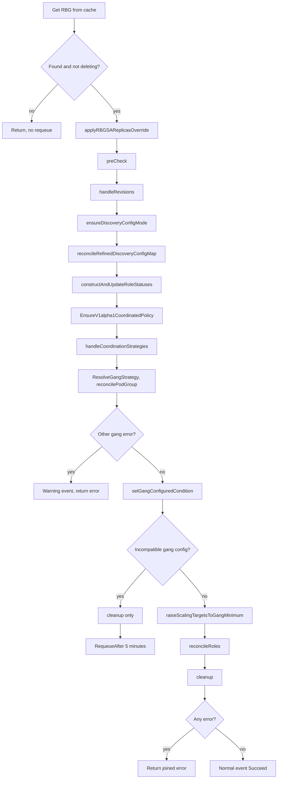

# RoleBasedGroup controller

> Last verified against `main` at `1fc69f70`. Pointers name files and symbols, not line
> numbers; if a symbol moved, search for it and update this page.

`RoleBasedGroupReconciler` turns a v1alpha2 RoleBasedGroup (RBG) into one workload per role, plus headless Services, a discovery ConfigMap, scaling adapters, a PodGroup and RBG status. This page follows one reconcile from fetch to requeue, then covers the workload reconcilers in `pkg/reconciler`, pod template rendering, and the write, status and watch contracts. The rules behind these facts live in the rbg-conventions skill and are linked, not repeated.

## Where the code lives

| Path | Responsibility |
|---|---|
| `internal/controller/workloads/rolebasedgroup_controller.go` | `RoleBasedGroupReconciler`: the `Reconcile` pipeline, revisions, discovery ConfigMap, coordination math, scaling-adapter lifecycle, status writes, `SetupWithManager`, `RBGPredicate`, `WorkloadPredicate` |
| `internal/controller/workloads/coordinatedpolicy_migration_controller.go` | `EnsureV1alpha1CoordinatedPolicy`: turns the v1alpha1 coordination annotation into a CoordinatedPolicy |
| `internal/controller/workloads/event.go` | Event reason constants |
| `internal/controller/workloads/rolebasedgroupscalingadapter_controller.go` | `RBGScalingAdapterPredicate`, used by the RBG controller's adapter watch; the adapter controller itself is in [other controllers](other-controllers.md) |
| `pkg/reconciler/workload_reconciler.go` | `WorkloadReconciler`, `GangSchedulerSetter`, the `NewWorkloadReconciler` factory, `WorkloadEqual` |
| `pkg/reconciler/roleinstanceset_reconciler.go` | Default workload path: `RoleInstanceSetReconciler`, `constructRoleInstanceSetApplyConfiguration` |
| `pkg/reconciler/selective_membership.go` | Conditional RoleInstanceSet writer used while stateful selective scale-down is active |
| `pkg/reconciler/pod_reconciler.go` | `PodReconciler.ConstructPodTemplateSpecApplyConfiguration`, exclusive-topology affinity, template equality helpers |
| `pkg/reconciler/svc_reconciler.go` | `ServiceReconciler.reconcileHeadlessService` |
| `pkg/reconciler/common.go` | `checkWorkloadClaimable`, `CleanupOrphanedObjs`, `ConstructWorkloadRoleStatus` |
| `pkg/reconciler/sts_reconciler.go`, `pkg/reconciler/deploy_reconciler.go`, `pkg/reconciler/lws_reconciler.go` | Deprecated StatefulSet, Deployment and LeaderWorkerSet paths; `validateRolloutStrategy` lives in the StatefulSet file |
| `pkg/dependency` | `DefaultDependencyManager`: dependency tiers and prerequisite readiness |
| `pkg/discovery` | Render-time injectors (`DefaultInjector`): discovery ConfigMap mount, RBG env vars, engine runtime profile containers; `ConfigBuilder` for the ConfigMap content |
| `pkg/component-discovery` | Parses the `rolebasedgroup.workloads.x-k8s.io/component-discovery` and `component-depends-on` annotations that rendering copies into component templates; read at Pod creation by `pkg/reconciler/roleinstance/sync/instance_scale.go`, not by this controller |
| `pkg/coordination/coordinationscaling` | `CoordinationScaler`: scaling targets for one CoordinatedPolicy rule |
| `pkg/scale` | Scaling-adapter name and ownership helpers |
| `pkg/scheduler`, `pkg/scheduler/common` | `GangScheduler` and `ResolveGangStrategy`; see [scheduling and networking](scheduling-and-networking.md) |
| `pkg/utils/utils.go` | `PatchObjectApplyConfiguration` (server-side apply helper) and `FieldManager` |
| `pkg/utils/revision_utils.go` | RBG ControllerRevisions and role hashes |
| `pkg/utils/service_utils.go` | `GetCompatibleHeadlessServiceName` |

## Reconcile pipeline

`Reconcile` runs these steps in order. A step that returns an error ends the pass, and controller-runtime retries with its default rate-limited backoff.



1. **Fetch.** The RBG is read through the cached client. NotFound returns `ctrl.Result{}`. A set `deletionTimestamp` also returns at once: the controller adds no finalizer and leaves children to owner-reference garbage collection.
2. **Adapter override.** `applyRBGSAReplicasOverride` replaces `role.Replicas` in memory with a bound scaling adapter's replicas (see the scaling adapter section).
3. **Pre-check.** `preCheck` rejects an RBG with both `rbg.workloads.x-k8s.io/group-gang-scheduling` and `rbg.workloads.x-k8s.io/role-instance-gang-scheduling` set to `true`, runs `ValidateRoleTemplates` and `ValidateRoleTemplateReferences`, and calls each role's `WorkloadReconciler.Validate`. Every `Validate` returns nil today, so in practice this step catches unsupported workload types.
4. **Revisions.** `handleRevisions` returns the role-to-hash map.
5. **Discovery.** `ensureDiscoveryConfigMode`, then `reconcileRefinedDiscoveryConfigMap`. The mode is fixed before status is written because the legacy check reads status.
6. **Role status.** `constructAndUpdateRoleStatuses` builds each role's status with `ConstructRoleStatus` and writes it through `updateRBGStatus`, before any role is reconciled.
7. **v1alpha1 policy.** `EnsureV1alpha1CoordinatedPolicy`.
8. **Coordination.** `handleCoordinationStrategies` computes scaling targets and rolling-update strategies from the same-name CoordinatedPolicy.
9. **Gang.** `ResolveGangStrategy` (`pkg/scheduler/common/gang_strategy.go`) resolves the strategy once and stores it on the context, so the PodGroup and every pod template see one value. `reconcilePodGroup` calls `GangScheduler.ReconcilePodGroup`. Any error other than an incompatible configuration (for example a missing PodGroup CRD) ends the pass with `FailedReconcilePodGroup`. `setGangConfiguredCondition` records the outcome. For an incompatible configuration the pass runs only `cleanup` and returns `RequeueAfter: incompatibleGangConfigRequeue` (5 minutes) without touching roles (#434).
10. **Gang minimums.** `raiseScalingTargetsToGangMinimum` lifts coordinated scaling targets that sit below `GangMinimumReplicas`.
11. **Roles.** `reconcileRoles` walks the dependency tiers.
12. **Cleanup.** `cleanup` runs `deleteOrphanRoles` and `utils.CleanExpiredRevision`. Its error is joined with the role error, so cleanup runs even when roles failed (#538).
13. **Success.** A Normal `Succeed` event with message `ReconcileSucceed`, and `ctrl.Result{}`.

There is no periodic requeue: apart from errors and the 5-minute gang backstop, progress depends on watch events. `Reconcile` also has a `RequeueAfter: time.Second` branch after `ensureDiscoveryConfigMode`, but that function reports `needRequeue` only together with an error, so the branch is never taken. Rule: see [controller-patterns.md](../../../.agents/skills/rbg-conventions/references/controller-patterns.md) (requeues and load). Gang details are in [scheduling and networking](scheduling-and-networking.md).

## Revisions in the flow

- `getCurrentRevision` lists ControllerRevisions labelled `rbg.workloads.x-k8s.io/group-name=<rbg>` (`utils.ListRevisions` keeps those this RBG controls or that have no controller) and takes the highest `revision` (`utils.GetHighestRevision`).
- `utils.NewRevision` builds the candidate: name `<rbg>-<hash>-<n>`, labels `group-name` and `group-revision`, and a controller reference to the RBG.
- When `utils.EqualRevision` reports a difference, `utils.SetMatchesRevision` re-applies the stored revision and re-serializes it. A match keeps the stored revision and its role hashes, and is cached in `revisionEqualityCache`, an LRU keyed by RBG UID, generation and revision resourceVersion (#433). Otherwise the candidate is written with a typed `Create`.
- `utils.GetRolesRevisionHash` turns the chosen revision into one hash per role. `reconcileSingleRole` passes it as `revisionKey`, and every workload reconciler writes it to the workload label `rbg.workloads.x-k8s.io/role-revision-<role>`.
- `cleanup` keeps the newest `utils.DefaultRevisionHistoryLimit` (5) revisions.
- The controller never applies a stored revision. `rbg rollout undo` does, with `utils.ApplyRevision` and a typed `Update` of the RBG (`cmd/cli/cmd/rollout/rollout_undo.go`).

Rule: the hashed inputs, what moves a hash, and why the role hash does not cover rendering are in [upgrade-compatibility.md](../../../.agents/skills/rbg-conventions/references/upgrade-compatibility.md).

## Discovery config mode and ConfigMap

- `ensureDiscoveryConfigMode` returns at once when the annotation `rbg.workloads.x-k8s.io/discovery-config-mode` is `legacy` or `refine`. Otherwise `shouldUseLegacyDiscoveryConfig` picks `legacy` when the RBG already has status (`observedGeneration > 0` or any `roleStatuses`) or a ConfigMap named `<rbg>-<role>` exists, and `refine` otherwise. The mode is written with a JSON merge patch on the RBG.
- `reconcileRefinedDiscoveryConfigMap` acts only in `refine` mode with at least one stateful role. `IsStatefulRole` is false for Deployment roles and for RoleInstanceSet roles whose `rbg.workloads.x-k8s.io/role-instance-pattern` is `Stateless`, and true otherwise. It builds `config.yaml` from the stateful roles with `discovery.NewConfigBuilder` and applies ConfigMap `<rbg>` with a controller reference to the RBG, before any role is reconciled. The controller never deletes it.
- In `legacy` mode no ConfigMap is written, yet rendering still mounts `<rbg>` (see the behaviors section).

The `config.yaml` content and the injected env vars are in [scheduling and networking](scheduling-and-networking.md).

## Coordination

- The policy is the CoordinatedPolicy with the RBG's own namespace and name; without one, `handleCoordinationStrategies` returns no targets. The same object supplies the gang strategy (`getGangStrategy`).
- **Scaling.** For each rule with `strategy.scaling`, `CalculateScalingForAllCoordination` builds a `RoleScalingState` per listed role: desired replicas from the spec (`utils.GetRoleReplicasV2`), current and ready replicas from the role statuses of step 6, and Pod counts from `getPodSchedulingCounts`. That function lists the role's Pods by `group-name` and `role-name` labels, counts non-terminating Pods that have a node, and expects current replicas times `ComputeSubGroupSize` Pods. `CoordinationScaler.CalculateTargetReplicas` holds every listed role at its current replicas until each role that is below desired and above zero meets `progression` (`OrderScheduled`: scheduled Pods reach the expected count; `OrderReady`: ready replicas reach current). Then roles at or above desired get their desired count, and each other role moves toward the lowest progress plus `maxSkew`, times desired, rounded up and capped at desired: a role below that bound gains at least one replica, a role at or above it keeps its count. A role in several rules gets the smallest target.
- **Rolling update.** For each rule with `strategy.rollingUpdate` and at least two roles, `calculateRollingUpdateForPolicyRule` starts from each role's own `rollingUpdate` and overrides `maxUnavailable` and `partition` when the rule sets them, converting `partition` to an absolute count. With `maxSkew`, `calculateNextRollingTarget` advances only the role with the lowest updated ratio and holds the others at their updated count through `partition = replicas - target`, never below the configured partition. `mergeStrategyRollingUpdate` combines rules by keeping the smaller `maxUnavailable` and the larger `partition`, but it compares values scaled against 100 rather than against the role's replicas, so when one rule uses an absolute value and the other a percentage it can keep the less restrictive limit: at 400 replicas, `5%` (20 Pods) wins over `10`.
- `reconcileSingleRole` applies the target to a deep copy of the role and passes the strategy to the workload reconciler, which overlays `partition` and `maxUnavailable`. The Deployment reconciler instead replaces `rollingUpdate` with one that holds only the coordinated `maxUnavailable`, dropping the role's own `maxSurge`; the StatefulSet reconciler overlays `partition` only.
- **v1alpha1 migration.** `EnsureV1alpha1CoordinatedPolicy` reads `conversion.workloads.x-k8s.io/v1alpha1-coordination`, which the conversion webhook writes and nothing removes, and applies a CoordinatedPolicy named after the RBG on every pass. Each rule takes the name of its v1alpha1 coordination (#526), and the owner reference points to the RBG without `controller: true`. v1alpha1 `OrderReady` progression is dropped, so the CRD default `OrderScheduled` applies.

## Dependency tiers and per-role steps

`reconcileRoles` builds a `dependency.DefaultDependencyManager`. `SortRoles` checks that every `dependencies` entry names a role and sorts roles into tiers with a depth-first topological sort, in name order within a tier. An unknown name or a cycle emits `InvalidRoleDependency` and fails the pass. For each role in each tier:

1. If `ValidateRoleExcludedOrdinals` fails, only that role is skipped; other roles and tiers continue, and the pass still ends with an error (#538).
2. `CheckDependencyReady` builds a fresh reconciler per dependency and calls `CheckWorkloadReady`. A read error (`FailedCheckRoleDependency`) or an unready dependency (`DependencyNotMet`) returns from `reconcileRoles` at once.
3. `reconcileSingleRole` runs. Errors are joined per tier, and a tier with errors stops the later tiers.

Rule: the failure semantics are stated in [controller-patterns.md](../../../.agents/skills/rbg-conventions/references/controller-patterns.md) (failure isolation). Inside `reconcileSingleRole`:

1. `getOrCreateWorkloadReconciler` returns the cached reconciler for the role's workload type.
2. The role's coordinated rolling-update strategy is picked, if any.
3. With a coordinated scaling target, a deep copy of the role with that `replicas` is reconciled instead.
4. `WorkloadReconciler.Reconciler(ctx, rbg, role, rollingUpdateStrategy, revisionKey)` renders and writes the workload and, for RoleInstanceSet and StatefulSet roles, the headless Service. Gang fields are injected during rendering.
5. `ReconcileScalingAdapter` runs last; a failure in step 4 skips it.

## Workload reconcilers

| Method | Purpose |
|---|---|
| `Validate` | Role check in `preCheck`; every implementation returns nil |
| `Reconciler` | Render and write the role's workload, and its Service where one exists |
| `ConstructRoleStatus` | Build the role's `RoleStatus` from the workload status |
| `CheckWorkloadReady` | Report readiness when another role depends on this one |
| `CleanupOrphanedWorkloads` | Delete this type's workloads that no role declares any more |

Optional interfaces: `GangSchedulerSetter.SetGangScheduler`, implemented by all four reconcilers, and `RoleInstanceSetReconciler.SetAPIReader`, set through a concrete type assertion.

`RoleSpec.GetWorkloadSpec` (`api/workloads/v1alpha2/rolebasedgroup_types.go`) parses the role annotation `rbg.workloads.x-k8s.io/role-workload-type` (`<apiVersion>/<kind>`, split at the last `/`) and defaults to RoleInstanceSet; v1alpha1 conversion sets that annotation (`api/workloads/v1alpha1/rolebasedgroup_conversion.go`). `getOrCreateWorkloadReconciler` caches one reconciler per `WorkloadSpec.String()`, shared by all RBGs. On a miss it calls `NewWorkloadReconciler`, which matches the string against `api/workloads/constants/external.go` and fails for anything else, then injects the gang scheduler and, for RoleInstanceSet, the uncached API reader.

| Implementation | Workload type | Child objects | How it writes | Status and readiness | Notes |
|---|---|---|---|---|---|
| `RoleInstanceSetReconciler` | `workloads.x-k8s.io/v1alpha2/RoleInstanceSet` | RoleInstanceSet `<rbg>-<role>`, headless Service | See the writes table: create then ownership migration, SSA afterwards, a conditional writer during selective scale-down | RoleInstanceSet status counters; ready when `status.readyReplicas` equals `spec.replicas` | Default; the target for new features |
| `StatefulSetReconciler` | `apps/v1/StatefulSet` | StatefulSet, headless Service | SSA, skipped when template, role hash, partition and replicas are unchanged and it is controlled | StatefulSet status; same readiness rule | Deprecated; partition and surge from `rollingUpdateParameters` |
| `DeploymentReconciler` | `apps/v1/Deployment` | Deployment | SSA, skipped when equal, same role hash and controlled | Deployment status; same readiness rule | Deprecated; no Service |
| `LeaderWorkerSetReconciler` | `leaderworkerset.x-k8s.io/v1/LeaderWorkerSet` | LeaderWorkerSet | SSA with LWS applyconfigurations, same skip rule | LWS status; ready when `status.readyReplicas` equals `status.replicas`; no observed-generation guard | Deprecated; no Service from this controller |

- `--enable-deprecated-workload-types` does not reach the factory. It gates the deprecated `Owns` watches in `SetupWithManager` and their cleanup in `deleteOrphanRoles`; admission rejects new deprecated uses (`api/workloads/v1alpha2/rolebasedgroup_admission.go`). Rule: deprecated types get fixes only ([SKILL.md](../../../.agents/skills/rbg-conventions/SKILL.md)).
- LeaderWorkerSet restart policy: `constructLWSApplyConfiguration` maps `RecreateRoleInstanceOnPodRestart` to `RecreateGroupOnPodRestart` and anything else to `None`. Leader/worker roles default to `RecreateRoleInstanceOnPodRestart` (`RoleSpec.GetRestartPolicyConfig`).
- `validateRolloutStrategy` (RoleInstanceSet and StatefulSet paths) fills an unset rollout strategy with `maxUnavailable: 1`, `maxSurge: 0` and `partition: 0` and assigns it to the in-memory role, so these workloads always carry an explicit update strategy.
- What happens below the RoleInstanceSet is in [instance workloads](instance-workloads.md).

## Pod template rendering

`constructRoleInstanceSetApplyConfiguration` renders the whole RoleInstanceSet on every pass:

1. **Labels.** `GetCommonLabelsFromRole` gives `group-name`, `role-name` and `group-uid`, used as selector and pod labels. The RoleInstanceSet adds `role-revision-<role>`, `role-type` per pattern, and `rbg-owner-uid` (the RBG object UID) when the role sets `role-inplace-scheduling`.
2. **Annotations.** The role's annotations without the two selective scale-down keys (`filteredRoleAnnotations`), overlaid with `GetCommonAnnotationsFromRole` (`role-size` plus role annotations without system-managed keys), `role-instance-pattern: Stateful` when the role sets none, and `role-instance-gang-scheduling: "true"` when the gang covers the role and the role sets no value.
3. **Restart policy.** The RoleInstance template carries `restartPolicyConfig` only when the role sets backoff delays or `activateAfter`, and the deprecated `restartPolicy` string otherwise.
4. **Components.** `constructRoleInstanceTemplateFromStandalonePattern` (one component named after the role), `constructRoleInstanceTemplateByLeaderWorkerPattern` (`leader` of size 1 and `worker` of size `size - 1`, each from the resolved template plus its strategic-merge patch) or `constructRoleInstanceTemplateByCustomComponentsPattern` (one per component, component labels and annotations merged into the template first). Each pod template comes from `ConstructPodTemplateSpecApplyConfiguration`; the builders add `component-size` (and `component-name` for leader/worker) and set `serviceName`, which the leader/worker `worker` component gets only under `All`.
5. **Ports.** With the port allocator enabled, `allocateRoleScopedPortAnnotations` allocates role-scoped ports into RoleInstanceSet annotations on create and copies them from the existing object afterwards.
6. **Spec.** Selector, replicas, template, `minReadySeconds`, `podManagementPolicy`, the controller reference, and the update strategy from `rolloutStrategy` overlaid with the coordinated `partition` and `maxUnavailable`. An `inPlaceUpdateStrategy` also adds the `inplace-update-grace-period-seconds` annotation.

`PodReconciler.ConstructPodTemplateSpecApplyConfiguration` builds one pod template:

1. Takes the caller's template, or `RoleSpec.GetResolvedTemplate` (inline template, or a `roleTemplates` entry plus `templatePatch`).
2. `InjectConfig`: for stateful roles, volume `rbg-cluster-config` from ConfigMap `<rbg>`, mounted read-only at `/etc/rbg` in every container.
3. `InjectSidecar`: for each `engineRuntimes` entry, reads the ClusterEngineRuntimeProfile, appends its init containers, containers and volumes that are missing by name, and appends the role's `env` and `args` to the profile containers it lists (`SidecarBuilder.injectRuntime`).
4. `InjectEnv`: RBG env vars from `EnvBuilder.Build`, merged by `mergeEnvVars`.
5. `InjectLeaderWorkerSetEnv`: leader/worker env vars.
6. Exclusive topology: when the RBG annotation `rbg.workloads.x-k8s.io/group-exclusive-topology` is set and the template lacks `rbg.workloads.x-k8s.io/role-disable-exclusive`, copies the annotation into the template and adds required pod affinity and anti-affinity (`setExclusiveAffinities`).
7. Converts to an apply configuration and calls `GangScheduler.InjectPodSchedulingFields` with the strategy from the context.
8. Sets the pod labels and annotations.

| Caller | Injectors, in order |
|---|---|
| Standalone, custom components, Deployment, StatefulSet, LeaderWorkerSet leader | config, sidecar, env |
| RoleInstanceSet leader template | config, sidecar, env, leader/worker env |
| RoleInstanceSet worker template | config, env, leader/worker env |
| LeaderWorkerSet worker template | config, env |

Gang fields, ports and discovery env: [scheduling and networking](scheduling-and-networking.md). Engine runtime profiles: [other controllers](other-controllers.md). Rule: render new content only when the user set it, and keep render order stable ([upgrade-compatibility.md](../../../.agents/skills/rbg-conventions/references/upgrade-compatibility.md)).

## Writes

| Object | Writer | Code |
|---|---|---|
| RoleInstanceSet, new | Typed `Create` with field owner `rbg`, then a JSON patch that moves that ownership to Apply (`csaupgrade`, guarded by a `test` on the UID) | `reconcileRoleInstanceSet`, `upgradeRoleInstanceSetOwnership` |
| RoleInstanceSet, existing | Ownership migration if still needed, then SSA carrying the `resourceVersion` read through the API reader, or the one returned by the migration patch when ownership was just migrated | `reconcileRoleInstanceSet` |
| RoleInstanceSet, selective scale-down active | Typed `Create`, or JSON merge patch with optimistic lock, field owner `rbg` | `reconcileSelectiveMembership` |
| StatefulSet, Deployment, LeaderWorkerSet | SSA | deprecated reconcilers |
| Headless Service | SSA | `reconcileHeadlessService` |
| Discovery ConfigMap | SSA | `reconcileRefinedDiscoveryConfigMap` |
| CoordinatedPolicy from v1alpha1 | SSA | `EnsureV1alpha1CoordinatedPolicy` |
| ControllerRevision | Typed `Create`; `Delete` when expired | `handleRevisions`, `utils.CleanExpiredRevision` |
| RoleBasedGroupScalingAdapter | Typed `Create`, `Update` of labels, `Delete` | `ReconcileScalingAdapter`, `CleanupOrphanedScalingAdapters` |
| RBG metadata | JSON merge patch of the discovery-mode annotation | `ensureDiscoveryConfigMode` |
| RBG status | SSA on the status subresource | `updateRBGStatus`, `setGangConfiguredCondition` |
| Orphaned workloads | `Delete` | `CleanupOrphanedWorkloads` |
| PodGroup | Gang scheduler implementation | `GangScheduler.ReconcilePodGroup` |

Every SSA goes through `utils.PatchObjectApplyConfiguration` with field manager `rbg` (`utils.FieldManager`) and `Force: true`; `utils.PatchStatus` targets the status subresource. Rule: one writer style per field set, in [controller-patterns.md](../../../.agents/skills/rbg-conventions/references/controller-patterns.md).

## Services

- `reconcileHeadlessService` runs after the workload write in `RoleInstanceSetReconciler.Reconciler` and `StatefulSetReconciler.Reconciler`. Deployment and LeaderWorkerSet roles get no Service from this controller.
- One headless Service per role: type `ClusterIP` with `clusterIP: None`, `publishNotReadyAddresses: true`, labels from `GetCommonLabelsFromRole`, annotations from `GetCommonAnnotationsFromRole`, so its `role-size` annotation follows the role's replicas.
- Name: `utils.GetCompatibleHeadlessServiceName` keeps `<rbg>-<role>` when a Service with that name exists (older releases) and otherwise uses `s-<rbg>-<role>` (`RoleBasedGroup.GetServiceName`, truncated to 63 characters). Components without their own `serviceName` and the StatefulSet `serviceName` use the same helper.
- Selector: `group-name` and `role-name`, plus `component-name: leader` when `RoleSpec.GetSharedServiceSelection` is `LeaderOnly`. That is the default for leader/worker roles on RoleInstanceSet; every other role resolves to `All`. Under `All` the worker component also gets the `serviceName` (#418).
- Owner reference: the workload, without `controller: true`.
- The apply is skipped when `semanticallyEqualService` finds the same labels, annotations and selector; no other field is compared.

## Scaling adapters from the RBG side

- The adapter for a role is named `<rbg>-<role>` (`scale.GenerateScalingAdapterName`), without truncation.
- `ReconcileScalingAdapter` is the last per-role step:
  - It exists and `scalingAdapter.enable` is false: deleted, whoever owns it.
  - It exists and is owned by this RBG UID (`ContainsRBGOwner`): typed `Update` only when labels differ from `buildScalingAdapterLabels` (user `scalingAdapter.labels` plus `group-name` and `role-name`, controller keys win).
  - It exists and is not owned: deleted with a UID precondition and created again, so it does not inherit a predecessor's replicas (#500). Unlike workloads, an orphaned adapter is replaced, not adopted.
  - It is missing and enabled: typed `Create` with `scaleTargetRef` (RBG name and role) and an owner reference without `controller: true`.
- `applyRBGSAReplicasOverride` (step 2) uses only adapters of enabled roles that this RBG UID owns, that are `Bound` and that have `spec.replicas`. It sets `role.Replicas` in memory and emits `ReplicasOverriddenByAdapter` when the values differ (#306). This covers an external writer such as `helm upgrade` dropping `replicas`, which the CRD then defaults to 1.
- `CleanupOrphanedScalingAdapters`, called from `deleteOrphanRoles`, deletes adapters labelled `group-name=<rbg>`, owned by this RBG UID and targeting it, whose role is gone.
- The adapter controller persists new replicas into `spec.roles[].replicas` with a typed `Update` of the RBG (`updateRoleReplicas`), which `RBGPredicate` turns into a reconcile. Details: [other controllers](other-controllers.md).

## Adoption, ownership and cleanup

- `checkWorkloadClaimable` (`pkg/reconciler/common.go`) decides whether a workload under the role's name belongs to this RBG:
  - controlled by another UID, such as a same-named predecessor: not claimable (#500);
  - no controller and no `group-name=<rbg>` label: not claimable (#487);
  - no controller but the label: claimable, and the next apply re-attaches the controller reference (the deprecated paths never skip an orphan through their equality shortcut);
  - controlled by this RBG and terminating: still claimable, so cleanup is not blocked.
- `Reconciler` returns `ErrWorkloadNotClaimable` (the role fails with `FailedReconcileWorkload`); `ConstructRoleStatus` treats the workload as absent and `CheckWorkloadReady` as not ready.
- The RoleInstanceSet path reads the existing object through the uncached API reader. The selective writer refuses sparse membership when the RoleInstanceSet's controller UID, name or kind does not match (`readSelectiveChild`).
- `deleteOrphanRoles` lists each workload type by `group-name=<rbg>` and deletes objects controlled by this RBG (`metav1.IsControlledBy`) whose kind and `<rbg>-<role>` name match no role. Deprecated types are listed only with the flag on, LeaderWorkerSets only when the CRD exists. Errors are aggregated across types, and a failure skips revision cleanup for the pass.
- Services follow their workload and the discovery ConfigMap follows the RBG, through garbage collection.
- Rule: [controller-patterns.md](../../../.agents/skills/rbg-conventions/references/controller-patterns.md) (ownership and adoption).

## Status and conditions

Each `RoleStatus` has `name`, `replicas`, `readyReplicas` and `updatedReplicas`, copied from the workload status by `ConstructRoleStatus`. While a workload's `status.observedGeneration` lags its `generation`, `ConstructWorkloadRoleStatus` keeps the previous entry; the LeaderWorkerSet path has no such guard. A missing or unclaimable workload yields an entry with zero counters.

| Condition | Status and reason | Set when |
|---|---|---|
| `Ready` | True, `AllRolesReady` | every spec role has an entry whose `replicas` equals the role's replicas (after the adapter override) and whose `readyReplicas` equals `replicas` |
| `Ready` | False, `RoleNotReady` | otherwise |
| `Ready` | False, `InvalidExcludedOrdinals` | `ValidateExcludedOrdinals` fails; takes precedence over the rows above |
| `GangConfigured` | True, `GangConfigured` | a gang strategy resolved and the PodGroup step succeeded |
| `GangConfigured` | False, `IncompatibleGangConfig` | the gang configuration cannot be satisfied |
| `GangConfigured` | removed | gang scheduling is off |

- `Progressing` and `RollingUpdateInProgress` are declared as `RoleBasedGroupConditionType` values, but nothing sets them. KEP-502 proposes a `Progressing` condition with layered reasons and deprecates `Ready`; proposed, not implemented on main.
- `updateRBGStatus` writes on every pass unless nothing changed; `setGangConfiguredCondition` writes only when its condition changes. Both apply `toRBGApplyConfigurationForStatus`, which carries `observedGeneration` (the RBG generation at write time), all role statuses and all conditions.
- Readers: `RoleBasedGroupSetReconciler.updateStatus` counts children with `Ready=True`; the scaling adapter controller copies `roleStatuses[].readyReplicas` into adapter status and is triggered by role status changes (`RBGRoleStatusPredicate`); this controller reads status in `shouldUseLegacyDiscoveryConfig` and `ConstructRoleStatue`.
- Rule: `Ready` keeps its meaning (golden rule 9 in [SKILL.md](../../../.agents/skills/rbg-conventions/SKILL.md)), and status writers and readers are covered in [controller-patterns.md](../../../.agents/skills/rbg-conventions/references/controller-patterns.md).

## Events

| Reason | Type | Emitted by |
|---|---|---|
| `Succeed` | Normal | end of a successful pass |
| `SucceedCreateRevision`, `FailedCreateRevision` | Normal, Warning | `handleRevisions` |
| `InvalidGangSchedulingAnnotations`, `InvalidRoleTemplates`, `InvalidTemplateRef` | Warning | `preCheck` |
| `FailedReconcileWorkload` | Warning | `preCheck`, `constructAndUpdateRoleStatuses`, `reconcileSingleRole` |
| `FailedReconcileDiscoveryConfigMap`, `FailedReconcilePodGroup`, `IncompatibleGangConfig` | Warning | discovery and gang steps |
| `FailedCalculateScaling`, `FailedUpdateStatus` | Warning | coordination and status writes; `FailedUpdateStatus` also reports rolling-update calculation errors |
| `InvalidRoleDependency`, `FailedCheckRoleDependency`, `DependencyNotMet` | Warning | `reconcileRoles` |
| `FailedCreateScalingAdapter`, `ReplicasOverriddenByAdapter` | Warning | scaling adapter steps |
| `InvalidExcludedOrdinals` | Warning | `updateRBGStatus` |
| `delete role error`, `delete expired revision error` | Warning | `cleanup`, as string literals |

## Watches and predicates

| Source | Predicate or handler | Enqueues |
|---|---|---|
| RoleBasedGroup (`For`) | `RBGPredicate`: create and delete always, update only when `spec` differs | the RBG |
| RoleBasedGroup (`Watches`) | delete handler that calls `NodeBindingStore.EvictByUID` for in-place scheduling | nothing |
| RoleInstanceSet (`Owns`) | `WorkloadPredicate`: no creates; updates when both versions carry a v1alpha2 RBG owner reference and `WorkloadEqual` reports a change (generation or status); deletes with such a reference | the controlling RBG |
| Service (`Owns`) | none | the controlling RBG |
| RoleBasedGroupScalingAdapter (`Owns`, `MatchEveryOwner`) | `RBGScalingAdapterPredicate`: create, delete, `spec` change | every owning RBG |
| CoordinatedPolicy (`Watches`) | `GenerationChangedPredicate`, mapped by namespace and name | the same-name RBG |
| StatefulSet, Deployment (`Owns`) | `WorkloadPredicate`; registered only with `--enable-deprecated-workload-types` | the controlling RBG |
| LeaderWorkerSet (`Owns`) | `WorkloadPredicate`; flag on and CRD present at startup | the controlling RBG |
| PodGroup, scheduler-plugins and Volcano (`Owns`) | none; CRD present at startup | the controlling RBG |

Pods, ConfigMaps, ClusterEngineRuntimeProfiles and ControllerRevisions are not watched; Pod changes arrive as RoleInstanceSet status changes. The cache keeps only Services, StatefulSets and Deployments that carry `group-name` (`cacheOptions` in `cmd/rbgs/main.go`, see [controller manager](controller-manager.md)). Rule: [controller-patterns.md](../../../.agents/skills/rbg-conventions/references/controller-patterns.md) (watches, predicates and cache).

## Behaviors worth knowing

- The scaling-adapter override is in memory only and nothing is written back (`internal/controller/workloads/rolebasedgroup_controller.go`, `applyRBGSAReplicasOverride`). Revisions strip replicas, so it never moves a hash ([upgrade-compatibility.md](../../../.agents/skills/rbg-conventions/references/upgrade-compatibility.md)).
- Revision equality is semantic, not byte-wise (`pkg/utils/revision_utils.go`, `SetMatchesRevision`). It absorbs serializer drift only; the rule file explains what it does not cover.
- Status describes the start of the pass: it is written in step 6, before any role is reconciled, and this pass's workload writes show up only after the next watch event (`internal/controller/workloads/rolebasedgroup_controller.go`, `constructAndUpdateRoleStatuses`).
- Role status entries are never pruned: a role removed from the spec keeps its last entry (`internal/controller/workloads/rolebasedgroup_controller.go`, `updateRBGStatus`).
- Dependency readiness reads the dependency's workload, not `status.roleStatuses`. The maxSkew exemption in `CheckWorkloadReady` is inert because `RoleInMaxSkewCoordinationV2` always returns false (`pkg/utils/utils.go`).
- An unmet dependency fails the pass and emits `DependencyNotMet` on every check; retries come from the workqueue backoff or a status change of the dependency's workload, and cleanup still runs (`internal/controller/workloads/rolebasedgroup_controller.go`, `reconcileRoles`).
- `Succeed` fires on every successful pass and `DependencyNotMet` on every pass that waits; only `IncompatibleGangConfig` and `InvalidExcludedOrdinals` are edge-triggered (`internal/controller/workloads/rolebasedgroup_controller.go`, `setGangConfiguredCondition`, `updateRBGStatus`). Rule: [controller-patterns.md](../../../.agents/skills/rbg-conventions/references/controller-patterns.md) (events).
- `RBGPredicate` ignores metadata, so annotation-driven settings such as `group-gang-scheduling`, `group-exclusive-topology` or the v1alpha1 coordination annotation take effect at the next reconcile caused by something else (`internal/controller/workloads/rolebasedgroup_controller.go`, `RBGPredicate`). Rule: [controller-patterns.md](../../../.agents/skills/rbg-conventions/references/controller-patterns.md).
- Service events do not reach the RBG: `Owns(&corev1.Service{})` maps only controller references to an RBG, and these Services reference their workload without `controller: true`. A deleted Service returns at the next reconcile caused by something else (`pkg/reconciler/svc_reconciler.go`, `constructServiceApplyConfiguration`).
- Watches added after startup are no-ops: `dynamicWatchCustomCRD` and both `GangScheduler.ReconcilePodGroup` implementations call `Owns` on `runtimeController` after `Complete`, but controller-runtime v0.22 registers watches only in `Build`. A LeaderWorkerSet or PodGroup CRD installed after startup is watched only after a restart (`internal/controller/workloads/rolebasedgroup_controller.go`, `dynamicWatchCustomCRD`; `pkg/scheduler/volcano/scheduler.go`; `pkg/scheduler/k8s-scheduler-plugin/scheduler.go`).
- Some reads bypass the cache on every pass: `CleanupOrphanedObjs` lists RoleInstanceSets, and StatefulSets with deprecated types on, as `unstructured` objects, which the controller's client does not cache, and the RoleInstanceSet path GETs each role's RoleInstanceSet through the API reader (`pkg/reconciler/common.go`, `CleanupOrphanedObjs`; `pkg/reconciler/roleinstanceset_reconciler.go`, `reconcileRoleInstanceSet`). Rule: show that load is unchanged versus `main` ([controller-patterns.md](../../../.agents/skills/rbg-conventions/references/controller-patterns.md)).
- `shouldUseLegacyDiscoveryConfig` reads ConfigMaps through the cache, which has no ConfigMap filter, so the first RBG without a discovery mode starts an informer over every ConfigMap in the cluster (`internal/controller/workloads/rolebasedgroup_controller.go`, `shouldUseLegacyDiscoveryConfig`; `cmd/rbgs/main.go`, `cacheOptions`).
- `InjectConfig` mounts ConfigMap `<rbg>` into stateful roles in both discovery modes, but only `refine` mode writes it, although the function's comment says the ConfigMap is created regardless of mode (`pkg/discovery/injector.go`, `DefaultInjector.InjectConfig`).
- ClusterEngineRuntimeProfiles are read through the manager cache while rendering; no watch maps a profile change to RBGs and the content is not hashed, so a profile edit reaches a referencing role at its next reconcile (`pkg/discovery/sidecar_builder.go`, `SidecarBuilder.injectRuntime`). Rule: pin referenced content ([upgrade-compatibility.md](../../../.agents/skills/rbg-conventions/references/upgrade-compatibility.md)).
- Coordination `maxSkew` works only as a percentage string. The scaling path rejects an integer and fails the pass with `FailedCalculateScaling` (`pkg/coordination/coordinationscaling/scaler.go`, `parsePercentage`); the rolling-update path ignores the parse error and computes its bounds with a skew of 0 (`internal/controller/workloads/rolebasedgroup_controller.go`, `calculateCoordinationUpdatedReplicasBound`). The API field comments say absolute numbers are accepted.
- `group-uid` is a SHA-1 of namespace and name, identical for a recreated RBG; `rbg-owner-uid` carries the object UID for in-place scheduling (`api/workloads/v1alpha2/helper.go`, `GenGroupUniqueKey`).
- Exclusive-topology affinity selects on the `rbg.workloads.x-k8s.io/group-unique-hash` label, which no code on `main` sets on Pods; rendered Pods carry `group-uid` (`pkg/reconciler/pod_reconciler.go`, `setExclusiveAffinities`). See [scheduling and networking](scheduling-and-networking.md).

## Tests

- `internal/controller/workloads/rolebasedgroup_controller_test.go`: pipeline (`TestRoleBasedGroupReconciler_Reconcile`, `TestRoleBasedGroupReconciler_CleanupRunsWhenOwnedWorkloadTerminating`), revisions (`Test_HandleRevisions_SemanticallyEqualRevisionKeepsPersistedRoleHash`), gang (`TestReconcileIncompatibleGangConfig`, `TestRaiseScalingTargetsToGangMinimum`), coordination math, adapters and status (`TestUpdateRBGStatusUpdatedReplicas`).
- `internal/controller/workloads/scalingadapter_uid_test.go`, `internal/controller/workloads/discovery_config_mode_test.go` and `internal/controller/workloads/coordinatedpolicy_migration_controller_test.go`.
- `pkg/reconciler` tests: rendering and upgrade fixtures (`TestRoleInstanceSetReconciler_RestartPolicyUpgrade`, fixtures in `pkg/reconciler/testdata/restart-policy-upgrade`), adoption (`TestWorkloadReconcilers_DoNotClaimWorkloadTheyDoNotControl`, `TestWorkloadReconcilers_AdoptOrphanedWorkloadCarryingGroupLabel`), Services (`TestServiceReconciler_reconcileHeadlessService_UpdatesSelectorInPlace`) and the selective writer (`pkg/reconciler/selective_membership_test.go`).
- Helpers: `pkg/dependency/dependency_test.go`, `pkg/discovery`, `pkg/coordination/coordinationscaling/scaler_test.go`, `pkg/utils/revision_utils_test.go`.
- envtest: `test/envtest/testcase/rbg` (`basic_test.go`, `shared_service_selection_test.go`, `selective_scale_down_test.go`).
- e2e on a cluster: `test/e2e/testcase/v1alpha2` (`rbg.go`, `revision.go`, `coordinated_policy.go`, `scaling_adapter.go`, `discovery_configmap.go`). The upgrade suite in `test/e2e/upgrade` must never run on a shared cluster.

```shell
go test ./internal/controller/workloads/ -run 'TestRoleBasedGroupReconciler_Reconcile'
go test ./pkg/reconciler/ -run 'TestRoleInstanceSetReconciler_RestartPolicyUpgrade'
go test ./pkg/dependency/ ./pkg/discovery/ ./pkg/coordination/... ./pkg/scale/
make setup-envtest
KUBEBUILDER_ASSETS="$(bin/setup-envtest use 1.31.0 --bin-dir "$PWD/bin" -p path)" \
  go test ./test/envtest/testcase/rbg/ -v -ginkgo.focus 'SharedServiceSelection'
```

How the layers fit together is in [testing](testing.md).

## Related

- User docs: [multiple roles](../../features/multiroles.md), [role dependencies](../../features/role-dependencies.md), [revisions](../../features/revision.md), [coordinated policy](../../features/coordinated-policy.md), [update strategy](../../features/update-strategy.md), [autoscaler](../../features/autoscaler.md), [gang scheduling](../../features/gang-scheduling.md), [selective scale-down](../../features/selective-scale-down.md).
- KEPs: [KEP-30 role coordination](../../../keps/30-role-coordination/README.md) proposes an in-spec `coordination` field and a `coordinationState` status; `main` reads a CoordinatedPolicy instead and writes no coordination status.
- KEPs: [KEP-31 controller revision](../../../keps/31-rbg-controller-revision/README.md), [KEP-29 auto-create scaling adapter](../../../keps/29-auto-create-scaling-adapter/README.md), [KEP-133 ConfigMap refine](../../../keps/133-configmap-refine/README.md), [workload compatibility mode](../../../keps/workload-compatibility-mode/README.md), [KEP-8 role templates](../../../keps/8-reduce-yaml-duplication/README.md), [KEP-260 leader-only Service](../../../keps/260-leaderonly-service/README.md), [KEP-430 gang scheduling](../../../keps/430-gang-scheduling/README.md), [KEP-499 stateful selective scale-down](../../../keps/499-stateful-selective-scale-down/README.md).
- Proposed, not implemented on `main`: [KEP-502 workload status model](../../../keps/502-workload-status-model/README.md) and [KEP-531 engine runtime profile injection](../../../keps/531-engine-runtime-profile-injection/README.md); rendering still uses `SidecarBuilder`.
- Rules: [SKILL.md](../../../.agents/skills/rbg-conventions/SKILL.md), [upgrade-compatibility.md](../../../.agents/skills/rbg-conventions/references/upgrade-compatibility.md), [controller-patterns.md](../../../.agents/skills/rbg-conventions/references/controller-patterns.md), [api-and-admission.md](../../../.agents/skills/rbg-conventions/references/api-and-admission.md), [verification-cases.md](../../../.agents/skills/rbg-conventions/references/verification-cases.md).
- Sibling pages: [overview](overview.md), [API layer](api-layer.md), [controller manager](controller-manager.md), [other controllers](other-controllers.md), [instance workloads](instance-workloads.md), [scheduling and networking](scheduling-and-networking.md), [testing](testing.md).
