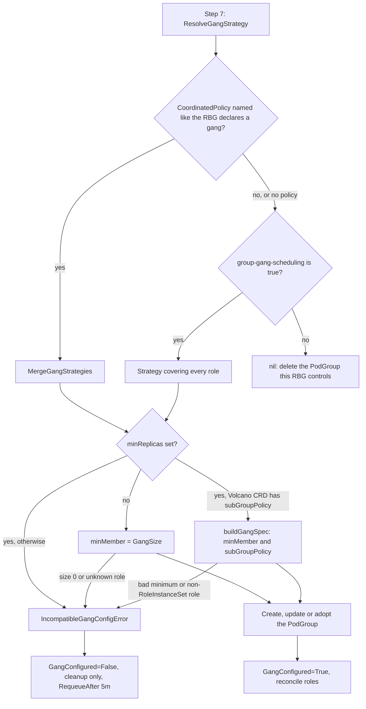

# Scheduling and networking

> Last verified against `main` at `1fc69f70`. Pointers name files and symbols, not line
> numbers; if a symbol moved, search for it and update this page.

How RBG decides where Pods land and how they find each other: gang scheduling, in-place
scheduling, exclusive topology, the port allocator and service discovery. Each section names the
caller in the RoleBasedGroup, RoleInstanceSet or RoleInstance path, what it writes, and its knobs.

## Where the code lives

| Path | Responsibility |
|---|---|
| `pkg/scheduler/gang_scheduler.go` | `GangScheduler` interface, `NewGangScheduler`, `SchedulerPluginType` (`volcano`, `scheduler-plugins`) |
| `pkg/scheduler/common/gang_strategy.go`, `pkg/scheduler/common/gang_error.go`, `pkg/scheduler/common/annotation_inheritance.go` | `ResolveGangStrategy`, `MergeGangStrategies`, `GangSize`, `GangMinimumReplicas`, `RoleInGang`; `IncompatibleGangConfigError`; `InheritPodGroupAnnotations` |
| `pkg/scheduler/volcano/scheduler.go`, `pkg/scheduler/k8s-scheduler-plugin/scheduler.go` | Volcano PodGroup (`buildGangSpec`, `supportsSubGroupPolicy`); scheduler-plugins PodGroup (`getScheduleTimeoutSeconds`) |
| `api/workloads/v1alpha2/coordinatedpolicy_types.go`, `api/workloads/v1alpha2/coordinatedpolicy_validation.go`, `api/workloads/v1alpha2/coordinatedpolicy_admission.go` | `GangSchedulingStrategy` (`minReplicas`), `ValidateCoordinatedPolicyGang`, `CoordinatedPolicyValidator` |
| `api/workloads/v1alpha2/helper.go` | `ComputeSubGroupSize`, `GetServiceName`, `GetWorkloadName`, `GetSharedServiceSelection`, `GetExclusiveKey`, `GenGroupUniqueKey`, `GetCommonLabelsFromRole` |
| `api/workloads/constants/annotation.go`, `api/workloads/constants/label.go`, `api/workloads/constants/env.go` | Gang, exclusive-topology, in-place-scheduling and discovery-mode keys; `RBG_*` env names |
| `internal/controller/workloads/rolebasedgroup_controller.go` | Reconcile Steps 2, 3 and 7, `setGangConfiguredCondition`, `raiseScalingTargetsToGangMinimum`, `reconcileRefinedDiscoveryConfigMap`, binding eviction in `SetupWithManager` |
| `pkg/reconciler/pod_reconciler.go` | `PodReconciler.ConstructPodTemplateSpecApplyConfiguration`: discovery injection, `setExclusiveAffinities`, gang fields |
| `pkg/reconciler/roleinstanceset_reconciler.go` | `constructRoleInstanceSetApplyConfiguration`: gang flag, owner-UID label, `allocateRoleScopedPortAnnotations`, component `serviceName` |
| `pkg/reconciler/svc_reconciler.go`, `pkg/utils/service_utils.go` | `ServiceReconciler.reconcileHeadlessService`; `GetCompatibleHeadlessServiceName` |
| `pkg/discovery/injector.go`, `pkg/discovery/env_builder.go`, `pkg/discovery/config_builder.go`, `pkg/discovery/sidecar_builder.go` | `DefaultInjector`, `mergeEnvVars`; `EnvBuilder`; `ConfigBuilder`; `SidecarBuilder` (engine runtime containers) |
| `pkg/component-discovery/component_discovery.go` | `InjectComponentDiscovery`; the package's start and delete ordering is in [instance workloads](instance-workloads.md) |
| `pkg/port-allocator/port_allocator.go`, `pkg/port-allocator/random.go`, `pkg/port-allocator/type.go`, `pkg/port-allocator/parser.go`, `pkg/port-allocator/manager.go` | `PortAllocatorInterface`, `SetupPortAllocator`; `RandomAllocator`; `PortAllocatorConfig`; parsing; allocation and Pod injection |
| `pkg/reconciler/roleinstance/sync/node_binding.go`, `pkg/reconciler/roleinstance/sync/instance_scale.go` | `NodeBindingStore`, `RecordNodeBindings`, `InjectInPlaceScheduling`; `realControl.Scale` and `createPods` (per-Pod injection) |
| `cmd/rbgs/main.go`, `deploy/helm/rbgs/values.yaml` | Scheduler and port-allocator flags; Helm `controller.features.gangScheduling` and `controller.features.portAllocator` |

## Where each subsystem hooks in

Anything rendered into the pod template enters the RoleInstanceSet revision. Rule: see
[upgrade-compatibility.md](../../../.agents/skills/rbg-conventions/references/upgrade-compatibility.md).

| Subsystem | When | Caller | Writes | In pod template |
|---|---|---|---|---|
| PodGroup | RBG reconcile, Step 7 | `RoleBasedGroupReconciler.reconcilePodGroup` | PodGroup named after the RBG, `GangConfigured` condition | n/a |
| Gang pod fields | pod template rendering | `ConstructPodTemplateSpecApplyConfiguration` | `schedulerName`, PodGroup label or annotation | yes |
| RoleInstance gang flag | RoleInstanceSet rendering | `constructRoleInstanceSetApplyConfiguration` | `role-instance-gang-scheduling` RoleInstanceSet annotation | no |
| Exclusive topology | pod template rendering | `setExclusiveAffinities` | required pod affinity and anti-affinity, template annotation | yes |
| Discovery env, mount, sidecars | pod template rendering | `DefaultInjector` | env, volume, volume mounts, containers | yes |
| Discovery ConfigMap | RBG reconcile, Steps 2 and 3 | `ensureDiscoveryConfigMode`, `reconcileRefinedDiscoveryConfigMap` | mode annotation on the RBG, ConfigMap named after the RBG | mount only |
| Headless Service | after each RoleInstanceSet or StatefulSet apply | `ServiceReconciler.reconcileHeadlessService` | one Service per role | n/a |
| Role-scoped ports | RoleInstanceSet rendering | `allocateRoleScopedPortAnnotations` | RoleInstanceSet annotations | no |
| Pod-scoped ports | building a new RoleInstance | `AllocatePortsForInstance` | RoleInstance annotations | no |
| Node bindings | every RoleInstance sync | `realControl.Scale` | in-memory `NodeBindingStore` | no |
| Ports, component discovery, node affinity | RoleInstance Pod creation | `createPods` | the Pod only | no |

## Gang scheduling

Gang scheduling (KEP-430, #434) keeps one PodGroup per RoleBasedGroup and marks the Pods of the
roles it covers. Step 7 of `RoleBasedGroupReconciler.Reconcile` decides:



### How the gang strategy is resolved

1. `ResolveGangStrategy` reads the CoordinatedPolicy with the RBG's namespace and name.
   `MergeGangStrategies` unions every rule with `strategy.scheduling.gang`: a rule without
   `minReplicas` covers its `roles` all-or-nothing; a rule with `minReplicas` covers the keys its
   `roles` also lists. Overlapping minimums take the largest value; a role an all-or-nothing rule
   covers loses its minimum.
2. Without a gang rule, the legacy RBG annotation `rbg.workloads.x-k8s.io/group-gang-scheduling`
   set to `"true"` yields an empty `GangStrategy`, which covers every role.
3. Otherwise gang scheduling is off. A read error other than NotFound is returned, never treated
   as "no policy".

The result rides on the context, so `GetGangStrategy` in the pod and RoleInstanceSet reconcilers
sees the same value as the PodGroup. `preCheck` rejects RBG metadata setting both
`group-gang-scheduling` and `role-instance-gang-scheduling` to `"true"`.

### Choosing the gang implementation

- `--scheduler-name` (default `scheduler-plugins`) picks one implementation per process through
  `NewGangScheduler`; an unknown value stops the manager. It also sets
  `PerRoleGangMinimumsSupported` on the CoordinatedPolicy webhook, true only for `volcano`.
- `--scheduler-profile-name` (default empty) is used only by scheduler-plugins, as `schedulerName`.
- CRD presence does not pick the implementation. `SetupWithManager` watches each PodGroup CRD
  established at startup (`watchedWorkload`); with gang on, the chosen implementation checks its
  own CRD and fails with `scheduling plugin <crd> not ready` if it is missing.

| | Volcano | scheduler-plugins |
|---|---|---|
| PodGroup | `podgroups.scheduling.volcano.sh`, `v1beta1` | `podgroups.scheduling.x-k8s.io`, `v1alpha1` |
| Pod marker (covered roles) | annotation `scheduling.k8s.io/group-name: <rbg>` | labels `pod-group.scheduling.sigs.k8s.io/name` (Koordinator, ACK) and `scheduling.x-k8s.io/pod-group` (upstream), both `<rbg>` |
| `schedulerName` (every role) | always `volcano` | the profile name, only when the flag is set |
| Spec fields written | `minMember`, `queue`, `priorityClassName`, `subGroupPolicy` | `minMember`, `scheduleTimeoutSeconds` |
| RBG annotations read | `group-gang-scheduling-volcano-queue`, `group-gang-scheduling-volcano-priority`, `volcano.sh/*` | `group-gang-scheduling-timeout` (default 60), `scheduling.x-k8s.io/*` |
| Per-role `minReplicas` | yes, if the served `v1beta1` schema has `subGroupPolicy` (Volcano 1.14 or later; probe result cached 5 minutes) | no |

### minMember calculation

- `ComputeSubGroupSize` is the Pod count of one replica: 1 for standalonePattern, `max(size, 1)`
  for leaderWorkerPattern, and for customComponentsPattern the sum of component sizes (omitted
  counts 1, negative counts 0, no floor).
- All-or-nothing: `GangSize` sums `ComputeSubGroupSize(role) * replicas` over the covered roles.
- Per-role (Volcano only): `buildGangSpec` emits one `subGroupPolicy` entry for each covered role
  whose effective minimum is above zero (a covered role scaled to zero is skipped), and returns an
  incompatible-configuration error for a covered role whose Pods don't carry the
  `role-instance-name` label (`emitsRoleInstanceLabel`). Each entry has:
  `subGroupSize` from `ComputeSubGroupSize`, `minSubGroups` = the minimum (or the replicas of an
  all-or-nothing role), a `labelSelector` on `group-name` and `role-name`, and `matchLabelKeys` on
  `role-instance-name`, so a subGroup is one RoleInstance. `minMember` sums their products.
- Neither implementation sets `minResources`.

### Gang fields in pod templates

`InjectPodSchedulingFields` runs inside `ConstructPodTemplateSpecApplyConfiguration` for every
workload type and pattern. With gang on, the Volcano implementation sets `schedulerName` on every
role so one scheduler places the group, while the scheduler-plugins implementation sets it only when
`--scheduler-profile-name` is configured; both add the PodGroup marker only where `RoleInGang` is true.
`constructRoleInstanceSetApplyConfiguration` also sets `role-instance-gang-scheduling: "true"` on
each covered role's RoleInstanceSet unless the role sets it. RoleInstances copy it; the
RoleInstance controller then fails Pod creation on a name collision instead of creating the
siblings, and recreates all of an instance's Pods when one cannot be updated in place
(`isGangSchedulingEnabled` in `pkg/reconciler/roleinstance/sync/instance_scale.go`).

### PodGroup lifecycle

- **Create**: typed `Create` with the RBG's name and a controller ownerReference, so it is
  garbage-collected with the RBG. Prefixed RBG annotations are copied at create only.
- **Update**: an orphan or a drifted written field triggers `RetryOnConflict` with a re-read,
  adoption of an orphan, and `Update`. A PodGroup controlled by another UID is an error. Rule: see
  [controller-patterns.md](../../../.agents/skills/rbg-conventions/references/controller-patterns.md).
- **Delete**: with gang off, `deletePodGroup` deletes only a PodGroup the RBG controls, and only
  if its CRD is in `watchedWorkload`. CoordinatedPolicy generation changes re-enqueue the RBG.

### Unsatisfiable gang configurations

`IncompatibleGangConfigError` marks what only a user or operator can fix: minimums all scoped out
of their rules, covered roles that do not exist or are all at 0 replicas, a minimum below 1 or
above the role's replicas, a minimum on a role not backed by a RoleInstanceSet
(`emitsRoleInstanceLabel`), a Volcano CRD without `subGroupPolicy`, or any minimum under
scheduler-plugins. The controller sets `GangConfigured=False` (reason `IncompatibleGangConfig`),
emits the event only on condition changes, runs cleanup, skips `reconcileRoles`, and returns
`RequeueAfter: incompatibleGangConfigRequeue` (5 minutes). Other errors emit
`FailedReconcilePodGroup` and return. See [RoleBasedGroup controller](rbg-controller.md).

At admission, `ValidateCoordinatedPolicyGang` checks only rules with `minReplicas`: Volcano as the
scheduler, keys listed in the rule's `roles`, values of at least 1. Role existence and
`minReplicas <= replicas` are checked at reconcile. After the gang step,
`raiseScalingTargetsToGangMinimum` lifts CoordinatedPolicy scaling targets below
`GangMinimumReplicas`, so `maxSkew` pacing cannot starve the gang.

## In-place scheduling

In-place scheduling (KEP-351, #368) steers a recreated Pod back to a node that ran it or its
component. It applies only to RoleInstanceSet roles, when the RoleInstance controller creates Pods.

| Role annotation | Constant | Values |
|---|---|---|
| `rbg.workloads.x-k8s.io/role-inplace-scheduling` | `RoleInplaceSchedulingAnnotationKey` | `Preferred` or `Required`; others are logged and ignored |
| `rbg.workloads.x-k8s.io/role-inplace-scheduling-granularity` | `RoleInplaceSchedulingGranularityAnnotationKey` | `Pod` or `Component`; unset means `Pod` for a RoleInstance with `role-instance-index` (stateful), else `Component` |
| `rbg.workloads.x-k8s.io/role-inplace-scheduling-avoid` | `RoleInplaceSchedulingAvoidAnnotationKey` | comma-separated node label keys, each a required `DoesNotExist` expression |

- **Propagation**: role annotations reach the RoleInstanceSet through `GetCommonAnnotationsFromRole`
  and RoleInstances through the copy lists in `newVersionedInstance` (stateful) and
  `GenInstanceFromTemplate` (stateless). With the mode annotation set,
  `constructRoleInstanceSetApplyConfiguration` adds label `rbg.workloads.x-k8s.io/rbg-owner-uid`
  (the RBG UID), which RoleInstances copy at creation.
- **Recording**: `realControl.Scale` calls `RecordNodeBindings`, which stores the node of every
  Running and Ready Pod under `{rbgUID}/{podName}` or `{rbgUID}/{role}-{component}`.
- **Injection**: `createPods` calls `InjectInPlaceScheduling` last. It skips Pods carrying the
  `group-exclusive-topology` annotation and Pods whose binding key cannot be built, for example
  without the owner-UID label. `Preferred` adds a weight-100 preferred term
  `kubernetes.io/hostname In <nodes>`; `Required` makes it a requirement. Required and avoid
  expressions are ANDed into every existing required node selector term, or a new one
  (`foldIntoRequired`). Without a binding only the avoid expressions are added.
- **Storage**: one in-memory store (`NewNodeBindingStore` in `cmd/rbgs/main.go`) shared by the RBG
  and RoleInstance reconcilers. A delete handler in `RoleBasedGroupReconciler.SetupWithManager`
  calls `EvictByUID`, since only the delete event carries the UID.

KEP-351 keeps bindings until a restart, replaces rather than folds `Required` terms, and has no
avoid annotation; the code differs on all three. Persisting bindings is a KEP alternative, not
implemented on main.

## Exclusive topology

The RBG annotation `rbg.workloads.x-k8s.io/group-exclusive-topology` (`GetExclusiveKey`) makes
`ConstructPodTemplateSpecApplyConfiguration` call `setExclusiveAffinities` for every role, workload
type and pattern, except templates whose annotations (for a customComponentsPattern component,
merged with its `annotations`) carry `rbg.workloads.x-k8s.io/role-disable-exclusive` with any
non-empty value. It appends, both with the annotation's topology key:

- a required pod affinity term `rbg.workloads.x-k8s.io/group-unique-hash In [GenGroupUniqueKey()]`
- a required pod anti-affinity term: that key `Exists` and `NotIn [GenGroupUniqueKey()]`

`GenGroupUniqueKey` is the SHA-1 of `namespace/name`. The template also gets the
`group-exclusive-topology` annotation, which in-place scheduling checks. `exclusiveAffinityApplied`
skips injection when the template already has a required affinity and a required anti-affinity
term with that topology key, whatever their selectors. A RoleBasedGroupSet passes the annotation
down through its group template; see [other controllers](other-controllers.md).

## Port allocator

The port allocator (KEP-171, #210, #250, #532) assigns ports from a range, mainly for
`hostNetwork` Pods that would collide on a node. It runs in the controllers; no webhook is involved.
It is configured by `--enable-port-allocator` (default `false`), `--port-allocate-strategy`
(`random`), `--start-port` (`30000`) and `--port-range` (`5000`), or the matching Helm values
under `controller.features.portAllocator`.

`SetupPortAllocator` configures a process-wide singleton; an unknown strategy stops the manager.
`PortAllocatorInterface` has `Start`, `Release` and `AllocateBatch`; the package-level
`AllocateBatch` and `Release` return `ErrPortAllocatorDisabled` while disabled. The only strategy,
`RandomAllocator`, keeps no state: values are unique only within one `AllocateBatch` call, and
`Start` and `Release` do nothing. No controller code calls `Release`.

### Port allocator configuration and storage

The JSON annotation `rolebasedgroup.workloads.x-k8s.io/port-allocator` (`PortAllocatorAnnotationKey`)
goes on a pod template or a customComponentsPattern component. `allocations[]` entries need `name`
and `env`, and take `scope` (default `PodScoped`), `protocol` (default `TCP`) and `annotationKey`;
`references[]` entries need `env` and `from` (`<role>.<component>.<port>`).

| Scope | Allocated by | Key | Stored on |
|---|---|---|---|
| `RoleScoped` | `allocateRoleScopedPortAnnotations`, when enabled and only while the RoleInstanceSet does not exist; later reconciles copy the existing keys | `<component>.<port>` | RoleInstanceSet, copied into each new RoleInstance |
| `PodScoped` | `AllocatePortsForInstance` when `newVersionedInstance` or `injectNewVersionedInstances` builds a RoleInstance, one per Pod | `<pod-name>.<port>` | RoleInstance |

### Port injection at Pod creation

`createPods` calls `InjectPortsIntoPod` for each annotated component: per allocation it reads the
key from the RoleInstance annotations, checks the value is 1 to 65535, declares it with
`injectContainerPort`, sets the env variable in all containers and init containers, and writes
`annotationKey`. `injectContainerPort` reuses an existing declaration of the same port and
protocol, else appends to the first regular container; only `hostNetwork` Pods get a matching
`hostPort`, which the NodePorts scheduler plugin accounts for (#532). A reference resolves inside
the same RoleInstance: the role segment of `from` is ignored, and the value is the `PodScoped` key
of Pod 0 of the referenced component (`GetReferencePodName`).

Pod creation fails for a Pod without regular containers, a conflicting host port, a malformed
value, or a missing key (`port not found for allocation`). `InjectPortsIntoPod` injects nothing
when the RoleInstance has no annotations, and `AllocatePortsForInstance` swallows allocation
errors, `ErrPortAllocatorDisabled` included.

## Service discovery and configuration injection

### Headless Service per role

`ServiceReconciler.reconcileHeadlessService` runs after the workload in
`RoleInstanceSetReconciler.Reconciler` and `StatefulSetReconciler.Reconciler`; RBG creates no
Service for Deployment or LeaderWorkerSet roles. There is one headless Service per role: no
ClusterIP Service and no separate leader-only Service.

- **Name**: `GetCompatibleHeadlessServiceName` keeps an existing Service named after
  `GetWorkloadName` (`<rbg>-<role>`); otherwise `GetServiceName` gives `s-<rbg>-<role>`, cut to
  63 characters with trailing hyphens trimmed.
- **Spec**: `clusterIP: None`, `publishNotReadyAddresses: true`, no ports; selector `group-name`
  and `role-name`, plus `component-name: leader` under `LeaderOnly`.
- **Metadata**: `GetCommonLabelsFromRole` labels, which keep it visible to the `cacheOptions`
  filter (rule: see [controller-patterns.md](../../../.agents/skills/rbg-conventions/references/controller-patterns.md));
  an ownerReference to the workload with `blockOwnerDeletion` and no `controller` flag.
- **Write**: an in-place SSA patch when `semanticallyEqualService` (filtered metadata and selector)
  differs, so a selector change keeps the Service UID.
- **Pod identity**: `setComponentPodIdentity` (`pkg/reconciler/roleinstance/core/instance_core.go`)
  sets `hostname` to the Pod name and `subdomain` to the component's `serviceName`, when set. The
  RoleInstanceSet reconciler sets `serviceName` on the standalone component, the leader, the
  worker only under `All`, and each custom component (its own `serviceName`, for which no Service
  is created, or the shared one). Changing it rolls the role and replaces Pods, because `hostname`
  and `subdomain` are immutable.

`GetSharedServiceSelection` (KEP-260, #273, #418) returns `All` for roles without
leaderWorkerPattern or not on RoleInstanceSet, else the stored `sharedServiceSelection`, else
`LeaderOnly`. A CEL rule on RoleSpec rejects an explicit `LeaderOnly` for other workload types.
Reading unset as `LeaderOnly` is a recorded upgrade migration; see
[upgrade-compatibility.md](../../../.agents/skills/rbg-conventions/references/upgrade-compatibility.md).

### Discovery ConfigMap

- **Mode** (Step 2): `ensureDiscoveryConfigMode` merge-patches
  `rbg.workloads.x-k8s.io/discovery-config-mode` once: `legacy` if the RBG already has status
  (`observedGeneration` or `roleStatuses`) or a `<rbg>-<role>` ConfigMap exists, else `refine`.
- **Write** (Step 3): in `refine` mode, if `HasStatefulRole`, `reconcileRefinedDiscoveryConfigMap`
  applies ConfigMap `<rbg>` (key `config.yaml`, controller ownerReference) on every reconcile
  without a pre-compare. `ConfigBuilder.Build` sees only stateful roles. `legacy` writes nothing.
- **Mount**: `InjectConfig` mounts ConfigMap `<rbg>` (volume `rbg-cluster-config`, not optional)
  read-only at `/etc/rbg` in the regular containers of stateful roles (`IsStatefulRole`), in either
  mode. It runs before engine runtime profile containers are appended, so those containers don't get
  the mount.

`config.yaml` holds `group` (`name`, `size` = stateful role count, `roles`) and, per role, `size`
(address count) and `instances[]` with `address` and `ports`. `buildInstances` writes one address
per Pod (#471): `<workload>-<i>` for standalonePattern, `<workload>-<i>-0` and `<workload>-<i>-<k>`
for leaderWorkerPattern on RoleInstanceSet, global ordinals for LeaderWorkerSet roles, and
`<workload>-<i>-<component>-<j>` with a component's own `serviceName` when set. `memberOrdinals`
follows the RoleInstanceSet's committed ordinals when excluded ordinals apply (#538). Port keys
come from `spec.roles[].servicePorts`, lower-cased with `-` turned into `_`, or `port<N>`.
KEP-133's single RBG-level ConfigMap is implemented; its compact `replicas`, `size`, `excludes`
format is proposed in KEP-133 and not implemented on main.

### Injected environment variables

`InjectEnv` and `InjectLeaderWorkerSetEnv` merge into regular containers with `mergeEnvVars`
(rule: see [controller-patterns.md](../../../.agents/skills/rbg-conventions/references/controller-patterns.md)).
No variable carries a replica count, so scaling leaves templates alone. The default injectors are
config, sidecar and common env; RoleInstanceSet leaderWorkerPattern templates add the LWP env and
worker templates drop sidecars (`SetInjectors`). Sidecars come from ClusterEngineRuntimeProfiles;
see [other controllers](other-controllers.md).

| Variable | Constant | Value | Injected for |
|---|---|---|---|
| `RBG_GROUP_NAME` | `EnvRBGGroupName` | RBG name | every role (`InjectEnv`) |
| `RBG_ROLE_NAME` | `EnvRBGRoleName` | role name | every role (`InjectEnv`) |
| `RBG_ROLE_INDEX` | `EnvRBGRoleIndex` | Downward API `role-instance-index`; `apps.kubernetes.io/pod-index` for StatefulSet and LeaderWorkerSet | stateful roles (`InjectEnv`) |
| `RBG_ROLE_INSTANCE_NAME` | `EnvRBGRoleInstanceName` | Downward API `role-instance-name` | RoleInstanceSet roles (`InjectEnv`) |
| `RBG_COMPONENT_NAME` | `EnvRBGComponentName` | Downward API `component-name` | RoleInstanceSet roles (`InjectEnv`) |
| `RBG_COMPONENT_INDEX` | `EnvRBGComponentIndex` | Downward API `component-id` | RoleInstanceSet roles (`InjectEnv`) |
| `RBG_LWP_LEADER_ADDRESS` | `EnvRBGLeaderAddress` | `$(RBG_ROLE_INSTANCE_NAME)-0.<service>.<namespace>` | leaderWorkerPattern on RoleInstanceSet (`InjectLeaderWorkerSetEnv`) |
| `RBG_LWP_WORKER_INDEX` | `EnvRBGIndex` | Downward API `component-index` (leader 0) | same |
| `RBG_LWP_GROUP_SIZE` | `EnvRBGSize` | Downward API `component-size` | same |
| allocator `env` names | `PortAllocation.Env`, `PortReference.Env` | allocated port | annotated components, at Pod creation |
| component-discovery `env` names | `ComponentAddressRef.Env`, `ComponentPortRef.Env` | FQDN or port | annotated components, at Pod creation |

### Component discovery

The JSON annotation `rolebasedgroup.workloads.x-k8s.io/component-discovery` (KEP-173) on a
customComponentsPattern component lists `addressRefs` and `portRefs`. `createPods` calls
`InjectComponentDiscovery`: it builds `<instance>-<component>-<index>.<serviceName>.<namespace>.svc.cluster.local`
(fixed cluster domain), resolves ports from the `PodScoped`, then the `RoleScoped` key
(`resolvePortRef`), sets the variables in all containers and init containers, removes the
annotation from the Pod, and fails Pod creation on an unknown component or port. So address shapes
differ: `<pod>.<service>` in the ConfigMap, `<pod>.<service>.<namespace>` in
`RBG_LWP_LEADER_ADDRESS`, and a full FQDN here.

KEP-275 (`networkConfig.subdomainPolicy`, one headless Service per RoleInstance) is proposed in
KEP-275 and not implemented on main; the API has no such field.

## Behaviors worth knowing

- Turning gang scheduling on or off, or changing the covered roles, re-renders pod templates
  (`schedulerName` everywhere, markers on covered roles), so those roles get a new RoleInstanceSet
  revision (`pkg/reconciler/pod_reconciler.go`, `ConstructPodTemplateSpecApplyConfiguration`).
  Rule: see [upgrade-compatibility.md](../../../.agents/skills/rbg-conventions/references/upgrade-compatibility.md).
- Scaling every covered role to 0 gives `minMember` 0, an `IncompatibleGangConfigError`, so the
  RBG's roles are not reconciled and the scale-down is not applied (`pkg/scheduler/common/gang_strategy.go`, `GangSize`).
- Changing only RBG annotations (gang, timeout, queue, priority, exclusive topology) does not
  enqueue the RBG (`internal/controller/workloads/rolebasedgroup_controller.go`, `RBGPredicate`).
  Rule: see [controller-patterns.md](../../../.agents/skills/rbg-conventions/references/controller-patterns.md).
- For a PodGroup CRD installed after startup, `ReconcilePodGroup` calls `runtimeController.Owns`
  on an already built controller, so PodGroups stay unwatched until a restart
  (`pkg/scheduler/volcano/scheduler.go`, `GangScheduler.ReconcilePodGroup`).
- A PodGroup with the RBG's name controlled by another UID fails Step 7 on every retry, so the
  RBG's roles are not reconciled (`pkg/scheduler/volcano/scheduler.go`, `createOrUpdate`).
- `CoordinatedPolicyValidator.ValidateUpdate` validates the whole new object: after a switch away
  from `--scheduler-name=volcano`, any update of a policy that keeps `minReplicas` is rejected,
  label-only ones too (`api/workloads/v1alpha2/coordinatedpolicy_admission.go`). Rule: see
  [api-and-admission.md](../../../.agents/skills/rbg-conventions/references/api-and-admission.md).
- Exclusive-topology terms select `rbg.workloads.x-k8s.io/group-unique-hash`, but Pods carry the
  group hash as `rbg.workloads.x-k8s.io/group-uid` (`GetCommonLabelsFromRole`), and nothing on main
  sets `group-unique-hash`. The e2e case only inspects the injected affinity, so check that Pods
  schedule before relying on it (`pkg/reconciler/pod_reconciler.go`, `setExclusiveAffinities`).
- Node bindings are lost on restart and refill only from Running and Ready Pods; component-level
  node sets only grow until the RBG is deleted (`pkg/reconciler/roleinstance/sync/node_binding.go`, `NodeBindingStore`).
- The port-allocator and component-discovery annotations use the `rolebasedgroup.workloads.x-k8s.io/`
  prefix, not `rbg.workloads.x-k8s.io/` (`pkg/port-allocator/manager.go`, `PortAllocatorAnnotationKey`).
- A `RoleScoped` allocation or component added to an existing role never gets a value, because
  only keys the RoleInstanceSet already has are copied (`pkg/reconciler/roleinstanceset_reconciler.go`).
- Random ports can collide between Pods (`pkg/port-allocator/random.go`, `RandomAllocator`). #532
  sets `hostPort` only on `hostNetwork` Pods, because default-on host ports could leave Pods
  Pending. Rule: see [upgrade-compatibility.md](../../../.agents/skills/rbg-conventions/references/upgrade-compatibility.md).
- Under `LeaderOnly`, the default for leaderWorkerPattern on RoleInstanceSet, worker addresses are
  in the ConfigMap but have no DNS record (`pkg/discovery/config_builder.go`, `buildInstances`).
- `spec.roles[].servicePorts` feed only the ConfigMap; the headless Service has no ports
  (`pkg/reconciler/svc_reconciler.go`, `constructServiceApplyConfiguration`).
- Service events never enqueue the RBG: the Service's owner is the workload, without the
  `controller` flag, and `Owns` maps only RBG controller owners (`internal/controller/workloads/rolebasedgroup_controller.go`, `SetupWithManager`).
- In `legacy` discovery mode no ConfigMap is written, yet stateful Pods still mount ConfigMap
  `<rbg>` (`pkg/discovery/injector.go`, `InjectConfig`).

## Tests

| Area | Unit | envtest | e2e |
|---|---|---|---|
| Gang scheduling | tests under `pkg/scheduler/`; `TestReconcileIncompatibleGangConfig` and `TestRaiseScalingTargetsToGangMinimum` in `internal/controller/workloads/rolebasedgroup_controller_test.go`; `api/workloads/v1alpha2/coordinatedpolicy_validation_test.go` | none | `test/e2e/testcase/v1alpha2/gang_scheduling.go`, labels `volcano` and `scheduler-plugins` |
| In-place scheduling | `pkg/reconciler/roleinstance/sync/node_binding_test.go` | none | `test/e2e/testcase/v1alpha2/inplace_scheduling.go`, labels `scheduler` and `serial` |
| Exclusive topology | `Test_setExclusiveAffinities`, `Test_exclusiveAffinityApplied` in `pkg/reconciler/pod_reconciler_test.go` | none | "rbg with exclusive-topology" in `test/e2e/testcase/v1alpha2/rbg.go` |
| Port allocator | tests under `pkg/port-allocator/`, host ports in `pkg/port-allocator/injection_test.go` | none | `test/e2e/testcase/v1alpha2/port_allocator.go`, label `feature` |
| Services | `pkg/reconciler/svc_reconciler_test.go`; `TestRoleSpec_GetSharedServiceSelection` in `api/workloads/v1alpha2/helper_test.go` | `test/envtest/testcase/rbg/shared_service_selection_test.go` | `test/e2e/testcase/v1alpha2/shared_service_selection.go`, label `feature` |
| Discovery | tests under `pkg/discovery/`; `pkg/component-discovery/component_discovery_test.go`; `internal/controller/workloads/discovery_config_mode_test.go` | none | `test/e2e/testcase/v1alpha2/discovery_configmap.go`, label `feature` |

`make test-e2e` defaults to `E2E_LABEL_FILTER ?= !volcano && !scheduler-plugins`. CI runs each
gang backend in its own Kind cluster (jobs `e2e-volcano-gang` and `e2e-scheduler-plugins-gang` in
`.github/workflows/e2e-test.yml`); `.github/actions/setup-e2e-cluster/action.yaml` enables the port
allocator for e2e.

```shell
go test ./pkg/scheduler/... ./pkg/port-allocator/... ./pkg/discovery/... ./pkg/component-discovery/...
go test ./pkg/reconciler/roleinstance/sync/ -run 'NodeBinding|BuildKey|ResolveGranularity|InjectInPlaceScheduling'
go test ./pkg/reconciler/ -run 'TestServiceReconciler|Test_setExclusiveAffinities|Test_exclusiveAffinityApplied'
go test ./internal/controller/workloads/ -run 'Gang|DiscoveryConfig'
go test ./api/workloads/v1alpha2/ -run 'CoordinatedPolicy|GetSharedServiceSelection|ComputeSubGroupSize'
make test-e2e E2E_LABEL_FILTER='volcano'  # cluster with Volcano and --scheduler-name=volcano
```

## Related

- KEPs: [KEP-430 gang scheduling](../../../keps/430-gang-scheduling/README.md), [KEP-351 in-place scheduling](../../../keps/351-inplace-scheduling/kep-inplace-scheduling.md),
  [KEP-171 port allocation](../../../keps/171-pod-port-allocation/README.md), [KEP-173 custom components](../../../keps/173-enhanced-custom-components-pattern/README.md),
  [KEP-133 ConfigMap refine](../../../keps/133-configmap-refine/README.md), [KEP-260 leader-only Service](../../../keps/260-leaderonly-service/README.md),
  [KEP-275 per-replica Services](../../../keps/275-enhance-network/README.md)
- User docs: [gang scheduling](../../features/gang-scheduling.md), [exclusive topology](../../features/exclusive-topology.md),
  [coordinated policy](../../features/coordinated-policy.md), [labels, annotations and variables](../../reference/variables.md),
  [port allocation and service discovery](../../best-practice/en/05-port-allocation-and-service-discovery.md),
  [in-place update and scheduling](../../best-practice/en/04-configuring-inplace-update-and-scheduling-policies.md)
- Rules: [upgrade-compatibility.md](../../../.agents/skills/rbg-conventions/references/upgrade-compatibility.md),
  [controller-patterns.md](../../../.agents/skills/rbg-conventions/references/controller-patterns.md),
  [api-and-admission.md](../../../.agents/skills/rbg-conventions/references/api-and-admission.md)
- Sibling pages: [RoleBasedGroup controller](rbg-controller.md), [instance workloads](instance-workloads.md),
  [controller manager](controller-manager.md), [other controllers](other-controllers.md), [API layer](api-layer.md),
  [testing](testing.md)
