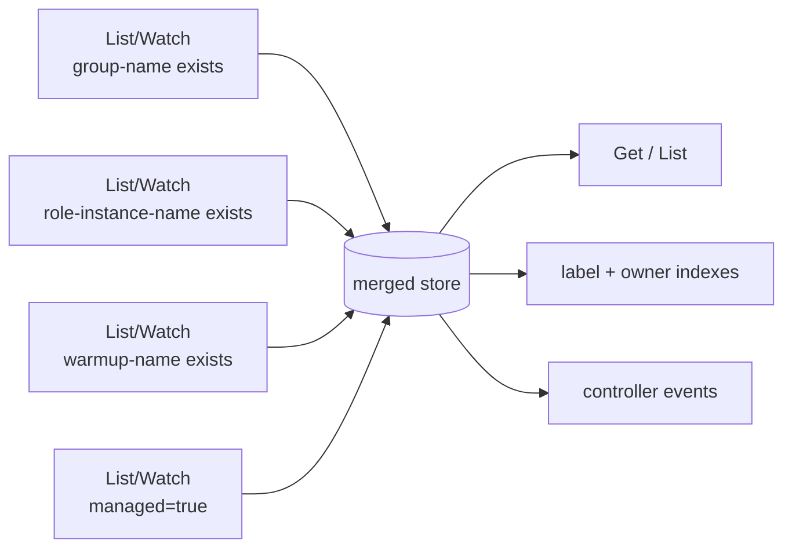
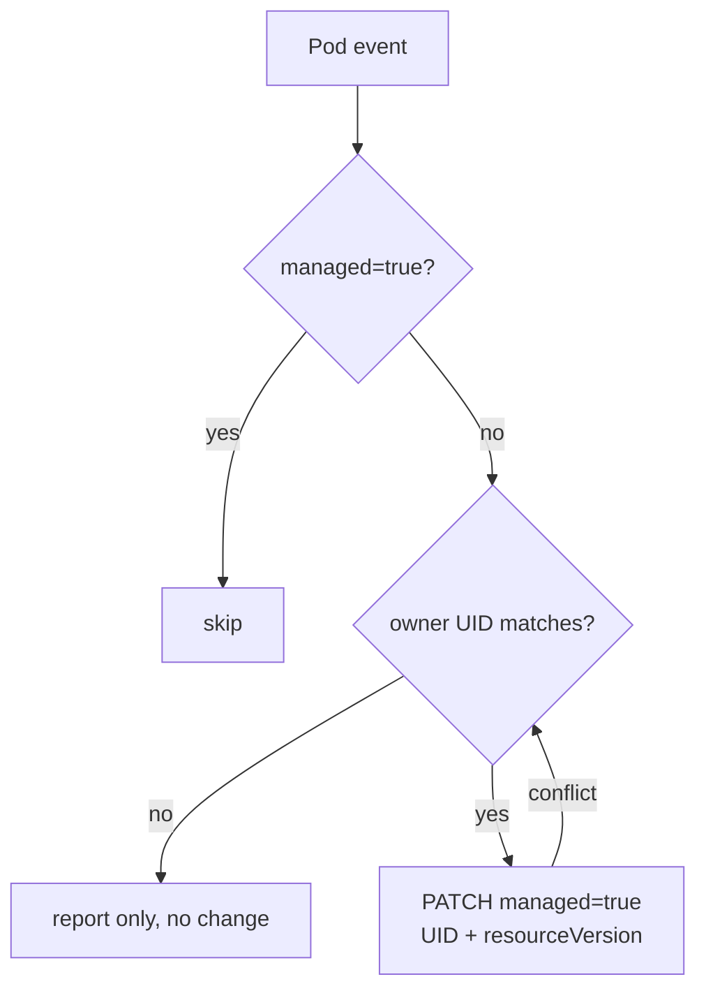

# KEP-284: Pod Cache Filtering: Legacy Label Union and Asynchronous Backfill

Status: **Provisional**. The validation results do not mean the maintainers approved
it or that the implementation is ready for release.

English is the normative version · Issue: sgl-project/rbg#284

## Summary

The difficulty is really about compatibility: in the long run we want one unified marker for
whether a Pod is managed by the RBG controller, but we have to deal with existing Pods that carry
no such label. That requires backfill, and the backfill should be as invisible as possible without
affecting the business.

Cache only the **union of the three existing labels and `rbg.workloads.x-k8s.io/managed=true`**.
Existing supported Pods stay visible before backfill; new creation paths set managed, and the
leader labels eligible Pods asynchronously in the background.

When fetching the four cache sources to take their union, fetch them serially to prevent a high
peak inside the Go process; serial performance is within an acceptable range.

This change fixes the operator's overly broad cache scope. **At this point this proposal adds no
enablement parameter, Helm toggle, or full-cache fallback branch.**

## Background

In a shared cluster, caching unrelated Pods' spec and status wastes memory, which can look like
an OOM on a large cluster while a small cluster is fine. RBG workloads, standalone RoleInstances,
and Warmup currently use three different labels, and none of them is a unified marker for whether a
Pod is managed by RBG; the change has to keep their union for compatibility, and managed provides
one marker for future creation paths. The three keys coexist because each resource family
introduced its own label; the next resource family should not have to change the cache again just
to be visible.

### Goals

- Stop retaining `spec` and `status` of unrelated Pods; retained cost should scale with admitted
  Pods, not with every Pod in the cluster.
- Existing supported Pods, creation paths, and templates keep working without a coordinated
  upgrade, backfill, or rolling update.
- Cached `Get`, `List`, field/label indexes, no-DeepCopy reads, and controller events share one
  deduplicated view, so filtering cannot produce inconsistent cached reads.
- The admission rule is auditable: a supported creation path that produces an inadmissible Pod is
  a detectable defect, not a silent visibility gap.
- Bound the runtime cost this change introduces: watch count, boundary reads, and backfill writes
  all have limits, measurements, and reporting.

### Non-Goals

- Changing ownership or adoption rules; an admission label does not grant permission to adopt a Pod.
- Migrating the v1alpha1 API or historical label schemes; retiring the old label watches is a
  separate migration, not part of this proposal.
- Rolling workloads in order to add labels or fix templates.

## Proposal

### Admission Rule

A Pod enters the cache when **any one** of the four conditions holds:

| Label key | Condition | Pod category |
| --- | --- | --- |
| `rbg.workloads.x-k8s.io/group-name` | key exists | RBG business Pods, including supported native workloads |
| `rbg.workloads.x-k8s.io/role-instance-name` | key exists | RoleInstance Pods, including standalone instances |
| `workloads.x-k8s.io/warmup-name` | key exists | Warmup execution Pods |
| `rbg.workloads.x-k8s.io/managed` | value is the string `true` | common marker for supported creation paths |

A Pod with legacy labels but `managed=false` is still admitted. When none of the four conditions
holds, the Pod does not enter the cache, and the background job cannot find it either. Labels only
decide cache admission; they do not imply ownership or a right to adopt.

### Cache Implementation

Kubernetes label selectors do not support OR across these different keys, so the operator runs
four server-side filtered List/Watch streams and merges them into one cache. Each item below is
there to make this cache indistinguishable from a full Pod cache except for what it retains.

1. **Every cached read path shares one view.** Cached `Get`, `List`, label and owner indexes,
   no-DeepCopy reads, and controller events all use the same deduplicated view, so one cached path
   cannot find a Pod that another misses. Named existence and ownership checks, including
   `getExistingPod`, must confirm a cache miss with a rate-limited named APIReader GET: a cache
   `NotFound` is not proof that the Pod is absent. Propagate API errors instead of treating them as
   absence, preserve the existing ownership checks, and do not insert out-of-scope results into the
   union cache.
2. **The four Lists are fetched one at a time.** Finish one source, merge its Pods into the store,
   drop the response, then fetch the next. Only one response is alive at any moment, so startup
   memory is "the store plus one list", and startup time is the sum of the four. Across four
   related/unrelated ratios, concurrent fetching produced a clearly higher startup peak, the more
   so the larger the related share; that is why the formal design fetches serially.
3. **Reconciliation starts only after all four sources are synced.** If one source fails to sync,
   readiness stays false; the runtime does not degrade to a full List — that would hide the failure
   and silently change what the operator retains.
4. **Merge instead of overwrite.** The same Pod can arrive from several sources. Keep only one
   canonical object per namespace/name, and accept an update only when the event's resourceVersion
   is greater than the stored one. Deletion does not remove the record; it leaves a "deletion
   watermark" (the name, no object, and the resourceVersion at deletion) so that older events
   cannot resurrect it. UID records which incarnation each source currently holds, which
   distinguishes a "same-name rebuild" from the object that was deleted. This ordering relies on
   Pod resourceVersions being numeric and monotonic within a single cluster: the implementation
   rejects non-numeric values outright instead of silently misordering; a re-list after a watch
   failure resets that source's state.
5. **A filtered DELETE does not mean the Pod is deleted.** It usually only means the Pod no longer
   matches one selector. Confirm with a rate-limited named GET; remove it only when no source still
   admits it; on an API error keep the last known state and do not treat the error as NotFound.
   When absence is confirmed, the deletion barrier (tombstone) must not be older than any event
   already applied for that name: taking the resourceVersion of the DELETE that triggered the check
   can be too old, and a concurrent or delayed event would then put back a Pod that a named GET
   already reported missing. After a tombstone exists, a later event for the same name is admitted
   only after a named GET confirms the object exists, so a genuine re-creation still enters the
   cache.
6. **Recover per source, without widening scope.** Each source resumes from its own cursor;
   deletion watermarks are reclaimed only after all sources have moved past them; a retry after a
   failed List must not widen the query to unrelated Pods. Startup order sets the peak: only one
   source response is alive at a time. Tombstone reclamation must be bounded: set a maximum lag
   (time or RV gap) and a capacity budget, and when either is exceeded relist that source with its
   filter, or apply backpressure to backfill and reconciliation. An idle source must not be expected
   to self-heal through BOOKMARKs: the API guarantees neither their delivery nor their interval.

### Creation and Asynchronous Backfill

RoleInstance and Warmup set managed before creating a Pod directly; new Deployment, StatefulSet,
and LWS templates also carry the marker, covering both the LWS leader and worker templates. Keep
existing templates, markers, legacy labels, and selectors; do not trigger a template rolling
update for this cache fix.

The leader consumes the union cache's initial, add, and update events and skips already-marked
Pods. Before backfilling it checks the owner UID against the existing ownership rules and confirms
the workload is managed by the operator; unrelated or ambiguous candidates are only reported, not
modified. The patch only sets managed=true, with the API enforcing UID and optimistic concurrency.
On conflict, re-read and re-validate, rate-limit writes, retry with backoff, and make repeated runs
idempotent; do not mutate shared cache objects in place, and do not change other labels, spec,
ownership, or templates.

Old templates may keep producing unmarked Pods, so the background job can keep running.

Backfill failure or a leader switch does not affect the visibility of Pods with legacy labels, does
not add a business pending state, and does not pause, reset, or extend Warmup business timeouts.
When leader election is disabled, the existing single-active-controller deployment requirement
applies.

### Risks and Mitigations

| Risk | Mitigation |
| --- | --- |
| Overlap, out-of-order events, or a filtered DELETE corrupts the view | Unified indexes and events, UID/version checks, per-source cursors, boundary confirmation, and absence barriers no older than applied state |
| Multiple watches, ownership lookups, or backfill add API pressure | Limit concurrency, retries, queue length, and request rate; watch API traffic and reconciliation latency |
| All admission labels are removed, or a creation path omits the marker | Enforce the creation contract; log an error and emit an Event when a named read finds an uncached Pod; fix the creation path and add regression tests |
| Merge state and slow sources retain memory | Bound merge state and buffering; measure heap, RSS, startup peak, and state reclamation |
| The memory benefit on the target deployment is lower than expected | Publish the benefit's dependence on the unrelated share, and re-measure at the target ratio instead of citing a single synthetic sample |

## Design Details

### Test Plan

Earlier prototype measurements are recorded in [Measured Sample](#measured-sample); this section
only lists what still needs coverage before release.

#### Unit Tests

- Admission: each of the four conditions hit separately, overlaps, `managed=false`, and Pods
  outside all four conditions.
- Merge ordering: late updates across sources, UID replacement, deletion watermark, and exiting a
  selector without clearing the object.
- Bounded event feed and resnapshot; per-source serial initialization; per-source recovery cursor.

#### Integration Tests

- Four-source sync: when one source is blocked or returns Forbidden, readiness stays false and it
  never falls back to a full List.
- Unified view: `Get`, `List`, label selector, owner UID index, and no-DeepCopy reads return
  consistent results, and unrelated Pods do not appear.
- Ownership collision: a cached `Get` miss is confirmed with a named APIReader GET; an unlabeled
  same-name Pod is detected, the controller returns the conflict instead of Create→AlreadyExists,
  and the Pod is not admitted to the cache.
- Backfill: ownership check, UID/resourceVersion conflict, partial failure, idempotent repeats,
  and rate limiting, with the Pod visible throughout.
- Serial initialization: only one source response is alive at any moment, and a failed source does
  not commit partial state.
- Final List behavior: one full List per source, with initial and relist both following the same
  serial rule; measure the startup and recovery peaks and timing of that path.

#### e2e Tests

- Pods produced by RoleInstance, Deployment, StatefulSet, and LWS creation, replacement, and
  scaling are admitted on the first attempt and stay visible.
- Both LWS templates (leader and worker), and the real controller same-name conflict path that
  includes `getExistingPod`.
- Warmup actions and timeouts are unaffected before, during, and after backfill.
- Upgrading with existing labeled Pods, and rolling back to the previous operator image, neither
  loses Pod visibility nor interrupts running workloads.
- Leader switching with multiple replicas neither blocks backfill nor hides Pods.

Real ownership chains, rate and retry limits, merge-state bounds, and the full load matrix remain
implementation acceptance work.

### Graduation Criteria

#### Alpha

- The union cache is the operator's only Pod source; no code path still lists Pods without a filter,
  and the Pod read-path audit is recorded in the implementation PR.
- Cache-NotFound paths that create Pods (`getExistingPod` and any newly found site) use named API
  reads or handle `AlreadyExists` explicitly.
- Unit and integration tests from the test plan are in the repository; e2e covers the supported
  creators.
- Admission misses, per-source sync failures, and backfill outcomes are diagnosable from error logs
  and Events.
- Upgrade and rollback between the previous release and this one are tested with legacy-labeled
  Pods present.

#### Beta

- Ownership chains for every supported creator, including native workloads and Warmup, are
  implemented and tested in production code.
- Leader failover and multi-replica operation are exercised; backfill ownership checks hold under
  both.
- The supported Kubernetes and namespace matrix, including `DefaultNamespaces` and
  `WatchListClient`, is decided and covered.
- Boundary-read and backfill rate limits are justified by measurement; merge-state bounds and
  reclamation are verified under sustained churn.
- Published memory and API numbers cover the target unrelated-Pod ratio, and the break-even point
  is documented in the release notes.

#### GA

- One full release with the union cache enabled has no admission-miss incident and no rollback
  caused by Pod visibility.
- A rollback from a release with backfill enabled has been exercised at least once.
- The legacy-selector retirement plan, or the decision to keep four sources permanently, is
  documented and approved.

### Expected Impact

Retained memory is proportional to admitted Pods, so the upper bound of the benefit is set by the
unrelated-Pod share. The estimate needs one line: $M_{\mathrm{before}} \approx B + NS$ and
$M_{\mathrm{after}} \approx B + RS + C$, where $N$ is total Pods, $R$ admitted Pods, $S$ the
average retained cost per Pod, $B$ other retained heap, and $C$ the cost of source identities,
merge metadata, extra indexes, and queued versions. With no transform configured, the current
implementation shares immutable Pod objects between the merge records and the business index, so each
admitted Pod is retained once. There is a benefit only when the cost saved by filtering unrelated
Pods exceeds $C$; object counts alone cannot establish a fixed break-even ratio, and live heap and
process RSS must be evaluated separately.

#### Measured Sample

Local prototype on an isolated kube-apiserver v1.31.0 + etcd, macOS arm64, synthetic unscheduled
Pods (64 × 512-byte environment values each), three independent rounds per shape, each with a
fresh control plane, with the serial initialization and shared immutable Pod objects described
above. Each figure is a median; retained heap is measured after two GCs, and peak RSS and footprint
are sampled across the startup window (process start through sync plus two seconds). The full
method, per-run samples, and caveats are in [Performance measurements](performance.md).

| Related / unrelated Pods | Full cache retained heap | Union retained heap | Full cache startup RSS | Union startup RSS | Sync time (full / union) |
| --- | ---: | ---: | ---: | ---: | ---: |
| 48 / 1,000 | 46.91 MiB | 4.82 MiB | 165.08 MiB | 47.03 MiB | 101 / 301 ms |
| 900 / 100 | 45.01 MiB | 41.71 MiB | 159.81 MiB | 192.31 MiB | 101 / 701 ms |
| 1,000 / 0 | 45.02 MiB | 45.94 MiB | 159.92 MiB | 208.34 MiB | 101 / 701 ms |

At 95.4% unrelated Pods, retained heap falls about 10x and startup RSS about 70%; at 900 related /
100 unrelated Pods, retained heap is about 7% lower; with no unrelated Pods, retained heap is about
2% higher. Startup RSS is the transient peak while the store and one complete source snapshot are
alive together: it is 20–30% higher than the full cache when almost every Pod is an RBG Pod. Across
the three runs, union peak RSS ranged from 189.08–197.84 MiB at 900/100 and 207.03–215.75 MiB at
1,000/0, against 159.72–160.06 MiB and 159.81–160.03 MiB for the full cache. At 900/100 and 1,000/0,
initial sync grows from 101 ms to 701 ms and cumulative allocation is about 4x the full cache because
four overlapping sources read and decode the same Pods. Bounded page merging measured a lower peak
(115.58/123.70 MiB at the same 701 ms) but is not the first implementation; see Alternatives. These
are prototype numbers from synthetic data; Linux cgroup and working-set peaks, real churn, and
production-path behavior remain to be measured.

#### Applicability

- **The upper bound of the benefit is set by the unrelated-Pod share.** More unrelated Pods mean
  more payload filtered out; beyond that ratio, the absolute benefit also depends on cluster size
  and per-Pod retained cost.
- **A dedicated deployment is slightly above the full cache in retained heap.** When almost all Pods
  are RBG Pods, filtering saves no Pod payload, and source identities plus merge metadata become pure
  overhead; the difference is small, but it has that direction.

### Scalability

- **Watches:** four filtered sources per namespace layout, each with its own initial List and watch
  stream, fetched one source at a time. A Pod with several admission labels is delivered once per
  matching source, and the merged view deduplicates it.
- **Startup:** serial initialization costs the sum of the four Lists; the time and the startup and
  recovery peaks of the real implementation remain to be measured. Initial and recovery Lists
  follow the same one-at-a-time rule.
- **Memory:** proportional to admitted Pods, dominated by per-Pod retained cost.
- **Writes:** one PATCH the first time each eligible unmarked Pod appears, rate-limited and
  retried; the QPS limit needs measurement support before release.
- **Boundary reads:** each ambiguous selector exit triggers one named GET; cost grows with Pod
  churn, not cluster size. They must be coalesced and rate-limited, and measured at
  rolling-update scale.
- **Business concurrency:** reconciliation concurrency, queues, and Warmup timeouts are unchanged;
  filtering must not introduce pending results.

### Upgrade, Rollback, and Version Skew

- **Old replicas and templates:** they stay compatible as long as they produce Pods carrying a
  supported legacy label; neither backfill nor template repair is a prerequisite.
- **Upgrade:** the new operator starts the union cache directly and keeps existing labels, so a
  rolling upgrade works.
- **Rollback:** the old image caches all Pods and ignores the managed marker; Pods from new
  creation paths carry managed plus the legacy labels, so either cache sees them.
- **Mixed versions:** Pods created by either version carry a legacy label or managed=true, so old
  and new replicas agree on visibility. Only v1.31.0 is validated; the support matrix, including
  `DefaultNamespaces` and `WatchListClient`, is still open.

## Production Readiness Review Questionnaire

### Feature Enablement and Rollback

###### How can this feature be enabled / disabled in a live cluster?

- [x] Other
    - Describe the mechanism: there is no feature gate or Helm toggle. The union cache is the
      operator's only Pod source and ships with the operator image; disabling it means rolling the
      operator Deployment back to an image that caches all Pods.
    - Will enabling / disabling the feature require downtime of the control plane? No.
    - Will enabling / disabling the feature require downtime or reprovisioning of a node? No; the
      operator restarts, and running workloads are not restarted.
    - The `managed` labels written by backfill are retained and are harmless to an older operator.

###### Does enabling the feature change any default behavior?

No workload behavior changes: Pod creation, updates, deletion, readiness, Warmup timeouts, and RBG
status are unchanged. Two operator-internal changes are visible in metadata: the cache watches four
filtered Pod sources, and backfill adds `rbg.workloads.x-k8s.io/managed=true` to eligible existing
Pods. There is no API or CRD change.

###### Can the feature be disabled once it has been enabled?

Yes, by rolling the operator image back. There is deliberately no runtime switch: a second cache
path would have to be maintained and tested. The rollback keeps the labels written by backfill, and
the older operator ignores them.

###### What happens if we re-enable the feature if it was previously rolled back?

The operator starts the union cache again. Backfill is idempotent, skips Pods that already carry
`managed=true`, and re-marks Pods that lost the label while the feature was disabled.

###### Are there any tests for feature enablement/disablement?

Upgrade and rollback with legacy-labeled Pods present are alpha graduation items and must be
demonstrated before release. The prototype exercised the previous full-cache behavior only as a
comparison.

## Open Questions

- **Is a standalone RoleInstance a supported path?** A RoleInstance created directly, bypassing RBG
  and RoleInstanceSet, has no `group-name`, so its Pods can only enter the cache via
  `role-instance-name`. If that usage is unsupported, the cache can drop the `role-instance-name`
  source and exclude it explicitly; the RBG path (including Pods created by RoleInstanceSet)
  already guarantees `group-name` through the merged workload labels. Confirm before implementation:
  simplify the admission rule to three sources, or document what standalone instances are for.
- **May a dedicated deployment cache all Pods?** When almost all Pods are RBG Pods, the union is
  slightly more expensive than the full cache (source identities plus merge metadata), but the
  difference is small. Offering an optional startup-time full mode for clusters that do not share
  Pods could save that cost, but adds a second cache path. I personally think it is not needed,
  because the growth is acceptable: a dedicated Kubernetes cluster normally has a few thousand
  Pods, so the growth is at most a few hundred MB, not enough to cause OOM or other serious
  problems.

## Implementation History

- 2026-10-28: KEP created. Simple implementation validation: 15 cases, three runs under the race detector,
  45 passes.
- 2026-10-29: Filled in sections per the KEP template (goals/non-goals, design details,
  implementation history, drawbacks).
- 2026-10-29: Merge records and the business index share immutable Pod pointers. Live
  heap drops, but startup RSS at high related share remains a limitation.
- 2026-10-30: Switched to serial four-source initialization: List one source at a time, merge and
  release it, then take the next. The memory test adds a serial mode.
- 2026-10-30: Recorded the serial startup measurements under Expected Impact, added the uncached
  named-read requirement for existence and ownership checks, and filled in alpha graduation and
  feature-rollback sections after review.
- TBD: implementation PR.

## Drawbacks

- **This cache layer is ours to maintain.** We redo controller-runtime's Get/List/index/event/
  no-copy semantics on four informers, and must keep up with upstream changes.
- **Four Pod watches replace the original one.** As long as the old labels exist, the four watches
  cannot be removed; managed does not reduce them by one.
- **Pod deletion costs one extra named API read**, to distinguish "really deleted" from "no longer
  matches some label"; the cost grows with change volume, not cluster size.
- **Backfill patches every existing Pod once**, and keeps running while old templates still produce
  unmarked Pods.
- **Memory saving depends on the unrelated-Pod share**; when almost all Pods are RBG Pods, we buy
  only complexity.
- **The managed label becomes a de facto public interface**; once someone filters by it, it is hard
  to remove.
- **The startup peak includes one full source response**, so it grows with the number of admitted
  Pods; when almost every Pod is an RBG Pod, that peak can be higher than the full cache it
  replaces.

## Alternatives

Weighing implementation complexity, compatibility with existing workloads, and the impact of
upgrades on production, the chosen approach is the "legacy label union + unified managed marker +
asynchronous backfill" above.

- **Enumerate only the existing labels:** filter only by the three legacy keys, keep the existing
  labels on creation paths, and have the operator write no Pods. This is the smallest change and
  needs no backfill job. It is not adopted because the admission set then lacks a stable marker:
  every new creation path or resource type would have to be added to the cache filter rules in
  lockstep, and there is no path to converge on a single selector. The trade-off is explicit — this
  proposal pays for "a fourth watch + one label write per existing Pod" so that new creation paths
  do not have to change the cache. If the project confirms that no new label scheme will appear in
  the future, that option is cheaper and should be chosen. **But the initial memory peak caused by
  three parallel sources still has to be addressed.**
- **Filter only by managed=true:** migrate existing Pods and templates first. This is the target
  end state — one watch, no merge layer — but it cannot be the first step: unmarked Pods are
  invisible, and a filtered watch cannot discover the Pods it still has to mark, so discovery needs
  the full watch this proposal removes. Blocking startup ties every upgrade to cluster size; not
  blocking leaves existing Pods invisible for the same time, the failure mode this proposal avoids.
- **Continuous full metadata discovery:** keep a `PartialObjectMetadata` informer over all Pods
  for discovery and existence checks, and cache full objects only for admitted Pods. It would find
  any legacy or unknown label scheme and avoid the boundary GET, but retained memory still grows
  with all Pods, the cluster-wide watch stays, and a second view must stay consistent with the
  full-object cache — the merge logic again. The union already finds every supported backfill
  candidate; the only extra reach is a label scheme we do not support, a coverage defect to fix in
  the selector list.
- **Paginate the initial List and merge page by page:** take pages with a small `limit`, merge and
  drop each page, sharing one page budget across the four sources. This can push the startup peak
  down to "store + one page", but neither controller-runtime's cache nor client-go's reflector
  provides a per-page callback (the pager accumulates all pages into one list), so the operator
  would have to implement pagination, continuation-expiry handling, snapshot consistency, and page
  timeouts itself. Taking on that implementation and maintenance cost for a peak that only appears
  on the startup path is not worth it, so it is not adopted.
- **Narrow to managed=true after backfill completes:** keep one watch and drop the merge layer once
  every eligible Pod carries the marker. Completion is neither observable nor stable — the cache
  could only infer it from the union it is about to delete — and any unlabeled Pod appearing later
  (old template, restarted old replica, restored object, manual create, removed label) goes
  invisible with no signal. Widening again means writing the merge layer back, and the steady-state
  gain is three watches, not memory.

Among the alternatives, I personally think the first one is worth some consideration, because it is
much simpler to implement and does solve the problem, without having to think about backfill; but
it deviates from my intended direction of putting one unified label on every Pod managed by RBG.
New or better suggestions are welcome.
