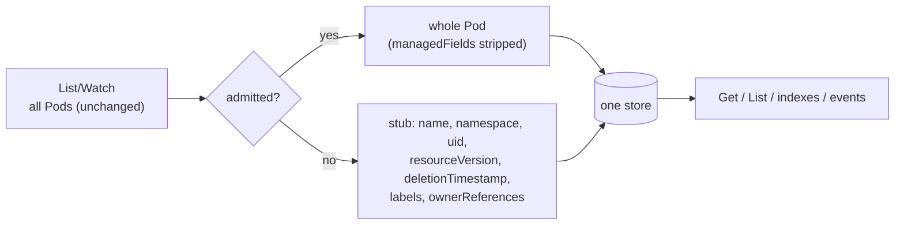

# KEP-284: Pod Cache Filtering with a Transform Stub

Issue: sgl-project/rbg#284

## Summary

The operator's Pod informer caches every Pod in the cluster: `cacheOptions()` bounds Services,
StatefulSets, and Deployments by the `group-name` label, but leaves Pods unfiltered. In a shared
cluster most of that memory belongs to Pods RBG does not manage.

This KEP keeps the single Pod informer and its watch, and adds a `cache.ByObject` **Transform**.
A Pod that RBG manages (see [Admission Rule](#admission-rule)) is cached whole, minus
`managedFields`; every other Pod is reduced to a stub before it enters the cache: name, namespace,
UID, resourceVersion, deletionTimestamp, labels, and ownerReferences, without spec or status.
There is still one watch, one store, one set of indexes and events, so cached `Get`, `List`, field
indexes, no-DeepCopy reads, and `Owns`/`Watches` behave as they do today. Named existence checks
keep working from the cache, because an unrelated Pod's name is still there.

The transform is enabled by `--pod-cache-scope=filtered`; `all` keeps today's cache and is the
default in alpha, and `filtered` becomes the default at beta. With `filtered`, the Pod informer also
transforms watch events before the reflector stores them. Where the apiserver supports streaming
lists and the operator opts in to client-go's `WatchListClient` (off by default), the startup and
relist peaks can fall with the retained store. Without streaming lists, startup still requires
decoding the complete List.

Separately from cache admission, RoleInstance and Warmup set `rbg.workloads.x-k8s.io/managed=true`
on the Pods they create, and existing Pods are labeled by an admin CLI that Helm runs as a
pre-upgrade hook. The marker is never written into a workload template, so no existing Pod rolls.

## Motivation

In a shared cluster, caching the spec and status of unrelated Pods wastes memory: the operator can
OOM on a large cluster while a small one is fine. The Pods RBG manages already carry one of three
labels (one per resource family that introduced it), so the operator can tell them apart in
process; what it lacks is a way to stop retaining everything else without changing how cached reads
behave.

### Goals

- Retain whole objects only for Pods RBG manages; an unrelated Pod costs one small stub.
- No change for existing workloads: no template change, no rolling update, no coordinated upgrade,
  and no backfill required for visibility.
- Keep every cached read path on one informer and one store, with today's semantics.
- Make the change switchable at startup, so it can be turned off without rolling back the image.
- Give RBG-managed Pods one common marker, set on direct creation paths and backfilled by an admin
  CLI.
- Measure the cost: retained heap, startup and relist peaks, sync time, CPU, and API traffic.

### Non-Goals

- Reducing Pod watch traffic or apiserver egress; the Pod watch stays unfiltered, as today.
- Changing ownership or adoption rules; admission does not grant the right to adopt a Pod.
- Writing the marker into any workload template (Deployment, StatefulSet, LeaderWorkerSet,
  RoleInstanceSet, RoleInstance), or rolling workloads to add it.
- Migrating the v1alpha1 API or retiring the legacy labels.
- Other unfiltered informers, tracked separately: ConfigMaps (started by the legacy discovery probe
  through the cached client), CustomResourceDefinitions and webhook configurations (webhook
  certificate controller), ControllerRevisions, and PodGroups.

## Proposal

### Admission Rule

A Pod is cached whole when **any one** of these conditions holds:

| Condition | Pod category |
| --- | --- |
| label `rbg.workloads.x-k8s.io/group-name` exists | RBG workload Pods, including supported native workloads |
| label `rbg.workloads.x-k8s.io/role-instance-name` exists | RoleInstance Pods, including standalone instances |
| label `workloads.x-k8s.io/warmup-name` exists | Warmup execution Pods |
| label `rbg.workloads.x-k8s.io/managed` equals `true` | the common marker |
| any ownerReference has API group `workloads.x-k8s.io` | Pods that reference an RBG object, including RBG-controlled Pods whose admission labels were removed |

A Pod with a legacy label but `managed=false` is still admitted. Admission is evaluated on the full
incoming object at every event, so any OR of conditions is possible, and a future resource family
only needs to carry the marker. Admission decides what the cache retains; it does not imply
ownership.

The ownerReference condition covers a Pod whose admission labels were all removed. Today such a Pod
is still found by `getOwnedPods`, which lists by the ownerReference-UID field index; admitting any
Pod that references an RBG object keeps that behavior. It also means no stub carries an
ownerReference to an RBG object, so an owner-index lookup for one can never return a stub. With a
controller-only condition, an unrelated Pod holding a non-controller reference to a RoleInstance
would be cached as a stub that keeps the reference, and the owner-index List would return it.

### Cache Implementation

When `--pod-cache-scope=filtered`, `cacheOptions()` sets a transform on the Pod entry, and
`cache.Options.NewInformer` wraps the Pod informer's ListerWatcher so that watch events pass
through the same transform before the reflector sees them (see item 6):

```go
&corev1.Pod{}: {Transform: podCacheTransform}
```



1. **One informer, one store.** There is no merge layer, tombstone, per-source cursor, or boundary
   GET. Cached `Get`, `List`, `IndexField`, `Owns`/`Watches`, and the no-DeepCopy List path keep
   their current semantics.
2. **The transform is idempotent.** With the watch-stream wrapper (item 6), a watched object is
   transformed in the wrapper and again when the informer's FIFO queues it. The FIFOs (`RealFIFO`,
   the default under client-go's `InOrderInformers`, and `DeltaFIFO`) do not transform deletion
   tombstones or Sync deltas, and require an idempotent transform (client-go v0.34.2,
   `tools/cache/the_real_fifo.go` and `delta_fifo.go`). A stub re-enters as a stub, and an admitted
   Pod has no `managedFields` left to strip.
3. **Transitions follow events.** A Pod that gains an admission label is stored whole at its next
   event; one that loses its last admission label is replaced by a stub; a Pod that references an
   RBG object never becomes a stub. Delete events carry whichever form was stored.
4. **Stubs never reach a production read path that expects a Pod.** Every cached Pod List in the
   operator is scoped by an RBG label selector or by the ownerReference-UID index:
   `sts_reconciler.go` (StatefulSet selector), `getOwnedPods` (owner index),
   `rolebasedgroupwarmup_controller.go` (group-name; warmup name and UID), and
   `rolebasedgroup_controller.go` (group-name and role-name). Each of them requires an admission
   label or an ownerReference to an RBG object, and a stub has neither, or it would have been
   admitted, so no stub matches. No code reads Pods by `spec.nodeName`. Both Pod event sources map a
   Pod through an ownerReference to an RBG kind (the RoleInstance Pod handler and Warmup's `Owns`),
   so a stub enqueues nothing. Only an unscoped List would see stubs, which is why the read-path
   audit is an alpha criterion.
5. **Named existence checks stay in the cache.** `getExistingPod` finds an unrelated Pod's stub,
   `metav1.IsControlledBy` returns false, and the controller reports the name conflict as it does
   today, with no extra API read. Gang-scheduled instances, which must confirm every name before
   creating any Pod, keep that property.
6. **Startup and relist.** Without streaming, the reflector decodes the complete List before
   transforming it. The smaller retained store can lower relist peaks, but startup still has
   the full-List decode cost. With WatchListClient and a supporting server, the reflector collects
   streamed objects in a temporary store until the initial-events-end bookmark. In client-go
   v0.34.2, only a store implementing the full `Store` interface (`TransformingStore`) passes its
   transform to that temporary store; informer FIFOs implement only `ReflectorStore`. Without
   the wrapper, streamed Pods remain whole until `Replace`; the diagnostic shows transformation
   near `Replace` and a full-cache-sized heap peak. Transforming watch events before the reflector
   reduces that temporary store as well. Unsupported servers fall back to List, where the wrapper
   does not avoid full decoding; both paths are measured.

#### Stub fields

The stub keeps the Pod's identity (name, namespace, UID, resourceVersion, deletionTimestamp), its
labels, and its ownerReferences, and drops spec and status. A label selector or an owner check
therefore evaluates a stub as it would the whole Pod, and "is this name taken by a Pod RBG does not
manage?" is answered with today's metadata. By the admission rule, a stub never carries an
admission label or an ownerReference to an RBG object.

### Marker and Backfill

**Creation paths.** RoleInstance and Warmup set `managed=true` on the Pod object when they create
it. The marker stays out of the RoleInstanceSet and RoleInstance templates, so revision hashes are
unaffected, and Deployment, StatefulSet, and LeaderWorkerSet templates are never stamped; their Pods
are admitted through `group-name`.

**No template rolling update.** `objectMetaEqual` compares workload metadata exactly after
`FilterSystemLabels`, which strips `app.kubernetes.io/` and the legacy
`rolebasedgroup.workloads.x-k8s.io/` prefix but not `rbg.workloads.x-k8s.io/`. A marker in a
workload template would therefore be label drift and roll every Pod of that workload. The design
avoids that in two ways:

1. The marker is never written into a template (above).
2. As a guard, `FilterSystemLabels` ignores the `rbg.workloads.x-k8s.io/managed` key, and only that
   key: ignoring the whole prefix would hide `group-name`, `role-name`, and `group-uid` drift. The
   contract tests `TestFilterSystemLabelsIgnoresManagedMarker` and
   `TestPodTemplateSpecEqualIgnoresManagedMarker` become regression tests, alongside a test that
   `group-name` drift is still detected.

**Backfill CLI.** Existing Pods are labeled by `kubectl rbg migrate pod-labels`:

- For each legacy key it lists candidates with the server-side selector
  `<legacy-key>,!rbg.workloads.x-k8s.io/managed`, and patches only the marker.
- Patches carry a UID precondition; `--dry-run`, a rate limit, and safe re-runs are supported.
- No owner-chain validation: the legacy label already identifies the Pod, and admission is not
  ownership.
- A read-only `check` mode reports unmarked Pods and deprecated workload templates without the
  marker. It is the observable completion criterion that an in-controller background job could
  not provide.
- Helm runs it as a best-effort `pre-upgrade` hook: on failure it reports what is left and does not
  block the upgrade. Manifest installs run it once by hand.

Pods that deprecated workloads create later stay unmarked until the next run; `check` reports them
until those workloads migrate to RoleInstanceSet. Cache visibility never depends on the marker, so
a missed run has no functional effect. The marker's consumer in this KEP is the admission rule;
retiring the legacy label conditions in favor of the marker alone is a later, separate decision.

### Enablement

These operator and Helm controls are proposed by this KEP; production integration is pending.

| Setting | Values | Default | Effect |
| --- | --- | --- | --- |
| `--pod-cache-scope` (Helm `controller.podCacheScope`) | `all`, `filtered` | `all` in alpha, `filtered` from beta | `all` keeps the current cache; `filtered` enables the Pod transform and early watch wrapper |
| `--watch-list-client` (Helm `controller.watchListClient`) | `true`, `false` | `false` | explicitly sets the process-wide client-go `WatchListClient` gate; unsupported servers fall back to List |

**Alpha defaults to `all`.** The same-source prototype now has macOS and Linux-container results,
with lower retained heap in every measured shape. These are synthetic arm64 tests, and the
production read-path audit, supported versions, upgrade e2e and target-scale cgroup memory /
working set remain graduation criteria. CPU and startup peaks vary with the environment; the
measurements do not promise zero overhead.

**WatchListClient remains a separate opt-in.** It changes every informer in the process. With a
supporting server, the early watch wrapper greatly lowers the shared-shape Pod startup peak.
CPU and sync-time costs differ between macOS and Linux, so evaluate them in the target environment
(see [Measured Sample](#measured-sample) and [Performance](performance.md)). Its default is revisited
at beta with supported Kubernetes versions.

**Set the effective gate explicitly.** The operator's production imports reach
`k8s.io/kubernetes/pkg/features`, which replaces client-go's environment-reading gate. Therefore
`KUBE_FEATURE_WatchListClient` alone does not enable streaming in the current operator dependency
chain. After parsing `--watch-list-client`, the implementation must call
`utilfeature.DefaultMutableFeatureGate.Set("WatchListClient=<true|false>")` before constructing
clients or informers, and return an error if it cannot set the gate. The harness exercises this
mechanism and verifies the effective value; its environment variable is explicitly translated by
`TestMain`.

### Risks and Mitigations

| Risk | Mitigation |
| --- | --- |
| A future unscoped Pod List sees stubs | Read-path audit as an alpha criterion; a regression test that every cached Pod List is selector- or index-scoped; the `rbg_pod_cache_stub_reads_total` metric |
| An RBG Pod is not admitted | Admission covers the three legacy labels, the marker, and any ownerReference to an RBG object; creation-path tests; whole and stub counts are exported |
| The marker in a template rolls existing Pods | Never written into templates; key-scoped drift exemption with contract tests; an upgrade e2e asserting zero template diffs |
| List startup still decodes all Pods | Budget from measured ranges; with a supporting server, the optional WatchListClient and early watch wrapper reduce the shared-shape peak |
| A transform defect hides Pod data | `--pod-cache-scope=all` restores today's cache with a restart; unit tests for every admission condition and for idempotence |
| Backfill load on the apiserver | Server-side selector, rate limit, `--dry-run`; it runs once per upgrade, not continuously |

## Design Details

### Test Plan

The prototype tests named below are in the harness described in [Performance](performance.md).
The macOS/Linux cache tests have run; marking, CLI, Helm and full operator e2e criteria remain
production-integration work.

#### Unit Tests

- Transform: each admission condition alone and combined, `managed=false`, controller versus
  non-controller references to RBG kinds, a foreign controller, non-Pod input, `managedFields`
  stripping, stub contents, and idempotence (prototype: `TestTransformIsIdempotent`).
- Drift: `FilterSystemLabels` and `podTemplateSpecEqual` ignore only the marker key, and
  `group-name` drift is still reported.
- CLI: candidate selection per legacy key, `--dry-run`, UID precondition, conflict retry, rate
  limit, and `check` output.

- Watch wrapper: Add/Modify/Delete, unchanged bookmarks/errors, idle and pending-send Stop with
  deterministic loop-exit checks; effective WatchListClient setting and restoration.

#### Integration Tests

- Admission and stubs: cached `Get` returns whole objects for admitted Pods and stubs otherwise;
  label-scoped Lists, deep-copying and not, never return a stub; the owner index finds Pods that
  reference an RBG object without admission labels and never returns a stub
  (prototype: `TestAPITransformAdmissionAndStubs`).
- Transitions and events: unadmitted to admitted and back, a Pod that references an RBG object
  keeps its whole form after losing its labels, and delete events for both forms
  (prototype: `TestAPITransformTransitionsAndEvents`).
- An owned Pod stripped of every admission label is still returned by `getOwnedPods`, and the
  RoleInstance does not under-count or try to replace it.
- Ownership collision: an unrelated Pod with the same name is found as a stub, and the controller
  reports the conflict without Create→AlreadyExists or an extra API read.
- Streaming list, fallback to List, and relist after an expired watch (410), with the apiserver's
  `WatchList` on and off (prototype: the transform comparison). With streaming and the watch-stream
  wrapper, every Pod is transformed before the reflector's temporary store and the startup heap
  peak follows the retained store (prototype: `TestAPITransformSyncHeapTimeline` and the
  `transform-*-stream` modes).
- During a disconnected watch, change the admission labels before injecting 410, then verify the
  replacement snapshot's Pod forms and resourceVersions (`TestAPITransformRelist`).
- `--pod-cache-scope=all` reproduces today's cache.

#### e2e Tests

- Upgrading from the previous release with existing Deployment, StatefulSet, LeaderWorkerSet, and
  RoleInstanceSet workloads produces zero template diffs and no Pod restarts.
- Pods created by RoleInstance, Deployment, StatefulSet, LeaderWorkerSet (leader and worker), and
  Warmup are admitted whole; Warmup actions and timeouts are unaffected.
- Rolling back to the previous image, and switching `--pod-cache-scope` both ways, keep every Pod
  visible.
- The Helm pre-upgrade hook labels existing Pods, and `check` reports completion and the
  deprecated workloads that still produce unmarked Pods.

### Graduation Criteria

#### Alpha

- `--pod-cache-scope`, defaulting to `all`; `filtered` enables the transform and the Pod informer's
  watch-stream wrapper. Helm exposes both settings in [Enablement](#enablement), with
  `WatchListClient` off by default.
- The Pod read-path audit is recorded in the implementation PR, with a regression test.
- RoleInstance and Warmup stamp the marker on created Pods; no template carries it; the key-scoped
  drift exemption ships with its contract tests.
- `kubectl rbg migrate pod-labels` with `check`, `--dry-run`, and a rate limit, plus the Helm
  pre-upgrade hook.
- Unit and integration tests in the repository; the upgrade e2e asserts zero template diffs.
- The [Monitoring](#monitoring) metrics are exported.

#### Beta

- `filtered` is the default, backed by measurements at target scale in a Linux container (cgroup
  memory and working set), including relist peaks with and without streaming lists.
- The supported Kubernetes versions, the `WatchListClient` default, and `DefaultNamespaces`
  (controller-runtime's multi-namespace informer fails the no-DeepCopy helper's type assertion
  today) are decided and covered.
- No admission-miss incident during alpha.

#### GA

- One release with `filtered` as the default and no Pod-visibility incident.
- The decision on retiring the legacy label conditions, based on `check` reports, is recorded.

### Monitoring

| Metric | Type | Meaning |
| --- | --- | --- |
| `rbg_pod_cache_scope{scope}` | gauge | configured scope, `all` or `filtered`, set to 1 |
| `rbg_pod_cache_objects{form}` | gauge | cached Pods by `form`: `whole` or `stub` |
| `rbg_pod_cache_transform_total{result}` | counter | transform decisions by `result`: `whole` or `stub` |
| `rbg_pod_cache_stub_reads_total{method}` | counter | stubs returned by a cached `List`; it should stay 0, and a non-zero value means an unscoped read path |
| `rbg_pod_cache_initial_sync_seconds` | gauge | duration of the Pod informer's initial sync |

### Expected Impact

Retained memory is $M \approx B + R\,S + (N - R)\,s$, where $N$ is all Pods, $R$ admitted Pods,
$S$ the average retained cost of a whole Pod, $s$ the cost of a stub, and $B$ other retained heap.
Today it is $B + N\,S$. The saving is $(N - R)(S - s)$, so the benefit grows with the unrelated
share; with no unrelated Pods the transform costs nothing beyond its per-event CPU.

#### Measured Sample

Measured 2026-11-01 on macOS arm64 and an offline Linux arm64 container, using the same prototype
sources, Go 1.26.0 and `GOMAXPROCS=4`. The isolated control plane is Kubernetes v1.31.0 / etcd
3.5.15; synthetic unscheduled Pods contain 64 × 512-byte environment values. Five shapes, three
rotated rounds per server configuration and platform: 240 cache processes passed.

Medians in MiB. `filtered` includes the selected stub **and early watch wrapper**. Retained heap
is whole-process `HeapAlloc` after two GCs. Startup RSS is the kernel lifetime peak at sync + two
seconds, without explicit GC in the window. Heap and List columns use the List-server batch;
streaming columns all use WatchListClient with server streaming enabled. Ranges, CPU, relist,
reproduction commands and coverage limits are in [Performance](performance.md).

| Platform | Related / unrelated Pods | Retained heap: full / union / filtered | List startup RSS: full / union / filtered | Streaming startup RSS: full / store-only transform / filtered |
| --- | --- | --- | --- | --- |
| macOS arm64 | 48 / 1,000 | 47.31 / 5.20 / 6.61 | 124.38 / 51.02 / 125.30 | 99.69 / 103.05 / 45.39 |
| macOS arm64 | 900 / 100 | 45.41 / 42.06 / 37.03 | 120.33 / 186.27 / 120.59 | 98.31 / 101.34 / 90.89 |
| macOS arm64 | 1,000 / 0 | 45.42 / 46.32 / 40.61 | 120.73 / 202.12 / 120.64 | 101.20 / 100.89 / 90.50 |
| macOS arm64 | 200 / 4,800 | 214.04 / 11.74 / 18.84 | 672.22 / 74.66 / 677.70 | 337.81 / 346.66 / 70.61 |
| macOS arm64 | 5,000 / 0 | 214.70 / 218.46 / 190.63 | 675.73 / 800.97 / 675.94 | 341.80 / 344.81 / 325.47 |
| Linux arm64 | 48 / 1,000 | 47.30 / 5.20 / 6.60 | 172.15 / 56.69 / 130.77 | 108.52 / 108.88 / 55.86 |
| Linux arm64 | 900 / 100 | 45.40 / 42.08 / 37.02 | 166.71 / 186.53 / 166.64 | 103.61 / 107.74 / 99.16 |
| Linux arm64 | 1,000 / 0 | 45.41 / 46.31 / 40.60 | 166.57 / 205.65 / 126.01 | 105.53 / 104.74 / 100.58 |
| Linux arm64 | 200 / 4,800 | 214.02 / 11.73 / 18.83 | 677.64 / 80.00 / 628.00 | 372.54 / 358.43 / 84.09 |
| Linux arm64 | 5,000 / 0 | 214.69 / 218.45 / 190.62 | 681.05 / 872.17 / 631.20 | 367.69 / 359.53 / 337.25 |

- **Shared-shape retained heap:** about −86% at 48 / 1,000 and −91.2% at 200 / 4,800 on both
  platforms. With no unrelated Pods, the roughly 11% gain comes from stripping `managedFields`,
  which the full cache could also adopt.
- **List startup still decodes every Pod.** RSS varies with GC timing; these samples do not bound
  its startup memory by the admitted Pod count. A lower post-GC heap does not imply immediate
  RSS reclamation.
- **Streaming requires the wrapper:** at 200 / 4,800 the store-only transform peaks at
  346.66 / 358.43 MiB (macOS / Linux), versus 70.61 / 84.09 MiB with early transformation.
- **Relist at 200 / 4,800:** List full / filtered peak footprint is 994.0 / 649.3 MiB on macOS,
  and 879.2 / 644.3 MiB on Linux; streaming full / filtered is 599.0 / 79.9 MiB and 606.5 / 84.6 MiB.
  macOS footprint and Linux sampled RssAnon have different definitions; compare within a platform.
  Relist fetch time excludes reconnect backoff and later cache processing, verified separately by
  the changed-snapshot integration test.
- **CPU costs are environment-dependent:** in the same streaming-server batch at 200 / 4,800,
  full-cache startup CPU changes 345 → 1,322 ms with WatchListClient on macOS, and 715 → 515 ms
  on Linux. The earlier universal CPU / sync-time multipliers are removed. The transform retains
  the full Pod watch and its decoded payload traffic.
- **Union tradeoff:** it retains less heap and reads fewer bytes in sparse shared shapes. The
  benchmark gives every related Pod all four labels, a maximum-overlap case; its duplicate-read
  and timing results apply to that shape. The transform is preferred for its single-store read
  semantics and smaller correctness surface, rather than a universal resource win.

### Scalability

- **Watches and traffic:** one unfiltered Pod watch. Within the same protocol, measured decoded
  response bytes match the full cache. Compressed wire bytes and steady event throughput were not measured.
- **Startup:** one full List, or a streaming list with explicit WatchListClient enablement and a
  supporting server. Ordinary List keeps the full-decode memory cost; streaming needs the early wrapper.
- **Sync budget:** the slowest selected-transform sample here was 1.14 seconds for at most
  5,000 synthetic Pods on a local API server. This does not establish target-scale latency or a
  linear forecast for 100,000 Pods. Keep the cache sync timeout and validate against the real cluster.
- **Memory:** whole admitted Pods plus a metadata stub per unrelated Pod; labels and ownerReferences
  affect stub size. Container memory / working-set and OOM behavior remain beta measurements.
- **CPU:** one transform per List item, and two per watched object with the early wrapper. Startup
  and relist results vary by platform; sustained event churn still needs measurement.
- **Writes:** controllers stamp labels only on creation; the rate-limited CLI patches existing Pods.
- **Reads:** no boundary reads; named existence checks remain cached.

### Upgrade, Rollback, and Version Skew

- **Upgrade:** with `all`, the alpha default, the cache is unchanged. With `filtered`,
  legacy-labeled Pods are admitted immediately. Either way, no template changes and no rolling
  update.
- **Rollback:** an older image caches all Pods and ignores the marker, which is harmless metadata.
- **Switching scope:** a restart with the other value rebuilds the cache; nothing is persisted.
- **Operator replicas:** each process keeps its own cache; only the leader reconciles.
- **Kubernetes versions:** the transform works on every supported version. Streaming lists depend
  on the apiserver's `WatchList` feature, whose default has changed across releases; the client
  falls back to List when it is not served. The supported matrix is a beta criterion.

## Production Readiness Review Questionnaire

### Feature Enablement and Rollback

###### How can this feature be enabled / disabled in a live cluster?

- [x] Other
    - Describe the mechanism: the operator flag `--pod-cache-scope=all|filtered`, exposed as the
      Helm value `controller.podCacheScope`. `all` keeps today's cache and is the alpha default;
      `filtered` enables the transform.
    - Will enabling / disabling the feature require downtime of the control plane? No.
    - Will enabling / disabling the feature require downtime or reprovisioning of a node? No; the
      operator restarts and running workloads are not restarted.

###### Does enabling the feature change any default behavior?

No workload behavior changes: Pod creation, update, deletion, readiness, Warmup timeouts, and RBG
status are unchanged. With `filtered`, the operator retains stubs for unrelated Pods. Independently
of the flag, Pods that RoleInstance and Warmup create carry `managed=true`, and the CLI adds it to
existing Pods. There is no API or CRD change.

###### Can the feature be disabled once it has been enabled?

Yes: restart the operator with `--pod-cache-scope=all`. Labels written by the CLI remain and are
ignored.

###### What happens if we re-enable the feature if it was previously rolled back?

The transform applies again when the cache starts; nothing is persisted between runs.

###### Are there any tests for feature enablement/disablement?

Switching `--pod-cache-scope` in both directions, and upgrade and rollback with legacy-labeled Pods
present, are alpha criteria.

## Implementation History

- 2026-10-28: KEP created with a four-source label union and in-controller backfill.
- 2026-10-29: Filled in the KEP template sections; the union shared immutable Pod objects between
  the merge records and the business index.
- 2026-10-30: Serial four-source initialization, startup measurements, the uncached named-read
  requirement, alpha graduation, and the rollback section.
- 2026-10-31: Revised after review. The design is now a single informer with a transform stub,
  behind `--pod-cache-scope`; backfill moved to an admin CLI; the marker stays out of workload
  templates. The union design moved to [Alternatives](#alternatives), and both designs were measured
  with the same harness (`test/podcacheunion`).
- 2026-11-01: Alpha defaults set: `--pod-cache-scope=all`, becoming `filtered` at beta, and
  `WatchListClient` off. The stub keeps labels and ownerReferences, and the ownerReference admission
  condition covers any reference to an RBG object.
- 2026-11-01: Validated the selected watch wrapper on macOS and an offline Linux container;
  240 cache processes passed. Updated measured ranges and platform-specific CPU results, and
  changed proposed WatchList enablement to an explicit effective-gate setting.
- TBD: implementation PR.

## Drawbacks

- **Unrelated Pods still cost a stub each and the full watch stream.** Retained memory still grows
  with all Pods, at the stub rate.
- **Ordinary List retains the full-decode startup cost.** Streaming lists are opt-in; startup
  memory cannot be bounded by the admitted Pod count without that path.
- **The watch-stream wrapper works around client-go.** It exists because client-go v0.34.2 does
  not pass informer transforms to the streaming-list temporary store; it should be removed once
  client-go does.
- **Event handlers still run for unrelated Pod events.** Their full input must still be decoded
  and dispatched; sustained event-load costs have not been measured here.
- **Correctness relies on scoped reads.** A future unscoped Pod List would silently see stubs;
  the audit, its regression test, and the stub-read metric guard against it.
- **The marker becomes a de facto public interface,** and manifest installs need a one-time CLI
  run.

## Alternatives

Each alternative was weighed against implementation complexity, compatibility with existing
workloads, and upgrade impact. The decisive comparison, the four-source union, was measured with
the same harness as the transform.

- **Four-source label union with a merge layer (the previous revision of this KEP).** Four
  server-filtered List/Watch sources need resourceVersion ordering, deletion watermarks, per-source
  cursors, boundary GETs, miss confirmation and serial initialization. It retains no unrelated stubs
  and wins on heap and response bytes in sparse shared shapes. **Rejected** because it expands the
  Get/List/index/event/no-copy correctness surface and still leaves owner-index and named-read
  compatibility gaps. Multiple matching selectors also duplicate decoding; the current maximum-
  overlap measurements show that cost, without claiming it for every workload mix.

  At 5,000 / 0, its List startup RSS is 800.97 MiB versus full-cache 675.73 MiB on macOS, and
  872.17 versus 681.05 MiB on Linux. At 200 / 4,800 it instead has much lower List startup peaks,
  74.66 / 80.00 MiB, while the selected transform with streaming reaches 70.61 / 84.09 MiB.
  These measured tradeoffs and ranges are recorded in [Performance](performance.md).

- **Disjoint-selector partition.** A variant of the union (for example `role-instance-name` exists
  and `group-name` does not) that removes duplicate decoding by construction, at the cost of more
  boundary transitions whenever admission labels change on a live Pod. **Rejected** with the union:
  it keeps the merge layer, and a single informer has no overlap to remove.
- **Legacy labels only, without the marker.** The union with three sources. **Rejected:** same
  merge cost as the union, and every new creation path would change the cache rules. Under the
  transform, admission is in-process code, but the marker still lets new paths avoid that change.
- **Full metadata informer for discovery plus a filtered full-object informer.** Two views to keep
  consistent. **Superseded:** the transform gives the same retention with one store.
- **Bounded page merging.** `ListPager.EachListItemWithAlloc` already streams paginated items with
  bounded page buffering, continuation handling and cancellation. The remaining work is integrating
  those callbacks with the union store, publishing a coherent replacement snapshot, and bounding
  recovery relists when a page or watch expires. **Rejected with the union:** the selected streaming
  transform avoids this additional merge/snapshot machinery. On List-only servers it still pays
  the full-List decode cost; the existing pagination API alone does not make informer `Replace`
  incremental.
- **Backfill in the leader (the previous revision).** A permanent background writer for a one-time
  migration, with owner-chain checks and no observable completion. **Rejected** in favor of the CLI
  with `check`.
