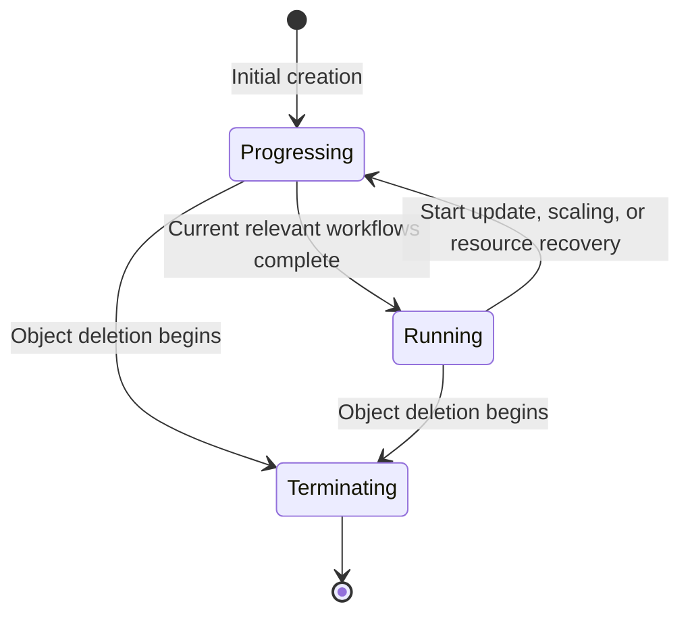

# KEP-502: Workload Status Model

<!-- toc -->
- [KEP-502: Workload Status Model](#kep-502-workload-status-model)
  - [Release Signoff Checklist](#release-signoff-checklist)
  - [Summary](#summary)
  - [Motivation](#motivation)
    - [Goals](#goals)
    - [Non-Goals](#non-goals)
  - [Proposal](#proposal)
    - [User Stories](#user-stories)
    - [Notes/Constraints/Caveats](#notesconstraintscaveats)
    - [Risks and Mitigations](#risks-and-mitigations)
  - [Design Details](#design-details)
    - [Phase Transition Principles](#phase-transition-principles)
    - [RoleBasedGroup](#rolebasedgroup)
    - [RoleInstanceSet](#roleinstanceset)
    - [RoleInstance](#roleinstance)
    - [Test Plan](#test-plan)
      - [Prerequisite testing updates](#prerequisite-testing-updates)
      - [Unit tests](#unit-tests)
      - [Integration tests](#integration-tests)
      - [e2e tests](#e2e-tests)
    - [Graduation Criteria](#graduation-criteria)
    - [Upgrade / Downgrade Strategy](#upgrade--downgrade-strategy)
    - [Version Skew Strategy](#version-skew-strategy)
  - [Production Readiness Review Questionnaire](#production-readiness-review-questionnaire)
    - [Feature Enablement and Rollback](#feature-enablement-and-rollback)
    - [Rollout, Upgrade and Rollback Planning](#rollout-upgrade-and-rollback-planning)
    - [Monitoring Requirements](#monitoring-requirements)
    - [Dependencies](#dependencies)
    - [Scalability](#scalability)
    - [Troubleshooting](#troubleshooting)
  - [Drawbacks](#drawbacks)
  - [Alternatives](#alternatives)
<!-- /toc -->

## Release Signoff Checklist

The following checklist applies to releases in the RBG project.

- [ ] The target release, enablement mechanism, and upgrade / rollback strategy are defined.
- [ ] The test plan and graduation criteria are confirmed.
- [ ] The production readiness review is complete and approved.
- [ ] The implementation, generated artifacts, and required compatibility regression tests pass project CI.
- [ ] User documentation, migration guidance, and release notes are complete.

## Summary

This KEP defines a workload status model for RoleBasedGroup (RBG), RoleInstanceSet (RIS), and RoleInstance (RI).
Lifecycle phases, conditions, and stable reasons distinguish lifecycle stages, readiness, configuration rejection, and resource waits.
An optional, persisted `status.phase` field is added. RBG uses three phases: Progressing / Running / Terminating. Progressing summarizes creation, updates, scaling, and resource recovery, while RIS / RI retain their specific phases.
The scope is limited to state machines, phase / condition fields and values, compatibility migration, and contract tests. It does not include controller refactoring or extensions to the role status schema.

## Motivation

The current status model has the following limitations:

- RBG / RIS / RI lack `status.phase`, requiring users to infer the lifecycle of the group, instance set, and individual instance from conditions, replica counts, and child resources.
- RBG declares `Progressing` and `RollingUpdateInProgress`, but the built-in controllers on the main branch do not currently write them.
- RBG Ready reflects readiness of all replicas without checking revision convergence. Rollout completion needs a separate representation of progress toward the target.
- RIS / RI `FailedScale` and `FailedUpdate` record individual operation failures, making it easy to confuse transient events with facts that remain true.
- Status does not clearly distinguish configuration and required environmental capability compatibility from runtime waits for resources, quota, and similar constraints.

### Goals

1. Define the relationship between lifecycle, readiness, progress toward the target, and observation freshness.
2. Define how lower-level phases and recovery facts trigger RBG phase transitions, and how operations across roles are summarized.
3. Define condition ownership, reasons, transition timestamps, and compatibility migration rules.
4. Preserve readiness gates, availability timing, and safeguards for restarts and rolling updates.

### Non-Goals

1. Refactoring reconciliation layers, internal interfaces, or status persistence paths.
2. Changing scheduling, dependency-based startup, scaling, rolling updates, restarts, or their gate policies.
3. Redesigning retry, logging, or event mechanisms, or reorganizing recovery fields. Operation failure reporting reuses the existing Event mechanism.
4. Changing the independent Warmup status.
5. Comprehensively redesigning status for RBGSet, ScalingAdapter, or CoordinatedPolicy; only consumer compatibility is assessed.
6. Adding features to deprecated backends or the feature-frozen v1alpha1 API, or automatically migrating workload types.
7. Adding a minimum-available-replica readiness policy or replacing the all-replicas-ready requirement with gang min.
8. Extending the roleStatuses schema or adding role conditions, activities, workloadRef, or similar fields.

## Proposal

Use phase for the coarse-grained lifecycle, conditions for configuration acceptance, progress toward the target, and readiness facts, and Events for individual operation failures.
RBG summarizes the workflows of its roles. Specific activities are available through reasons, messages, and lower-level status; programs use structured fields and stable reasons rather than parsing messages.

### User Stories

- Operators distinguish creation, updates, scaling, recovery, and waiting through reasons, messages, and lower-level status without treating Running as ready.
- Release systems distinguish observing a target from completing the target revision.
- Troubleshooters identify activity and blockers for a specific role through messages and the corresponding RIS / RI status.
- Readiness gate providers retain control over existing behavior, and the aggregation layer does not overwrite their conditions.

### Notes/Constraints/Caveats

Deployment, StatefulSet, and LeaderWorkerSet are deprecated backends whose status capabilities will not be extended.
RBG enables the new phase / condition model only when all roles use RIS. If any role uses a legacy backend, RBG continues to use the existing Ready and role replica status.
For example, an RBG with prefill using RIS and decode using LeaderWorkerSet does not report the new overall phase, but the prefill RIS / RI resources still use the new status model.
Missing new fields on legacy backends do not affect existing Ready checks for existing objects.

The `role-workload-type` annotation provides compatibility with legacy workload types in v1alpha1. It will be retired as part of the v1alpha1 deprecation process and is not a long-term v1alpha2 capability.

Status contains fields consumed by control logic and must not be treated as presentation-only data. Changes to Ready or transition timestamps can affect release waits, dependency-based startup,
rollouts, scaling, and `minReadySeconds`. Recovery fields must not be discarded on the assumption that they can be recomputed.
Phase is not set through ordinary spec updates; the status subresource remains subject to RBAC.

### Risks and Mitigations

| Risk | Mitigation |
| --- | --- |
| Confusing lifecycle, service readiness, and revision convergence | Define field semantics separately and cover partition, pause, and zero-replica cases |
| New checks leave deprecated backends permanently not Ready | Preserve legacy semantics during migration and run compatibility regression tests with actual backend status |
| Readiness changes bypass existing gates or alter timing | Validate against stateful / stateless consumer baselines |
| Overwriting external conditions or causing timestamp churn | Define ownership, unique keys, and transition rules; test concurrent writes |
| Losing information during schema or legacy condition migration | Validate legacy writes, conversion, failure Event coverage, current blocker reporting, and recovery data preservation |

## Design Details

The following sections describe status API changes by CR type. Example annotations labeled "New", "Changed", "Retained", and "Proposed deprecation" are relative to the current API; "TBD" indicates an unresolved decision.
The YAML examples show only status-related fragments, omitting spec and unchanged fields, and cannot be applied directly.
New fields target v1alpha2. Compatibility requirements for older APIs are described in the upgrade strategy.

Status fields across all three CR types follow these common rules:

- Status describes observed facts. Successfully issuing an API request does not mean that lower-level work has completed.
- Conditions describe facts that currently hold. FailedScale / FailedUpdate are deprecated; individual operation attempts are reported as Warning Events on the corresponding RIS / RI. Persistent current blockers are represented by the owning layer's `Progressing` reason and message, not by replacement failure conditions or `Accepted`. Events are diagnostic history and must not be used to infer current status.
- Phase records the lifecycle stage the object has entered. It does not replace conditions, readiness gates, or recovery fields, and does not directly copy the phase of a parent or child object.
- Conditions use type as the unique key, with an explicit owner for each type. The aggregation layer does not overwrite externally owned conditions, reasons, or messages. Reasons are scoped to the object that owns the condition; parents aggregate reason families rather than copying child reasons verbatim.
- Controller-written reasons must be valid, non-empty, and consistent with status. New, unrecognized reasons must not cause client parsing failures.
- `lastTransitionTime` changes only when condition.status changes. Changes only to reason, message, or observedGeneration do not reset it.
- Transitions compare the latest persisted status with the final status being submitted, not intermediate values within a reconciliation. For example, False → temporary True → final False is not a transition.
- `status.observedGeneration` identifies the generation of this object that has been processed; a condition's observedGeneration identifies the generation of this object to which its fact applies. Neither directly proves target completion.
- Phase transitions and progress decisions use valid observations corresponding to the current operation target. Parent and child generations cannot be compared directly, and old status cannot prove completion of a new target.
- When observations are insufficient, affected conditions whose facts cannot be determined use Unknown, with `ObservationIncomplete` as a candidate reason. A read failure does not mean zero replicas, and an absent phase does not mean Running.
- Status must eventually update after changes only to label / revision metadata or after dependencies recover, without requiring an additional manual spec change.
- Do not add a finalizer solely to display phase, and do not guarantee that clients observe every intermediate phase.

### Reason Taxonomy and Aggregation

RBG, RIS, and RI do not share one flat reason enumeration. They share reason families so parents can aggregate child facts without parsing messages. Reason strings remain scoped to the object that owns the condition.

External blocker families use stable, machine-readable categories. RI may report the operation affected by the blocker, while RIS and RBG map those facts to their canonical reasons:

| Reason family | RI example reason | RIS reason | RBG reason |
| --- | --- | --- | --- |
| Permission | `PodCreateForbidden`, `PodUpdateForbidden` | `PermissionDenied` | `PermissionDenied` |
| Admission | `PodAdmissionRejected` | `AdmissionDenied` | `AdmissionDenied` |
| Quota | `PodCreateQuotaExceeded`, `PodUpdateQuotaExceeded` | `WaitingForQuota` | `WaitingForQuota` |
| Resources | `InsufficientResources` | `WaitingForResources` | `WaitingForResources` |
| Dependencies | `DependencyNotReady` | `WaitingForDependencies` | `WaitingForDependencies` |
| Gang scheduling | Not owned by RI | `WaitingForGang` | `WaitingForGang` |

Activity and child-readiness reasons are layer-specific:

| Fact | RI reason | RIS reason | RBG reason |
| --- | --- | --- | --- |
| Child readiness | `PodsNotReady` | `InstancesNotReady` | `RolesNotReady` |
| Initial creation | `Creating` | `Creating` | `Creating` |
| Update | `Updating` | `RollingUpdate` | `ScalingOrUpdating` |
| Instance-count scaling | Not owned by RI | `ScalingUp`, `ScalingDown` | `ScalingOrUpdating` |
| Recovery | `Recovering` | `Recovering` | `Recovering` |

`ScalingOrUpdating` is an RBG reporting aggregate, not a distinct lifecycle phase or controller workflow. RIS reports the concrete workflow, and RI does not own instance-count scaling.

Parent controllers must aggregate through the documented reason-family mapping and must not parse condition messages. When multiple facts belong to the same family, the parent uses its canonical reason for that family and describes the details in message. When one `Progressing` condition must summarize multiple facts, select the reason family with the highest reporting priority:

```text
Permission
Admission
Quota
Resources
Gang
Dependencies
ChildReadiness
```

A current blocker outranks an activity reason because it explains why the current target is not converging. This reporting precedence does not determine controller execution order.

### Phase Transition Principles

Phase transitions start from the last persisted phase and occur only when the corresponding transition conditions are met. Phase is not reselected from current Ready, replica counts, or child phases; the same phase, target, and observations must produce consistent transition results.
Child readiness is a transition condition, not an invariant required to remain Running. Conditions continuously report current readiness, progress, and blockers.

- Initial creation transitions to Running once the target structure is established and the effective readiness policy is satisfied. RBG transitions from Progressing; RIS / RI transition from Creating. RI retains readyPolicy (AllPodReady by default) and configured readiness gates, with completion signals propagating through RI → RIS → RBG.
- Recreating missing resources after RIS / RI have entered normal operation does not trigger a return to Creating; a child object with a new UID goes through creation independently. RBG transitions from Running to Progressing when it confirms missing resources and enters recovery. A readiness drop alone, without entering recovery, leaves it Running.
- Recovery completes when the target Pods are all present, the relevant recreation / replacement / cleanup work is complete, and readyPolicy and configured readiness gates are satisfied. Completion facts propagate upward according to each layer's target.
- When observations are insufficient to confirm a transition condition, retain the last phase; if it was absent, leave it absent. Related conditions may still change. A confirmed deletionTimestamp on the object allows it to enter Terminating without complete observations of child resources.
- When multiple workflows remain incomplete, select the phase using the display priority defined for each CR. Display priority does not determine execution order. Completion requires confirming the current effective target and the corresponding completion conditions; child Ready alone is not a substitute.
- When a target changes or is withdrawn, evaluate remaining work against the current target, accounting for operations already issued and required cleanup. Target changes during initial creation do not waive structural completeness or effective readiness requirements; pausing does not mean completion.

### RoleBasedGroup

RBG adds `status.phase`, with transitions based on the current target, lower-level phases, and recovery facts, and uses Accepted / Progressing / Ready conditions.
In the example below, all roles use RIS. Prefill is scaling up and decode is updating; decode has a target of 3 replicas, of which 2 are ready.

```yaml
apiVersion: workloads.x-k8s.io/v1alpha2
kind: RoleBasedGroup
metadata:
  name: inference
  generation: 5
status:
  # [New] Progressing summarizes creation, updates, scaling, and recovery; it differs from the condition of the same name.
  phase: Progressing
  observedGeneration: 5
  conditions:
    - type: Accepted # [New type] Configuration validity and compatibility of required environmental capabilities.
      status: "True" # [Retained values] True / False / Unknown; also applies to the conditions below.
      reason: ValidSpec # [Changed] Controllers write stable, non-empty reasons consistent with status.
      message: "Configuration is valid and required environmental capabilities are supported" # [Retained] Human-readable diagnostics, not a machine-parsing interface.
      observedGeneration: 5 # [Retained, semantics clarified] The RBG generation to which this fact applies.
      lastTransitionTime: "2026-10-26T09:00:00Z" # [Rule clarified] Changes only when status changes.
    - type: Progressing # [Changed] The type is already declared; define writes and execution, waiting, and pause semantics.
      status: "True"
      reason: ScalingOrUpdating # [Changed] Summarizes scaling and updates across roles.
      message: "prefill is Scaling; decode is Updating, with 1/3 replicas updated"
      observedGeneration: 5
      lastTransitionTime: "2026-10-26T09:01:00Z"
    - type: Ready # [Retained] Requires all roles to be ready, without additionally requiring target revision completion.
      status: "False"
      reason: RoleNotReady # [Retained] At least one role does not meet readiness requirements.
      message: "decode has 2/3 replicas ready"
      observedGeneration: 5
      lastTransitionTime: "2026-10-26T09:01:00Z"
```

RBG phase uses the following three values:

| Phase | Meaning |
| --- | --- |
| `Progressing` | Creation, updates (including deployment pattern migration), scaling, or resource recovery remains incomplete |
| `Running` | Relevant workflows have completed; the object is in normal operation, without guaranteeing current readiness |
| `Terminating` | The RBG itself has a deletionTimestamp |

Initial creation enters Progressing. During normal operation, starting an update or scaling, or confirming missing Pods / RIs / RISs and entering recovery, re-enters Progressing.
Enter Running after all relevant workflows are complete and no work remains to be issued. Deletion of the object takes priority and enters Terminating.
phase=Progressing means a workflow remains incomplete; it is not equivalent to the condition of the same name being True. When all relevant progress is paused, the condition may report Progressing=False(reason=Paused).



The proposed semantics of RBG conditions are:

| Condition | True | False | Unknown |
| --- | --- | --- | --- |
| `Accepted` | Configuration is valid and required environmental capabilities are supported | Invalid spec / referenced configuration, or required environmental capabilities are confirmed unsupported | Required configuration or capability validation cannot be completed |
| `Progressing` | The target is incomplete, with work executing or waiting for execution prerequisites | Converged, all relevant progress paused, configuration rejected, or terminating | Progress facts cannot be determined |
| `Ready` | All roles are ready | At least one role is not ready, or the object is terminating | Readiness cannot be determined reliably |

Accepted validates the object's configuration, expanded templates, referenced configuration actually in use (such as CoordinatedPolicy), and required environmental capabilities (such as Volcano gang support). It does not check GPU capacity, quota, permissions to execute operations, or runtime readiness, and does not guarantee resource creation will succeed.
An absent optional configuration reference does not cause rejection. A required reference confirmed missing reports False(reason=InvalidSpec); a read or validation that cannot be completed reports Unknown(reason=ObservationIncomplete). Template errors, dependency cycles, and unsupported capabilities use the corresponding reasons in the table below, with details in message.
Re-evaluate after configuration or environmental capability changes, without requiring a change to RBG generation. Accepted=False does not directly rewrite Ready or trigger a phase transition.

Progressing covers execution and waiting during creation, updates, scaling, and recovery, without requiring a generation change. True does not guarantee that progress has been made or that completion will be timely. Pausing only updates must not set it to False while other workflows are still progressing.
Current blockers caused by resources, quota, execution permissions, external admission policies, or dependencies are expressed through Progressing reason / message, not Accepted. Clear stale waiting reasons after recovery; do not infer current blockers from historical errors or Events.

Ready requires all roles to be ready, retaining existing checks on desired, actual, and ready replica counts. It does not additionally require target revision completion or lower the threshold to gang min.
Updates, pauses, or partition retaining older revisions do not by themselves make Ready False.
Ready=False does not mean the service is completely unavailable. Zero replicas retain existing behavior; an empty revision does not add a readiness blocker.

Each condition has one reason. Overall RBG progress for scaling and updates uses `ScalingOrUpdating`, with message describing each role's activity. Creation, recovery, and waiting use the corresponding reasons below. A current blocker takes precedence over an activity reason.

| Condition / Status | Candidate Reasons |
| --- | --- |
| Accepted=True | `ValidSpec` |
| Accepted=False | `InvalidSpec`, `TemplateInvalid`, `DependencyCycle`, `IncompatibleGangConfig`, `SchedulerUnsupported` |
| Progressing=True | `Preparing`, `Creating`, `ScalingOrUpdating`, `Recovering` |
| Progressing=True, waiting | `WaitingForDependencies`, `RolesNotReady`, `WaitingForGang`, `WaitingForResources`, `WaitingForQuota`, `PermissionDenied`, `AdmissionDenied` |
| Progressing=False | `Converged`, `Paused`, `InvalidSpec`, `IncompatibleGangConfig`, `SchedulerUnsupported`, `Terminating` |
| Ready=True / False | `AllRolesReady` / `RoleNotReady`, `Terminating` |
| Unknown | `ObservationIncomplete` |

`status.roleStatuses[]` retains existing replica information.

### RoleInstanceSet

RIS adds a persisted `status.phase` and Ready / Progressing condition types. The following example shows an update in progress; the new condition observedGeneration refers to the RIS itself.

```yaml
apiVersion: workloads.x-k8s.io/v1alpha2
kind: RoleInstanceSet
metadata:
  name: inference-decode
  generation: 8
status:
  phase: Updating # [New] Optional, persisted instance-set lifecycle field; does not replace Ready / Progressing.
  conditions: # [Changed] Add condition types and writing rules; retain the existing type rather than switching to metav1.Condition.
    - type: Progressing # [New type] Progress toward the target, whether executing or waiting.
      status: "True" # [Retained values] Continue using True / False / Unknown.
      reason: RollingUpdate # [Changed] Non-empty, stable, and consistent with status; do not turn a single error into a lasting failure state.
      message: "1/3 instances updated"
      lastTransitionTime: "2026-10-26T09:01:00Z" # [Rule clarified] Changes only when the final persisted status changes.
      observedGeneration: 8 # [New] Absent from current RIS conditions; when used, refers to the RIS itself.
    - type: Ready # [New type] Requires replica counts to meet the target and all RIs to be ready.
      status: "False"
      reason: InstancesNotReady
      message: "2/3 instances ready; the updated instance is not yet ready"
      lastTransitionTime: "2026-10-26T09:01:00Z"
      observedGeneration: 8
```

RIS phase uses the following six values, distinguishing scale-up from scale-down:

| Phase | Meaning |
| --- | --- |
| `Creating` | Initially establishing the target RIs, waiting for creation and effective readiness conditions to be satisfied |
| `Running` | Normal operation after startup or subsequent operations complete; RI recreation or a readiness drop does not return it to Creating |
| `Updating` | An instance-set template, revision, or configuration update is in progress |
| `ScalingUp` | Adding instances to meet the current effective replica target; scale-up remains incomplete |
| `ScalingDown` | Removing instances to meet the current effective replica target; scale-down remains incomplete |
| `Terminating` | The RIS itself has a deletionTimestamp, rather than a child RI being deleted |

Deletion of the RIS takes priority and enters Terminating. When both update and scaling workflows remain incomplete, phase displays Updating, `Progressing` uses `RollingUpdate`, and the message describes the scaling workflow. This does not mean updates execute before scaling.
After the update completes, transition to ScalingUp / ScalingDown if scaling remains incomplete; if scaling completes first, remain Updating. Transition to Running when all relevant workflows are complete.
Choose ScalingUp / ScalingDown according to the operation direction required by the current effective replica target.
Initial creation must not be classified as ScalingUp solely because the RI count is below the target; an empty revision during initial creation does not by itself indicate Updating.
Scaling cannot be identified solely from the difference between actual and desired replica counts: update surge, terminating instances, fault recovery, and pattern migration also affect counts.
If the target changes during scaling, for example from 10 toward 20 with 15 instances already present (excluding surge), changing the target to 18 keeps ScalingUp, while changing it to 12 transitions to ScalingDown. The old target need not complete first, and creation requests already issued are not revoked.

Completion conditions are listed below. Return to Running only after all relevant workflows complete:

| Workflow | Completion Conditions |
| --- | --- |
| ScalingUp | All instances required by the current target are present; newly added instances have completed startup and satisfy effective readiness conditions |
| ScalingDown | Instances selected for deletion by the current target are gone, with no outstanding scale-down work; readiness of all remaining instances is not additionally required |
| Updating | Instances that the current policy requires updating have completed their updates and satisfy the corresponding readiness conditions; replacement and surge cleanup for this update are complete |

Completion checks retain readiness gate and minReadySeconds rules rather than using revision equality as a substitute. Partition may retain older-revision instances; completion is evaluated over the update scope required by the current policy.

RIS Progressing follows RBG rules for progress, pauses, and insufficient observations, scoped to that instance set. Activity reasons may include `ScalingUp`, `ScalingDown`, and `RollingUpdate`; current blockers use the RIS reasons in the reason-family table, and child readiness uses `InstancesNotReady`. RIS maps RI reason families to these canonical reasons without parsing RI messages.
Ready requires replica counts to meet the target and all RIs to be ready, retaining existing readyPolicy and readiness gate rules.
RIS retains replicas, readyReplicas, availableReplicas, currentReplicas, updatedReplicas, updatedReadyReplicas,
expectedUpdatedReplicas, currentRevision, updateRevision, labelSelector, collisionCount, and rolloutReplacementState. The effective partition target must be consistent with expectedUpdatedReplicas.

Conditions retain the existing Go type for now, adding optional observedGeneration. Its omission by a legacy writer must not be treated as confirmation of the current generation.
> This proposal retains existing required-field constraints and the condition list schema; future changes must validate compatibility with legacy writes and SSA.

### RoleInstance

RI adds optional `status.phase` while retaining existing readiness condition names. In the example, the RI has completed startup and remains Running while a required Pod recreation is quota-blocked and a custom readiness gate is unsatisfied.

```yaml
apiVersion: workloads.x-k8s.io/v1alpha2
kind: RoleInstance
metadata:
  name: inference-decode-0
  generation: 2
status:
  phase: Running # [New] Optional lifecycle field; Running does not mean RoleInstanceReady=True.
  observedGeneration: 2 # [Retained, semantics clarified] Refers to the RI generation, not the parent RIS generation.
  conditions: # [Changed] Standardize ownership, reasons, and transition rules; retain the custom type for now, with future schema changes marked TBD.
    - type: Progressing # [New type] Current progress or current blocker for this RI; not a readiness gate.
      status: "True"
      reason: PodCreateQuotaExceeded # [New] Operation-specific RI reason; RIS maps this family to WaitingForQuota.
      message: "Recreating a required Pod is blocked by resource quota"
      lastTransitionTime: "2026-10-26T09:01:00Z" # [Rule clarified] Changes only when status changes.
      observedGeneration: 2 # [New] Refers to the RI generation.
    - type: RoleInstanceReady
      status: "False"
      reason: ReadinessGatesNotReady
      message: "RoleInstanceCustomReady is not yet satisfied"
      lastTransitionTime: "2026-10-26T09:01:00Z" # [Rule clarified] Changes only when status changes, preserving availability timing.
      observedGeneration: 2 # [New] Absent from current RI conditions; when used, refers to the RI itself.
    - type: RoleInstanceCustomReady
      status: "False"
      reason: ExternalCheckPending
      message: "External check has not yet passed"
      lastTransitionTime: "2026-10-26T09:01:00Z"
      observedGeneration: 2
```

The proposed RI phase values and boundaries are:

| Phase | Meaning |
| --- | --- |
| `Creating` | Initially establishing the target Pods for each component, waiting for readyPolicy and configured readiness gates to be satisfied |
| `Running` | Normal operation after startup or an update completes; Pod recreation or a readiness drop does not return it to Creating |
| `Updating` | An identified component spec, template, or revision update is in progress, including in-place updates and Pod replacements required by the update |
| `Terminating` | The RI itself has a deletionTimestamp, rather than a child Pod being deleted |

Deletion of the RI takes priority and enters Terminating. Identifying an update target enters Updating; an empty revision during initial creation is not evidence of an update.
Scaling the number of RIs belongs to RIS; component spec changes within an RI are expressed as Updating.

To leave Updating, the RI must have all components / Pods required by the current target present, the target configuration must have taken effect, in-place updates or replacement must have completed, and the effective readiness conditions for this update must be satisfied. Revision equality alone does not prove completion.

| Situation | Phase Handling |
| --- | --- |
| An update remains incomplete, and target Pods are missing or being recreated | Remain Updating until the current update target and its recovery work are complete |
| An independent failure and recreation occur after an update completes | Remain Running; existing readiness and recovery conditions report current facts |
| Observations are insufficient to confirm update completion | Retain the phase and handle affected conditions as having insufficient observations |

`inPlaceUpdateContainerBaselines` may remain after an in-place update completes to identify expected container restarts. A non-empty field does not mean the RI is still Updating.

RI readiness and restart safeguards remain expressed by the following conditions; phase changes do not directly rewrite them:

| RI Condition | Ownership and Compatibility Requirements |
| --- | --- |
| `Progressing` | Current target progress or current blocker for this RI; owned by the RI controller and not used as a readiness gate |
| `RoleInstanceReady` | Aggregated readiness, compatible with existing cooperative writes and gate blocking |
| `RoleInstanceAllPodsReady` | Pod readiness facts provided by the RI controller, preserving readyPolicy semantics |
| `RoleInstanceInPlaceUpdateReady` | Maintained by writers involved in in-place updates, preserving existing gate behavior |
| `RoleInstanceCustomReady` and external gates | Maintained by the corresponding owners, preserving their conditions, reasons, and messages |
| `Restarting` | Restart safeguard maintained by the RI controller; continues to suppress duplicate restart-policy recreation and does not automatically become a readiness gate |

RI `Progressing` uses operation-specific reasons such as `PodCreateQuotaExceeded`, `PodCreateForbidden`, `PodAdmissionRejected`, `InsufficientResources`, `Creating`, `Updating`, and `Recovering`. A blocker reason is cleared only after a fresh observation of the current target succeeds or confirms that the blocker no longer holds; it must not be inferred from Event history. Candidate reasons for aggregated RI readiness are Ready, PodsNotReady, InPlaceUpdateNotReady, and ReadinessGatesNotReady.
Multiple blocking gates require a stable priority. If blocking recurs after recovery, a stale `False / Ready` combination must not remain.
Preserve restartCount, lastRestartTime, inPlaceUpdateContainerBaselines, and their safety-critical persistence ordering.

RI conditions retain the custom Go type for now, adding optional observedGeneration. Its absence does not confirm the current generation, and the aggregation layer does not fill in confirmation on behalf of external owners.
This proposal retains existing required-field constraints and the condition list schema.

<<[UNRESOLVED RI condition schema]>>
Whether to adopt metav1.Condition or change required fields, listType=map / listMapKey=type in the future remains unresolved. Compatibility with legacy data, external writers, and SSA must be validated.
<<[/UNRESOLVED]>>

### Test Plan

New-feature tests cover RIS / RI and RBGs whose roles all use RIS. Legacy backends receive regression coverage only while supported during migration;
after support is removed, tests verify rejection and migration guidance instead. The following is a test plan; there are no execution records or coverage measurements for the new model yet.

#### Prerequisite testing updates

- Record main-branch behavior baselines for readiness gates, readyPolicy, minReadySeconds, restarts, and existing backend status.
- Preserve genuinely absent fields and zero values in fixtures; for example, tests must not fill in observedGeneration when LWS does not publish it.
- Validate schemas, conversion, and external condition writes against a real API Server, not only a fake client.

#### Unit tests

- Cover transition conditions for creation, recreation, updates, scaling, pattern migration, pauses, deletion, and insufficient observations for RBG, RIS, and RI individually.
- When different RISs are updating and scaling, RBG phase is Progressing, the condition of the same name uses ScalingOrUpdating, and message describes each role's activity. When all relevant progress is paused, phase remains Progressing and the condition is False.
- Propagate initial readiness and creation completion signals upward. RBG transitions from Progressing to Running, and RIS / RI from Creating to Running. Recreating a child with a new UID does not return its RIS / RI parent to Creating.
- During normal operation, RBG transitions to Progressing when missing Pods / RIs / RISs are confirmed and recovery begins, then returns to Running after recovery. A readiness drop alone, without recovery, leaves it Running.
- Recovery completion requires all target Pods to be present and readyPolicy and configured gates to be satisfied, with completion facts aggregated upward. Cover AllPodReady waiting for Pod readiness and None skipping that wait.
- Insufficient observations retain the current phase or leave it absent; related conditions may change. Deletion of the object does not require complete child observations.
- Cover RI deletion taking priority to enter Terminating, empty revisions during initial creation, child Pod deletion versus RI deletion, and readiness gates becoming unsatisfied again after Running.
- Distinguish RIS initial creation from scale-up, and cover scaling direction and target reversal. Surge, terminating instances, and fault recovery must not be misclassified as scaling.
- Display Updating when both RIS update and scaling workflows remain incomplete, without relying solely on whether Scale or Update was called in the current reconciliation. If the update completes first, transition to ScalingUp / ScalingDown; if scaling completes first, remain Updating.
- Target changes during initial creation do not bypass structural or readiness requirements; withdrawing a target does not bypass operations already issued or required cleanup.
- Lowering the target during scale-up while still requiring more instances keeps ScalingUp. A target requiring fewer instances transitions to ScalingDown without first completing the old target or bypassing observation waits, OrderedReady, budgets, or hooks because of a phase transition.
- Scale-up requires new instances to complete startup and satisfy effective readiness conditions; scale-down requires actual completion of target deletions; updates require target configuration to take effect and related replacement / surge cleanup to finish. Request success is not completion.
- Partition may retain older revisions while the current update target completes. A paused, incomplete target must not return to Running early; counts or revision equality alone are not completion signals.
- Missing Pods during an RI update keep it Updating; independent failures after completion leave it Running. Updates may complete while inPlaceUpdateContainerBaselines remains populated.
- Cover readiness / convergence truth tables for partition, surge, zero replicas, terminating instances, revisions, and stale observations.
- Ready may be True when all roles / RIs are ready but the target revision is incomplete. It remains False when gang min is satisfied but not all replicas are ready; other replicas cannot compensate for an unready role / RI.
- Accepted covers configuration, templates, referenced configuration, and required environmental capabilities. Absent optional configuration does not cause rejection; a required reference confirmed missing and one that cannot be read report False / Unknown respectively, distinguished by reason and message. Confirmed unsupported capabilities are distinct from read failures, and insufficient GPU capacity, quota, or execution permissions are not configuration rejections.
- Individual RIS / RI scaling or update failures produce Warning Events on the corresponding objects, not new failure conditions, and do not directly change Accepted, Ready, or phase. Legacy writes during the compatibility window follow migration rules.
- Progressing reasons match current facts during resource or dependency blocking, recovery, and repeated blocking, without inferring current blockers from historical Events or errors. RI operation-specific reasons map to the documented RIS / RBG reason families, and parents do not parse messages.
- When one role is scaling and another is quota-blocked, RBG uses `WaitingForQuota` while its message describes both facts. When permission and quota blockers overlap, permission takes precedence. Multiple facts in the same reason family retain the canonical parent reason and list all affected roles / instances in message.
- A blocker clears only after a fresh successful observation of the current target. Reason or message changes do not reset `lastTransitionTime`; only condition status changes do.
- RI phase and `Progressing` remain independent, including `phase=Running` with `Progressing=True` while recovery or a current blocker is unresolved.
- Cover absent / False / Unknown / True gates, multiple gates, readyPolicy, and reason consistency across blocking, recovery, and repeated blocking.
- Cover gate and minReadySeconds consumer behavior in stateful / stateless modes, and condition uniqueness, ownership, and transition timestamps.
- Cover legacy API writes, historically incomplete conditions, and applicability boundaries for v1alpha2 objects using legacy backends and mixed-backend RBGs.
- A legacy writer omitting condition.observedGeneration does not confirm the current generation; the aggregation layer does not supply confirmation for external owners.
- For existing objects without phase, confirmed completion may initialize Running, confirmed in-progress workflows initialize the corresponding CR phase, and uncertainty leaves phase absent. Confirmed deletion of the object initializes Terminating.

#### Integration tests

- Validate CRD constraints, condition list semantics, SSA, conversion, and writes to existing objects against a real API Server.
- Test concurrent external gate writes and status retries: external fields are preserved, and timestamps do not change without a transition.
- After changes only to revision labels or after dependency recovery, status eventually reflects current facts without an additional manual spec change.
- Re-evaluate Accepted when required environmental capabilities recover, even if RBG generation is unchanged. Capability probe failures must not be reported as confirmed lack of support.
- Validate failure Event attribution to the correct object and duplicate reporting handling. After upgrade, stop writing and clean up controller-owned failure conditions according to the compatibility window; legacy writers / rollback must not cause removal of external conditions.
- Preserve restart / rollout recovery fields across status migration and controller restarts. Healthy workloads are not recreated because of status field migration.
- RI phase changes do not overwrite external conditions, reset readiness timing, or bypass Restarting safeguards. Initialization of existing objects does not fabricate initial creation; re-upgrade after rollback revalidates current facts rather than reusing a phase that stopped being updated.
- RIS phase transitions use valid observations of the current target. Display priority does not change existing Stateless / Stateful execution order, budgets, or gates. RBG transitions use lower-level phases and recovery facts; Running for an old target or an absent phase must not trigger completion.
- Missing resources and recreation can still trigger RBG recovery when RBG generation is unchanged and RIS / RI remain Running. After controller restart, completion still requires all target Pods to be present and effective readiness conditions to hold; recovery waits must not return to Running early, and read failures must not be treated as missing resources.
- RBGs containing legacy backends retain existing status. Clean up controller-owned new-model output when applicability changes, and initialize from fresh observations after migration to all-RIS roles, without recreating workloads.

#### e2e tests

- Cover RBG / RIS / RI lifecycle, observation freshness, overlapping operations across roles, resource loss and recovery during normal operation, gang / dependency recovery, and consumer compatibility across RIS modes.
- Cover custom gates, minReadySeconds, partition, pauses, zero replicas, and upgrade / downgrade / re-upgrade.
- Prevent regressions in existing Ready behavior for legacy backends and mixed-backend RBGs during migration. When LWS is involved, run its actual controller rather than only installing its CRD.
- Backends whose support has been removed receive explicit rejection and migration guidance, rather than being ignored or reported as globally converged.

### Graduation Criteria

| Stage | Criteria |
| --- | --- |
| Alpha | Approved scope implemented; enablement and rollback boundaries defined; unit, integration, RIS e2e, consumer, and required legacy-backend regression tests pass; generated artifacts match the English API documentation |
| Beta | Functional, security, monitoring, compatibility, testing, and scalability requirements met; known defects and gaps resolved; stable test records, user feedback, and overhead measurements available |
| GA | A defined feedback period has elapsed, Beta feedback has been addressed, and status semantics are stable; missing functionality or test coverage is not deferred to GA |

Deprecating legacy conditions / reasons first requires defining reporting behavior and the compatibility window, then stopping writes and cleaning up entries, and finally removing Go constants or types approved for deprecation.
Specific release versions and feedback periods will be added when the release target is determined.

### Upgrade / Downgrade Strategy

| Interface | Migration Requirements |
| --- | --- |
| RBG / RIS / RI phase | New optional field; initialization when absent follows the table below; updates may stop after rollback |
| Ready / Progressing | Ready retains the all-replicas-ready requirement; RBG summarizes updates and scaling as ScalingOrUpdating; validate compatibility for release waits, dependency-based startup, and upper-level replica counts |
| Legacy backend applicability | RBGs containing legacy backends retain existing status without enabling the new overall phase / condition model; new status on RIS / RI themselves is unaffected |
| RollingUpdateInProgress | Not a new implementation goal; deprecate before handling constants and persisted legacy values |
| GangConfigured | Retain existing semantics and absence when gang is not enabled during the compatibility window; new and legacy conditions must not contradict each other |
| FailedScale / FailedUpdate | After confirming Warning Event coverage and the compatibility window, stop writing and clean up controller-owned legacy entries |
| Condition schema | RIS / RI retain custom types for now, adding optional observedGeneration; do not tighten existing required-field constraints or change the list schema; absence does not confirm the current generation |
| Recovery fields and external conditions | Upgrades, downgrades, and legacy writers must not inadvertently overwrite or delete them |

While v1alpha1 is supported, conversion and legacy writes must preserve data compatibility; equivalent new fields are not required in the frozen API.
Status field migration does not recreate healthy Pods / RIs. User-initiated migration of legacy workload types may recreate Pods and is a separate process.
When an RBG no longer uses RIS for all roles, clean up controller-owned new-model output while preserving existing status and external conditions.
After migration to all-RIS roles, initialize from fresh observations rather than inheriting legacy backend completion conclusions. New fields may stop updating after rollback; consumers must recognize missing or stale status.

Initialize existing objects without phase based on facts that can currently be confirmed:

| Confirmed Fact | Initialization Behavior |
| --- | --- |
| Current relevant workflows have completed | May enter Running directly without repeating initial creation |
| Creation, update, scaling, or recovery is in progress | Initialize according to the CR's phase definitions; RBG uses Progressing, while independent recreation does not return RIS / RI to Creating |
| The current phase cannot be confirmed | Leave phase absent; do not default to initial creation or Running |
| The object itself has a deletionTimestamp | Enter Terminating without requiring complete child observations |

Re-upgrade after rollback revalidates current targets and observations rather than trusting a retained phase that stopped being updated.
Upgrade to a CRD that supports the additional fields and remains compatible with legacy writes before enabling the new controller. Rollback does not guarantee continued updates to new status, and new CRD fields must not be removed casually.
Upgrades, rollbacks, and re-upgrades preserve valid readiness timing, external conditions, and recovery safeguard fields.

<<[UNRESOLVED Upgrade and schema compatibility]>>
The specific projection and field-preservation behavior for legacy APIs, handling of historical duplicate conditions and missing timestamps, and supported version / rollback combinations still require confirmation and compatibility testing against a real API Server.
<<[/UNRESOLVED]>>

### Version Skew Strategy

| Combination | Compatibility Requirements |
| --- | --- |
| New CRD + old controller | Legacy writes are not rejected by new required fields or list constraints |
| Old CRD + new controller | Define the outcome of pruning / rejecting new fields; do not claim the new contract is enabled |
| Existing objects / old clients + new controller | Accept historically absent fields, handle unknown phases / reasons conservatively, and preserve recovery data |
| v1alpha1 / v1alpha2 coexistence | Ensure projection / write compatibility within the support window, without promising new status capabilities in v1alpha1 |
| Existing deprecated backends | Preserve legacy behavior while supported; retain rejection and migration guidance after support is removed |

This feature does not require synchronized upgrades of kubelet, CRI, CNI, or cloud services, and introduces no new LWS version support commitment.

## Production Readiness Review Questionnaire

### Feature Enablement and Rollback

| Question | Answer |
| --- | --- |
| How is the feature enabled / disabled? | Release-based enablement versus a feature gate is TBD and will be specified with the release target |
| Does it change default behavior? | New phases / conditions add output; Ready retains the all-replicas-ready requirement, while aggregation, observation, and legacy condition / schema changes still require consumer impact assessment |
| Can enablement be rolled back? | No supported combinations have been validated yet; new fields may stop updating, recovery fields must be preserved, and rollback cannot consist solely of deleting CRD fields |
| What happens on re-enablement? | Revalidate phase against current targets and observations rather than reusing stale values; preserve readiness timing, external conditions, and recovery information |
| Have enable / disable tests been run? | No results yet; upgrade / downgrade / re-upgrade are planned, with enabled / disabled combinations added if a feature gate is adopted |

Enabling the status feature should not require workload or node recreation. Availability during controller upgrades follows the project's deployment approach.

### Rollout, Upgrade and Rollback Planning

| Question | Answer |
| --- | --- |
| How can rollout or rollback fail? | Schema rejection of legacy writes, field pruning, incorrect aggregation, regressions in existing Ready behavior, gate bypass, or loss of recovery data may affect running workloads |
| What signals indicate a need to roll back? | Increased status update errors, previously ready objects remaining not Ready, abnormal transition timestamps, gate failures, or unexpected recreation |
| Has upgrade / downgrade / re-upgrade been validated? | Not yet; traceable execution results are required for delivery |
| Does the feature introduce deprecations? | See the upgrade strategy for legacy condition / reason handling; specific windows will be determined with the release plan |

### Monitoring Requirements

| Question | Answer |
| --- | --- |
| How can feature usage be identified? | Check the version / configuration, each role's actual workload type, and valid output from new fields; apiVersion or historical phase alone is insufficient |
| How is object health assessed? | Read phase, conditions, observedGeneration, role status, and RIS targets together; evaluate legacy / mixed-backend RBGs using compatibility semantics |
| What is the SLO? | Report actual convergence without false convergence or status churn for stable facts; measure quantitative latency and scale baselines before release |
| Which SLIs are used? | Reconcile errors and duration, workqueue latency, status write failures, and the duration of discrepancies between targets and reported status |
| Are additional metrics needed? | Decide after quantitative assessment; do not use messages or unbounded reasons as high-cardinality labels |

### Dependencies

The feature depends on the Kubernetes API Server, controller cache, and RBG / RIS / RI controllers. External readiness writers and enabled scheduling capabilities affect condition facts.
Controller or dependency failures can delay observations and must not result in unverified convergence reports. The new feature does not depend on the LWS controller or add services outside the cluster.
Legacy backends retain their existing runtime dependencies during migration; their compatibility regression tests require actual backend controllers.

### Scalability

| Question | Answer |
| --- | --- |
| Does it add API calls? | Field changes may increase status updates; request volume remains to be measured |
| Does it add API types or cloud service calls? | Neither is added |
| Does it increase object size or count? | No workload objects are added; phase / condition fields enlarge status, so field and message lengths must be bounded; failure reporting reuses Event aggregation, with event volume and write overhead to be assessed |
| Does it increase operation latency? | Aggregation and serialization add overhead that must be measured |
| Does CPU, memory, or IO usage increase? | Measure cache reads, deep copies, serialization, and write volume across multiple roles and RIS modes; assess mixed-backend RBG impact during the compatibility window |
| Can it exhaust node resources? | No node processes or workload instances are added; validation focuses on controller / API load and sustained status-change scenarios |

### Troubleshooting

When the API Server / etcd is unavailable, the controller cannot guarantee writing Unknown, and clients may see old persisted values.
Check controller and API health first, then verify that status updates resume after recovery. Historical Ready does not prove completion of a new target.

| Symptom | Checks and Mitigation | Planned Validation |
| --- | --- | --- |
| Legacy backends become not Ready after upgrade during migration | Compare against the legacy behavior baseline and check for unintended freshness requirements; roll back if necessary rather than requiring new fields from legacy backends | Compatibility regression tests |
| Existing operations continue while a gate is False | Compare against consumer baselines and roll back affected changes; do not bypass the issue by removing the gate | Gate / minReadySeconds tests |
| Transition timestamps change without a status change | Compare persisted results and concurrent writers | Concurrent write tests |
| Status does not recover after label-only changes | Check target association and status refresh | Label-change tests |
| Legacy status writes are rejected | Check CRD constraints, list semantics, conversion, and version combinations | Schema / upgrade tests |

Use structured reasons to identify current status. For individual scaling or update failures, inspect Warning Events on the corresponding RIS / RI along with logs.
Events may be aggregated and have a retention period; they are neither permanent audit records nor the sole evidence of current blockers. Public messages must not contain sensitive information, credentials, or unfiltered container output.
If the SLO is not met, check the workqueue, dependency health, and status errors, then follow a validated rollback procedure.

## Drawbacks

- Multi-layer status increases the long-term cost of maintaining consistency and API compatibility.
- RBG phase does not distinguish initial creation from subsequent work; specific activities require reasons, messages, and lower-level status.
- Even with Ready retaining all-replicas-ready semantics, aggregation, observation, and condition migration can affect automation and upper-level controllers. Migration cost cannot be estimated from the number of new fields alone.
- New and legacy status coexist during migration, and mixed-backend RBGs cannot receive the full new top-level convergence guarantees.

## Alternatives

| Approach | Trade-off |
| --- | --- |
| Add reasons only | Smaller API change, but clients must still infer lifecycle |
| Use phase only | Simple presentation, but cannot express independent readiness facts and overlapping operations |
| Retain all-replicas-ready semantics for Ready and express progress toward the target separately | Adopted; requires all roles / RIs to be ready without folding revision convergence into Ready |
| Use gang min as the Ready threshold | Not adopted; the scheduling minimum does not automatically change the all-replicas-ready contract |
| Retain only conditions on RI without adding phase | Reduces the cost of maintaining summary status, but clients must still infer the lifecycle of individual instances; this proposal adds phase while preserving independent condition facts |
