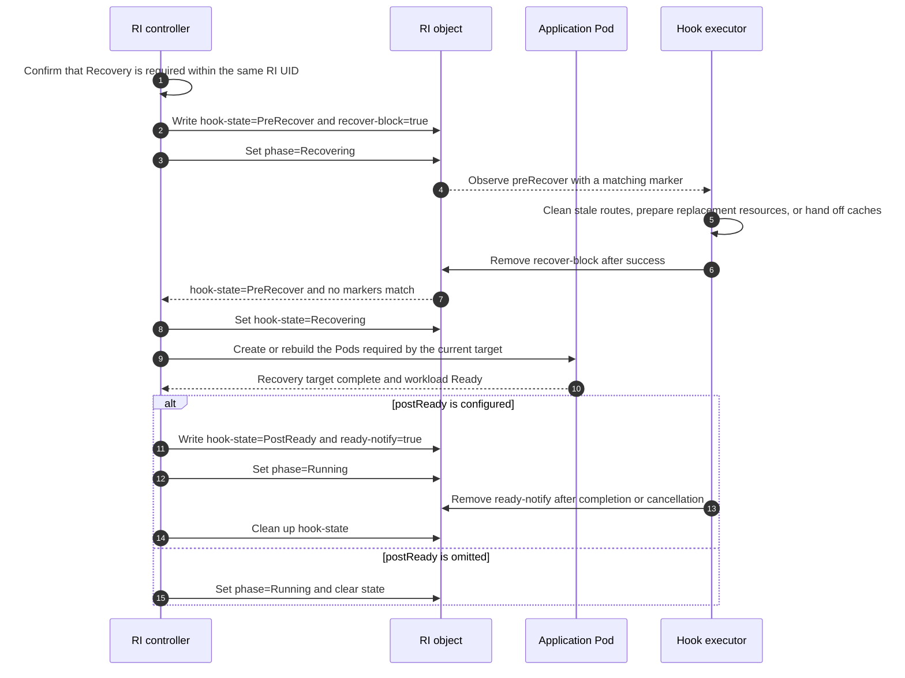

# KEP-527: RoleInstance Lifecycle Hooks

<!-- toc -->
- [KEP-527: RoleInstance Lifecycle Hooks](#kep-527-roleinstance-lifecycle-hooks)
  - [Summary](#summary)
  - [Motivation](#motivation)
    - [Goals](#goals)
    - [Non-Goals](#non-goals)
  - [Proposal](#proposal)
    - [Responsibilities](#responsibilities)
    - [Use Cases](#use-cases)
    - [Notes/Constraints/Caveats](#notesconstraintscaveats)
    - [Risks and Mitigations](#risks-and-mitigations)
  - [Design Details](#design-details)
    - [Hooks and Trigger Boundaries](#hooks-and-trigger-boundaries)
    - [Wire Names and Constants](#wire-names-and-constants)
    - [Signal Label Coordination](#signal-label-coordination)
    - [Signal Label Propagation to Pods](#signal-label-propagation-to-pods)
    - [Hook Executor Service](#hook-executor-service)
    - [Update Interaction Flow](#update-interaction-flow)
    - [Recovery Interaction Flow](#recovery-interaction-flow)
    - [postReady Interaction Flow](#postready-interaction-flow)
    - [Deletion Interaction Flow](#deletion-interaction-flow)
    - [Restart Recovery and Concurrency Constraints](#restart-recovery-and-concurrency-constraints)
    - [Permissions and Field Ownership](#permissions-and-field-ownership)
    - [Relationship to Existing Mechanisms](#relationship-to-existing-mechanisms)
    - [Settled Design and Remaining Questions](#settled-design-and-remaining-questions)
    - [Test Plan](#test-plan)
      - [Prerequisite Test Updates](#prerequisite-test-updates)
      - [Unit Tests](#unit-tests)
      - [Integration Tests](#integration-tests)
      - [E2E Tests](#e2e-tests)
    - [Graduation Criteria](#graduation-criteria)
    - [Upgrade / Downgrade Strategy](#upgrade--downgrade-strategy)
    - [Version Skew Strategy](#version-skew-strategy)
  - [Production Readiness Review](#production-readiness-review)
    - [Feature Enablement and Rollback](#feature-enablement-and-rollback)
    - [Rollout, Upgrade, and Rollback Planning](#rollout-upgrade-and-rollback-planning)
    - [Monitoring Requirements](#monitoring-requirements)
    - [Dependencies](#dependencies)
    - [Scalability](#scalability)
    - [Troubleshooting](#troubleshooting)
  - [Implementation History](#implementation-history)
  - [Drawbacks](#drawbacks)
  - [Alternatives](#alternatives)
  - [Infrastructure Needed](#infrastructure-needed)
<!-- /toc -->

## Summary

This KEP defines four instance-level lifecycle hooks for RoleInstance (RI):
`preUpdate`, `preRecover`, `postReady`, and `preDelete`. They coordinate
application-specific actions before an update, before a recovery, after an
instance reaches workload Ready, and before deletion, respectively.
The new protocol coexists with the legacy RoleInstanceSet lifecycle protocol
at the API level, but admission prevents both from being active on the same
RIS.

All four hooks use the same signal-label coordination model. When a hook is
triggered, the RI controller writes a label marker. The hook executor watches
for matching markers, performs the required application action, and removes
the marker when it completes, cancels, or explicitly allows the operation to
proceed. The pre-operation hooks block the actual workload operation until
their markers no longer match. By contrast, `postReady` is fully asynchronous:
the controller writes its marker and immediately enters `Running` without
waiting for application processing to finish. The controller mirrors signal
labels onto member Pods so Pod-level consumers can observe them without RI
access.

Unlike the legacy protocol, executors do not register markers initially or
restore them after a post-operation hook completes. Executors own application
retries, backoff, and idempotent recovery. Hook markers never participate
in RI Ready computation.

## Motivation

The resource hierarchy is RBGSet → RBG → RIS → RI → Pod. An RI may comprise
multiple Pods that together form a single inference instance. The startup or
termination of any one container cannot indicate that the instance as a whole
is prepared for an update, has passed application validation, or is safe to
remove from service.

Before an update or recovery, an application may need to remove the instance
from routing, drain in-flight requests, clean up stale routes, or migrate
shared caches. After a create, recovery, or update, it may need to validate
the engine, restore dynamic configuration, and register application routes.
Before deletion, it may need to hand off resources that require a live
engine. These actions must have a well-defined ordering relative to the RI
controller's workload operations.

Container `postStart` and `preStop` hooks govern individual container startup
and termination; they cannot provide the instance-level barriers proposed
here. When an application already has an engineRuntime or a third-party
management service, a long-running executor can reuse those capabilities.
RBG does not need to embed application logic or create a Job for every hook.

### Goals

- Provide four instance-level hooks: `preUpdate`, `preRecover`, `postReady`,
  and `preDelete`.
- Mirror `signalLabels` keys from the RI onto member Pods for Pod-level
  consumers.
- Have the controller write a marker whenever a hook is triggered, and have
  the executor remove it after completion or when allowing the operation.
- Block the actual workload operation while a pre-operation marker remains,
  without making the controller execute application actions or manage their
  retry schedules.
- Use `postReady` uniformly for instance validation and application
  registration after create, recovery, and update, without blocking the
  phase, RI Ready, or subsequent operations.
- Preserve the legacy RIS lifecycle protocol while adding the new RoleInstance
  lifecycle protocol.
- Preserve existing behavior for workloads that do not configure lifecycle
  hooks.

### Non-Goals

- Running independent application hooks on RBGSet, RBG, or RIS. Although
  lifecycle configuration is declared on a Role or RIS template, execution
  remains scoped to RI operations. The legacy RIS lifecycle API remains only
  for compatibility.
- Allowing the legacy RIS protocol and the new RI protocol to be configured
  simultaneously on the same RIS.
- Adding `preCreate` or `postDelete`. `preCreate` has no established workload
  or executor to coordinate before Pod creation, while `postDelete` concerns
  external cleanup after the live instance is gone and needs a separate
  protocol.
- Intercepting direct external Pod deletion, node failures, or container
  restarts initiated independently by kubelet.
- Providing a general-purpose script execution platform, or creating a Job or
  dedicated execution Pod for each hook.
- Defining a generic request/result protocol, or making the RI controller
  manage application attempt counts or backoff.
- Providing a readiness-gating field or changing RI Ready; applications
  control their own traffic ingress.
- Providing automatic failure-ignore or explicit skip policies for
  pre-operation hooks in the initial release; `postReady` is an asynchronous
  notification.
- Guaranteeing exactly-once external side effects, or automatically making
  every traffic ingress honor RI Ready.

## Proposal

### Responsibilities

| Participant | Owns | Does not own |
| --- | --- | --- |
| RI controller | Phases, marker writes, Pods, Ready | App actions, retries |
| RI | Config, context, phase, Signal Labels | Execution and message queuing |
| Executor | Watch, execute, retry, remove markers | Registration, spec, phase |

Configuration authority follows object ownership rather than the creation
path. For an RBG-managed RIS, users declare
hooks and marker-matching rules in `RoleBasedGroup.spec.roles[].lifecycle`.
For a standalone RIS, users declare them in
`RoleInstanceSet.spec.roleInstanceTemplate.lifecycle`. In both cases, the RIS
controller propagates the effective snapshot to
`RoleInstance.spec.lifecycle`, and the RI controller reads that local snapshot
without reading back from RBG or RIS.

A controller-written marker indicates that the current hook invocation is
pending. For pre-operation hooks, the executor removes the marker to allow
the workload operation to proceed. For `postReady`, the controller writes the
marker and immediately enters `Running`; the executor processes the hook in
the background and removes the marker. The controller never waits for
`postReady` to complete. It receives no application return value; the
executor obtains the context it needs from the RI and application systems.

### Use Cases

| Hook | Inference application example |
| --- | --- |
| `preUpdate` | Remove from routing, drain requests, and migrate caches |
| `preRecover` | Clean routes, prepare resources, or hand off caches |
| `postReady` | Validate engine, restore LoRA/config, and register routes |
| `preDelete` | Drain traffic and hand off resources needing a live engine |

The `postReady` executor validates the engine, restores dynamic
configuration, and registers routes in the background, then removes the
marker after completion or cancellation. An RI may enter `Running` and become
Ready while `postReady` is still running. If the application must not receive
traffic before registration completes, the application must control its own
traffic ingress rather than relying on a `postReady` marker to gate RI Ready.

Shared KVCache migration must also account for in-flight reads and writes on
other instances and for the data handoff itself. A zero request count on the
local instance is not sufficient evidence that it is safe to exit.

### Notes/Constraints/Caveats

- Hooks are scoped to an operation on the whole RI, not repeated per Pod or
  per reconciliation.
- `preUpdate` and `preRecover` constrain only controller operations that have
  not yet executed. They cannot prevent external actors from directly
  modifying or deleting Pods.
- The top-level phases are `Creating`, `Updating`, `Recovering`,
  `Terminating`, and `Running`. Ready remains an independent status
  condition.
- Delete can move any of `Creating`, `Updating`, `Recovering`, or `Running`
  to `Terminating`. Once there, Update and Recovery are skipped at the start
  of reconciliation.
- `postReady` triggers after a create, recovery, or update target completes
  and the RI reaches workload Ready. Ordinary Ready fluctuations do not
  replay it.
- `postReady` is fully asynchronous: the controller writes the state and
  marker, then immediately enters `Running` without waiting for the executor
  or gating RI Ready.
- When RIS scales the number of RIs, a new RI may run `postReady` after first
  reaching workload Ready, and a deleted RI may run `preDelete`.
- An executor for `preUpdate`, `preRecover`, or `postReady` may run inside an
  application Pod or as a separate deployment. The `preDelete` executor must
  be independently deployed and available before the application Pod is
  deleted.
- `preRecover` cannot depend on an application Pod that has already failed.
  If all members are unavailable, an independently deployed executor is
  required.
- If a pre-operation executor is unavailable or continues to fail, its marker
  remains and the controller keeps waiting while exposing diagnostics. A
  `postReady` executor failure does not block the controller state machine.
- Hooks do not change RI Ready, Pod Ready, EndpointSlice, or an external
  router; applications explicitly integrate traffic control.

### Risks and Mitigations

| Risk | Mitigation or prerequisite |
| --- | --- |
| Repeated marker writes | Write on phase entry only |
| Metadata overwrites markers | Exclude markers from declarative labels |
| Stale marker cleanup within one hook | Consumers coordinate; no generations |
| Marker keys reused by different hooks | Reject in admission |
| Signal key overwrites controller state | Reject reserved keys in admission |
| Retry duplicates | Use recoverable records or idempotency; no exactly-once |
| Foreground/direct deletion bypass | Reject foreground; direct is Recovery |
| Executor outage blocks progress | Diagnostics; no automatic skip in Alpha |
| Broad metadata permissions | Limit scope; use admission/proxy for fields |

## Design Details

### Hooks and Trigger Boundaries

| Hook | Trigger | After marker removal |
| --- | --- | --- |
| `preUpdate` | Before the first Pod change for an update | Start Update |
| `preRecover` | Before restoring a Pod in `Recovering` | Start Recovery |
| `postReady` | Controlled operation is workload Ready | Already `Running` |
| `preDelete` | Before final Pod termination | Delete Pods; finish RI |

In this KEP, workload Ready means the RI satisfies its existing health
conditions.

`postReady` is neither a Pod creation notification nor a container
`postStart`. Creating a Pod, writing the RI spec, or updating a revision is
not sufficient to trigger it. The controller must first confirm that the
current operation target has reached workload Ready.
`hook-state=PostReady` and its marker are written only during that
controlled operation's state transition. Enabling the configuration or
running ordinary metadata synchronization must not backfill them onto an
existing RI. The same `postReady` hook covers application processing after
create, recovery, and update; there are no separate post-operation hooks per
operation type.

An in-place update or Pod rebuild within Update triggers only `preUpdate`;
its internal Pod deletion does not trigger `preDelete`. Creating or rebuilding
Pods during Recovery does not trigger `preUpdate`; instead, `preRecover` runs
before the actual recovery operation, and the common `postReady` runs after
the recovered workload becomes Ready. If the RI UID is replaced, the old RI
follows Delete and the new RI follows Create. This is not Recovery within the
same RI.

### Wire Names and Constants

The following names and values are normative:

| Purpose | Exact name or value |
| --- | --- |
| RBG authority | `RoleBasedGroup.spec.roles[].lifecycle` |
| Standalone authority | `RoleInstanceSet.spec.roleInstanceTemplate.lifecycle` |
| RI execution snapshot | `RoleInstance.spec.lifecycle` |
| Hook fields | `signalLabels` |
| Legacy RIS field | `RoleInstanceSet.spec.lifecycle` |
| Hook-state key | `rbg.workloads.x-k8s.io/role-instance-hook-state` |
| Hook-state value | `PreUpdate` |
| Hook-state value | `Updating` |
| Hook-state value | `PreRecover` |
| Hook-state value | `Recovering` |
| Hook-state value | `PostReady` |
| Hook-state value | `PreDelete` |
| Hook-state value | `Terminating` |
| Phase field | `RoleInstance.status.phase` |
| Phase value | `Creating` |
| Phase value | `Running` |
| Phase value | `Updating` |
| Phase value | `Recovering` |
| Phase value | `Terminating` |
| preDelete finalizer | `rbg.workloads.x-k8s.io/role-instance-pre-delete` |
| Marker-key record | `rbg.workloads.x-k8s.io/role-instance-hook-marker-keys` |
| Legacy state key | `rbg.workloads.x-k8s.io/role-instance-lifecycle-state` |
| Feature gate | `RoleInstanceLifecycleHooks` |
| State-key Go constant | `RoleInstanceLifecycleHookStateKey` |
| Finalizer Go constant | `RoleInstancePreDeleteFinalizer` |
| Marker-key Go constant | `RoleInstanceHookMarkerKeysAnnotation` |

The hook-state label is absent when no lifecycle operation is active. The
protocol does not define a `Running` hook-state value; `Running` is a
`status.phase` value. `Updating`, `Recovering`, and `Terminating` appear in
both fields because the hook-state records which operation is in progress;
it is cleared once no operation or background hook remains. Unknown
hook-state values are invalid: the controller
must not advance, the executor must not execute, and diagnostics must expose
the invalid value without automatic cleanup.

`hook-state` is a defined short name for the exact label key above. Marker
keys and values are user-configured through `signalLabels`; they are not
project-wide constants.

### Signal Label Coordination

All four hooks use the same coordination direction:

1. After determining the current operation, the controller sets
   `hook-state`, the corresponding marker, and its marker-key record in the
   same RI metadata write.
2. The executor starts the application action when it observes a matching
   `hook-state` and marker.
3. For a pre-operation hook, the executor removes the marker after success or
   when it decides to allow the operation. On failure, it leaves the marker
   in place and retries with its own backoff.
4. The controller proceeds with the actual workload operation only after all
   markers associated with the pre-operation hooks no longer match.
5. For `postReady`, the controller writes the state and marker and immediately
   enters `Running`. The executor removes the marker after background
   completion or cancellation, and the controller then cleans up the state.

“Matching” means that the RI label key and value equal those configured in
`signalLabels`. If any marker for a pre-operation hook still matches, the
controller keeps waiting. A `postReady` marker participates in neither this
wait nor Ready evaluation. A hook that is not configured writes no marker and
establishes no coordination.

The controller writes a pre-operation marker only when entering that hook's
phase. It must not rewrite the marker on every reconcile while waiting.
When entering `postReady`, it may idempotently write an already-present
marker. The executor only removes markers; it does not create them initially
or restore them after processing.

The following example shows the proposed API shape for configuration on an
RBG Role. `RoleBasedGroup.spec.roles[].lifecycle` is a proposed new field
path; it does not imply that the field already exists:

```yaml
apiVersion: workloads.x-k8s.io/v1alpha2
kind: RoleBasedGroup
metadata:
  name: inference-group
spec:
  roles:
    - name: prefill
      # Other Role fields, such as replicas and standalonePattern, are omitted.
      lifecycle:
        preUpdate:
          signalLabels:
            example.com/update-block: "true"
        preRecover:
          signalLabels:
            example.com/recover-block: "true"
        postReady:
          signalLabels:
            example.com/ready-notify: "true"
        preDelete:
          signalLabels:
            example.com/delete-block: "true"
```

The configuration hierarchy is settled. For an RBG-managed RIS,
`RoleBasedGroup.spec.roles[].lifecycle` is the user-owned desired
configuration; each Role may declare its own hooks, and the RBG controller
writes the desired snapshot to
`RoleInstanceSet.spec.roleInstanceTemplate.lifecycle`. Direct edits to that
snapshot on an RBG-owned RIS are unsupported and are overwritten on the next
RBG reconcile. The RIS controller then copies the snapshot to
`RoleInstance.spec.lifecycle`.

For a standalone RIS, `roleInstanceTemplate.lifecycle` is the user-owned
desired configuration. The RIS controller copies it to each RI in the same
way. The creation path does not change hook execution; it only determines
which object owns the desired configuration and how that configuration is
propagated.

The new protocol defines an independent hook type: every hook contains only
`signalLabels`, and no hook changes RI Ready.

The new lifecycle protocol and the existing `RoleInstanceSetSpec.lifecycle`
use distinct API types and runtime protocols. The legacy RIS field remains
for existing standalone RIS usage, and its `inPlaceUpdate` hook is
deprecated. Admission rejects a Role/RIS combination in which the new
lifecycle protocol and a legacy user-configured RIS lifecycle are both
non-empty. RBG-managed RIS lifecycle data is propagated from the Role and is
not independently editable. For this check, a legacy RIS lifecycle is
user-configured whenever the RBG controller does not own it: RBG propagates
only the new protocol field, so any non-empty legacy `spec.lifecycle` on an
RBG-managed RIS is treated as user configuration.

The two protocols can coexist safely because they use distinct state keys and
distinct controller responsibilities: the legacy protocol is executed by the
RIS controller, while the new protocol is executed by the RI controller.
Admission enforces mutual exclusion so one RIS never activates both.

The new protocol does not reuse the legacy hook type. `finalizersHandler` and
`inPlaceUpdate` are absent from the new API rather than deprecated-and-empty.
The legacy RIS protocol retains its existing `finalizersHandler` and
`markPodNotReady` semantics. Conversely, the legacy standalone RIS path
rejects `preUpdate`, `preRecover`, and `postReady`; those three hooks are
meaningful only through the new protocol.

Declarative configuration flows only downward. `hook-state` and runtime
markers are written to RI labels, mirrored onto member Pods, and never
written back to RBG or RIS. `signalLabels` defines the matching rules used
by the controller when
writing markers and by both parties when evaluating them; it is not
registration state maintained by the executor.

An omitted hook disables that hook. A configured hook with an omitted or
empty `signalLabels` is invalid and must be rejected by admission. Multiple
labels on a pre-operation hook represent multiple coordination conditions;
the controller proceeds only after none of them match. Ordinary metadata
synchronization must not modify runtime markers.

Every `signalLabels` key and value must satisfy Kubernetes label syntax.
Marker keys must be valid Kubernetes label keys: an optional prefix is a
DNS subdomain of at most 253 characters, and the name segment is at most 63
characters. Marker values must be valid Kubernetes label values and are at
most 63 characters. Admission rejects invalid marker keys or values before
configuration is accepted. The controller does not truncate, rewrite, or
drop a configured marker to make it writable.

Marker keys are scoped to a hook point. Admission must reject a key used by
more than one configured hook, including `postReady` and `preDelete`, because
delayed cancellation cleanup from one hook can otherwise remove the marker
belonging to another hook. Signal label keys must also be rejected when
they equal the exact hook-state key or use the reserved
`rbg.workloads.x-k8s.io/` prefix. Hook marker keys are runtime labels, but
they must not collide with controller-reserved state. Admission also rejects
a marker key used by the owning RIS `spec.selector`, whether in `matchLabels`
or in any `matchExpressions` entry, even when the key is absent from template
labels. Writing such a marker can make an RI stop matching the selector, and
the stateful RIS instance-reference logic then releases the RI's owner
reference.

The implementation must use the exact hook-state label key
`rbg.workloads.x-k8s.io/role-instance-hook-state` and must not reuse the
existing `rbg.workloads.x-k8s.io/role-instance-lifecycle-state` key.

The controller always evaluates the latest effective lifecycle configuration.
If a hook is configured, its markers are matched; if a hook is not configured,
no marker matching occurs for that hook. A configuration change therefore
takes effect on the next reconciliation without special in-flight handling.
For example, after markerA changes to markerB, the controller checks markerB
directly and stops waiting for markerA. If an active hook is removed, the
controller treats it as absent, stops matching its marker, removes its stale
runtime labels, and follows the same transition as a released hook; for
example, `PreUpdate` advances to `Updating`. This is the intended declarative
semantics.

To make stale-label cleanup and rollback verification durable, the controller
records the marker keys owned by the protocol in the annotation
`rbg.workloads.x-k8s.io/role-instance-hook-marker-keys`, a comma-separated
list of keys whose labels the protocol may still have written. The record is
updated in the same metadata write as the marker, and a key is removed only
after the corresponding label is confirmed absent. After markerA changes to
markerB, markerA stays recorded until its label is cleaned, so a restart can
still distinguish protocol-owned stale labels from ordinary user labels. The
rollback precondition is an absent `hook-state` label together with an empty
or absent marker-key record.

### Signal Label Propagation to Pods

For every key declared in `signalLabels`, the RI controller mirrors the
corresponding RI label onto every member Pod. When the RI carries the key,
the controller writes the same key and value to the Pod; when the RI loses
the key, the controller removes it from the Pod; when the value changes, the
change is synced to the Pod. Pod-level consumers such as routers,
EndpointSlice-based selectors, and sidecars can therefore observe hook
signals without watching or patching RIs.

Propagation rules:

- Propagation is unidirectional from RI to Pod. The RI is the only source
  of truth, and the Pod copies are controller-owned mirrors.
- Executors still remove markers only on the RI; the removal reaches member
  Pods through the same propagation.
- Propagation is a metadata-only Pod update. It does not change the Pod
  template, create a new controller revision, or recreate Pods.
- The controller reconciles these keys on every RI reconciliation and
  batches the Pod updates it issues.
- Signal label keys are controller-owned on member Pods. Declaring the same
  key in the Pod template labels is a configuration error and is rejected by
  admission.

### Hook Executor Service

The executor is a long-running, application-provided service that watches
RI phases and the markers it processes, mapping each phase to an
application action. It may reuse an engineRuntime directly or run as a
separate deployment.

If the engineRuntime exposes only application management APIs, an adapter
service can act as the executor. The adapter watches RIs, invokes runtime
APIs, and removes markers; the runtime itself need not understand the
Kubernetes lifecycle protocol. This adapter is one executor implementation,
not a new custom resource.

The existing `ClusterEngineRuntimeProfile` injects initContainers, containers,
and volumes; the CR itself is not an execution process. Reusing an
engineRuntime still requires a long-running process or adapter service to
implement phase observation, application retries, idempotent recovery, and
marker removal.

RBG is intentionally agnostic to the identity, number, and deployment model
of marker consumers. The controller evaluates marker presence only through
`signalLabels`. It does not identify consumers or manage consumer leader
election, membership aggregation, or result arbitration.

Application owners decide how multiple consumers coordinate and when a marker
shared within one hook is safe to remove. Removing such a marker too early is
a consumer coordination problem and does not change the RBG protocol. Marker
keys remain scoped to a single hook point.

### Update Interaction Flow

This example uses `example.com/update-block=true` and
`example.com/ready-notify=true`, abbreviated as update-block and ready-notify.

```mermaid
sequenceDiagram
    autonumber
    participant C as RI controller
    participant R as RI object
    participant P as Application Pod
    participant E as Hook executor
    C->>R: Record the update target
    C->>R: Write hook-state=PreUpdate and update-block=true
    C->>R: Set phase=Updating
    R-->>E: Observe preUpdate with a matching marker
    loop While the phase is valid and preUpdate has not succeeded
        E->>E: Remove from routing and drain; retry with backoff on failure
        Note over C,R: Controller waits and does not update the Pod
    end
    E->>R: Remove update-block after success
    R-->>C: hook-state=PreUpdate and no markers match
    C->>R: Set hook-state=Updating
    C->>P: Perform an in-place update or rebuild the Pod
    P-->>C: Update target complete and workload Ready
    alt postReady is configured
        C->>R: Write hook-state=PostReady and ready-notify=true
        C->>R: Set phase=Running
        R-->>E: Observe postReady with a matching marker
        E->>E: Validate, restore config, and register routes
        E->>R: Remove ready-notify after completion or cancellation
        C->>R: Clean up hook-state
    else postReady is omitted
        C->>R: Set phase=Running and clear state
    end
```

While `preUpdate` is active, the absence of any matching marker is a
necessary condition for the controller to start the update. `postReady`
blocks neither `Running`, RI Ready, nor the next operation. The executor
removes ready-notify after completion or cancellation and does not restore
it. The next update writes a new hook-state and corresponding marker
through the controller.

### Recovery Interaction Flow

`preRecover` uses the same marker coordination and blocking rules as
`preUpdate`, but has its own phase, marker, and application actions:



`preRecover` is not used for Pod replacement within Update, or for deletion
and recreation that replaces the RI UID. The executor retains the marker
until the recovery preparation completes; the controller does not perform
the actual Pod recovery while it remains.

### postReady Interaction Flow

`postReady` follows the same processing rules after create, recovery, and
update:

```mermaid
sequenceDiagram
    autonumber
    participant C as RI controller
    participant R as RI object
    participant E as Hook executor
    C->>C: Confirm that the create, recovery, or update target is complete
    C->>C: Wait for workload Ready
    C->>R: Write hook-state=PostReady and the ready marker together
    C->>R: Set phase=Running and compute RI Ready
    R-->>E: Observe postReady with a matching marker
    loop While the phase is valid and the background action is incomplete
        E->>E: Validate, restore config, or register routes; retry on failure
    end
    E->>R: Remove the ready marker after completion or cancellation
    R-->>C: Running with hook-state=PostReady and no marker
    C->>R: Clean up hook-state
```

Hook markers never participate in RI Ready computation, and background
`postReady` results do not change the controller's phase or Ready. The
executor diagnoses application results, and the application system owns
traffic ingress.

The controller reconstructs `postReady` progress from the combination of
phase, `hook-state`, and marker, without adding a `step` field or private
controller state. `postReady` may originate only from a controlled operation
already in `Creating`, `Updating`, or `Recovering`, and its state and marker
must be written during the transition in which that operation reaches
workload Ready.

`Running` is not a trigger source, and ordinary Ready changes do not backfill
these labels. Consequently, enabling `postReady` on an existing `Running` RI
does not immediately execute or replay a historical hook because there is no
corresponding state transition.

Even if the previous ready marker has not yet been removed, a new operation
that reaches workload Ready still writes the `postReady` state and marker and
immediately enters `Running`. Rewriting the same marker is idempotent and
introduces no operation generation.

### Deletion Interaction Flow

```mermaid
sequenceDiagram
    autonumber
    participant C as RI controller
    participant R as RI object
    participant P as Application Pod
    participant E as Hook executor
    R-->>C: Observe deletion intent; finalizer keeps the RI present
    C->>R: Write hook-state=PreDelete and delete-block=true
    C->>R: Set phase=Terminating
    R-->>E: Observe preDelete with a matching marker
    loop While the phase is valid and preDelete has not succeeded
        E->>P: Drain traffic and hand off resources; retry on failure
        Note over C,P: Controller does not delete the application Pod
    end
    E->>R: Remove delete-block after success
    R-->>C: No preDelete markers match
    C->>R: Set hook-state=Terminating
    C->>P: Delete the application Pod
    C->>R: Remove the reserved preDelete finalizer and finish RI deletion
```

This proposal does not include `postDelete`; other mechanisms handle external
cleanup after application Pod deletion. The deletion flow consists only of
`preDelete` coordination, Pod deletion, and final RI cleanup. The executor
does not restore a marker after deletion completes.

When the effective RI configuration includes `preDelete`, the controller
ensures that the reserved finalizer
`rbg.workloads.x-k8s.io/role-instance-pre-delete` is present on the RI before
the hook is considered effective. The executor removes only the delete marker
on the RI. While that marker matches, the controller does not issue member
Pod deletions.
After confirming that `preDelete` has been released, the controller deletes
the member Pods, performs final RI cleanup, and removes its reserved finalizer.
No per-Pod finalizer is used.

On the default background deletion path, the reserved RI finalizer keeps the
owner object present, and Kubernetes background GC does not delete dependent
member Pods while their owner object still exists. This is the invariant that
gives the executor access to a live workload while `preDelete` runs. The
controller is still responsible for not deleting member Pods before the
marker is released.

New RIs are created with the reserved finalizer when their effective
configuration includes `preDelete`. For an existing stable RI, the controller
adds the finalizer before exposing the effective `preDelete` configuration.
If the RI already has a deletionTimestamp, the controller cannot add the
finalizer, so the hook is never exposed on that RI and its deletion
continues without `preDelete`; Kubernetes does not allow a new finalizer to
be added after deletion has begun. Removing a hook from the effective
configuration is a normal disable: the controller stops matching its markers,
removes stale runtime labels identified through the marker-key record, and,
for `preDelete`,
removes the reserved RI finalizer as part of configuration convergence. If
`preDelete` is removed while deletion is in progress, removing the finalizer
lets deletion continue. The change applies whether or not another lifecycle
operation is in flight; no special active-hook state is retained.

When Update or Recovery replaces a Pod, the controller performs the internal
replacement after the corresponding pre-operation hook is released, without
triggering `preDelete`. No member Pod requires a lifecycle finalizer.

Controller-initiated deletion and default background cascade are the supported
deletion paths. Foreground cascading deletion must be rejected by admission
for RBGSet, RBG, RIS, or RI deletion requests that can reach an RI with
`preDelete` configured. The webhook intercepts those DELETE requests, checks
`DeleteOptions.propagationPolicy`, and rejects `Foreground`; it resolves
reachable RIs through owner references and cached informers. Resolution is
fail-closed: when the cache has not yet observed a newly created RI or a
recently enabled `preDelete`, the webhook cannot prove the deletion is safe
and rejects or defers the request. A cache miss must not establish that
deletion is safe. Foreground GC may delete dependent Pods before the hook is
released. Namespace teardown is outside the live-engine guarantee:
the namespace controller may delete member Pods directly, and an operator must
use the break-glass procedure if a reserved RI finalizer remains. A direct
external Pod deletion cannot be undone by clearing its deletionTimestamp. That
path still belongs to Recovery, does not trigger `preDelete`, and provides no
live-engine barrier.

### Restart Recovery and Concurrency Constraints

The phase model is defined by KEP-502, currently proposed in PR #528. RI
phases are persisted in `RoleInstance.status.phase` as `Creating`, `Running`,
`Updating`, `Recovering`, and `Terminating`. The executor observes
`status.phase` together with the RI lifecycle labels. KEP-527 cannot become
implementable until the KEP-502 schema and phase persistence rules are
accepted.

The executor owns application retries. The controller retries only its own
API reads and writes and status convergence. If an application result is
unknown, the executor must query, recover, or retry idempotently before
removing a marker.

The controller adds neither a `step` field nor private runtime state. It
reconstructs progress from the combination of RI phase, `hook-state`,
marker, and the marker-key record. On hook entry, `hook-state`, the marker,
and its marker-key record must be set in the same metadata write. An
intermediate state with the state present but the marker not yet written is
not allowed.

After a pre-operation hook is released, the controller must not clear its
state. It explicitly transitions to the actual operation phase:

```text
PreUpdate + marker   → PreUpdate + no marker → Updating
PreRecover + marker  → PreRecover + no marker → Recovering
PreDelete + marker   → PreDelete + no marker → Terminating
```

A state such as `PreUpdate + no marker` means that the hook has been released.
After a restart, the controller uses this state to continue without
incorrectly treating the hook as untriggered. It performs the actual workload
operation only after entering `Updating`, `Recovering`, or `Terminating`.
`postReady` subsequently replaces the update or recovery state, while the
deletion state remains until the RI is finally deleted.

For `postReady`, the controller first enters `Running`; the executor then
removes the marker asynchronously, and the controller finally cleans up the
state. The controller does not wait for the application result. On startup or
watch reconnection, the executor rereads the RI and executes or resumes an
application action only when `hook-state` matches and its marker exists.

The operation rules are:

| Current operation | New operation | Rule |
| --- | --- | --- |
| `Creating` | Update, Recovery | Fold target into Create; no hooks |
| `Updating` | Update | Merge; preUpdate only from non-updating |
| `Updating` | Recovery | Fold into Update; no preRecover |
| `Recovering` | Recovery | Continue; no repeat preRecover |
| `Recovering` | Update | Interrupt; run preUpdate and Update |
| Any non-terminating phase | Delete | Preempt; `Terminating` and preDelete |
| `Terminating` | Update, Recovery | Skip at reconcile start |
| Background postReady | Update, Recovery, Delete | Start; executor uses state |

For `Creating`, a target change is folded into Create convergence rather than
ignored. A corrected initial image may replace a member that has not reached
workload Ready, but the controller does not enter separate Update or Recovery
operations and does not invoke their hooks.

Update may interrupt Recovery; the previous engine may then be dead. A
`preUpdate` executor therefore must not assume that a live engine is
available. It either determines that the engine-dependent action is
inapplicable and safely releases the marker, or retains the marker until the
application-side prerequisite is satisfied. The controller does not infer
engine liveness and does not skip the marker.

`Recovering` means that the current Recovery has not yet completed
successfully. Repeated reconciliations or another observation of the same
Recovery need merely continue that operation. They do not start a new
operation and must not re-enter `preRecover`.

The Update and Recovery checks for `Terminating` must run before their
operation and hook logic, preventing another operation from taking over while
deletion is in progress.

The `postReady` completion condition is deliberately simple: when a controlled
operation reaches workload Ready and `postReady` is configured, write the state
and marker and immediately enter `Running`. If `postReady` is omitted, enter
`Running` and clear `hook-state` without writing a marker. If the previous
marker still exists, rewriting
it does not change its value. `hook-state` has moved from the new
operation's pre-operation phase to `postReady`, so the executor processes the
latest phase.

An old executor removes its marker after completion or cancellation. The
controller neither waits for confirmation that the old task has stopped nor
introduces an operation generation. Identical marker names do not distinguish
application iterations: delayed cleanup from the first iteration may remove
the same marker just written for the second, causing the controller to treat
the second `postReady` as complete prematurely.

This design explicitly accepts that shared-marker risk within `postReady`.
Consumers must coordinate cleanup timing and use idempotency and
application-side fencing for delayed external side effects. RBG provides no
generation isolation.

### Permissions and Field Ownership

The controller writes hook markers, and the executor removes the markers it
processes. Each party modifies only the marker keys it is responsible for
rather than replacing the entire labels map. Ordinary RIS metadata
synchronization must not overwrite these runtime markers.

Field ownership is explicit: users own the authoritative lifecycle
configuration described above; the controller owns phase, `hook-state`, the
effective RI snapshot, the reserved finalizer, and the mirrored signal labels
on member Pods; the executor only removes markers. Admission or a restricted
proxy may enforce this boundary.

An executor that polls with GET and PATCHes markers needs `get` and `patch`
on `roleinstances` in the target namespace. LIST/WATCH additionally requires
`list` and `watch`. A `resourceNames` restriction requires a matching field
selector and cannot be applied directly to an unrestricted informer.

Native RBAC cannot restrict PATCH to a specific label. Strict field-level
isolation requires admission control or a restricted proxy.

### Relationship to Existing Mechanisms

This proposal builds on the coordination model of the existing RIS
`labelsHandler`, but changes marker initialization ownership. In the new RI
protocol, the controller writes the marker on every hook trigger. The
executor only removes it; there is no initial registration or post-operation
restoration.

The legacy RIS `spec.lifecycle` and new lifecycle protocol use distinct API
types and runtime protocol state. The legacy `inPlaceUpdate` and
`finalizersHandler` fields remain part of the legacy protocol only. The new
protocol exposes only `signalLabels`. The two runtime protocols must
not be active on the same RIS; an admission webhook enforces that boundary.
Their state keys remain distinct. Warmup and container lifecycle hooks retain
their own responsibilities and are not equivalent to the instance-level hooks
proposed here.

### Settled Design and Remaining Questions

The four-hook API design is settled: for RBG-managed workloads, the Role
defines the desired configuration; for standalone RIS objects, the RIS
template defines it. The RIS template stores the desired snapshot, and the
RIS controller copies it into `RoleInstance.spec.lifecycle` as the effective
copy. The new lifecycle protocol defines an independent hook type rather
than reusing the legacy structure. Empty `signalLabels` values fail
validation. Every hook contains only `signalLabels`, and no hook gates RI
Ready. The wire names and Go constant names above are settled.

Restart recovery adds no `step`: `hook-state`, the marker, and the
marker-key record are written together on hook entry. After a pre-operation
hook is released, the state
transitions to `Updating`, `Recovering`, or `Terminating` rather than being
cleared. `postReady` enters `Running` immediately and finishes
asynchronously.

`postReady` covers only controlled Create, Update, and Recovery operations.
Workload Ready means the RI's existing health conditions. Neither ordinary
Ready fluctuations
nor enabling the feature on an existing `Running` RI replays the hook.

The continuous-operation rules are also settled. Update merges subsequent
Update and Recovery targets; Update can interrupt Recovery; Delete preempts
other operations. `Creating` folds target changes into Create convergence,
including correcting a failed initial image, but does not enter separate
Update or Recovery operations or invoke their hooks; `Recovering` does not
re-enter Recovery; and `Terminating` skips Update and Recovery at the start of
reconciliation. `postReady` blocks no subsequent operation and adds no
operation generation.

The consumer boundary is settled: RBG evaluates only marker presence and is
agnostic to consumer identity, count, election, and aggregation. The
`preDelete` barrier is also settled: the controller retains a reserved RI
finalizer, deletes member Pods only after `preDelete` is released, and then
removes the finalizer. Internal Update or Recovery replacement does not
execute `preDelete` and needs no member Pod finalizer.

The rollout and rollback boundaries are settled: deploy the executor and its
permissions before enabling the feature; existing `postReady` hooks are not
replayed merely because an RI is currently Ready. Established hook semantics
must not change, new behavior requires a new hook, and a version that does
not understand the protocol must not take over an unfinished operation.

The Alpha compatibility rule is also settled: the new lifecycle protocol
and the legacy user-configured RIS lifecycle are mutually exclusive. The
legacy protocol remains unchanged; the new protocol exposes only
`signalLabels`.

The designs above are settled; what remains before this KEP can become
`implementable` is completion and validation, not redesign:

1. Acceptance of the KEP-502 `RoleInstance.status.phase` schema and the
   post-Alpha migration path for standalone RIS lifecycle users.
2. Finalize authorization and diagnostics details, the version support
   matrix, and the procedure for adopting existing resources.
3. Validate the settled preDelete barrier: default background GC behavior
   with the reserved RI finalizer, admission rejection of foreground
   cascading deletion, and controller-ordered member Pod deletion.

Timeout budgets, manual skipping, and alternative failure policies are left
for future enhancements.

### Test Plan

The following tests are planned; they are not a record of completed
validation.

#### Prerequisite Test Updates

Establish regression baselines for create, update, component scaling,
Recovery, Ready, and deletion when lifecycle hooks are not configured. Retain
behavioral tests for the old RIS lifecycle and distinguish workload backends.

#### Unit Tests

- Trigger boundaries for all four hooks, confirming that no other lifecycle
  hooks exist.
- Admission rejects a new lifecycle protocol together with a legacy
  user-configured RIS lifecycle, and rejects marker keys that collide with
  the fully qualified controller state key.
- Admission rejects marker keys used by the owning RIS `spec.selector` in
  `matchLabels` or `matchExpressions`, including keys selected only by
  `DoesNotExist`.
- Admission rejects `signalLabels` keys and values that are invalid
  Kubernetes labels, including over-long names or values, invalid prefix
  syntax, invalid leading or trailing characters, and unsupported
  characters.
- Admission rejects signal label keys that are declared in the Pod template
  labels.
- Signal labels propagate from the RI to member Pods: present keys are
  copied, absent keys are removed, and value changes are synced; propagation
  is metadata-only and does not recreate Pods.
- The new API exposes only `signalLabels` on every hook. The legacy RIS
  protocol retains its existing fields and rejects the three new hook
  fields.
- The controller persists and exposes the KEP-502 RI `status.phase`, and the
  executor observes it together with the lifecycle marker labels.
- The implementation uses the exact hook-state key, finalizer, feature gate,
  and value set; an unknown hook-state is not advanced or executed.
- The controller writes a pre-operation marker only when entering the phase
  and does not restore it while waiting; `postReady` supports idempotent
  writes to an existing marker.
- The executor acts only when phase and marker match. It removes
  pre-operation markers to release the operation and removes `postReady`
  markers after background completion or cancellation.
- A pending preUpdate marker prevents Pod updates, a pending preRecover
  marker prevents Pod recovery, and a pending preDelete marker prevents Pod
  deletion.
- `postReady` triggers only after the target completes and the workload is
  Ready; ordinary Ready fluctuations do not retrigger it.
- Hook markers never participate in RI Ready computation; a pending
  `postReady` marker does not prevent entry into `Running`.
- `Recovering` runs preRecover followed by asynchronous postReady. Ordinary
  Ready fluctuations in `Running` and enablement on existing RIs do not
  trigger `postReady`.
- Update merges while `Updating` without repeating preUpdate, and Recovery
  folds into the current Update. Update while `Recovering` enters preUpdate;
  repeated Recovery neither re-enters the phase nor repeats preRecover.
- `Creating` folds Update and Recovery target changes into Create
  convergence, allowing a corrected image to replace a not-yet-Ready member
  without invoking preUpdate or preRecover; `Terminating` skips both at the
  start of reconciliation.
- Delete preempts Update, Recovery, and background postReady; new operations
  do not wait for an old `postReady`.
- Multiple marker conditions, admission rejection of empty handlers and
  illegal marker keys (keys shared between hooks or colliding with
  controller-managed labels), restart recovery, behavior with no configured
  hooks, and controller agnosticism to consumer identity.
- `hook-state`, marker, and marker-key-record writes occur together. After a
  pre-operation marker is removed, the controller transitions to the actual
  operation
  state, and a restart does not repeat the released hook. `postReady` enters
  `Running` before asynchronous state cleanup.
- A change from markerA to markerB immediately uses the latest configuration
  without migrating or removing the old marker; the old key remains recorded
  until its label is cleaned.
- The marker-key record is written with the marker, retained across
  restarts, and cleared only after the corresponding label is removed; the
  rollback precondition is an absent `hook-state` label and an empty record.
- Removing an active hook uses absence semantics: the controller performs no
  marker matching for it, removes its stale runtime labels, and follows the
  released-hook transition.
- Repeated controlled operations reaching workload Ready idempotently write
  the same `postReady` marker without generations. Delayed cleanup can
  remove a newer marker, and consumers own coordination of that risk.
- When `postReady` is omitted, an Update or Recovery that reaches workload
  Ready enters `Running` and clears `hook-state`
  without writing a marker.
- Disabling a hook stops future invocations and, on the next reconciliation,
  stops marker matching even if an operation is unfinished.

#### Integration Tests

- When a pre-operation executor starts late, its marker remains matched and
  the controller keeps waiting; no initial executor registration is needed.
- An executor eventually succeeds with its own backoff after repeated
  application failures, while the controller does not advance the blocked
  operation.
- Controller and executor restarts, watch reconnections, PATCH conflicts,
  and successful application actions followed by marker-removal failures.
- Foreground-deletion admission is fail-closed: requests that race RI
  creation or `preDelete` enablement are rejected or deferred while the
  informer cache is stale.
- RIS metadata synchronization preserves runtime markers, and the controller
  does not rewrite a marker during the same pre-operation phase.
- RI signal-label changes reach member Pods without revision changes, and
  marker removal on the RI removes the mirrored Pod labels.
- Consecutive updates, delayed old `postReady` tasks, recreation of an RI
  with the same name, and takeover by multiple executors, validating
  state-driven cancellation, recovery, and idempotent cleanup.
- GC propagation for `preDelete`, deletion with zero Pods, and compatibility
  between old and new lifecycle protocols.
- Reserved RI finalizer addition, retention while `preDelete` is pending, and
  removal after member Pod deletion is complete.
- New RIs are created with the reserved finalizer; existing enablement adds
  it before exposing the hook, and an RI already being deleted never exposes
  the hook; that deletion continues without `preDelete`.
- Default background deletion retains member Pods until `preDelete` is
  released, admission rejects foreground deletion at every affected ancestor
  including RBGSet, and namespace teardown is documented as outside the
  live-engine guarantee.
- Update and Recovery replace Pods during internal replacement without
  executing `preDelete` and without member Pod finalizers.
- Hook disablement stops marker matching on the next reconciliation and
  cleans stale runtime labels and the reserved RI finalizer, even when
  another lifecycle operation is unfinished.
- The emergency break-glass procedure removes only the exact blocking marker
  and lets the controller advance without direct phase, finalizer, or Pod
  edits.

#### E2E Tests

- Drain traffic from a multi-Pod RI before an update, then asynchronously
  validate the updated workload, restore LoRA, and register application
  routes after it reaches workload Ready.
- Run preRecover before actually creating or rebuilding Pods during Recovery,
  and run the common postReady after workload Ready; ordinary Ready
  fluctuations do not replay it.
- Run postReady directly after Create reaches workload Ready, without running
  preRecover.
- Verify that application routing resumes according to its own traffic
  policy while background `postReady` processing is still running.
- The controller does not terminate application Pods before `preDelete`
  completes; after release, it deletes member Pods and removes the reserved
  RI finalizer.
- Submit several consecutive updates and verify that `Updating` does not
  repeat preUpdate, old postReady work does not block new operations, and
  same-name markers are handled idempotently.
- Verify that Update interrupts Recovery and Delete preempts other
  operations.
- Exercise prolonged executor unavailability, unknown application results,
  and restarts of both parties, covering pre-operation waits, background
  postReady processing, and diagnostics.
- Preserve behavior with no configured hooks, and avoid replaying historical
  actions during adoption, upgrade, or rollback.

### Graduation Criteria

Before Alpha, resolve the three remaining pre-implementable questions in
"Settled Design and Remaining Questions". Implement all four hooks,
controller-write/executor-remove signal-label coordination; complete the
core tests and provide an executor integration example.

Before Beta, validate real applications, multi-Pod coordination, permissions,
recovery and upgrade compatibility, and overhead at scale. Complete
operational diagnostics and recovery procedures.

Stable requires sustained production feedback and resolution of Beta issues.
This KEP does not assign a release milestone.

### Upgrade / Downgrade Strategy

Workloads with no new hooks configured retain their existing behavior.
Enabling the feature on an existing RI does not replay `postReady` or
`preUpdate` solely because the RI is currently Ready or was updated in the
past; those hooks are triggered by controlled operations. When `preDelete`
is enabled, the controller adds the reserved finalizer to existing stable
RIs as described above.

Before enabling lifecycle hooks, deploy a compatible executor and verify its
RBAC permissions, then allow hook configuration. Writing a pre-operation
marker before a consumer is available leaves the corresponding update,
recovery, or deletion waiting indefinitely. The executor does not perform
initial marker registration.

Phases and markers already in use retain stable semantics across upgrades.
After a hook's semantics are established, later versions keep its trigger
conditions, blocking behavior, marker direction, and operation boundaries.
New lifecycle behavior is expressed through a new hook.

Before an incompatible downgrade, disable the hooks while a controller that
understands the protocol still owns the RIs. Wait until every RI is stable,
has no `hook-state` label or remaining marker (verified through the
marker-key record), and has no reserved `preDelete` RI finalizer remaining.
Replace the controller only after those conditions are
verified; otherwise, retain a compatible controller to finish operations and
remove finalizers. Clearing labels or finalizers manually is not a
supported rollback.

### Version Skew Strategy

The controller and executor must agree on where the phase is stored, its
values, and marker direction. An executor that does not understand the new
protocol must not remove markers blindly.

The support matrix and migration rules will be defined when the API is
finalized.

## Production Readiness Review

This section records requirements and outstanding gaps. The production
readiness review has not yet been completed.

### Feature Enablement and Rollback

The feature gate is `RoleInstanceLifecycleHooks`. Deploy an executor that
supports the phase protocol and grant its required permissions before enabling
the gate. The gate defaults to false. While it is disabled, the new protocol
fields are rejected and the legacy RIS lifecycle protocol retains its existing
behavior.

Disabling or re-enabling the feature leaves in-flight markers and unfinished
phases intact. A version that does not understand the current protocol does
not take over an unfinished operation. `preDelete` requires an
executor that is available before application Pod deletion and validation of
the barrier across all supported deletion paths.
Foreground cascading deletion is not a supported path and must be rejected by
admission for RBGSet, RBG, RIS, or RI deletion when it can reach an RI with
`preDelete` configured.

The `disable-supported` metadata field describes feature-gate rollback, not
stable-boundary removal of individual hook configuration.

For an incompatible rollback, disable the hook configuration before removing
the compatible controller. The disablement is complete only after the RIs are
stable and no reserved `preDelete` RI finalizer remains. A feature-gate change
or configuration deletion is not a substitute for that convergence.

### Rollout, Upgrade, and Rollback Planning

The main risks are repeated marker writes by the controller, removal of new
markers by old executors, and indefinitely stalled deletion. Validation must
cover controller/executor version compatibility, the impact of pre-operation
waits on higher-level rollout budgets, and the handoff between the old and
new protocols.

Testing will cover upgrade → downgrade → upgrade. This proposal does not
remove the existing RIS lifecycle API.

### Monitoring Requirements

RI exposes its phase and current marker matches. The controller reports the
wait reason through a controller-owned condition or event; its exact schema
is part of the open diagnostics design. The executor
provides application execution logs and failure/retry diagnostics. Markers
alone cannot distinguish an executor that has not started, an application
action in progress, and persistent failure; additional diagnostics are
required. Avoid writing to the RI on every application failure to prevent
high-frequency API writes.

Planned metrics include phase wait duration by operation type, executor
availability, application retries and failures, and
update/deletion latency. Application execution time and controller
convergence latency are measured separately. This KEP does not define an
unvalidated numeric SLO.

### Dependencies

This feature depends on the Kubernetes API, RI controller, and hook executor;
it does not depend on creating a Job for each invocation. Failures in engine
management APIs, routing, or storage services used by the executor can extend
pre-operation waits or background `postReady` processing.

### Scalability

The main additional costs are phase and marker writes, executor watch
connections, and application retries. No per-invocation Job or Pod is
created. Executors must bound their watch scope, connection counts, polling
rates, and application backoff to prevent multiple sidecars from watching all
RIs.

Scale testing will cover mass creation, rollouts, failure recovery, executor
failures, and large numbers of instances waiting for hooks to complete.

### Troubleshooting

- A `preUpdate`, `preRecover`, or `preDelete` marker remains: check whether
  the executor is online and authorized, and inspect application logs for the
  failure.
- A `postReady` marker remains: check instance validation, dynamic
  configuration, and application registration. Do not report success by
  manually removing the marker.
- The controller repeatedly writes the same marker: verify that operation
  context is persisted correctly and that a phase transition has not been
  implemented as continuous reconciliation.
- The application action succeeded but the operation did not advance: check
  whether the marker PATCH succeeded, whether the phase is still valid, and
  whether other markers have been removed.
- RI is NotReady: check workload health and any existing readiness gates;
  lifecycle hooks do not change RI Ready.
- A new update has not started: check whether the RI is still `Updating`;
  `postReady` must not block it.
- Deletion is waiting: distinguish `preDelete`, Pod deletion, and other
  finalizers.
- The API is unavailable: reread the phase and markers after reconnecting.
  A write failure does not prove that the application side effect did not
  occur.

Alpha provides no automatic failure-ignore policy. The only supported
emergency procedure for an executor that is permanently unavailable is an
explicit operator break-glass action: stop new operations, verify that the
executor can no longer run and that its application action is no longer
required, record the decision, and remove only the exact blocking marker key.
The controller then advances normally. Do not modify the phase, reserved RI
finalizer, or member Pods directly. This procedure is not a
routine rollback or a substitute for restoring an executor.

## Implementation History

- 2026-10-26: Initial KEP, `provisional`; not yet implemented.
- 2026-10-30: Settled the four hooks, asynchronous postReady, and rules for
  consecutive operations and preemption.

## Drawbacks

- The four hooks do not cover pre-create preparation or external cleanup
  after Pod deletion.
- Both the controller and executor modify markers, so write/removal ownership
  must be strictly separated and operation progress must be persisted.
- Without a separate result protocol, the controller cannot diagnose a
  specific application error from markers alone; diagnostics depend on the
  executor.
- Identical marker names and fixed states do not distinguish application
  generations. Delayed side effects require executor idempotency and
  application-side fencing.
- Persistent pre-operation failures can block update, recovery, or deletion
  indefinitely. Persistent `postReady` failures affect neither phase nor
  RI Ready and therefore need separate application alerts.

## Alternatives

- **Eight-hook model:** Broader coverage, but a more complex API, executor
  liveness requirements, and state machine. This proposal is scoped to four
  hooks.
- **Executor registration and post-operation restoration:** Reduces
  controller writes, but introduces initial-registration races and ambiguous
  behavior across consecutive operations. The controller writes each marker
  in this proposal.
- **Structured request/result protocol:** Useful for dynamic application
  parameters and uniform task status. The current phase-plus-marker model is
  sufficient to represent triggering and completion.
- **A Job per invocation:** Supports arbitrary scripts and provides Job logs.
  This proposal instead reuses a long-running executor and avoids scheduling
  a workload for every hook.
- **Direct HTTP calls from the controller:** Reduces RI writes but requires
  addressing, authentication, and result recovery. An executor may still use
  HTTP internally.
- **Container lifecycle hooks:** Suitable for local initialization and
  shutdown, but unable to provide the instance-level barriers and post-Ready
  validation required here.

## Infrastructure Needed

No new repository or external project infrastructure is requested. The work
requires engineRuntime or adapter-service integration, least-privilege
authorization, any necessary field-level validation, and a
controller/executor integration test environment. This proposal does not
build a per-hook Job system or a generic request/result service.
