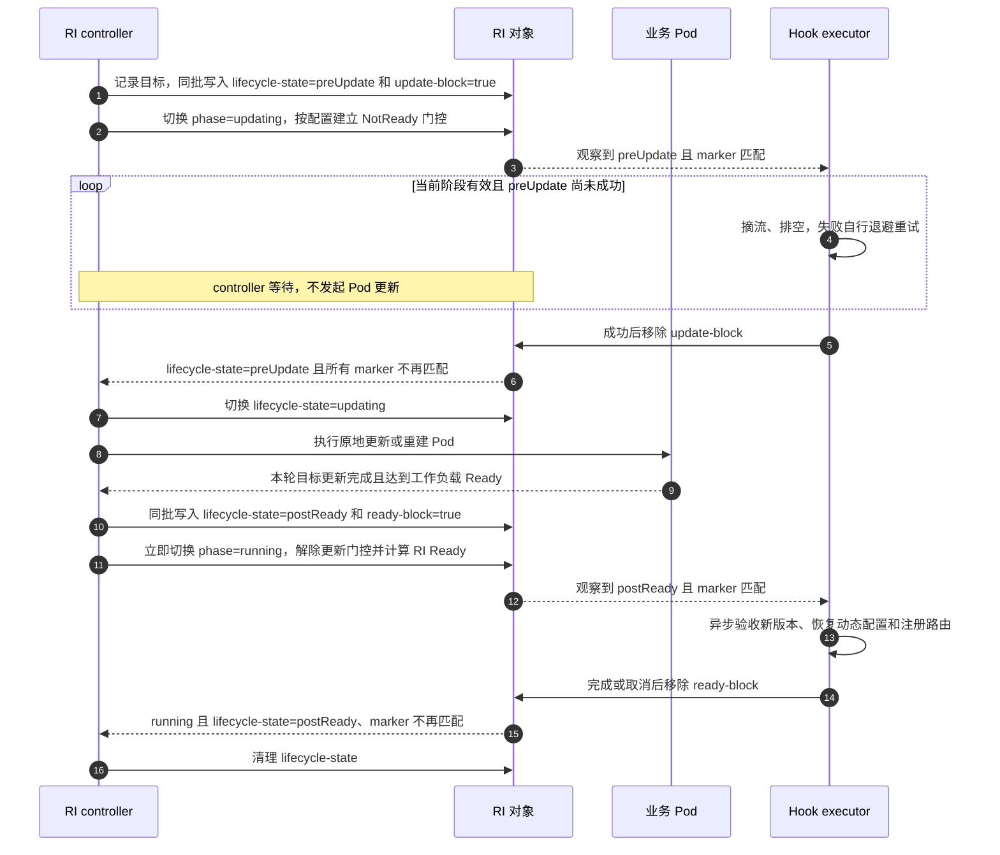
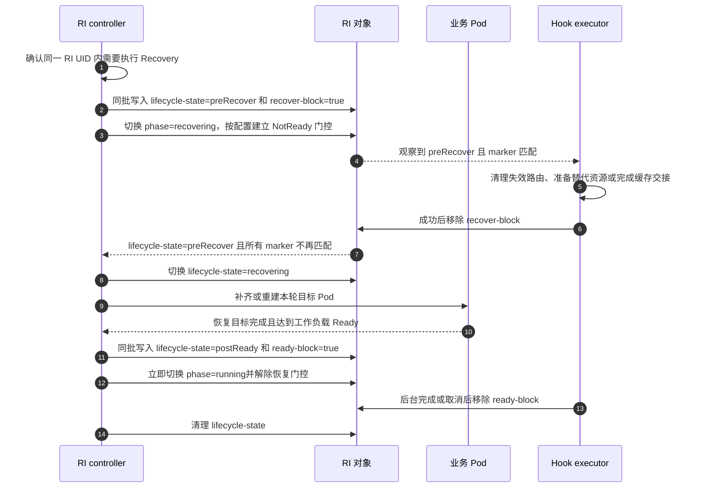
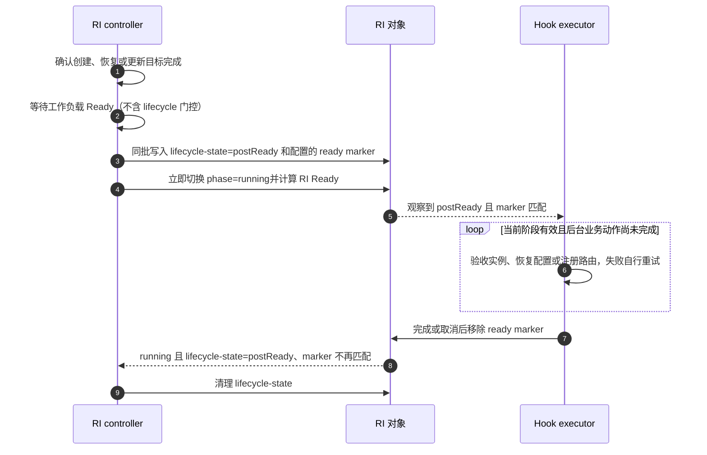
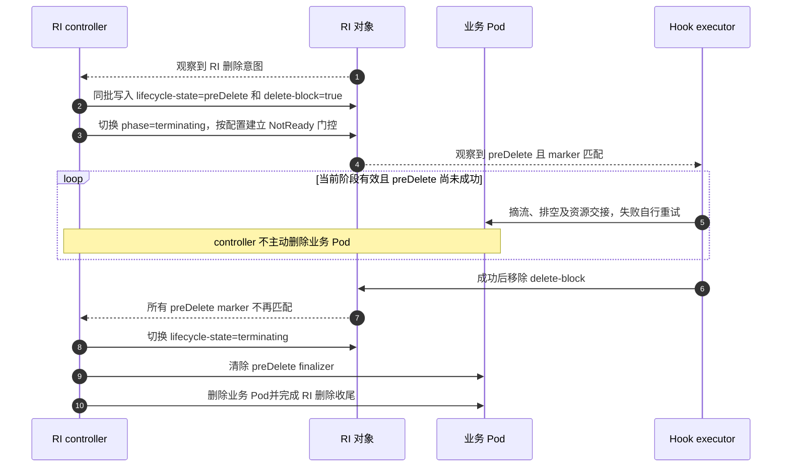

# KEP-527：RoleInstance 生命周期挂载点

<!-- toc -->
- [KEP-527：RoleInstance 生命周期挂载点](#kep-527roleinstance-生命周期挂载点)
  - [摘要](#摘要)
  - [动机](#动机)
    - [目标](#目标)
    - [非目标](#非目标)
  - [提案](#提案)
    - [职责划分](#职责划分)
    - [用户场景](#用户场景)
    - [约束与注意事项](#约束与注意事项)
    - [风险与缓解措施](#风险与缓解措施)
  - [设计细节](#设计细节)
    - [挂载点与触发边界](#挂载点与触发边界)
    - [Handler Label 协作](#handler-label-协作)
    - [Ready 门控](#ready-门控)
    - [Hook executor 服务](#hook-executor-服务)
    - [更新交互流程](#更新交互流程)
    - [恢复交互流程](#恢复交互流程)
    - [postReady 交互流程](#postready-交互流程)
    - [删除交互流程](#删除交互流程)
    - [执行恢复与并发约束](#执行恢复与并发约束)
    - [权限与字段所有权](#权限与字段所有权)
    - [与现有机制的关系](#与现有机制的关系)
    - [待讨论的设计问题](#待讨论的设计问题)
    - [测试计划](#测试计划)
      - [前置测试补充](#前置测试补充)
      - [单元测试](#单元测试)
      - [集成测试](#集成测试)
      - [端到端测试](#端到端测试)
    - [成熟度晋级标准](#成熟度晋级标准)
    - [升级与降级策略](#升级与降级策略)
    - [版本偏差策略](#版本偏差策略)
  - [生产就绪评审](#生产就绪评审)
    - [功能启用与回退](#功能启用与回退)
    - [发布、升级与回滚规划](#发布升级与回滚规划)
    - [监控要求](#监控要求)
    - [依赖](#依赖)
    - [可扩展性](#可扩展性)
    - [故障排查](#故障排查)
  - [实现历史](#实现历史)
  - [不足与代价](#不足与代价)
  - [替代方案](#替代方案)
  - [所需基础设施](#所需基础设施)
<!-- /toc -->

## 摘要

本 KEP 为 RoleInstance（RI）定义四个实例级生命周期挂载点：`preUpdate`、`preRecover`、`postReady` 和 `preDelete`。
它们分别用于更新前协调、恢复前协调、实例达到工作负载 Ready 后的业务验收与注册，以及删除前摘流和排空。

四个 hook 使用相同的 Handler Label 协作方式：RI controller 在触发 hook 时写入 label marker；
hook executor 观察到匹配 marker 后执行业务动作，完成、取消或决定放行后清除 marker。
前置 hooks 阻塞实际负载操作，controller 等 marker 不再匹配后继续；
postReady 完全异步，controller 写入 marker 后立即进入 `running`，不等待业务处理完成。
marker 不再由 executor 初始登记，也不要求 executor 在后置 hook 完成后加回。

executor 负责业务重试、退避和幂等恢复。前置 hooks 可配置 `markNotReady`；
postReady marker 不阻塞 phase 或 RI Ready。

## 动机

资源管理链路为 RBGSet → RBG → RIS → RI → Pod。
一个 RI 可以由多个 Pod 共同组成推理实例，单个容器的启动或退出不能代表整个实例已经完成更新准备、业务验收或安全下线。

更新或恢复前可能需要摘流、排空在途请求、清理失效路由或迁移共享缓存；实例创建、恢复或更新后，可能需要验收引擎、
恢复动态配置并注册业务路由；删除前则需要完成依赖存活引擎的交接。
这些动作需要与 RI controller 的实际工作负载操作保持明确顺序。

容器 `postStart`、`preStop` 适用于容器自身的启动和终止，不能提供本提案需要的实例级屏障。
业务已有 engineRuntime 或第三方管理服务时，可以由常驻 executor 复用这些能力，无需由 RBG 内置业务逻辑或逐次创建 Job。

### 目标

- 提供 `preUpdate`、`preRecover`、`postReady`、`preDelete` 四个实例级挂载点。
- controller 在每次 hook 触发时写入 marker，executor 完成或决定放行后清除 marker。
- 前置 hooks 的未清除 marker 阻塞实际负载操作，controller 不执行业务动作或调度业务重试。
- `postReady` 统一覆盖创建、恢复和更新后的实例验收与业务注册，但不阻塞 phase、RI Ready 或后续操作。
- 前置 hooks 提供可配置的 RI Ready 门控，区分工作负载健康与操作期间的就绪状态。
- 未配置新 hooks 的负载保持现有行为。

### 非目标

- 不在 RBGSet、RBG 或 RIS 上执行独立业务 hooks；lifecycle 虽在 Role 中定义，
  仍以 RI 操作为执行粒度，不替换现有 RIS lifecycle API。
- 不拦截外部直接删除 Pod、节点故障或 kubelet 自主重启容器。
- 不提供通用脚本执行平台，不为每次 hook 创建 Job 或独立执行 Pod。
- 不定义通用请求／结果协议，不由 RI controller 管理业务尝试次数或退避。
- postReady 采用异步通知；首期不提供自动忽略前置 hook 失败或显式跳过策略。
- 不保证外部副作用恰好执行一次，不自动让所有流量入口遵循 RI Ready。

## 提案

### 职责划分

| 参与方 | 职责 | 不承担的职责 |
| --- | --- | --- |
| RI controller | 维护操作、阶段、marker、Pod 与 RI Ready | 不执行业务动作，不决定业务重试 |
| RI | 保存配置、操作上下文、阶段和 Handler Label | 不作为执行进程或消息队列 |
| Hook executor | 观察阶段和 marker，执行业务并重试，完成后清除 | 不登记 marker，不修改 spec 或 phase |

用户在 `RoleBasedGroup.spec.roles[].lifecycle` 中声明需要协作的 hook 和 marker 匹配规则，
RIS 负责传递配置，RI 保存实际生效的配置快照。
RIS 不是独立的用户配置入口，RI controller 不需要反向读取 RBG 或 RIS。
controller 写入 marker 表示本轮 hook 待执行；前置 hooks 由 executor 清除 marker 放行实际负载操作。
postReady 由 controller 写入 marker 后立即进入 `running`，executor 在后台处理并清除 marker；
controller 不等待 postReady 完成。
controller 不接收业务返回值，executor 从 RI 和业务系统获取所需上下文。

### 用户场景

| 挂载点 | 推理业务示例 |
| --- | --- |
| `preUpdate` | 更新前从路由摘除实例，等待在途请求完成，必要时迁移共享缓存 |
| `preRecover` | 恢复前清理失效路由、准备替代资源或完成缓存交接，阻塞实际 Pod 恢复操作 |
| `postReady` | 创建、恢复或更新后的实例达到工作负载 Ready 时，验收引擎、恢复 LoRA 等动态配置并注册路由 |
| `preDelete` | 缩容或删除 RI 时摘流、排空，并完成需要存活引擎参与的资源交接 |

postReady executor 在后台验收引擎、恢复动态配置并注册路由，完成或取消后清除 marker。
RI 可以在 postReady 尚未完成时进入 `running` 和 Ready；
如果业务注册完成前不能接收流量，业务必须自行控制流量入口，不能依赖 postReady marker 门控 RI Ready。
共享 KVCache 迁移还需确认其他实例的在途读写和数据交接，不能只以本实例请求归零作为安全退出依据。

### 约束与注意事项

- hook 以整个 RI 的操作为粒度，不按 Pod 数量或 reconcile 次数重复触发。
- `preUpdate` 和 `preRecover` 只约束 controller 尚未执行的更新或恢复，不能阻止外部直接修改或删除 Pod。
- 顶层 phase 包括 `creating`、`updating`、`recovering`、`terminating`、`running`；
  Ready 仍是独立的 status condition。
- Delete 可使 `creating`、`updating`、`recovering`、`running` 中任一阶段进入 `terminating`；
  进入后 Update 和 Recovery 均在 reconcile 开头跳过。
- `postReady` 在创建、恢复或更新目标完成且 RI 达到工作负载 Ready 后触发，普通 Ready 抖动不重放。
- postReady 完全异步：写入 state 和 marker 后立即进入 `running`，不等待 executor，也不门控 RI Ready。
- RIS 扩缩 RI 数量时，新 RI 可在首次达到工作负载 Ready 后执行 `postReady`，被删除 RI 可执行 `preDelete`。
- executor 可以位于业务 Pod 内，也可以独立部署；`preDelete` 的执行者必须在业务 Pod 删除前可用。
- `preRecover` 不能依赖已经失效的业务 Pod，全部成员不可用时需要独立 executor。
- 前置 executor 不可用或持续失败时保留 marker，controller 保持等待并暴露诊断；
  postReady executor 故障不阻塞 controller 状态机。
- RI Ready 门控不自动修改 Pod Ready、EndpointSlice 或外部 Router，流量控制需要业务侧明确接入。

### 风险与缓解措施

| 风险 | 缓解措施或实施前必须解决的问题 |
| --- | --- |
| 前置 marker 被重复写入 | 只在阶段转换时写入，等待期间不补回 |
| metadata 同步覆盖 marker | 运行时 marker 不属于声明式 labels |
| 共享 marker 被迟到请求清理 | 明确接受该风险；由消费者协调并保证业务幂等，不增加代次 |
| 重试造成重复副作用 | executor 使用可恢复记录或业务幂等去重，不承诺恰好一次 |
| Ready 与 postReady 相互等待 | postReady 不参与 RI Ready 计算 |
| preDelete 前 Pod 已被 GC 删除 | 创建时注入 Pod finalizer，并验证实际容器终止时序 |
| executor 故障导致长期等待 | 暴露阶段、marker 和 executor 诊断；Alpha 不静默跳过 |
| metadata 回写权限过宽 | 限定命名空间、资源和身份；字段级限制需要 admission 或受限代理 |

## 设计细节

### 挂载点与触发边界

| 挂载点 | 触发边界 | marker 清除后的推进 |
| --- | --- | --- |
| `preUpdate` | 已确定本轮更新目标，controller 第一次实际变更业务 Pod 之前 | 开始执行本轮更新 |
| `preRecover` | `recovering` 中实际恢复业务 Pod 之前 | 开始执行本轮恢复 |
| `postReady` | 受控操作达到工作负载 Ready | 已提前 running；清 marker 后清 state |
| `preDelete` | RI 最终删除流程中，controller 主动终止业务 Pod 之前 | 开始删除业务 Pod并完成 RI 删除收尾 |

`postReady` 不是 Pod 对象创建通知，也不是容器 `postStart`。
仅创建 Pod、写入 RI spec 或更新 revision 不足以触发它；controller 必须先确认本轮目标已达到工作负载 Ready。
`lifecycle-state=postReady` 和对应 marker 只在这次受控操作的状态转换中写入，
不能由启用配置或普通 metadata 同步补写到存量 RI。
`postReady` 复用同一挂载点表达创建、恢复和更新后的业务处理，不再按操作类型拆分后置 hooks。

Update 内的原地更新或 Pod 重建只触发 `preUpdate`，其内部 Pod 删除不触发 `preDelete`。
恢复过程中补齐或重建 Pod 不触发 `preUpdate`，而是在实际操作前触发 `preRecover`；恢复后达到工作负载 Ready 时触发统一的 `postReady`。
若替换的是 RI UID，旧 RI 走 Delete，新 RI 走 Create，不能视为同一 RI 的 Recovery。

### Handler Label 协作

四个 hooks 使用相同的协作方向：

1. controller 确定本轮操作后，在同一次 RI labels 写入中设置 `lifecycle-state` 和对应 marker。
2. executor 观察到 `lifecycle-state` 和自己的 marker 匹配，开始执行业务动作。
3. 前置 hooks 由 executor 成功或决定放行后清除 marker；失败时保留并自行退避重试。
4. controller 等前置 hooks 的所有相关 marker 不再匹配后，继续实际负载操作。
5. postReady 写入 state 和 marker 后立即进入 `running`，不等待 executor；
   executor 后台完成或取消后清除 marker，controller 再清理 state。

“匹配”表示 RI label 的 key/value 与 `labelsHandler` 一致。
前置 hooks 的多个 marker 只要仍有一个匹配，controller 就保持等待；postReady marker 不参与等待或 Ready 判断。
未配置的 hook 不写入 marker，也不建立协作。

controller 只在进入前置 hook 阶段时写入一次 marker，不能在每次 reconcile 中强制其持续存在。
进入 postReady 时可幂等写入已有 marker；executor 只负责清除，不负责首次添加，也不在处理完成后加回。

以下示例展示用户从 RBG Role 进入配置的 API 形状。拟新增字段路径为
`RoleBasedGroup.spec.roles[].lifecycle`，不表示该字段已经存在：

```yaml
apiVersion: workloads.x-k8s.io/v1alpha2
kind: RoleBasedGroup
metadata:
  name: inference-group
spec:
  roles:
    - name: prefill
      # Role 的其他字段（如 replicas、standalonePattern）略
      lifecycle:
        preUpdate:
          labelsHandler:
            example.com/update-block: "true"
          markNotReady: true
        preRecover:
          labelsHandler:
            example.com/recover-block: "true"
          markNotReady: true
        postReady:
          labelsHandler:
            example.com/ready-block: "true"
        preDelete:
          labelsHandler:
            example.com/delete-block: "true"
          markNotReady: true
```

配置层级已经确定：`RoleBasedGroup.spec.roles[].lifecycle` 是唯一的用户定义入口，
每个 Role 可以声明自己的 hooks；RIS 只负责传递，RI 保存实际生效的执行快照。
RIS 和 RI 不作为独立用户配置入口，具体 Go 字段类型和名称仍需 API 评审。
声明式配置只向下传递，`lifecycle-state` 和运行时 marker 只写入 RI labels，不回写 RBG 或 RIS。
`labelsHandler` 是 controller 写入及双方判断的匹配规则，不是由 executor 维护的登记配置。
未配置 hook 表示禁用；配置了 hook 但 `labelsHandler` 缺省或为空属于配置错误，准入校验必须拒绝。
前置 hooks 的多个 label 表示多个协作条件，全部不再匹配后 controller 才继续。
普通 metadata 同步不得修改运行时 marker。

运行中修改 `labelsHandler` 不提供迁移或兼容处理。controller 按 RI 中最新的生效配置切换判断条件，
例如从 markerA 改为 markerB 后直接检查 markerB，不继续等待 markerA，也不负责清理或迁移旧 marker。
此类在途修改属于主动错误操作，可能跳过等待或遗留状态，不应作为正常运维方式。

### Ready 门控

下文“工作负载 Ready”指 RI 满足原有健康条件，但不包含本功能的 lifecycle Ready 门控。
“对外 RI Ready”是上层资源和其他 controller 观察到的最终 Ready 状态。

- `preUpdate.markNotReady`、`preRecover.markNotReady` 和 `preDelete.markNotReady`
  控制进入相应前置阶段时是否将 RI 标记为 NotReady。
- 该门控复用现有 `RoleInstanceCustomReady` condition；RI 的 `spec.readinessGates`
  必须登记 `RoleInstanceCustomReady`，否则现有 readiness helper 会直接返回，门控不生效。
  实现必须保证启用 `markNotReady` 时满足此前提，不能只写 condition 而缺少 readinessGate。
- 更新或恢复期间建立的 NotReady 门控持续到本轮操作进入 `running`，不能在 preUpdate 或 preRecover marker 清除后立即解除。
- `postReady` 不配置 `markNotReady` 或 `blockReady`，其 marker 不参与 RI Ready 计算。
- 工作负载达到 Ready 后，controller 写入 postReady state 和 marker，立即进入 `running`，
  并按原有健康条件和前置门控计算 RI Ready。
- postReady 后台处理结果不改变 controller 的 phase 和 Ready；业务结果由 executor 自行诊断，流量准入由业务系统负责。

controller 必须根据不包含本功能门控的工作负载 Ready 触发 `postReady`。
executor 根据 postReady state 和 marker 开始后台处理，不需要等待对外 RI Ready；
对外 RI Ready 由 controller 独立计算，与 postReady marker 互不等待。

### Hook executor 服务

executor 是业务提供的常驻服务，观察 RI 阶段和自己负责的 marker，将阶段映射为业务动作。
它可以直接复用 engineRuntime，也可以独立部署。

如果 engineRuntime 只提供业务管理接口，可以增加适配服务作为 executor：
适配服务负责观察 RI、调用 runtime 接口并清除 marker，runtime 无需感知 Kubernetes 生命周期协议。
适配服务是 executor 的一种实现方式，不是新增 CR。

现有 `ClusterEngineRuntimeProfile` 用于注入 initContainers、containers 和 volumes，CR 本身不是执行进程。
复用 engineRuntime 仍需在常驻进程或适配服务中实现阶段观察、业务重试、幂等恢复和 marker 清除。

RBG 不关心 marker 的消费者身份、数量或部署方式。controller 只按照 `labelsHandler` 判断 marker 是否存在，
不识别消费者，也不负责消费者选主、成员聚合或执行结果仲裁。

多个消费者如何协调、何时可以清除共享 marker，由业务自行决定。
消费者过早清除共享 marker 属于其内部协调问题，不改变 RBG 的协议。
多个 label 仍表示多个匹配条件，前置 hooks 等所有条件不再匹配后继续。

### 更新交互流程

以下示例使用 `example.com/update-block=true` 和 `example.com/ready-block=true`，
分别简称 update-block 和 ready-block。



preUpdate 期间 marker 不匹配是 controller 开始更新的必要条件。
postReady 不阻塞 `running`、RI Ready 或下一轮操作；executor 完成或取消后清除 ready-block，不再加回。
下一轮更新由 controller 重新写入 lifecycle-state 和对应 marker。

### 恢复交互流程

`preRecover` 与 `preUpdate` 使用相同的 marker 协作和阻塞规则，但阶段、marker 和业务动作独立：



`preRecover` 不用于 Update 内部的 Pod 替换，也不用于替换 RI UID 的删除和新建。
executor 在恢复动作完成前保留 marker，controller 不执行实际 Pod 恢复。

### postReady 交互流程

`postReady` 在创建、恢复和更新后使用相同的处理规则：



controller 通过 phase、`lifecycle-state` 和 marker 的组合恢复 postReady 进度，
不新增 `step` 或 controller 私有状态。
postReady 只允许由 `creating`、`updating`、`recovering` 中正在执行的受控操作发起，
并且必须在本轮达到工作负载 Ready 的状态转换中写入 state 和 marker。
`running` 不是触发来源，普通 Ready 变化不会补写这些 labels。
因此，存量 `running` RI 启用 postReady 后没有对应状态转换，不会立即执行或重放历史 hook。
即使上一轮 ready marker 尚未清除，新一轮达到工作负载 Ready 时仍写入 postReady state 和 marker，
并立即进入 `running`；重复写同名 marker 是幂等操作，不增加操作代次。

### 删除交互流程



本提案不包含 postDelete，业务 Pod 删除后的外部清理由其他机制承担。
删除流程只包括 preDelete 协作、Pod 删除和 RI 最终收尾，executor 不在删除完成后加回 marker。

RI finalizer 只保留 RI 对象，不天然阻止 GC 提前删除依赖 Pod。
因此，RI 生效配置包含 preDelete 时，controller 必须在创建成员 Pod 时注入 RBG 专属的 preDelete finalizer。
executor 只清除 RI 上的 delete marker；controller 确认 preDelete 放行后，再清除 Pod finalizer并执行删除。
这样 executor 不需要额外的 Pod PATCH 权限，finalizer 始终由 controller 管理。

存量 RI 启用 preDelete 时，controller 为现有成员 Pod 补充 finalizer。
仅在 RI 稳定且没有未完成删除操作时，禁用 preDelete 才清理对应 finalizer；
删除过程中禁用或修改 preDelete 属于在途配置修改，不作为正常回滚或跳过 hook 的方式。
Update 或 Recovery 需要替换 Pod 时，controller 在各自前置 hook 放行后清除待替换 Pod 的 finalizer，
再执行内部删除，不触发 preDelete；新 Pod 创建时重新按配置注入。

Pod finalizer 保留的是 Pod API 对象，不能保证容器在 preDelete 完成前持续运行。
外部直接删除 Pod 后 deletionTimestamp 无法撤销，该路径仍属于 Recovery，不触发 preDelete。
需要存活引擎参与的删除协调必须验证 kubelet 实际终止时序，不能仅凭 finalizer 声称提供存活屏障。

### 执行恢复与并发约束

业务重试由 executor 负责，controller 只重试自身 API 读写和状态收敛。
业务结果未知时，executor 应先查询、恢复或幂等重试，不能直接清除 marker。

controller 不新增 `step` 或私有运行状态，而是通过 RI phase、`lifecycle-state` 和 marker 的组合恢复进度。
进入 hook 时，`lifecycle-state` 与 marker 必须在同一次 labels 写入中设置，
不允许出现只有 state、尚未写 marker 的中间状态。
前置 hooks 放行后不能清空 state，而要显式切换到实际操作阶段：

```text
preUpdate + marker   → preUpdate + 无 marker → updating
preRecover + marker  → preRecover + 无 marker → recovering
preDelete + marker   → preDelete + 无 marker → terminating
```

`preUpdate + 无 marker` 等状态表示 hook 已放行；controller 重启后据此继续，不会误判为尚未触发。
进入 `updating`、`recovering` 或 `terminating` 后再执行实际负载操作，
后续由 postReady 覆盖更新／恢复 state，删除 state 则保留到 RI 最终删除。
postReady 先进入 `running`，再由 executor 异步清除 marker，最后清理 state；controller 不等待业务结果。
executor 启动或 watch 重连后重新读取 RI，只在 `lifecycle-state` 匹配且 marker 存在时执行或恢复业务动作。

操作规则如下：

| 当前操作 | 新操作 | 处理规则 |
| --- | --- | --- |
| `creating` | Update、Recovery | 不处理，只继续当前 Create，不执行对应 reconcile 逻辑或 hooks |
| `updating` | Update | 合并目标，不重复 preUpdate；仅非 updating 启动时触发 |
| `updating` | Recovery | 认为当前更新尚未完成，将恢复目标并入本轮 Update，不单独执行 preRecover |
| `recovering` | Recovery | 属于当前 Recovery 的持续推进，不重复进入，也不重复 preRecover |
| `recovering` | Update | 中断当前 Recovery，进入 preUpdate，再执行 Update 和异步 postReady |
| 任意非删除 phase | Delete | 进入 terminating 和 preDelete，不等待当前操作 |
| `terminating` | Update、Recovery | 在 reconcile 开头检查后跳过，不执行具体逻辑或对应 hooks |
| 后台 postReady | Update、Recovery、Delete | 直接开始；旧 executor 按 state 自行处理 |

`recovering` 表示本轮恢复尚未成功完成；期间重复 reconcile 或再次观察到 Recovery 需求，
都只继续当前恢复，不构成新一轮操作，也不能再次进入 preRecover。
`terminating` 的 Update／Recovery 检查必须先于对应操作和 hook 逻辑，避免删除过程中被其他操作重新接管。

postReady 的完成条件非常简单：受控操作达到工作负载 Ready 时写入 state 和 marker，并立即进入 `running`。
如果上一轮 marker 仍存在，重复写入不改变 marker 值；
lifecycle-state 已从新一轮前置阶段变为 postReady，executor 据此处理最新阶段。
旧 executor 完成或取消后清除自己负责的 marker；controller 不等待旧任务确认停止，也不引入操作代次。
同名 marker 不区分业务轮次：第一轮任务的迟到清理可能清除第二轮刚写入的同名 marker，
使 controller 提前将第二轮 postReady 视为结束。本设计明确接受这一共享 marker 风险，
由消费者自行协调清理时机，并通过幂等和业务侧 fencing 处理迟到的外部副作用；RBG 不提供代次隔离。

### 权限与字段所有权

controller 负责写入 hook marker，executor 负责清除自己处理的 marker。
双方只修改各自负责的 key，不整体替换 labels map。普通 RIS metadata 同步不得覆盖这些运行时标记。

executor 采用 GET 轮询并 PATCH marker 时，基本权限是目标命名空间内
`roleinstances` 的 `get`、`patch`。
采用 LIST/WATCH 时另需 `list`、`watch`；`resourceNames` 限制需要匹配的 field selector，
不能直接用于全量 informer。
原生 RBAC 无法限制 PATCH 只修改特定 label，严格字段级隔离需要 admission 或受限代理。

### 与现有机制的关系

本方案沿用现有 RIS `labelsHandler` 的协作思路，但改变 marker 的初始化职责：
新 RI 协议由 controller 在每次 hook 触发时写入，executor 只负责清除，不采用首次登记或后置加回。

现有 RIS lifecycle 的配置和阶段不能不加区分地复用为新 RI 协议。
新阶段 key、枚举、配置字段及新旧机制隔离方式需要定稿，两个 controller 不能无约束地写同一状态。
Warmup 和容器 lifecycle hooks 继续承担各自职责，不等同于本提案的实例级 hooks。

### 待讨论的设计问题

四个 hooks 的 API 设计已确认：Role 定义、RIS 传递、RI 生效；空 handler 校验失败；
前置 hooks 保留 `markNotReady`，postReady 不门控 RI Ready。具体字段类型和名称仍需 API 评审。
重启恢复不新增 `step`：进入 hook 时同批写入 `lifecycle-state` 与 marker；
前置 hooks 放行后切换到 `updating`、`recovering` 或 `terminating`，不清空 state；
postReady 则立即进入 `running` 并异步收尾。
postReady 只覆盖 Create、Update、Recovery 的受控操作，工作负载 Ready 不含 lifecycle 门控；
普通 Ready 抖动和存量 `running` 启用均不重放。
连续操作规则已确认：Update 中合并 Update 和 Recovery，Update 可打断 Recovery，Delete 抢占其他操作；
`creating` 不处理 Update／Recovery，`recovering` 不重复进入 Recovery，
`terminating` 在 reconcile 开头跳过 Update／Recovery；postReady 不阻塞任何后续操作，不增加操作代次。
消费者边界已确认：RBG 只判断 marker 是否存在，不关心消费者身份、数量、选主或聚合。
preDelete 屏障已确认：controller 在创建 Pod 时注入 finalizer，preDelete 放行后清除；
Update 和 Recovery 内部替换 Pod 时由 controller 单独放行 finalizer，不执行 preDelete。
上线与回滚边界已确认：先部署 executor和权限再启用，存量 postReady 不因当前 Ready 重放；
已确定的 hook 语义不得修改，新逻辑使用新 hook；有未完成操作时不得直接降级。

进入 `implementable` 前需解决：

1. 新旧 lifecycle 的兼容或隔离。
2. 授权与诊断细则、版本支持矩阵和存量接管实施流程。
3. preDelete finalizer 保留 Pod 对象时的实际容器终止时序。

超时预算、人工跳过和不同失败策略作为后续能力讨论。

### 测试计划

以下为拟开展的测试，不代表已经验证。

#### 前置测试补充

建立未配置新 hooks 时的创建、更新、component 扩缩容、Recovery、Ready 和删除回归基线。
保留旧 RIS lifecycle 行为测试，并区分工作负载后端。

#### 单元测试

- 四个 hooks 的触发边界，确认不存在其他生命周期挂载点。
- controller 在进入前置 hook 阶段时只写入一次 marker，等待期间不重复补回；
  postReady 支持幂等写入已有 marker。
- executor 只在阶段和 marker 匹配时处理，前置 hooks 放行后清除，postReady 后台完成或取消后清除。
- preUpdate marker 未清除时不更新 Pod，preRecover marker 未清除时不恢复 Pod；
  preDelete marker 未清除时不删除 Pod。
- postReady marker 未清除时仍进入 `running`，且不阻塞 RI Ready。
- postReady 仅在目标完成且工作负载 Ready 后触发，普通 Ready 抖动不重复触发。
- 前置 `markNotReady` 的建立及解除时机，以及 postReady 不参与 RI Ready 计算。
- `recovering` 中依次执行 preRecover 和异步 postReady，普通 `running` Ready 抖动及存量启用不触发 postReady。
- `updating` 中 Update 合并且不重复 preUpdate，Recovery 并入当前 Update；
  `recovering` 中 Update 进入 preUpdate，重复 Recovery 不重新进入或重复 preRecover。
- `creating` 中 Update／Recovery 不处理；`terminating` 中在 reconcile 开头跳过二者。
- Delete 抢占 Update、Recovery 和后台 postReady，新操作不等待旧 postReady。
- 多 marker 条件、空 handler 准入失败、重启恢复和未配置 hooks 的行为；controller 不识别消费者身份。
- `lifecycle-state` 与 marker 同批写入；前置 hooks 清 marker 后切换到实际操作 state，
  重启后不会重复执行已放行 hook；postReady 先进入 `running` 再异步清理 state。
- 在途 markerA 改为 markerB 后直接按最新配置判断，不迁移或清理旧 marker。
- 启用 `markNotReady` 时必须存在 `RoleInstanceCustomReady` readinessGate。
- 连续 Ready 时同名 postReady marker 幂等写入，不引入操作代次；
  迟到清理可能误清新 marker，该风险由消费者协调。

#### 集成测试

- 前置 executor 延迟启动时 marker 保持匹配，controller 持续等待；executor 不需要首次登记。
- 前置业务多次失败后自行退避成功，期间 controller 不推进受阻操作。
- controller／executor 重启、watch 重连、PATCH 冲突和业务成功但 marker 清除失败。
- RIS metadata 同步不覆盖运行时 marker，controller 不在同一前置阶段重复写入。
- 连续更新、旧 postReady 任务迟到、同名 RI 重建及多执行者接管，验证 state 驱动的取消、恢复和幂等清理。
- preDelete 的 GC 传播、零 Pod 删除，以及新旧 lifecycle 和 Ready 门控兼容性。
- 创建 Pod 时按配置注入 finalizer，存量启用时补充、禁用时清理，preDelete 放行前不提前清除。
- Update 和 Recovery 内部替换 Pod 时清除旧 Pod finalizer，不执行 preDelete，新 Pod 重新注入。

#### 端到端测试

- 多 Pod RI 更新前摘流排空，更新达到工作负载 Ready 后异步验收、恢复 LoRA 和业务路由。
- Recovery 在实际补齐或重建 Pod 前执行 preRecover，达到工作负载 Ready 后执行统一的 postReady，普通 Ready 抖动不重放。
- Create 达到工作负载 Ready 后直接执行 postReady，不执行 preRecover。
- 开关前置 RI Ready 门控，验证 postReady marker 不影响 RI Ready，业务路由按自身流量策略恢复。
- preDelete 完成前业务 Pod 不被 controller 主动终止；放行后由 controller 清除 finalizer并进入最终删除。
- 连续提交多个 update，验证 updating 中不重复 preUpdate、旧 postReady 不阻塞新操作，以及同名 marker 的幂等处理。
- 验证 Update 打断 Recovery 和 Delete 抢占其他操作。
- executor 长期不可用、业务结果未知和双方重启时的前置等待、postReady 后台处理与诊断。
- 未配置 hooks 行为不变，存量启用、升级和回滚不重放历史动作。

### 成熟度晋级标准

进入 alpha 前，解决操作上下文、并发隔离和删除时序等阻塞问题，实现四个挂载点、
controller 写入与 executor 清除的 Handler Label 协作及可配置 Ready 门控，完成核心测试并提供 executor 接入示例。
进入 beta 前验证真实业务、多 Pod 协调、权限、恢复和升级兼容、规模开销，完善故障诊断及运维恢复流程。
进入 stable 需持续生产反馈并解决 beta 问题；本 KEP 不指定发布里程碑。

### 升级与降级策略

未配置新 hooks 时保持行为不变。存量 RI 启用功能不得因当前 Ready 或历史更新而重放 postReady／preUpdate。
postReady 由受控操作的状态转换和运行时 labels 触发，不能仅根据存量 RI 当前 Ready 触发。
启用 preDelete 时，controller 按前述规则为存量成员 Pod 补充 finalizer。

启用 lifecycle 前，先部署兼容 executor并确认 RBAC 权限，再开放 hook 配置。
如果先写入前置 marker 而没有可用消费者，对应更新、恢复或删除会持续等待。
executor 不需要初始登记 marker。

已进入的阶段和 marker 在升级中必须保持语义稳定。
hook 的语义一旦确定，后续版本不得改变其触发条件、阻塞方式、marker 方向或操作边界。
需要不同生命周期逻辑时，应添加新 hook，而不是重用已有 hook 名称并改变含义。

存在未完成操作时不得直接降级；回滚前应等待操作完成，或由理解该协议的兼容 controller 接管。
降级可能使 controller 忽略阶段、绕过 hook 或卡住删除。
不得把清除 labels、门控或 finalizers 视为通用回滚方法。

### 版本偏差策略

controller 与 executor 必须约定阶段位置、阶段值和 marker 方向。
不理解新协议的 executor 不得盲目清除 marker；混合版本中不允许旧 controller 接管运行中操作。
已发布 hook 的语义不得随版本变化；新逻辑通过新 hook 表达。
支持矩阵与迁移规则在 API 定稿时明确。

## 生产就绪评审

本节记录要求与缺口，尚未通过生产就绪评审。

### 功能启用与回退

启用方式及 feature gate 待定。先部署支持该阶段协议的 executor并授予必要权限，再启用配置。
关闭或重新启用功能时，不能重置执行中的 marker或跳过未完成阶段。
有未完成操作时不得直接回退到不理解当前协议的版本。
preDelete 需要确认 executor 在业务 Pod 删除前可用，并验证所支持删除路径的屏障。

### 发布、升级与回滚规划

主要风险是 controller 重复写入 marker、旧 executor 清除新 marker、Ready 循环等待和删除持续等待。
需要验证 controller 与 executor 版本兼容、门控对上层发布预算的影响，以及新旧协议交接。
计划覆盖“升级 → 降级 → 升级”，本提案不移除现有 lifecycle API。

### 监控要求

RI 暴露阶段、当前 marker 匹配情况和等待原因；executor 提供业务执行日志、失败和重试诊断。
单靠 marker 无法区分“executor 未启动”“业务正在执行”和“持续失败”，需要配合诊断信息。
无需每次业务失败写 RI，避免高频 API 写入。

拟按操作类型监控阶段等待时长、executor 可用性、业务重试与失败、Ready 门控时间和更新／删除延迟。
业务执行耗时与 controller 收敛延迟分别衡量，本 KEP 不设未经验证的数值 SLO。

### 依赖

依赖 Kubernetes API、RI controller 和 hook executor，不依赖逐次创建的 Job。
executor 依赖的引擎管理接口、路由和存储服务故障会延长前置阶段等待或 postReady 后台处理时间。
前置 hooks 是否影响 RI Ready 由门控配置决定，但不能因为关闭门控就越过 marker 等待；
postReady 不参与 RI Ready 计算，也不阻塞后续操作。

### 可扩展性

主要新增开销是阶段和 marker 写入、executor 观察连接及业务重试，不创建逐次执行的 Job／Pod。
executor 需要限制观察范围、连接数、轮询频率和业务退避，避免多 sidecar 全量 watch RI。
规模测试覆盖集中创建、发布、故障恢复、executor 故障及大量等待 hook 完成的实例。

### 故障排查

- `preUpdate`、`preRecover` 或 `preDelete` 仍有 marker：检查 executor 是否在线、是否有权限，以及业务日志中的失败原因。
- `postReady` 仍有 marker：检查实例验收、动态配置或业务注册是否完成，不要手动清除 marker伪报成功。
- controller 反复写入同一 marker：检查操作上下文是否正确保存，避免把阶段转换变成 reconcile 持续同步。
- 业务成功但未推进：检查 marker PATCH 是否成功、当前阶段是否仍有效，以及其他 marker 是否已清除。
- RI NotReady：区分工作负载健康失败、旧 readiness gates 和本功能门控，检查是否错误等待对外 Ready。
- 新 update 未开始：检查是否仍处于 updating；postReady 不应阻塞新操作。
- 删除等待：区分 preDelete、Pod 删除和其他 finalizers，不应把强制清除 marker作为常规恢复方法。
- API 不可用：连接恢复后重读阶段和 marker，不能因写入失败推断业务副作用未发生。

## 实现历史

- 2026-10-26：KEP 初始版本，状态为 `provisional`，尚未实现。
- 2026-10-30：确定四个 hooks、异步 postReady，以及连续操作与抢占规则。

## 不足与代价

- 只保留四个挂载点，无法覆盖创建前准备和 Pod 删除后的外部清理。
- controller 和 executor 都能修改 marker，必须严格区分写入与清除的所有权，并保存操作进度。
- 无独立结果协议，controller 不能单靠 marker 判断具体业务错误，诊断依赖 executor。
- 同名 marker 与固定 state 不区分业务代次，迟到副作用需要 executor 幂等和业务侧 fencing。
- 前置持续失败可能长期阻塞更新、恢复或删除，开启门控还可能使 RI 持续 NotReady；
  postReady 持续失败不影响 phase 和 RI Ready，需要独立的业务告警。

## 替代方案

- 八挂载点模型：覆盖更完整，但 API、执行者存活和状态机复杂度更高；本期收缩为四个挂载点。
- executor 首次登记并在后置加回：减少 controller 写入，但引入初始登记竞态和连续操作歧义；本期由 controller 每次写入。
- 结构化请求／结果：适合动态业务参数和统一任务状态；当前阶段加 marker 已能表达触发与完成。
- 每次创建 Job：适合任意脚本并提供任务日志；本期复用常驻 executor，不增加逐次调度。
- controller 直接调用 HTTP：可以减少 RI 写入，但需要寻址、认证和结果恢复；executor 内部仍可调用 HTTP。
- 容器 lifecycle hooks：适合本地初始化和退出，无法提供本提案需要的实例级屏障和 Ready 后验收。

## 所需基础设施

不申请新仓库或外部项目基础设施。
需要 engineRuntime／适配服务接入、最小授权、必要的字段级校验及 controller／executor 集成测试环境。
本期不建设逐次 hook Job 或通用请求／结果服务。
