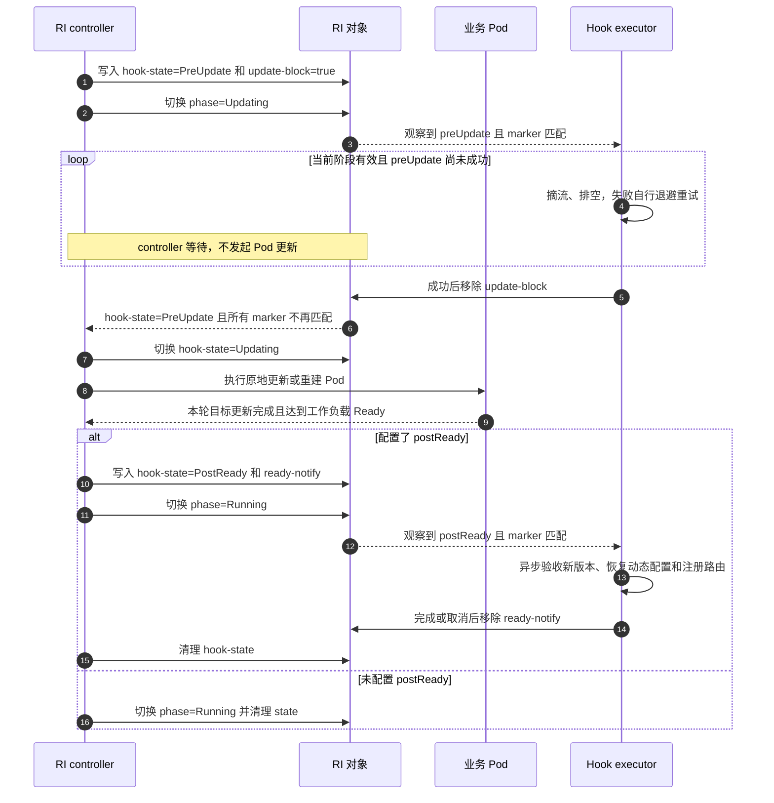
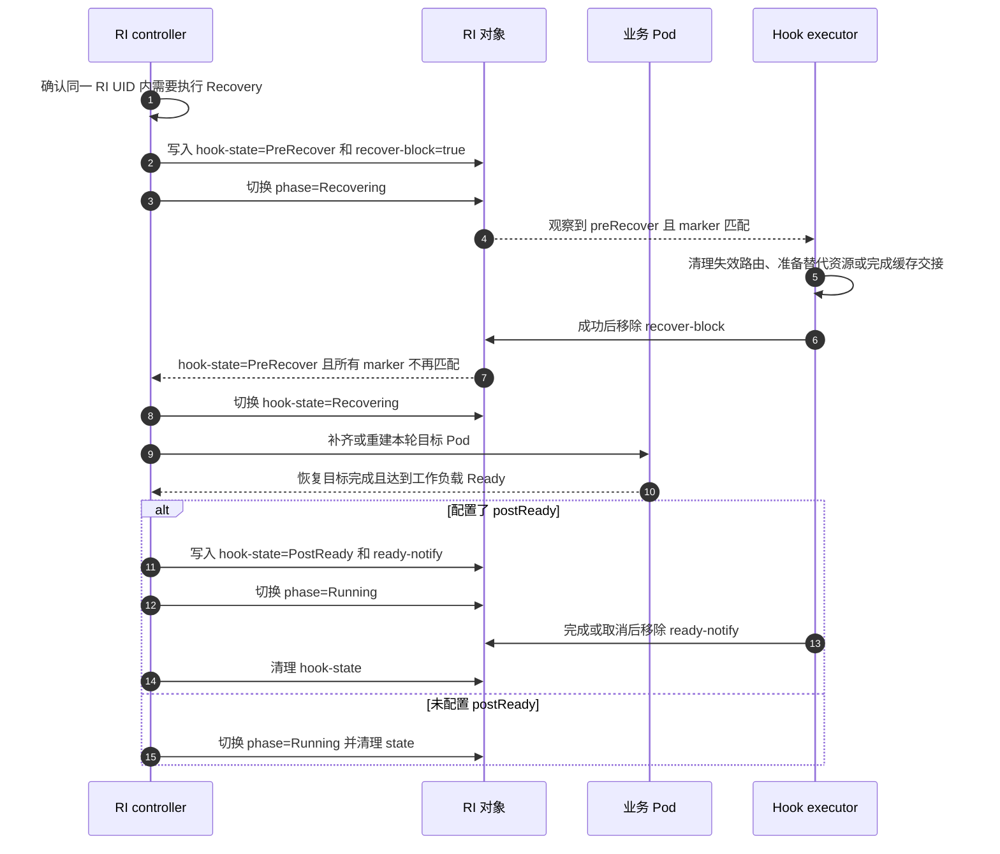
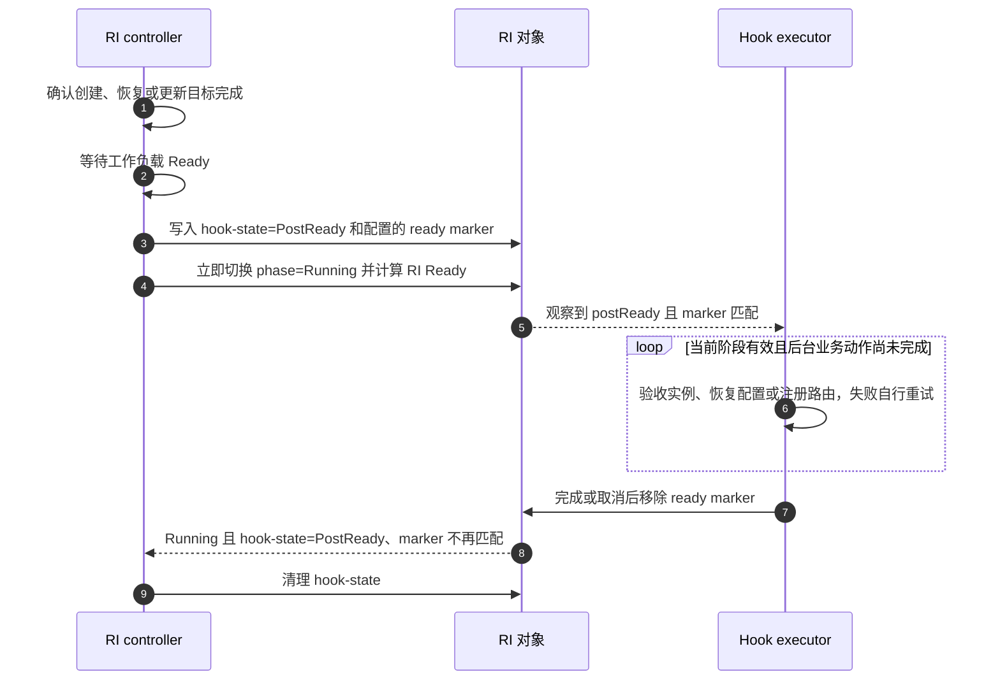
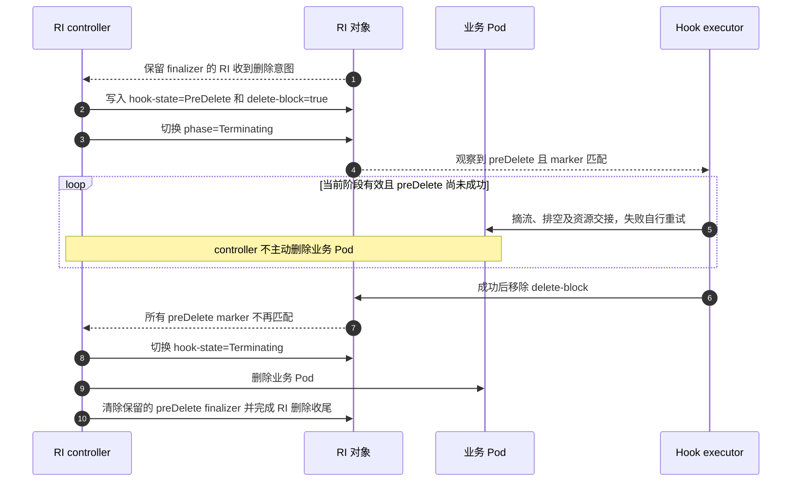

# KEP-527：RoleInstance 生命周期挂载点

<!-- toc -->
- [KEP-527：RoleInstance 生命周期挂载点](#kep-527roleinstance-生命周期挂载点)
  - [摘要](#摘要)
  - [动机](#动机)
    - [目标](#目标)
    - [非目标](#非目标)
  - [提案](#提案)
    - [职责划分](#职责划分)
    - [用户场景](#用户场景)
    - [约束与注意事项](#约束与注意事项)
    - [风险与缓解措施](#风险与缓解措施)
  - [设计细节](#设计细节)
    - [挂载点与触发边界](#挂载点与触发边界)
    - [固定名称与常量](#固定名称与常量)
    - [信号标签协作](#信号标签协作)
    - [信号标签向 Pod 传递](#信号标签向-pod-传递)
    - [Hook executor 服务](#hook-executor-服务)
    - [更新交互流程](#更新交互流程)
    - [恢复交互流程](#恢复交互流程)
    - [postReady 交互流程](#postready-交互流程)
    - [删除交互流程](#删除交互流程)
    - [执行恢复与并发约束](#执行恢复与并发约束)
    - [权限与字段所有权](#权限与字段所有权)
    - [与现有机制的关系](#与现有机制的关系)
    - [已确定设计与遗留问题](#已确定设计与遗留问题)
    - [测试计划](#测试计划)
      - [前置测试补充](#前置测试补充)
      - [单元测试](#单元测试)
      - [集成测试](#集成测试)
      - [端到端测试](#端到端测试)
    - [成熟度晋级标准](#成熟度晋级标准)
    - [升级与降级策略](#升级与降级策略)
    - [版本偏差策略](#版本偏差策略)
  - [生产就绪评审](#生产就绪评审)
    - [功能启用与回退](#功能启用与回退)
    - [发布、升级与回滚规划](#发布升级与回滚规划)
    - [监控要求](#监控要求)
    - [依赖](#依赖)
    - [可扩展性](#可扩展性)
    - [故障排查](#故障排查)
  - [实现历史](#实现历史)
  - [不足与代价](#不足与代价)
  - [替代方案](#替代方案)
  - [所需基础设施](#所需基础设施)
<!-- /toc -->

## 摘要

本 KEP 为 RoleInstance（RI）定义四个实例级生命周期挂载点：`preUpdate`、`preRecover`、`postReady` 和 `preDelete`。
它们分别用于更新前协调、恢复前协调、实例达到工作负载 Ready 后的业务验收与注册，以及删除前摘流和排空。
新协议与旧 RoleInstanceSet lifecycle 协议在 API 层共存，
但准入保证同一个 RIS 上不会同时激活二者。

四个 hook 使用相同的信号标签协作方式：RI controller 在触发 hook 时写入 label marker；
hook executor 观察到匹配 marker 后执行业务动作，完成、取消或决定放行后清除 marker。
前置 hooks 阻塞实际负载操作，controller 等 marker 不再匹配后继续；
postReady 完全异步，controller 写入 marker 后立即进入 `Running`，不等待业务处理完成。
controller 把 RI 上的运行时信号标签镜像到成员 Pod，Pod 级消费者无需访问
RI 即可观察这些信号。
与旧协议不同，executor 不做 marker 初始登记，也不在后置 hook 完成后加回。

executor 负责业务重试、退避和幂等恢复。hook marker 不参与 RI Ready 计算。

## 动机

资源管理链路为 RBGSet → RBG → RIS → RI → Pod。
一个 RI 可以由多个 Pod 共同组成推理实例，单个容器的启动或退出不能代表整个实例已经完成更新准备、业务验收或安全下线。

更新或恢复前可能需要摘流、排空在途请求、清理失效路由或迁移共享缓存；实例创建、恢复或更新后，可能需要验收引擎、
恢复动态配置并注册业务路由；删除前则需要完成依赖存活引擎的交接。
这些动作需要与 RI controller 的实际工作负载操作保持明确顺序。

容器 `postStart`、`preStop` 适用于容器自身的启动和终止，不能提供本提案需要的实例级屏障。
业务已有 engineRuntime 或第三方管理服务时，可以由常驻 executor 复用这些能力，无需由 RBG 内置业务逻辑或逐次创建 Job。

### 目标

- 提供 `preUpdate`、`preRecover`、`postReady`、`preDelete` 四个实例级挂载点。
- 将 `signalLabels` key 对应的运行时 label 从 RI 镜像到成员 Pod，供
  Pod 级消费者使用。
- controller 在每次 hook 触发时写入 marker，executor 完成或决定放行后清除 marker。
- 前置 hooks 的未清除 marker 阻塞实际负载操作，controller 不执行业务动作或调度业务重试。
- `postReady` 统一覆盖创建、恢复和更新后的实例验收与业务注册，但不阻塞 phase、RI Ready 或后续操作。
- 保留旧 RIS lifecycle 协议，并新增 RoleInstance lifecycle 协议。
- 未配置 lifecycle hooks 的负载保持现有行为，唯一例外是 feature gate
  开启期间集群级拒绝 Foreground 删除。

### 非目标

- 不在 RBGSet、RBG 或 RIS 上执行独立业务 hooks；lifecycle 虽在 Role 或 RIS 模板中定义，
  仍以 RI 操作为执行粒度。
- 不允许同一个 RIS 同时配置旧协议和新协议。
- 不新增 preCreate 或 postDelete。preCreate 发生在 Pod 创建前，尚无已建立的
  workload 和 executor 可协调；postDelete 面向实例退出后的外部清理，
  需要独立协议。
- 不拦截外部直接删除 Pod、节点故障或 kubelet 自主重启容器。
- 不提供通用脚本执行平台，不为每次 hook 创建 Job 或独立执行 Pod。
- 不定义通用请求／结果协议，不由 RI controller 管理业务尝试次数或退避。
- 不提供 Ready 门控字段或修改 RI Ready；流量入口由业务自行控制。
- postReady 采用异步通知；首期不提供自动忽略前置 hook 失败或显式跳过策略。
- 不保证外部副作用恰好执行一次，不自动让所有流量入口遵循 RI Ready。

## 提案

### 职责划分

| 参与方 | 职责 | 不承担的职责 |
| --- | --- | --- |
| RI controller | 维护操作、阶段、写入 marker、Pod 与 RI Ready | 不执行业务动作，不决定业务重试 |
| RI | 保存配置、操作上下文、阶段和信号标签 | 不作为执行进程或消息队列 |
| Hook executor | 观察阶段和 marker，执行业务并重试，完成后清除 | 不登记 marker，不修改 spec 或 phase |

配置权威取决于对象所有权，而不是创建路径。RBG 管理的 RIS 在
`RoleBasedGroup.spec.roles[].lifecycle` 中声明需要协作的 hook 和 marker
匹配规则；standalone RIS 在
`RoleInstanceSet.spec.roleInstanceTemplate.lifecycle` 中声明。两种归属都由
RIS controller 把生效快照传递到 `RoleInstance.spec.lifecycle`，
RI controller 只读取本地快照，不需要反向读取 RBG 或 RIS。
controller 写入 marker 表示本轮 hook 待执行；前置 hooks 由 executor 清除 marker 放行实际负载操作。
postReady 由 controller 写入 marker 后立即进入 `Running`，executor 在后台处理并清除 marker；
controller 不等待 postReady 完成。
controller 不接收业务返回值，executor 从 RI 和业务系统获取所需上下文。

### 用户场景

| 挂载点 | 推理业务示例 |
| --- | --- |
| `preUpdate` | 更新前从路由摘除实例，等待在途请求完成，必要时迁移共享缓存 |
| `preRecover` | 恢复前清理失效路由、准备替代资源或完成缓存交接 |
| `postReady` | 创建、恢复或更新后的实例达到工作负载 Ready 时，验收引擎、恢复 LoRA 等动态配置并注册路由 |
| `preDelete` | 缩容或删除 RI 时摘流、排空，并完成需要存活引擎参与的资源交接 |

postReady executor 在后台验收引擎、恢复动态配置并注册路由，完成或取消后清除 marker。
RI 可以在 postReady 尚未完成时进入 `Running` 和 Ready；
如果业务注册完成前不能接收流量，业务必须自行控制流量入口，不能依赖 postReady marker 门控 RI Ready。
共享 KVCache 迁移还需确认其他实例的在途读写和数据交接，不能只以本实例请求归零作为安全退出依据。

### 约束与注意事项

- hook 以整个 RI 的操作为粒度，不按 Pod 数量或 reconcile 次数重复触发。
- `preUpdate` 和 `preRecover` 只约束 controller 尚未执行的更新或恢复，不能阻止外部直接修改或删除 Pod。
- 顶层 phase 包括 `Creating`、`Updating`、`Recovering`、`Terminating`、`Running`；
  Ready 仍是独立的 status condition。
- Delete 可使 `Creating`、`Updating`、`Recovering`、`Running` 中任一阶段进入 `Terminating`；
  进入后 Update 和 Recovery 均在 reconcile 开头跳过。
- `postReady` 在创建、恢复或更新目标完成且 RI 达到工作负载 Ready 后触发，普通 Ready 抖动不重放。
- postReady 完全异步：写入 state 和 marker 后立即进入 `Running`，不等待 executor，也不门控 RI Ready。
- RIS 扩缩 RI 数量时，新 RI 可在首次达到工作负载 Ready 后执行 `postReady`，被删除 RI 可执行 `preDelete`。
- preUpdate、preRecover 和 postReady 的 executor 可以位于业务 Pod 内，
  也可以独立部署；`preDelete` 的执行者必须独立部署，
  并在业务 Pod 删除前可用。
- `preRecover` 不能依赖已经失效的业务 Pod，全部成员不可用时需要独立 executor。
- 前置 executor 不可用或持续失败时保留 marker，controller 保持等待并暴露诊断；
  postReady executor 故障不阻塞 controller 状态机。
- hooks 不修改 RI Ready、Pod Ready、EndpointSlice 或外部 Router，流量控制需要业务侧明确接入。

### 风险与缓解措施

| 风险 | 缓解措施或实施前必须解决的问题 |
| --- | --- |
| 前置 marker 被重复写入 | 只在阶段转换时写入，等待期间不补回 |
| metadata 同步覆盖 marker | 运行时 marker 不属于声明式 labels |
| Pod 镜像被外部覆盖 | 每次 RI reconcile 重新同步；RI 是权威来源 |
| 操作中删除 hook 配置 | 屏障被跳过；由运维确认删除时机 |
| 同一 hook 内共享 marker 被迟到请求清理 | 明确接受该风险；由消费者协调并保证业务幂等，不增加代次 |
| 不同 hook 复用 marker key | 准入校验拒绝 |
| 信号标签 key 覆盖 controller 状态 | 准入校验拒绝保留 key |
| 重试造成重复副作用 | executor 使用可恢复记录或业务幂等去重，不承诺恰好一次 |
| foreground 级联或直接删除 Pod 绕过存活引擎屏障 | 准入拒绝 foreground 传播；直接删除 Pod 归入 Recovery |
| executor 故障导致长期等待 | 暴露阶段、marker 和 executor 诊断；Alpha 不自动跳过 |
| metadata 回写权限过宽 | 限定命名空间、资源和身份；字段级限制需要 admission 或受限代理 |

## 设计细节

### 挂载点与触发边界

| 挂载点 | 触发边界 | marker 清除后的推进 |
| --- | --- | --- |
| `preUpdate` | 已确定本轮更新目标，controller 第一次实际变更业务 Pod 之前 | 开始执行本轮更新 |
| `preRecover` | `Recovering` 中实际恢复业务 Pod 之前 | 开始执行本轮恢复 |
| `postReady` | 受控操作达到工作负载 Ready | 已提前进入 `Running`；清 marker 后清 state |
| `preDelete` | RI 最终删除流程中，controller 主动终止业务 Pod 之前 | 开始删除业务 Pod 并完成 RI 删除收尾 |

本文中的“工作负载 Ready”指 RI 满足原有健康条件。

`postReady` 不是 Pod 对象创建通知，也不是容器 `postStart`。
仅创建 Pod、写入 RI spec 或更新 revision 不足以触发它；controller 必须先确认本轮目标已达到工作负载 Ready。
`hook-state=PostReady` 和对应 marker 只在这次受控操作的状态转换中写入，
不能由启用配置或普通 metadata 同步补写到存量 RI。
`postReady` 复用同一挂载点表达创建、恢复和更新后的业务处理，不再按操作类型拆分后置 hooks。

Update 内的原地更新或 Pod 重建只触发 `preUpdate`，其内部 Pod 删除不触发 `preDelete`。
恢复过程中补齐或重建 Pod 不触发 `preUpdate`，而是在实际操作前触发 `preRecover`；恢复后达到工作负载 Ready 时触发统一的 `postReady`。
若替换的是 RI UID，旧 RI 走 Delete，新 RI 走 Create，不能视为同一 RI 的 Recovery。

### 固定名称与常量

以下名称和取值是规范性的：

| 用途 | 固定名称或取值 |
| --- | --- |
| RBG 权威 | `RoleBasedGroup.spec.roles[].lifecycle` |
| standalone 权威 | `RoleInstanceSet.spec.roleInstanceTemplate.lifecycle` |
| RI 执行快照 | `RoleInstance.spec.lifecycle` |
| hook 字段 | `signalLabels` |
| 旧 RIS 字段 | `RoleInstanceSet.spec.lifecycle` |
| hook-state key | `rbg.workloads.x-k8s.io/role-instance-hook-state` |
| hook-state 取值 | `PreUpdate` |
| hook-state 取值 | `Updating` |
| hook-state 取值 | `PreRecover` |
| hook-state 取值 | `Recovering` |
| hook-state 取值 | `PostReady` |
| hook-state 取值 | `PreDelete` |
| hook-state 取值 | `Terminating` |
| phase 字段 | `RoleInstance.status.phase` |
| phase 取值 | `Creating` |
| phase 取值 | `Running` |
| phase 取值 | `Updating` |
| phase 取值 | `Recovering` |
| phase 取值 | `Terminating` |
| preDelete finalizer | `rbg.workloads.x-k8s.io/role-instance-pre-delete` |
| 旧协议 state key | `rbg.workloads.x-k8s.io/role-instance-lifecycle-state` |
| marker key 记录 | `rbg.workloads.x-k8s.io/role-instance-hook-marker-keys` |
| feature gate | `RoleInstanceLifecycleHooks` |
| state key Go 常量 | `RoleInstanceLifecycleHookStateKey` |
| finalizer Go 常量 | `RoleInstancePreDeleteFinalizer` |
| marker key 记录 Go 常量 | `RoleInstanceHookMarkerKeysAnnotation` |

没有 lifecycle 操作进行时，hook-state label 不存在。协议不定义 `Running`
hook-state；`Running` 是 `status.phase` 的取值。`Updating`、`Recovering` 和
`Terminating` 在两个字段中同名，是因为 hook-state 记录当前操作；
没有进行中的操作或后台 hook 时清空。未知 hook-state 值非法：
controller 不得推进，executor 不得执行，诊断必须暴露非法值，且不能自动清理。

本文中的 `hook-state` 是上表 label key 的固定简称。marker key 和 value
由用户通过 `signalLabels` 配置，不是项目级常量。

### 信号标签协作

四个 hooks 使用相同的协作方向：

1. controller 确定本轮操作后，在同一次 RI labels 写入中设置 `hook-state` 和对应 marker。
2. executor 观察到 `hook-state` 和自己的 marker 匹配，开始执行业务动作。
3. 前置 hooks 由 executor 成功或决定放行后清除 marker；失败时保留并自行退避重试。
4. controller 等前置 hooks 的所有相关 marker 不再匹配后，继续实际负载操作。
5. postReady 写入 state 和 marker 后立即进入 `Running`，不等待 executor；
   executor 后台完成或取消后清除 marker，controller 再清理 state。

“匹配”表示 RI label 的 key/value 与 `signalLabels` 一致。
前置 hooks 的多个 marker 只要仍有一个匹配，controller 就保持等待；postReady marker 不参与等待或 Ready 判断。
未配置的 hook 不写入 marker，也不建立协作。

controller 只在进入前置 hook 阶段时写入一次 marker，等待期间不得在每次 reconcile 重新写入。
进入 postReady 时可幂等写入已有 marker；executor 只负责清除，不负责首次添加，也不在处理完成后加回。

executor 清除 marker 前必须重读 RI，只有当前 `hook-state` 仍匹配自己执行的
hook 且 RI UID 未变化时才执行清除。如果 `hook-state` 已推进或改变，该
marker 属于其他 hook 或调用——例如记录清空后 key 被重新分配给
`preDelete`——executor 必须保留它交给 controller。marker key 记录清空只能
证明 label 已清理，不能证明被取代的执行已停止。

以下示例展示用户从 RBG Role 进入配置的 API 形状。拟新增字段路径为
`RoleBasedGroup.spec.roles[].lifecycle`，不表示该字段已经存在：

```yaml
apiVersion: workloads.x-k8s.io/v1alpha2
kind: RoleBasedGroup
metadata:
  name: inference-group
spec:
  roles:
    - name: prefill
      # Role 的其他字段（如 replicas、standalonePattern）略
      lifecycle:
        preUpdate:
          signalLabels:
            example.com/update-block: "true"
        preRecover:
          signalLabels:
            example.com/recover-block: "true"
        postReady:
          signalLabels:
            example.com/ready-notify: "true"
        preDelete:
          signalLabels:
            example.com/delete-block: "true"
```

配置层级已经确定。对 RBG 管理的 RIS，
`RoleBasedGroup.spec.roles[].lifecycle` 是用户拥有的期望配置，
每个 Role 可以声明自己的 hooks；RBG controller 将期望快照写入
`RoleInstanceSet.spec.roleInstanceTemplate.lifecycle`。
直接修改 RBG 所管理 RIS 上的该快照不受支持，并会在下一次
RBG reconcile 被覆盖。RIS controller 再把快照复制到
`RoleInstance.spec.lifecycle`。

对 standalone RIS，`roleInstanceTemplate.lifecycle` 是用户拥有的期望配置，
RIS controller 按同样方式复制到每个 RI。创建路径不改变 hook 执行方式，
只决定哪个对象拥有期望配置，以及配置如何向下传播。

新协议定义独立的 hook 类型：每个 hook 只包含 `signalLabels`，
不修改 RI Ready。

新 lifecycle 协议与现有 `RoleInstanceSetSpec.lifecycle` 使用不同 API
类型和运行协议。旧 RIS 字段仅供存量 standalone RIS 使用，其中
`inPlaceUpdate` 标记为 deprecated。准入拒绝新 lifecycle 协议
与用户配置的旧 RIS lifecycle 同时非空；RBG 管理的 RIS lifecycle
只能由 Role 向下传递，不支持直接修改。该校验中，只要 RBG controller
不拥有旧字段，就视为用户配置：RBG 只向下传递新协议字段，因此
RBG 管理的 RIS 上旧 `spec.lifecycle` 非空即视为用户配置。

两套协议可以安全共存，因为它们使用不同 state key，且 controller 职责不同：
旧协议由 RIS controller 执行，新协议由 RI controller 执行。准入通过互斥
校验保证同一个 RIS 不会同时激活两套协议。

新协议不复用旧 hook 类型。`finalizersHandler` 和 `inPlaceUpdate`
在新 API 中不存在，而不是 deprecated 后必须为空。旧 RIS 协议继续保留
现有 `finalizersHandler` 和 `markPodNotReady` 语义。
反之，legacy standalone RIS 路径拒绝 `preUpdate`、`preRecover` 和
`postReady`；这三个 hook 只在新协议中生效。
声明式配置只向下传递，`hook-state` 和运行时 marker 写入 RI labels 并镜像到成员 Pod，不回写 RBG 或 RIS。
`signalLabels` 是 controller 写入及双方判断的匹配规则，不是由 executor 维护的登记配置。
未配置 hook 表示禁用；配置了 hook 但 `signalLabels` 缺省或为空属于配置错误，准入校验必须拒绝。
前置 hooks 的多个 label 表示多个协作条件，全部不再匹配后 controller 才继续。
普通 metadata 同步不得修改运行时 marker。

`signalLabels` 中的每个 key 和 value 都必须满足 Kubernetes label 语法。
marker key 必须是合法 Kubernetes label key：可选 prefix 是不超过 253 字符的
DNS subdomain，name 部分不超过 63 字符。marker value 必须是合法 Kubernetes
label value，且不超过 63 字符。准入在配置被接受前拒绝非法 marker key 或
value。controller 不会为了可写而截断、改写或丢弃配置的 marker。

marker key 的作用域限定在单个 hook 挂载点内。任何一个 key 被多个已配置 hook 使用时，
准入校验必须拒绝，包括 postReady 和 preDelete 共用 key 的情况；
否则一个 hook 的迟到取消清理可能删除另一个 hook 的 marker。
信号标签 key 也不能等于固定的 hook-state key 或使用保留的
`rbg.workloads.x-k8s.io/` 前缀；hook marker 本身是运行时 label，
但不得与 controller 保留的状态 key 冲突。
准入还拒绝与所属 RIS `spec.selector` 相关的 marker key，
包括 `matchLabels` 和任何 `matchExpressions` 条目中的 key，
即使该 key 未出现在 template labels 中。写入这类 marker 可能使 RI
不再匹配 selector，stateful RIS 的实例引用管理随后会释放该 RI 的
owner reference。反过来，准入也拒绝在所属 RIS selector 中使用
hook-state key 等 controller 保留 key：controller 自身的运行时写入
会使 RI 反复匹配和不匹配。
唯一性校验同样覆盖配置代际：只要受该配置管理的任一 RI 仍记录某个
信号 key，该 key 不得被重新分配给另一个 hook，避免已退役的 executor
清掉现在属于其他 hook 的 marker，例如把 pending postReady 的 key
重新分配给 preDelete。

实现必须使用固定 hook-state label key
`rbg.workloads.x-k8s.io/role-instance-hook-state`，
且不得复用现有的 `rbg.workloads.x-k8s.io/role-instance-lifecycle-state`。

controller 始终按最新的生效 lifecycle 配置判断。配置了 hook 时匹配其 marker；
未配置 hook 时不为该 hook 执行 marker 匹配。因此配置变更在下一次 reconcile
直接生效，不引入特殊的在途处理。例如 markerA 改为 markerB 后，controller
直接检查 markerB，不再等待 markerA；如果删除 active hook，controller 视其
为不存在，不为它执行 marker 匹配，清理遗留 runtime labels，并按已放行
hook 的转换继续，例如 `PreUpdate` 切换到 `Updating`。这是预期的声明式语义。

为了让遗留 label 清理和回滚校验可持久验证，controller 在 annotation
`rbg.workloads.x-k8s.io/role-instance-hook-marker-keys` 中记录协议拥有的
marker key 集合，值为逗号分隔的 key 列表，表示协议可能仍在 RI 上留有这些
key 的 label。该记录与 marker 在同一次 metadata 写入中更新，只有确认对应
RI label 及其 Pod 镜像均已不存在后才移除条目。markerA 改为 markerB 后，
markerA 在 label 和 Pod 镜像清理前保持记录，因此重启后仍能区分协议遗留
label 与普通用户 label。
回滚前置条件是：`hook-state` label 不存在、marker key 记录为空或不存在，
且没有保留的 preDelete finalizer 残留。

### 信号标签向 Pod 传递

对 `signalLabels` 中声明的每个 key，RI controller 都会把 RI 上对应的
label 镜像到每个成员 Pod：RI 上存在该 key 时，controller 把相同
key/value 写入 Pod；RI 上不存在该 key 时，controller 从 Pod 上移除；
value 变化时同步到 Pod。路由、基于 EndpointSlice 的选择器和 sidecar 等
Pod 级消费者因此无需 watch 或 patch RI，就能观察 hook 信号。

传递规则：

- 传递是单向的，只从 RI 到 Pod。RI 是唯一事实来源，Pod 上的副本由
  controller 拥有。
- 仅镜像 `signalLabels` 的 key；`hook-state` 只保留在 RI 上。
- executor 仍然只在 RI 上清除 marker；清除结果通过同一传递机制到达
  成员 Pod。
- 当某个信号 key 不再出现在生效配置中时，controller 仍会按 marker key
  记录清理其遗留 RI label 和 Pod 镜像。
- 传递是仅修改 metadata 的 Pod 更新，不修改 Pod template、不生成新的
  controller revision，也不重建 Pod。
- controller 在每次 RI reconcile 时核对这些 key，并合并批量更新 Pod。
- 镜像不可信。任何有 Pod 更新权限的对象都能在下一次 reconcile 同步前
  写入或清除这些 key，因此 RI 是唯一权威来源；安全相关的消费者必须
  回验 RI，不能只信镜像。
- 信号标签 key 在成员 Pod 上由 controller 拥有；在 Pod template labels
  中声明相同 key 属于配置错误，准入校验拒绝。

### Hook executor 服务

executor 是业务提供的常驻服务，观察 RI 阶段和自己负责的 marker，将阶段映射为业务动作。
它可以直接复用 engineRuntime，也可以独立部署。

如果 engineRuntime 只提供业务管理接口，可以增加适配服务作为 executor：
适配服务负责观察 RI、调用 runtime 接口并清除 marker，runtime 无需感知 Kubernetes 生命周期协议。
适配服务是 executor 的一种实现方式，不是新增 CR。

现有 `ClusterEngineRuntimeProfile` 用于注入 initContainers、containers 和 volumes，CR 本身不是执行进程。
复用 engineRuntime 仍需在常驻进程或适配服务中实现阶段观察、业务重试、幂等恢复和 marker 清除。

RBG 不关心 marker 的消费者身份、数量或部署方式。controller 只按照 `signalLabels` 判断 marker 是否存在，
不识别消费者，也不负责消费者选主、成员聚合或执行结果仲裁。

多个消费者如何协调、何时可以清除同一 hook 内共享的 marker，由业务自行决定。
消费者过早清除该 marker 属于其内部协调问题，不改变 RBG 的协议；
但 marker key 仍不得在不同挂载点之间复用。

### 更新交互流程

以下示例使用 `example.com/update-block=true` 和 `example.com/ready-notify=true`，
分别简称 update-block 和 ready-notify。



preUpdate 期间 marker 不匹配是 controller 开始更新的必要条件。
postReady 不阻塞 `Running`、RI Ready 或下一轮操作；executor 完成或取消后清除 ready-notify，不再加回。
下一轮更新由 controller 重新写入 hook-state 和对应 marker。

### 恢复交互流程

`preRecover` 与 `preUpdate` 使用相同的 marker 协作和阻塞规则，但阶段、marker 和业务动作独立：



`preRecover` 不用于 Update 内部的 Pod 替换，也不用于替换 RI UID 的删除和新建。
executor 在恢复动作完成前保留 marker，controller 不执行实际 Pod 恢复。

### postReady 交互流程

`postReady` 在创建、恢复和更新后使用相同的处理规则：



hook marker 不参与 RI Ready 计算，postReady 后台处理结果也不改变
controller 的 phase 和 Ready；业务结果由 executor 自行诊断，流量入口
由业务系统负责。

controller 通过 phase、`hook-state` 和 marker 的组合恢复 postReady 进度，
不新增 `step` 或 controller 私有状态。
postReady 只允许由 `Creating`、`Updating`、`Recovering` 中正在执行的受控操作发起，
并且必须在本轮达到工作负载 Ready 的状态转换中写入 state 和 marker。
`Running` 不是触发来源，普通 Ready 变化不会补写这些 labels。
因此，存量 `Running` RI 启用 postReady 后没有对应状态转换，不会立即执行或重放历史 hook。
即使上一轮 ready marker 尚未清除，新一轮达到工作负载 Ready 时仍写入 postReady state 和 marker，
并立即进入 `Running`；重复写同名 marker 是幂等操作，不增加操作代次。

### 删除交互流程



本提案不包含 postDelete，业务 Pod 删除后的外部清理由其他机制承担。
删除流程只包括 preDelete 协作、Pod 删除和 RI 最终收尾，executor 不在删除完成后加回 marker。

RI 生效配置包含 preDelete 时，controller 必须确保 RI 在 hook 生效前带有
保留 finalizer
`rbg.workloads.x-k8s.io/role-instance-pre-delete`。executor 只清除 RI 上的 delete marker；
marker 仍匹配时，controller 不得删除成员 Pod。确认 preDelete 放行后，
controller 删除成员 Pod、完成 RI 收尾，并移除保留 finalizer。
本方案不使用逐 Pod finalizer。

默认 background 删除路径上，保留的 RI finalizer 使 owner 对象继续存在，
Kubernetes background GC 在 owner 对象仍然存在时不会删除 dependent 成员 Pod。
这就是 preDelete 执行期间 executor 仍能访问存活负载的 invariant；
controller 仍必须在 marker 放行前避免主动删除成员 Pod。

新建 RI 在生效配置包含 preDelete 时，创建请求即带保留 finalizer。
存量稳定 RI 启用 preDelete 时，controller 先补充保留 finalizer，
再暴露生效的 preDelete 配置。如果 RI 已有 deletionTimestamp，
controller 无法补充 finalizer，因此该 RI 不暴露 preDelete，
本次删除继续且不触发该 hook；Kubernetes 不允许删除开始后新增 finalizer。
从生效配置中删除 hook 属于普通禁用。controller 停止匹配其 marker，
按 marker key 记录清理遗留运行时 labels 及其 Pod 镜像；对 preDelete 还要在正常配置收敛中
清理 RI 上的保留 finalizer。如果删除过程中移除 preDelete，清理
finalizer 后删除可以继续。无论是否存在其他在途 lifecycle 操作，
该变更都直接生效，不保留特殊的 active-hook 状态。
Update 或 Recovery 需要替换 Pod 时，controller 在各自前置 hook 放行后执行内部替换，
不触发 preDelete；成员 Pod 不需要 lifecycle finalizer。

受支持的删除路径是 controller 发起的删除和默认 background 级联。
`RoleInstanceLifecycleHooks` 开启期间，准入拒绝 RBGSet、RBG、RIS 和 RI
所有使用 `Foreground` 传播的删除请求。webhook 检查
`DeleteOptions.propagationPolicy`，且不依赖 informer 缓存：cache miss
和成功 lookup 都无法证明没有可达 RI 启用 preDelete，因为新建 RI 或刚启用
的 hook 可能已提交而 watch 事件尚未到达。客户端可以改用 background
传播重试。该拒绝在 gate 开启期间是集群级的：同样作用于未配置 hooks 的
负载，这些负载其余行为不变，gate 关闭后恢复 Foreground 删除。
foreground GC 可能在 hook 放行前删除 dependent Pods。
namespace 删除不在存活引擎保证范围内：namespace controller 可能直接删除
成员 Pods；若保留 RI finalizer 残留，运维需要使用 break-glass 流程。
外部直接删除 Pod 后 deletionTimestamp 无法撤销，该路径仍属于 Recovery，
不触发 preDelete，也不提供存活引擎屏障。

### 执行恢复与并发约束

phase 模型来自 KEP-502，现已合入。RI 的 `Creating`、`Running`、
`Updating`、`Recovering`、`Terminating` 持久化在
`RoleInstance.status.phase`，executor 同时观察 `status.phase` 和 RI lifecycle
labels。KEP-502 的 schema 与持久化规则被接受前，本 KEP 不能进入
implementable。已合入的 KEP-502 文本仍引用早期提案中的 `markPodNotReady`
lifecycle 门控；本 KEP 不定义任何 Ready 门控机制，需要 KEP-502 后续
修订删除这些引用后才能实现。

业务重试由 executor 负责，controller 只重试自身 API 读写和状态收敛。
业务结果未知时，executor 必须先查询、恢复或幂等重试，再清除 marker。

controller 不新增 `step` 或私有运行状态，而是通过 RI phase、`hook-state`、
marker 和 marker key 记录的组合恢复进度。
进入 hook 时，`hook-state`、marker 及其 marker key 记录必须在同一次
metadata 写入中设置，
不允许出现只有 state、尚未写 marker 的中间状态。
前置 hooks 放行后不能清空 state，而要显式切换到实际操作阶段：

```text
PreUpdate + marker   → PreUpdate + 无 marker → Updating
PreRecover + marker  → PreRecover + 无 marker → Recovering
PreDelete + marker   → PreDelete + 无 marker → Terminating
```

`PreUpdate + 无 marker` 等状态表示 hook 已放行；controller 重启后据此继续，不会误判为尚未触发。
进入 `Updating`、`Recovering` 或 `Terminating` 后再执行实际负载操作，
后续由 postReady 覆盖更新／恢复 state，删除 state 则保留到 RI 最终删除。
postReady 先进入 `Running`，再由 executor 异步清除 marker，最后清理 state；controller 不等待业务结果。
executor 启动或 watch 重连后重新读取 RI，只在 `hook-state` 匹配且 marker 存在时执行或恢复业务动作。

操作规则如下：

| 当前操作 | 新操作 | 处理规则 |
| --- | --- | --- |
| `Creating` | Update、Recovery | 目标并入 Create；不单独触发 hooks |
| `Updating` | Update | 合并目标，不重复 preUpdate；仅非 Updating 启动时触发 |
| `Updating` | Recovery | 恢复目标并入本轮 Update，不单独执行 preRecover |
| `Recovering` | Recovery | 继续当前 Recovery，不重复进入或执行 preRecover |
| `Recovering` | Update | 中断当前 Recovery，进入 preUpdate，再执行 Update |
| 任意非删除 phase | Delete | 进入 `Terminating` 和 preDelete，不等待当前操作 |
| `Terminating` | Update、Recovery | 在 reconcile 开头检查后跳过，不执行具体逻辑或对应 hooks |
| 后台 postReady | Update、Recovery、Delete | 直接开始；旧 executor 按 state 自行处理 |

`Creating` 中的目标变化会并入当前 Create 收敛，而不是被忽略。
初始镜像错误可以在成员尚未达到工作负载 Ready 时被修正并替换，
但 controller 不进入独立 Update／Recovery 操作，也不触发对应 hooks。

Update 可以打断 Recovery；此时旧 engine 可能已经失效。preUpdate executor 因此
不能假设必然存在存活 engine：要么判断依赖 engine 的动作不适用并安全放行，
要么保留 marker 等待业务侧条件满足。controller 不推断 engine 存活状态，
也不跳过 marker。

`Recovering` 表示本轮恢复尚未成功完成；期间重复 reconcile 或再次观察到 Recovery 需求，
都只继续当前恢复，不构成新一轮操作，也不能再次进入 preRecover。
`Terminating` 的 Update／Recovery 检查必须先于对应操作和 hook 逻辑，避免删除过程中被其他操作重新接管。

postReady 的完成条件非常简单：受控操作达到工作负载 Ready 且配置了 postReady 时，
写入 state 和 marker，并立即进入 `Running`。未配置 postReady 时，controller 直接进入
`Running` 并清理 `hook-state`，不写入 marker。
如果上一轮 marker 仍存在，重复写入不改变 marker 值；
hook-state 已从新一轮前置阶段变为 PostReady，executor 据此处理最新阶段。
旧 executor 完成或取消后清除自己负责的 marker；controller 不等待旧任务确认停止，也不引入操作代次。
同名 marker 不区分业务轮次：第一轮任务的迟到清理可能清除第二轮刚写入的同名 marker，
使 controller 提前将第二轮 postReady 视为结束。本设计明确接受 postReady 同一挂载点内的共享 marker 风险，
由消费者自行协调清理时机，并通过幂等和业务侧 fencing 处理迟到的外部副作用；RBG 不提供代次隔离。

### 权限与字段所有权

controller 负责写入 hook marker，executor 负责清除自己处理的 marker。
双方只修改各自负责的 key，不整体替换 labels map。普通 RIS metadata 同步不得覆盖这些运行时标记和 marker key 记录。

字段所有权明确：用户拥有上文定义的权威 lifecycle 配置；controller 拥有
phase、`hook-state`、RI 生效快照、marker key 记录、保留 finalizer 以及
成员 Pod 上的镜像信号标签；executor 只负责清除 marker。用户、metadata
同步和 executor 都不得写 marker key 记录。该边界可由 admission 或
受限代理执行。

executor 采用 GET 轮询并 PATCH marker 时，基本权限是目标命名空间内
`roleinstances` 的 `get`、`patch`。
采用 LIST/WATCH 时另需 `list`、`watch`；`resourceNames` 限制需要匹配的 field selector，
不能直接用于全量 informer。
原生 RBAC 无法限制 PATCH 只修改特定 label，严格字段级隔离需要 admission 或受限代理。

### 与现有机制的关系

本方案沿用现有 RIS `labelsHandler` 的协作思路，但改变 marker 的初始化职责：
新 RI 协议由 controller 在每次 hook 触发时写入，executor 只负责清除，不采用首次登记或后置加回。

旧 RIS `spec.lifecycle` 与新 lifecycle 协议使用不同 API 类型和运行协议。
旧 `inPlaceUpdate` 与 `finalizersHandler` 仅属于旧协议。新协议只暴露
`signalLabels`。
两套运行协议不得在同一 RIS 上同时生效，准入 webhook 强制该边界，状态 key 也必须彼此独立。
Warmup 和容器 lifecycle hooks 继续承担各自职责，不等同于本提案的实例级 hooks。

### 已确定设计与遗留问题

四个 hooks 的 API 设计已确认：RBG 管理的 RIS 由 Role 定义期望配置，
standalone RIS 由 RIS 模板定义；RIS 模板保存期望快照，
RIS controller 将其复制到 `RoleInstance.spec.lifecycle` 作为生效副本；
新 lifecycle 协议定义独立 hook 类型，
不复用旧结构；空 `signalLabels` 校验失败；每个 hook 只包含
`signalLabels`，不门控 RI Ready。
上表中的 wire 名称和 Go 常量名均已确定。
重启恢复不新增 `step`：进入 hook 时同批写入 `hook-state`、marker
及其 marker key 记录；
前置 hooks 放行后切换到 `Updating`、`Recovering` 或 `Terminating`，不清空 state；
postReady 则立即进入 `Running` 并异步收尾。
postReady 只覆盖 Create、Update、Recovery 的受控操作，工作负载 Ready 指 RI 的原有健康条件；
普通 Ready 抖动和存量 `Running` 启用均不重放。
连续操作规则已确认：Update 中合并 Update 和 Recovery，Update 可打断 Recovery，Delete 抢占其他操作；
`Creating` 将 Update／Recovery 的目标变化并入当前 Create 收敛，包括修正初始镜像错误，
但不进入独立 Update／Recovery 操作，也不触发对应 hooks；`Recovering` 不重复进入 Recovery，
`Terminating` 在 reconcile 开头跳过 Update／Recovery；postReady 不阻塞任何后续操作，不增加操作代次。
消费者边界已确认：RBG 只判断 marker 是否存在，不关心消费者身份、数量、选主或聚合。
preDelete 屏障已确认：controller 在 RI 上保留专属 finalizer，preDelete 放行后再删除成员 Pod 并清除；
Update 和 Recovery 内部替换 Pod 时不执行 preDelete，成员 Pod 不需要 lifecycle finalizer。
上线与回滚边界已确认：先部署 executor 和权限再启用，存量 postReady 不因当前 Ready 重放；
已确定的 hook 语义不得修改，新逻辑使用新 hook；有未完成操作时不得直接降级。

Alpha 兼容规则也已确认：新 lifecycle 协议与用户配置的旧 RIS lifecycle 互斥；
旧协议保持原有字段不变；新协议只暴露 `signalLabels`。

上述设计已确定；进入 `implementable` 前需要的是完成与验证，而不是重新设计：

1. KEP-502 的 `RoleInstance.status.phase` schema 被接受，后续修订删除
   其遗留的 `markPodNotReady` 引用，以及 Alpha 后
   standalone RIS lifecycle 用户的迁移路径。
2. 明确授权与诊断细则、版本支持矩阵和存量接管实施流程。
3. 验证已确定的 preDelete 屏障：保留 RI finalizer 时的默认
   background GC 行为、foreground 级联删除的准入拒绝，
   以及 controller 有序删除成员 Pod。

超时预算、人工跳过和不同失败策略作为后续能力讨论。

### 测试计划

以下为拟开展的测试，不代表已经验证。

#### 前置测试补充

建立未配置 lifecycle hooks 时的创建、更新、component 扩缩容、Recovery、Ready 和删除回归基线，
并注明 gate 开启期间对这类负载的唯一变化是 Foreground 删除被拒绝。
保留旧 RIS lifecycle 行为测试，并区分工作负载后端。

#### 单元测试

- 四个 hooks 的触发边界，确认不存在其他生命周期挂载点。
- 准入拒绝新 lifecycle 协议与用户配置的旧 RIS lifecycle 共存，
  以及 marker key 与 controller 状态 key 冲突或使用保留的
  `rbg.workloads.x-k8s.io/` 前缀。
- 准入拒绝所属 RIS selector 使用 controller 保留 key，并拒绝在受影响 RI
  仍记录某个信号 key 时将其重新分配给另一个 hook，使已退役的
  `postReady` 执行者无法清除 `preDelete` marker。
- 准入拒绝所属 RIS `spec.selector` 在 `matchLabels` 或 `matchExpressions`
  中使用的 marker key，包括仅通过 `DoesNotExist` 选择的 key。
- 准入拒绝不符合 Kubernetes label 语法的 `signalLabels` key/value，
  包括 name/value 超长、prefix 语法非法、首尾字符非法或包含不支持字符。
- 准入拒绝在 Pod template labels 中声明的信号标签 key。
- 信号标签从 RI 传递到成员 Pod：存在则复制、不存在则移除、value 变化
  则同步；传递仅修改 metadata，不重建 Pod。
- 新 API 的每个 hook 只暴露 `signalLabels`；旧 RIS 协议保留原有字段，
  并拒绝三个新 hook 字段。
- controller 持久化并暴露 KEP-502 的 RI `status.phase`，executor 同时观察
  该 phase 和 lifecycle marker labels。
- 实现使用固定的 hook-state key、finalizer、feature gate 和取值集合；
  未知 hook-state 不被推进或执行。
- controller 在进入前置 hook 阶段时只写入一次 marker，等待期间不重复补回；
  postReady 支持幂等写入已有 marker。
- executor 只在阶段和 marker 匹配时处理，前置 hooks 放行后清除，postReady 后台完成或取消后清除。
- executor 只在 `hook-state` 仍匹配自身调用且 RI UID 未变化时清除 marker；
  key 被重新分配且记录清空后，迟到的 postReady 清理无法删除 preDelete marker。
- preUpdate marker 未清除时不更新 Pod，preRecover marker 未清除时不恢复 Pod；
  preDelete marker 未清除时不删除 Pod。
- postReady 仅在目标完成且工作负载 Ready 后触发，普通 Ready 抖动不重复触发。
- 所有 hook marker 均不参与 RI Ready 计算；postReady marker 未清除时
  仍进入 `Running`，不阻塞 RI Ready。
- `Recovering` 中依次执行 preRecover 和异步 postReady，普通 `Running` Ready 抖动及存量启用不触发 postReady。
- `Updating` 中 Update 合并且不重复 preUpdate，Recovery 并入当前 Update；
  `Recovering` 中 Update 进入 preUpdate，重复 Recovery 不重新进入或重复 preRecover。
- `Creating` 中 Update／Recovery 的目标变化并入当前 Create 收敛，
  允许修正错误镜像并替换尚未 Ready 的成员，但不触发 preUpdate 或 preRecover；
  `Terminating` 中在 reconcile 开头跳过二者。
- Delete 抢占 Update、Recovery 和后台 postReady，新操作不等待旧 postReady。
- 多 marker 条件、空 `signalLabels` 和非法 marker key 的准入失败
  （不同 hooks 共用 key，或与 controller 管理 label 冲突）、
  重启恢复和未配置 hooks 的行为；controller 不识别消费者身份。
- `hook-state`、marker 与 marker key 记录同批写入；前置 hooks 清 marker 后切换到实际操作 state，
  重启后不会重复执行已放行 hook；postReady 先进入 `Running` 再异步清理 state。
- markerA 改为 markerB 后直接按最新配置判断，不迁移或清理旧 marker；
  旧 key 在 label 和 Pod 镜像清理前保持记录。
- marker key 记录与 marker 同批写入、跨重启保留，仅在对应 label 及其
  Pod 镜像移除后清空；
  回滚前置条件是 `hook-state` label 不存在、记录为空且没有保留的
  preDelete finalizer。
- 删除 active hook 后按“不存在”语义处理：controller 不为它执行 marker
  匹配，清理遗留 runtime labels，并按已放行 hook 的转换继续。
- 连续受控操作达到工作负载 Ready 时，同名 postReady marker 幂等写入，不引入操作代次；
  迟到清理可能误清新 marker，该风险由消费者协调。
- 未配置 postReady 时，Update 或 Recovery 达到工作负载 Ready 后直接进入
  `Running` 并清理 `hook-state`，不写入 marker。
- 禁用 hook 后停止后续触发；下一次 reconcile 起即停止 marker 匹配，
  即使操作尚未完成。

#### 集成测试

- 前置 executor 延迟启动时 marker 保持匹配，controller 持续等待；executor 不需要首次登记。
- 前置业务多次失败后自行退避成功，期间 controller 不推进受阻操作。
- controller／executor 重启、watch 重连、PATCH 冲突和业务成功但 marker 清除失败。
- feature gate 开启期间，RBGSet、RBG、RIS 和 RI 的 foreground 删除均被拒绝，
  包括与 RI 创建或 preDelete 启用并发的请求。
- RIS metadata 同步不覆盖运行时 marker，controller 不在同一前置阶段重复写入。
- RI 信号标签变化在不修改 revision 的情况下到达成员 Pod；RI 上清除
  marker 会移除 Pod 上的镜像 label。
- 连续更新、旧 postReady 任务迟到、同名 RI 重建及多执行者接管，验证 state 驱动的取消、恢复和幂等清理。
- preDelete 的 GC 传播、零 Pod 删除，以及新旧 lifecycle 兼容性。
- RI 保留 finalizer 的添加、preDelete 等待期间保持，以及成员 Pod 删除完成后的移除。
- 新建 RI 的创建请求包含保留 finalizer；存量启用先加 finalizer 再暴露 hook，
  RI 已开始删除时不暴露该 hook，删除继续且不触发 preDelete。
- 默认 background 删除在 preDelete 放行前保留成员 Pod，gate 开启期间准入
  拒绝 RBGSet、RBG、RIS 和 RI 所有删除入口的 foreground 删除，并明确
  namespace 删除不提供存活引擎保证。
- Update 和 Recovery 内部替换 Pod 时不执行 preDelete，也不使用成员 Pod finalizer。
- 禁用 hook 后，下一次 reconcile 起停止 marker 匹配，
  清理遗留运行时 labels、其 Pod 镜像和 RI 上的保留 finalizer，
  即使其他 lifecycle 操作尚未完成。
- 紧急 break-glass 只移除精确匹配的阻塞 marker，controller 正常推进，
  不直接修改 phase、finalizer 或 Pod。

#### 端到端测试

- 多 Pod RI 更新前摘流排空，更新达到工作负载 Ready 后异步验收、恢复 LoRA 和业务路由。
- Recovery 在实际补齐或重建 Pod 前执行 preRecover，达到工作负载 Ready 后执行统一的 postReady，普通 Ready 抖动不重放。
- Create 达到工作负载 Ready 后直接执行 postReady，不执行 preRecover。
- 后台 postReady 尚未完成时，业务路由按自身流量策略恢复。
- 验证 Pod 级消费者能观察镜像信号标签，并在更新开始前停止向成员 Pod
  分发流量。
- preDelete 完成前业务 Pod 不被 controller 主动终止；放行后由 controller
  删除成员 Pod 并清除保留的 RI finalizer。
- 连续提交多个 update，验证 `Updating` 中不重复 preUpdate、旧 postReady 不阻塞新操作，以及同名 marker 的幂等处理。
- 验证 Update 打断 Recovery 和 Delete 抢占其他操作。
- executor 长期不可用、业务结果未知和双方重启时的前置等待、postReady 后台处理与诊断。
- 未配置 hooks 行为不变，存量启用、升级和回滚不重放历史动作。

### 成熟度晋级标准

进入 alpha 前，先解决“已确定设计与遗留问题”中的三个 implementable 前置问题，实现四个挂载点、
controller 写入与 executor 清除的信号标签协作，完成核心测试并提供 executor 接入示例。
进入 beta 前验证真实业务、多 Pod 协调、权限、恢复和升级兼容、规模开销，完善故障诊断及运维恢复流程。
进入 stable 需持续生产反馈并解决 beta 问题；本 KEP 不指定发布里程碑。

### 升级与降级策略

未配置 lifecycle hooks 时保持行为不变，唯一例外是 feature gate 开启期间
Foreground 删除被拒绝。存量 RI 启用功能不会仅因当前
Ready 或历史更新而重放 postReady／preUpdate；这些 hooks 只由受控操作触发。
启用 preDelete 时，controller 按前述规则为存量稳定 RI 补充保留 finalizer。

启用 lifecycle 前，先部署兼容 executor 并确认 RBAC 权限，再开放 hook 配置。
如果先写入前置 marker 而没有可用消费者，对应更新、恢复或删除会持续等待。
executor 不需要初始登记 marker。

已进入的阶段和 marker 在升级中保持语义稳定。hook 语义确定后，
后续版本保持其触发条件、阻塞方式、marker 方向和操作边界不变；
新的生命周期逻辑通过新 hook 表达。

不兼容降级前，应先在理解该协议的 controller 仍管理 RI 时禁用 hooks。
等待所有 RI 稳定、没有 `hook-state` label、遗留 marker 和 Pod 镜像
（通过 marker key 记录验证），并且没有残留保留的
preDelete RI finalizer 后，再替换 controller。
替换前必须验证上述条件；否则应保留兼容 controller，由其完成操作并清理 finalizer。
手工清除 labels 或 finalizers 不是受支持的回滚方法。

### 版本偏差策略

controller 与 executor 必须约定阶段位置、阶段值和 marker 方向。
不理解新协议的 executor 不得盲目清除 marker。
支持矩阵与迁移规则在 API 定稿时明确。

## 生产就绪评审

本节记录要求与缺口，尚未通过生产就绪评审。

### 功能启用与回退

feature gate 为 `RoleInstanceLifecycleHooks`。先部署支持该阶段协议的
executor 并授予必要权限，再开启该 gate。该 gate 默认关闭；
关闭期间拒绝新协议字段，旧 RIS lifecycle 协议保持现有行为。
gate 边界：开启 gate 不会回溯校验存量对象，但互斥规则作用于后续每次
写入，已同时携带新旧配置的对象必须在下一次更新前修正。gate 关闭期间，
controller 不写入也不匹配新协议运行时 labels；存量 `hook-state`、
marker 和 marker key 记录保留给兼容 controller 收尾。旧 `inPlaceUpdate`
hook 在公布弃用版本前继续支持 standalone RIS 用户。
关闭或重新启用功能时，执行中的 marker 和未完成阶段保持不变；
不理解当前协议的版本不接管未完成操作。
preDelete 需要确认 executor 在业务 Pod 删除前可用，并验证所支持删除路径的屏障。
foreground 级联删除不是受支持路径。gate 开启期间，RBGSet、RBG、RIS 和
RI 删除入口的 Foreground 传播一律被准入拒绝。
执行不兼容回滚时，应先禁用 hook 配置，再移除兼容 controller。
只有 RI 已稳定且兼容 controller 已清理全部保留的 preDelete RI finalizer 后，
禁用才算完成；feature gate 或配置删除不能替代该收敛过程。

KEP metadata 中的 `disable-supported` 描述 feature gate 回退，
不是稳定边界上删除单个 hook 配置的语义。

### 发布、升级与回滚规划

主要风险是 controller 重复写入 marker、旧 executor 清除新 marker 和删除持续等待。
需要验证 controller 与 executor 版本兼容、前置等待对上层发布预算的影响，
以及新旧协议交接。
计划覆盖“升级 → 降级 → 升级”，本提案不移除现有 RIS lifecycle API。

### 监控要求

RI 暴露阶段和当前 marker 匹配情况。等待原因由 controller 通过自有
condition 或 event 上报，具体 schema 属于待定的诊断设计；
executor 提供业务执行日志、失败和重试诊断。
单靠 marker 无法区分“executor 未启动”“业务正在执行”和“持续失败”，需要配合诊断信息。
无需每次业务失败写 RI，避免高频 API 写入。

拟按操作类型监控阶段等待时长、executor 可用性、业务重试与失败及更新／删除延迟。
业务执行耗时与 controller 收敛延迟分别衡量，本 KEP 不设未经验证的数值 SLO。

### 依赖

依赖 Kubernetes API、RI controller 和 hook executor，不依赖逐次创建的 Job。
executor 依赖的引擎管理接口、路由和存储服务故障会延长前置阶段等待或 postReady 后台处理时间。

### 可扩展性

主要新增开销是阶段和 marker 写入、信号标签镜像扇出（每次信号转换 1 次
RI 写入加每个成员 Pod 各 1 次写入，且每次 reconcile 重新核对）、executor
观察连接及业务重试，不创建逐次执行的 Job／Pod。
executor 需要限制观察范围、连接数、轮询频率和业务退避，避免多 sidecar 全量 watch RI。
规模测试覆盖集中创建、发布、故障恢复、executor 故障、多 Pod 实例的镜像
扇出及大量等待 hook 完成的实例。

### 故障排查

- `preUpdate`、`preRecover` 或 `preDelete` 仍有 marker：检查 executor 是否在线、是否有权限，以及业务日志中的失败原因。
- `postReady` 仍有 marker：检查实例验收、动态配置或业务注册是否完成，不要手动清除 marker 伪报成功。
- Pod 信号 label 缺失或过期：controller 在下次 RI reconcile 同步；检查
  controller 健康和近期 Pod 更新。
- controller 反复写入同一 marker：检查操作上下文是否正确保存，避免把阶段转换变成 reconcile 持续同步。
- 业务成功但未推进：检查 marker PATCH 是否成功、当前阶段是否仍有效，以及其他 marker 是否已清除。
- RI NotReady：检查工作负载健康和既有 readiness gates；lifecycle hooks 不修改 RI Ready。
- 新 update 未开始：检查是否仍处于 `Updating`；postReady 不应阻塞新操作。
- 删除等待：区分 preDelete、Pod 删除和其他 finalizers。
- API 不可用：连接恢复后重读阶段和 marker，不能因写入失败推断业务副作用未发生。

Alpha 不提供自动忽略失败策略。executor 永久不可用时，唯一受支持的
紧急流程是显式 break-glass：先停止新操作，确认 executor 已无法恢复且
业务动作不再需要，记录决策，然后只移除精确匹配的阻塞 marker key，
让 controller 正常推进。不得直接修改 phase、保留的 RI finalizer
或成员 Pods。该流程不是常规回滚，也不能替代恢复 executor。

## 实现历史

- 2026-10-26：KEP 初始版本，状态为 `provisional`，尚未实现。
- 2026-10-30：确定四个 hooks、异步 postReady，以及连续操作与抢占规则。

## 不足与代价

- 只保留四个挂载点，无法覆盖创建前准备和 Pod 删除后的外部清理。
- controller 和 executor 都能修改 marker，必须严格区分写入与清除的所有权，并保存操作进度。
- 无独立结果协议，controller 不能单靠 marker 判断具体业务错误，诊断依赖 executor。
- 同名 marker 与固定 state 不区分业务代次，迟到副作用需要 executor 幂等和业务侧 fencing。
- 操作中删除 hook 配置会跳过其剩余屏障。preDelete 的放行是单向的——
  删除开始后无法重新添加 finalizer——运维必须先确认该 hook 不再需要
  再删除配置。
- 前置持续失败可能长期阻塞更新、恢复或删除；
  postReady 持续失败不影响 phase 和 RI Ready，需要独立的业务告警。

## 替代方案

- 八挂载点模型：覆盖更完整，但 API、执行者存活和状态机复杂度更高；本期收缩为四个挂载点。
- executor 首次登记并在后置加回：减少 controller 写入，但引入初始登记竞态和连续操作歧义；本期由 controller 每次写入。
- 结构化请求／结果：适合动态业务参数和统一任务状态；当前阶段加 marker 已能表达触发与完成。
- 每次创建 Job：适合任意脚本并提供任务日志；本期复用常驻 executor，不增加逐次调度。
- controller 直接调用 HTTP：可以减少 RI 写入，但需要寻址、认证和结果恢复；executor 内部仍可调用 HTTP。
- 容器 lifecycle hooks：适合本地初始化和退出，无法提供本提案需要的实例级屏障和 Ready 后验收。

## 所需基础设施

不申请新仓库或外部项目基础设施。
需要 engineRuntime／适配服务接入、最小授权、必要的字段级校验及 controller／executor 集成测试环境。
本期不建设逐次 hook Job 或通用请求／结果服务。
