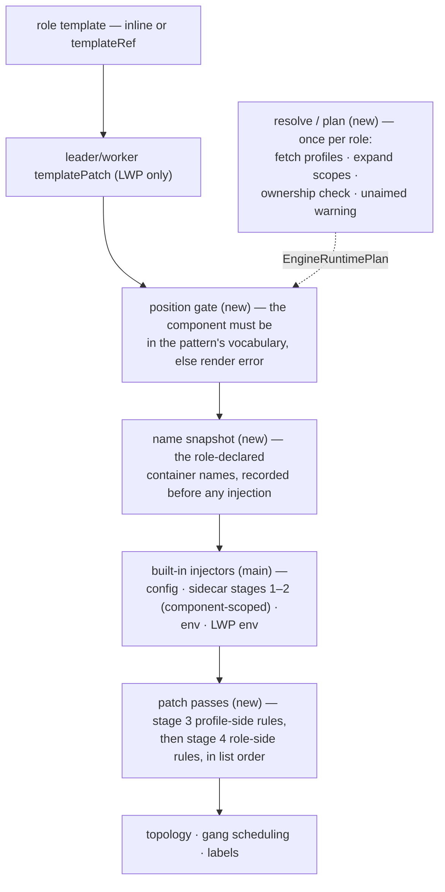

# KEP-531: Engine Runtime Profile Injection

<!-- toc -->
- [KEP-531: Engine Runtime Profile Injection](#kep-531-engine-runtime-profile-injection)
  - [Summary](#summary)
  - [Motivation](#motivation)
  - [Goals](#goals)
  - [Non-Goals](#non-goals)
  - [Proposal](#proposal)
    - [Overview](#overview)
    - [User Stories](#user-stories)
    - [Design Overview](#design-overview)
  - [Design Details](#design-details)
    - [Effective Component Set](#effective-component-set)
    - [Scope Ownership](#scope-ownership)
    - [Per-Dimension Gates](#per-dimension-gates)
    - [Consent and Trust](#consent-and-trust)
    - [Duplicate Delivery](#duplicate-delivery)
    - [Role-Side Patches](#role-side-patches)
    - [Patch Grammar](#patch-grammar)
    - [Render Pipeline](#render-pipeline)
    - [Profile Mutability](#profile-mutability)
    - [Validation Model](#validation-model)
    - [Version Serving and Conversion](#version-serving-and-conversion)
  - [Compatibility Guarantees](#compatibility-guarantees)
  - [Risks and Mitigations](#risks-and-mitigations)
  - [Test Plan](#test-plan)
    - [Unit Tests](#unit-tests)
    - [Integration Tests](#integration-tests)
    - [E2E Tests](#e2e-tests)
    - [Upgrade / Downgrade Drills](#upgrade--downgrade-drills)
  - [Graduation Criteria](#graduation-criteria)
  - [Upgrade / Downgrade Strategy](#upgrade--downgrade-strategy)
  - [Feature Enablement and Rollback](#feature-enablement-and-rollback)
  - [Alternatives Considered](#alternatives-considered)
  - [Future Work](#future-work)
<!-- /toc -->

## Summary

ClusterEngineRuntimeProfile (CERP) is the cluster-scoped, independently
published object carrying engine-runtime machinery. Its spec carries
`initContainers`, `containers` and `volumes` as full corev1 objects, delivered
at render by append-if-missing keyed by name, the role's same-named declaration
always winning; the same precedence on volumes lets a role re-back a profile's
mounts with its own PVC or Secret. A role references profiles through the
`engineRuntimes` list; the legacy `containers` field on the reference — env and
args appended into profile-declared containers — is the imprecise grammar this
KEP supersedes. A profile referenced by any live role is immutable — its spec
frozen for as long as a reference exists — so publishing a revision means
creating a new profile and migrating references to it; accordingly the published
`updateStrategy` field is deprecated (it was never consumed, and immutability
removes the surface it would have governed) and is removed alongside the
never-consumed `injectContainers` at the next version boundary. (Immutability
is staged: enforced from the beta — see Profile Mutability.)

This KEP completes the selection on both sides. The profile side gains
`containerPatches` — RFC 6902 `add` operations addressed by container-relative
RFC 6901 paths, each firing at the addresses the referencing role consents to.
The reference side states, per `engineRuntimes` entry, where a referenced
profile applies:

- `component` (optional) names the **one** component of the role's pattern the
  reference operates on — the rendered workload's `leader`/`worker`, a declared
  component name, or, under standalonePattern, the role's own name. Absent, the
  reference keeps main's compatible behavior: each pattern applies its own
  default injection scope — and under standalonePattern the field may stay
  absent even when `targetContainers` is present, the pattern having exactly one
  component.
- `targetContainers` (optional) organizes the container surface **per
  container**: one entry per container the reference touches, keyed by `name`.
  Listing a **role-declared** name is the **consent**: the profile's
  `containerPatches` fire at that container, and the entry's `extraPatches`
  carry the **role's** own patch rules for that same container, landing after
  the profile's. An entry naming a **profile-declared** container receives only
  its own `extraPatches` — the profile's rules are written for the consumer's
  engine containers, never for its own.

The allowed patch paths cover four surfaces of a Linux process — its filesystem
(volume mounts), its environment, its argv, and its privileges (Linux
capabilities). The root allowlist is side-asymmetric: the profile side may
address only the shape-independent subset — env, volume mounts, and an outermost
command wrap — while argv surgery and capabilities are role-side-only roots,
because only the role author knows the container's command/args shape. The
result is a generic injection mechanism: rbg provides a capability set, and
plugins — an acceleration package for SGLang/vLLM, a telemetry interposition
library, a C++ hook package — fit it by publishing a profile, with rbg retaining
zero knowledge of the plugin's internals.

## Motivation

Engine-runtime concerns — an acceleration package, a telemetry sidecar, an
interposition library, a model-cache volume — are orthogonal to a workload's own
topology. Embedding them in every role spec means every workload author copies
machinery they do not understand, and every publisher revision becomes a
fleet-wide edit. CERP extracts them into a cluster-scoped, independently
published object: the platform operator writes one profile, a RoleBasedGroup
author references it by name. The immediate drive is the plugin ecosystem
growing around the community inference engines — the publishers cannot write the
workloads, the workload authors do not know the plugin's internals, and the
profile is the meeting point.

Four principles shaped CERP's design: **mechanism, not data** — a profile
carries machinery and zero workload data, every divergent datum stays in the
role; **one-way declarations** — only the role consumes the profile, never the
reverse; **render-time, not admission-time** — stored objects stay exactly as
their authors wrote them, every composition happens at render and fails before
any pod is created; **cluster scope is a trust decision** — the publisher is
trusted like a cluster admin of every consuming namespace, and RBAC on CERP
writes is the gate.

CERP's published surface answers half the problem; the other half was never
designed — a profile cannot touch the role's own containers, a reference cannot
say which component a runtime belongs to, and the one customization grammar that
exists is an imprecise full-object merge. Issue
[#531](https://github.com/sgl-project/rbg/issues/531) inventories the defects
this KEP answers:

1. **Pod-level injection is uncontrolled.** Referencing a profile injects
   wherever the pattern happens to; a role cannot say "this runtime belongs to
   the worker component."
2. **No way to touch role-declared containers.** A profile author cannot add an
   env var or a volumeMount to the role's own engine container.
3. **Role customization of profile containers is env/args-only**, expressed as
   full `corev1.Container` objects whose extra fields are silently ignored.
4. **The dormant `injectContainers []string`** predates any semantics; its shape
   cannot express the consent model this KEP needs.

## Goals

- A role can scope one `engineRuntimes` reference to a single component of its
  pattern, with the absent-field default byte-identical to main.
- RoleBasedGroupSet carries the new fields to its child RBGs by propagation —
  the same semantics as on a directly written RBG, no second implementation.
- A profile can patch role-declared containers — env, volume mounts, and an
  outermost command wrap — at listed targets, using RFC 6902 `add` operations
  with container-relative RFC 6901 paths; argv surgery and Linux capabilities
  are role-side-only roots.
- A role can patch any container of the component — its own or the profile's —
  with the same rule format: one grammar, every role-authored modification
  expressed in the reference.
- The reference is a self-contained toggle: removal takes every modification it
  carried with it, leaving no residue in the role template.
- The legacy `containers` env/args merge keeps working unchanged, within the
  reference's component scope.
- Pre-existing objects render byte-for-byte identically to main.
- Validation is split: CEL at write time checks shape only; vocabularies and
  existence are decided at render time.

## Non-Goals

- A component opt-out of pod-level injection: deliberate non-injection remains
  inexpressible, exactly as on main.
- Multi-component targeting per reference: one reference names at most one
  component; multiple components are multiple references sharing the
  `profileName`.
- Attaching semantics to `injectContainers`: it stays optional and inert,
  exactly as published, and is removed at the next API version boundary.
- Any rollout or orchestration machinery for profile revisions. Immutability
  settles how a profile change reaches existing workloads — it does not, while
  referenced; versioning is the new-name-plus-reference-migration workflow
  defined in Profile Mutability, and rbg provides nothing beyond it: no
  channels, no revision tracking, no automated migration.
- The deprecated workload surfaces: roles rendered as Deployment, StatefulSet or
  LWS through the PodReconciler path. The new fields' semantics are defined for
  the RoleBasedGroup → RoleInstanceSet render path only; deprecated surfaces
  take no new features, and the follow-up implementation rejects the new fields
  there rather than giving them meaning.
- `replace`/`remove`/`test` patch operations: the grammar is `add`-only.
- Mutating the injected pod-level content (initContainers, sidecars, volumes)
  via the patch grammar — patches address containers only.
- Any pod-spec mutation of role templates: resources, probes, ports, `hostIPC`,
  `terminationGracePeriodSeconds`, sysctls, `runtimeClassName` and kin stay with
  the role template author (a `/dev/shm` enlargement is still expressible — an
  emptyDir `medium: Memory` volume plus a mount patch).
- Tuning a profile-injected container beyond the four patch surfaces (its
  resources, `envFrom`, probes): the profile author sizes them; the consuming
  role's remedy is a republished profile, not a patch.
- Structural ordering guarantees beyond author precedence — e.g. a profile's
  command wrap staying outermost no matter what the role prepends. Role patches
  land last, so the profile cannot claim positions ahead of role content; a
  profile whose command wrap must be outermost relies on the role author not
  prepending into a listed container, with a render-time event when that
  happens. The reserved `replace` op and any ordering change are the future
  extension points.

## Proposal

### Overview

A ClusterEngineRuntimeProfile declares pod-level content — init containers,
sidecars and volumes — and, new, per-container patch rules. A role's
`engineRuntimes` entry references a profile by `profileName` and, optionally,
narrows the reference to one `component` and organizes its container surface per
container: `targetContainers` entries, each the consent to the profile's patch
rules at that container and the holder of the role's own patch rules for it:

```yaml
apiVersion: workloads.x-k8s.io/v1alpha2
kind: RoleBasedGroup
spec:
  roles:
  - name: lg
    # ... other role fields omitted
    leaderWorkerPattern:
      template:
        spec:
          containers:
          - name: w
            image: w
    engineRuntimes:
    - profileName: vllm-runtime       # required; render-time resolution
      component: worker               # optional; absent = the pattern's default components
      targetContainers:               # optional; one entry per container this reference touches
      - name: w                       # role-declared; listing = consent to the profile's patches
        extraPatches:                 # the role's own patches for w — land after the profile's
        - jsonPatch: {op: add, path: /env/-, value: {name: TELEMETRY_ENDPOINT, value: 'sidecar:9090'}}
      - name: runtime-sidecar         # profile-declared; receives only its own extraPatches — the profile's patches fire at role-declared entries
        extraPatches:
        - jsonPatch: {op: add, path: /env/-, value: {name: FOO, value: bar}}
      containers:                     # legacy; unchanged
      - name: runtime-sidecar
        args: [--extra]
```

```yaml
apiVersion: workloads.x-k8s.io/v1alpha2
kind: ClusterEngineRuntimeProfile
metadata: {name: vllm-runtime}
spec:
  containers:
  - name: runtime-sidecar
    image: vllm/runtime:latest
  volumes: [...]
  containerPatches:                   # profile-side: target-less rules, each firing at every listed role-declared targetContainers address
  - jsonPatch: {op: add, path: /env/-, value: {name: NCCL_DEBUG, value: INFO}}
```

The profile side speaks the same rule format with a different addressing model:
`spec.containerPatches []ContainerPatch` entries are **target-less** — each
entry is `{jsonPatch}` and fires at every listed **role-declared**
`targetContainers` address of the referencing component. The split follows the
knowledge: the role author knows container names; a cluster-scoped publisher
cannot.

```go
// ContainerPatch is one ordered patch entry — the format-selection
// wrapper shared by both sides. Today `jsonPatch` is the only format
// and is required; a future format joins as a sibling field,
// `jsonPatch` relaxes to optional and a oneOf rule takes over.
type ContainerPatch struct {
	// +kubebuilder:validation:Required
	JSONPatch *ContainerJSONPatch `json:"jsonPatch"`
}

// ContainerJSONPatch is a single RFC 6902 `add` operation applied to
// a container at render time — semantics defined in Patch Grammar.
// `value` is schemaless at write time, unmarshalled strictly into
// the corev1 type the path implies at render; a mismatched shape is
// a render error attributed to the patch author. The path allowlist
// is enforced twice: the CEL rule below, and a render-time grammar
// re-check (segment boundaries, element-pointer shape) that a CEL
// string match cannot guarantee.
//
// +kubebuilder:validation:XValidation:rule="self.path.startsWith('/command/') || self.path.startsWith('/args/') || self.path.startsWith('/env/') || self.path.startsWith('/volumeMounts/') || self.path.startsWith('/securityContext/capabilities/add/')",message="path must be an element pointer under /command, /args, /env, /volumeMounts or /securityContext/capabilities/add"
type ContainerJSONPatch struct {
	// +kubebuilder:validation:Enum=add
	// +kubebuilder:validation:Required
	Op string `json:"op"`

	// +kubebuilder:validation:MinLength=1
	// +kubebuilder:validation:Required
	Path string `json:"path"`

	// +kubebuilder:pruning:PreserveUnknownFields
	// +kubebuilder:validation:Schemaless
	// +kubebuilder:validation:Required
	Value runtime.RawExtension `json:"value"`
}
```

### User Stories

These stories illustrate the main shapes the feature serves — a pod-level-only
reference, wheel-delivered plugins, a command wrap, an interposition library,
layering, error and warning paths, and multi-component delivery of one profile.
Each is expressed under the final grammar.

1. **A metrics sidecar for the leader, nothing else.** One sidecar, scoped
   `component: leader` with no `targetContainers`: pod-level content injects
   into the leader only, the worker renders byte-identically, and no
   `containerPatches` means no `UnaimedContainerPatch` warning.
2. **A pure-Python engine plugin, delivered as a wheel.** An image volume holds
   the wheel; an initContainer unpacks it into a shared emptyDir; the patches
   mount that directory read-only and add a `PYTHONPATH` env entry pointing at
   it via `/env/-`. The leader and worker references list the same engine
   container; the role's own data is one feature-gate env differing per
   component. The engine discovers the plugin through entry-point metadata — the
   profile never learns the engine's identity.
3. **A runtime launcher wrapped around the engine command.** Wheel delivery as
   above, plus three reverse-order `/command/0` head inserts rendering `[python,
   -m, <launcher-module>, <original tail...>]`, and a role-side capability
   append — argv surgery and capabilities being role-side roots (no manual setup
   — the grammar creates the intermediate path).
4. **A storage-transport interposition library with zero workload data in the
   profile.** An initContainer copies a preload library and its config into a
   shared volume; the patches mount it read-only, set `LD_PRELOAD`, and point a
   config-path env at the config. Every divergent datum (enable flag, endpoint,
   region, bucket) is role-owned via env entries in the reference's
   `targetContainers[].extraPatches`; credentials arrive via `secretKeyRef`,
   never plaintext.
5. **The full five-root bundle.** One profile exercising every root at once: the
   profile keeps the command head-insert, the env append and the volumeMount;
   the role owns the args head-insert and the capability append, the two
   role-side-only roots.
6. **The unscoped reference that warns.** A standalone role references the
   profile by `profileName` alone; the profile declares `containerPatches` (one
   env append), so pod-level content injects while the patches find no listed
   container — the render completes with an `UnaimedContainerPatch` warning, a
   soft signal, not an error.
7. **The render error that never reaches a pod.** A `targetContainers` entry
   naming `ghost` under `component: worker`: the render fails, no child workload
   is created, an `EngineRuntimeRenderFailed` event fires with the attributed
   error — the render-vocabulary failure, kept out of the API's write path.
8. **Stacking two profiles on one container.** An accelerator and a telemetry
   publisher, both scoped to the worker and both listing `engine`, listed in
   that order: the two `/env/0` head-inserts stack with the later-listed
   reference leftmost — the rendered env is `[telemetry, accelerator, original]`
   — both volumes mount, and each profile's env wins its own name.
9. **The same profile, delivered differently to two components.** One profile
   referenced twice: `component: leader` with no `targetContainers` (pod-level
   content only) and `component: worker` with an entry naming `engine`
   (pod-level content plus the env patch) — disjoint effective component sets,
   the legal two-reference shape, with the target-less leader reference emitting
   the unaimed-patch warning.

### Design Overview

One reference is one scope: an `engineRuntimes` entry names a profile and,
optionally, the **one** component of the pattern it covers; absent, it covers
the pattern's default component set — main's behavior, kept byte-for-byte,
except that standalonePattern's single component stays addressable without
writing `component`. The profile side gains `spec.containerPatches` —
target-less patch rules, each firing at every address the reference lists — and
consent and the role's own rules are organized per container through
`targetContainers` entries (Per-Dimension Gates states the firing rules).
Same-profile references own disjoint effective component sets, except the exempt
compatibility pair. The patch grammar is shared RFC 6902 `add` element pointers
under five roots, split asymmetrically by side: the profile side may address
only the shape-independent roots (`/env`, `/volumeMounts`, `/command/0`). Render
errors and warnings are events; write-time checks — CEL shape, the webhook half
of the invariants — are early feedback only.

## Design Details

### Effective Component Set

One reference names **at most one** component; a runtime covering several
components is expressed as multiple references sharing the `profileName` — one
reference, one scope, so bare container names need no qualified
`component/container` form.

| pattern | `component` absent | `component` present |
|---|---|---|
| leaderWorkerPattern | `{leader}` | `{component}` |
| customComponentsPattern | all declared components | `{component}` |
| standalonePattern | the single implicit component — the one pattern where `targetContainers` may appear with `component` omitted | `{component}` — the component must equal the role's name, else render error |

Two rows deserve emphasis. The standalonePattern one: "implicit component" is
easy to misread as "unnamed component" — KEP-173 defines standalonePattern as
**one component named after the role** (main's renderer implements exactly that,
`constructRoleInstanceTemplateFromStandalonePattern` → `WithName(role.Name)`),
so `component: <role name>` selects it and any other name fails the render
vocabulary check. And the leaderWorkerPattern row records an asymmetry in main's
renderer — the worker template never receives pod-level injection; this KEP
preserves that default verbatim, and naming `component: worker` is therefore
**new capability**, not a narrowing.

The absent column is main's default, and main decides it per render path — which
templates carry the sidecar injector at all:

| render path | templates receiving pod-level injection |
|---|---|
| RoleInstanceSet, standalonePattern or customComponentsPattern | every component template |
| RoleInstanceSet or LWS, leaderWorkerPattern | the leader template only — the worker chain omits the sidecar injector |
| legacy Deployment / StatefulSet (PodReconciler; deprecated, see Non-Goals) | the single role template |

The legacy rows record existing behavior as-is; every new dimension in this KEP
is scoped to the RoleInstanceSet path.

RoleBasedGroupSet embeds the full `RoleBasedGroupSpec`, and its controller
deep-copies `spec.groupTemplate.spec.roles` into each child RBG
(`deepCopyRoles` in `rolebasedgroupset_controller.go`) — children render
through the RoleInstanceSet path this KEP defines, so the new fields carry the
same semantics there by propagation, with no second implementation: the
role-side shared validation is wired into the existing RoleBasedGroupSet
webhook as well, and a test pins that a child RBG carries
`component`/`targetContainers` from the group template.

The absent-column expansion applies to pod-level injection (and the legacy
`containers` merge). `targetContainers` normally requires `component` — the
write-time CEL rule — with one exception: standalonePattern has exactly one
component, so a reference may list `targetContainers` with `component` omitted
and it attaches to the role's own component; a written `component` that does not
equal the role's name fails the same render vocabulary check as any unknown
component. Terminology: the
user-facing word is **component**; the internal resolver concept is `position`,
which the Render Pipeline section uses.

### Scope Ownership

Each reference expands to its effective component set (the table above), and
ownership is enforced on that set: for one `profileName`, any two references
whose effective sets intersect are a render error. The set form covers the mix —
an unscoped reference implicitly covers the pattern's default set, so under
customComponentsPattern and standalonePattern it intersects every scoped
reference of the same profile, while under leaderWorkerPattern only `component:
leader` overlaps, leaving `component: worker` the one legal mix. The exemption
is the **pure compatibility pair** — two references both lacking `component` (no
`targetContainers`; `containers` allowed) — which keeps main's
duplicate-reference semantics verbatim; it is the only same-profile combination
old data can hold, so the rule is forward-compatible by construction.
Consequences: patch addresses cannot collide across same-profile references, and
every scoped consent and patch rule for a (profile, component) pair lives in
exactly one reference. Under standalonePattern an unscoped reference carrying
`targetContainers` is exactly as scoped as `component: <role name>` — same
effective set, same ownership.

### Per-Dimension Gates

| dimension | direction | gate | absent means |
|---|---|---|---|
| pod-level injection | profile → pod | `component` (scope) | the pattern's default component set (main behavior) |
| container patches | profile → role-declared containers of the reference's component | `targetContainers` (the role-declared listed names) | patches fire nowhere; if the profile declares `containerPatches`, a warning event is emitted and the render succeeds |
| role patches | role → any container of the component (role-declared or profile-declared) | the entry's `extraPatches` (presence) | nothing applies; no warning — writing the rules is the consent |

A `targetContainers` entry names exactly one rendered container of the
reference's component — role-declared or profile-declared, both kinds covering
init containers: the grammar distinguishes targets by name, not by kind. The two
kinds differ in what listing fires: the profile's `containerPatches` — written
for the consumer's engine containers — fire at role-declared entries only; a
profile-declared entry fires just its own `extraPatches`, so a publisher's
launcher wrap can never land around its own sidecar's command. Consent is the
role's to give over its own containers; the profile's containers need no consent
to themselves, and their entries stay addressable — the channel that must
survive the day `containerPatches` replaces the legacy `containers` merge. Under
standalonePattern the reference's component is the pattern's single one,
`component` written or omitted.

### Consent and Trust

Consent is per container, all-or-nothing across the profile's entire patch list:
listing `engine` also consents to its env additions, its mounts and its command
wrap. Refusing one rule of a profile is the job of a separately published
variant — the reference cannot cherry-pick payloads. The grant is describable in
one sentence — the profile may add env entries and mounts to, and wrap the
outermost command of, the named containers — which is what the root split buys:
no consented rule's meaning depends on the consumer's command/args shape.

What consent does **not** gate: merely referencing a profile runs every
profile-authored container and mounts every profile volume — full corev1
objects, so a publisher controls the securityContext of its own injected
containers with no consent step at all; and an argv prepend into a consented
engine container is code execution in that container's context — its image, its
service account, its GPUs. `containerPatches` is a trust boundary for a fraction
of the surface; the profile reference itself is the real one. The trust premise
follows from the object scopes: CERP is cluster-scoped and its publisher is
trusted like a cluster admin of every consuming namespace; profile-side patch
values may carry `valueFrom.secretKeyRef` into the consuming namespace — a
consent-gated power. The converse — role content flowing into a profile-declared
container — is the role author's decision, not a blocked channel; role-side
patches are no escalation path for the role author, who can already set any
securityContext on their own template containers. Alpha guidance: grant CERP
write verbs only to cluster-admin-equivalent principals.

### Duplicate Delivery

Referencing a profile twice can never inject duplicate containers, init
containers or volumes — a name already present, from the role's own template, an
earlier reference of the same profile, or a different profile, is never appended
a second time. Append rather than merge is deliberate: a merge needs ownership
rules for every field both sides might write, append needs only a name. The same
precedence applies to volumes — a role-declared volume with the profile's volume
name wins, so the profile's own volumeMounts read the role's volume: the
sanctioned re-backing of a profile's mounts with the role's own PVC or Secret, a
role-authored, reviewable decision. The delivery mechanics, stated once:

| aspect | behavior |
|---|---|
| init containers | appended after the role's own — they run after them — append-if-missing by name |
| sidecars and volumes | appended, append-if-missing by name; the role's same-named declaration wins |
| the role's own containers | untouched by profile content — no env, no volumeMounts; `injectContainers` stays inert |
| `RBG_*` env | reaches profile-injected sidecars, not profile init containers — the env injector scans `containers` only |
| `rbg-cluster-config` mount | not mounted into profile sidecars — the config injector precedes the sidecar stage, and stateful roles only |
| missing profile | the render fails and the reconcile retries; no event on main — this KEP attributes it via `EngineRuntimeRenderFailed` |

One hazard is deliberate: when **two different profiles** declare the same
container or volume name, the earlier reference wins and the later profile's
same-named entry is skipped — reordering `engineRuntimes` changes the winner, so
profile publishers should prefix names to avoid collisions. The skip is
deterministic but not silent: a render-time warning event
(`EngineRuntimeNameCollision`) fires on every cross-profile skip. The patch
dimensions handle duplicates per field: env names resolve per the Patch
Grammar's author-precedence and positional rules; a volumeMount is an idempotent
no-op only under full-field semantic equality, a partial match being a render
error; a duplicate Linux capability is an idempotent no-op. The legacy
`containers` env/args merge remains per-reference additive, exactly as on main.
Mixed same-profile references never render a half-owned scope — the
scope-ownership error above — and the one legal mix renders byte-identically to
its all-scoped spelling.

### Role-Side Patches

The two sides are organized by **author**: the profile's `spec.containerPatches`
carries the publisher's rules (target-less entries, firing at every listed
address), while the role's rules live in the `extraPatches` of its
`targetContainers` entries — each entry both names its target and consents to
the profile's rules there. An entry name resolves against the role-declared
names snapshotted before injection plus the container names this reference's own
profile declares; anything else — a name injected only by a different reference
or profile — is a render error. A name the role's own template also declares
resolves to the role-owned container.

An entry name may be **role-declared** — the `extraPatches` are coupled to the
profile and disappear with the reference — or **profile-declared** — configuring
the publisher's code with env, args, command or mounts, its entry firing only
its own `extraPatches` (the profile's rules never fire at the profile's own
containers; see Per-Dimension Gates). Profile-declared targets include init
containers — the legacy `containers` merge silently no-ops for them (the
override loop only ever scans the pod's `containers` list); the patch grammar
closes that gap, including the mounts main could never deliver: a model-cache
PVC or a log `emptyDir` is role-declared content, and the role-side patch is the
only author holding both halves — the role-private volume name and the profile's
mount target. A patch's volumeMount names resolve against the rendered pod's
volume list with the same role-wins precedence. Entries apply in list order,
after the profile-side pass; same-name env resolution is the Patch Grammar's
author-precedence rule — the role's entry wins over profile content at whatever
index it used, and a profile-side append onto a role-owned name is the render
error.

### Patch Grammar

- Op: RFC 6902 `add` only. `replace`, `remove`, `test` are reserved for a future
  revision.
- Path: container-relative RFC 6901. The path space is an allowlist of exactly
  five roots, each addressed as a list element pointer — `<root>/<element>`,
  where `<element>` is `-` (append) or a numeric index (insert):

  | root | field | value |
  |---|---|---|
  | `/command` | `command` | string |
  | `/args` | `args` | string |
  | `/env` | `env` | corev1.EnvVar with a unique `name` |
  | `/volumeMounts` | `volumeMounts` | corev1.VolumeMount |
  | `/securityContext/capabilities/add` | `capabilities.add` | string |

**The root allowlist is side-asymmetric.** Profile-side entries may address
`/env`, `/volumeMounts`, and `/command/0` only; anything else is a render error
attributed to the profile. The rule follows where the knowledge sits: an entry's
effect is a function of its content (profile knowledge) and the target's shape
(role knowledge). `/env` and `/volumeMounts` are name-addressed,
shape-independent. Kubelet concatenates `command` and `args` into one argv, and
where the split falls is an authoring convention the publisher cannot read;
`/command/0` — a boundary operation on the concatenated argv, identical under
every convention — is the profile side's only argv vehicle: activation flags
ride it as a wrap (the multi-entry head insert, reverse order, whose `exec "$0"
"$@"` re-splices the original process). The wrap guarantees argv preservation,
not engine-flag delivery: a consumer whose process is itself a shell script
(`command: [sh, -c, "<script>"]`) is opaque — `sh -c "<script>" --flag` makes
the flag the inner shell's `$0`, never reaching the engine — so engine flags for
such consumers come from role-authored patches or an explicit launcher contract,
and the wrap's tests assert the child process's actual arguments, not just the
rendered command array. Role-side entries keep all five roots at any index —
their author wrote the shape, so argv surgery there is ordinary first-party
authoring risk — and with profile-side `/args` out of the grammar, an argv token
has exactly one author, so the cross-side duplicate-flag question never arises.
Per-role divergent values cannot come from one static profile in any design;
they are role-side patches or published profile variants.

An index inserts at that position — `/command/0` prepends, so multi-element head
inserts are written in **reverse order**; `/env/0` head inserts also interact
with `$(VAR)` references, which resolve against earlier entries only. An index
past the list end or beyond machine integer range is a render error, not a
wraparound. Two deliberate deviations from strict RFC 6902 accommodate the
common nil-field container shape: a missing target list is treated as empty
where insertion is allowed, and intermediate struct members along an allowlisted
path are created when absent — except `command` and `args`, whose creation can
silently discard image-defined process definitions. The exact rule follows the
Kubernetes entrypoint merge (containerd `WithProcessArgs`): when a container
sets `command`, the image ENTRYPOINT **and** CMD are already ignored, so
creating `args` discards nothing and is allowed; creating `args` is an error
only when the container sets neither `command` nor `args`, and creating
`command` is always an error. The emptiness predicate is `len == 0`, also
correct for an explicitly written empty array. Whole-list paths (`/env`) and
member addressing (`/env/name`) are rejected: `add` onto an existing location
replaces it, which would overwrite user values. The element segment must be `-`
or digits — no allowlisted token contains `~`, so RFC 6901 escape sequences
never pass.
- Values are raw JSON, schema-less by design: write time accepts arbitrary JSON
  for the value, and render time unmarshals it into the target field's corev1
  type, rejecting a mismatched shape with the error attributed to the patch
  author.
- Same-name env patches take effect in a fixed order — author precedence first
  (role content over profile content), position only within one author — never
  an outright refusal, except where an ownership boundary below draws one:
  - **Within one patch list** (either side), two entries creating the same env
    name are an error — the earlier entry never takes effect, so a duplicate is
    always a mistake. The check needs the value unmarshalled, so at alpha the
    reference-side half rides the RoleBasedGroup webhook's shared check
    function, while the profile-side half fires at render with attribution (see
    Validation Model).
  - **Profile-side rules may only default.** A profile entry for a name the
    target already carries is a default that loses by author; the `/env/0` head
    insert is the conventional spelling, keeping the default unobtrusive — no
    landing position makes profile content win. A profile-side `-` append onto a
    role-owned name is a render error: an append reads as an override attempt,
    and profile content never wins against role content on the same name. The
    default is genuine across renders: effective while the role does not declare
    the name, superseded once it does.
  - **Role-side rules may override, by author rather than position.** The
    guarantee is that the role's `extraPatches` win: final normalization keeps a
    role-authored entry over any profile-authored entry of the same name,
    whatever index the role entry used — a role-side `/env/0` insert over a
    profile default renders the role value. Position picks the winner only
    within one author. The same override the legacy `containers[].env` merge
    performs positionally today (role content landing last), expressible in the
    new grammar without waiting for a `replace` op.
  - **Across profiles**, same-named entries resolve positionally: values are
    never merged, resolution is silent, prefixing names is the convention.
    Appends follow last-wins by reference order; `/env/0` defaults invert it —
    head-insert geometry puts the later reference's entry ahead, so the earlier
    reference's default wins. Application order plus append-vs-head-insert, not
    author intent, picks the winner — the opposite direction of the container
    dimension, where append-if-missing lets the earlier reference win. A warning
    event is future work.
  - **The `RBG_` prefix is reserved.** An env name beginning `RBG_` belongs to
    the controller's own injection; a patch entry on either side creating one is
    a render error. This also protects names the controller does not inject yet.
  - **The rendered template is duplicate-free.** A final normalization after
    stage 4 collapses same-name entries — the role-authored entry winning over
    any profile-authored entry of the same name, the positional (last-wins)
    winner otherwise — with the same dedupe the built-in env injectors perform,
    because the RoleInstanceSet reconciler — the one apply path that carries the
    new fields — applies workloads via server-side apply, whose `env` list is
    keyed by name and rejects duplicates; the deprecated
    Deployment/StatefulSet/LWS paths share the apply mode but reject the new
    fields (Non-Goals). Only entries the author-precedence and positional rules
    had already beaten are removed; the role template's own duplicates, if any,
    pass through untouched, so normalization never turns a render main would
    reject into an accepted one. The surviving entry lands at the **earliest**
    occurrence position of the name, not the winner's own index: `$(VAR)`
    references expand against earlier entries only, so a later-positioned winner
    (a role `/env/-` append beating a profile `/env/0` default) would otherwise
    strand any `$(X)` consumer sitting between the two — with the earliest
    position, such a consumer resolves to the winner's value, deterministic even
    where it differs from kubelet's own left-to-right expansion of the
    pre-normalization list.
- **volumeMounts.** A mount whose `(name, mountPath)` key matches an existing
  entry is an idempotent no-op only under **full semantic equality** of the
  unmarshalled structs — an absent field and an explicit zero value counting as
  equal; a partial match — key equal, any other field different — is a render
  error, since `add` cannot modify the existing entry. The same volume `name` at
  a different `mountPath` is a legal second mount; a `mountPath` already used by
  a different volume name is a render error — kubelet resolves overlapping mount
  paths last-wins, a shadowing the merge refuses to create; two entries in one
  patch list creating the same key are an error.
- **Capabilities.** A capability already present is an idempotent no-op, by
  verbatim match. Names pass through **verbatim, no normalization** — the
  capability set drifts across kernel versions, so a render-time list check
  would falsely reject names newer kernels accept; the unknown-name policy is
  the runtime's, exactly as for corev1 pod specs: containerd matches
  case-insensitively but silently drops `CAP_`-prefixed and unknown names, CRI-O
  fails creation on unknown names (kubernetes#119569). One form hazard gets a
  render-time signal: a name not matching the canonical uppercase form
  `^[A-Z]+(_[A-Z]+)*$` emits a warning event attributed to the role — not an
  error, because lowercase works on both runtimes while the prefixed form works
  only on CRI-O. Well-formed unknown names pass silently; PodSecurity admission
  gates additions when the rendered pod is created.
- Override is scoped by author, not refused: a role-side entry of an existing
  name overrides, and a profile needing a different value for a role-owned name
  can publish only a superseded default or a variant. What no `add` — positional
  or not — can do is **join** values: the patch value is static JSON, written
  without sight of the target's current value. The reserved `replace` op and a
  future join op cover it.
- PATH-like composition works in layers. Where the role owns the name, it writes
  the composed value directly. Where the profile owns delivery, it contributes
  names it owns (`IK_SHIM_DIR=/opt/inference-kit/shims`) and a role-side patch
  appends the consuming entry, resolvable because role patches land last and
  kubelet `$(VAR)` expands against earlier entries. What no render-time rule can
  reach is the **image's** ENV: `$(VAR)` expands only pod-spec entries, so
  "prepend to the CUDA image's `LD_LIBRARY_PATH`" — #531's headline GPU-driver
  scenario — is served by a wrapper convention: a structured role-side head
  insert (`bash`, `-c`, `export LD_LIBRARY_PATH=/opt/x:$LD_LIBRARY_PATH; exec
  "$0" "$@"`, reverse order) whose shell expansion happens *inside* the
  container after image ENV applies. The same wrap on the profile side is how a
  publisher delivers activation argv to every consented consumer once.
  Multi-plugin composition of one name follows the cross-profile last-wins rule:
  the value is never merged — the role author composes it over the profiles'
  delivered names, or the wrapper does.
- `ContainerPatch` carries one patch format: today `jsonPatch` is required; a
  future format joins as a sibling field, `jsonPatch` relaxes to optional, a
  oneOf rule takes over, and the single ordered list preserves cross-format
  application order.
- List bounds: `MaxItems=32` on the new patch lists, per reference and per
  profile — new fields, so no compatibility surface is touched. The published
  lists (`roles`, `engineRuntimes`) carry **no new caps**: capping them inside
  the already-published v1alpha2 would reject stored objects on any update. If
  the CEL cost budget is ever exceeded, the remedy is restructuring checks into
  OpenAPI-native validation, verified against the oldest supported
  kube-apiserver (1.28) via envtest. Patch values are expected small — a
  per-value size CEL rule is a beta candidate; until then object size is bounded
  only by the apiserver request limit.

### Render Pipeline

Stages 1 and 2 are **interleaved per reference** — main's `sidecar_builder.go`
pass, unchanged. The two patch passes are phased by **author, not by
reference**, both following `engineRuntimes` list order.

1. Pod-level injection — initContainers, sidecars, volumes, append-if-missing,
   per reference.
2. Legacy `containers` env/args merge — per reference, immediately after that
   reference's stage-1 append, within the reference's effective scope.
3. Profile-side `containerPatches` at the listed role-declared
   `targetContainers` addresses — the profile-side roots only — for **every
   reference covering the component, in list order**, each pass applying that
   profile's own patch list in order.
4. Role-side `extraPatches`, in the same reference order, each pass applying its
   own list in order — into the entry's container, all five roots at any index.

Interleaving the patch passes per reference would let a later reference's
profile-side insert land ahead of an earlier reference's role-side insert — the
exact direction the author boundary refuses — and the boundary keeps the list
order from favoring either author: reordering shifts both phases together.
Positional overlaps inside stage 3 follow the cross-profile silent convention (a
warning there is future work). Each stage-3 pass resolves its role-owned checks
against the role template and the pod-level content of earlier references only —
no pass sees another reference's patches — and role-owned names come from the
pre-injection snapshot, so check timing cannot change the outcome.

Role-side targets may overlap profile-side ones, so the fixed order carries
semantics: a role-side `/command/0` insert is the rendered command's index 0,
and among profile-side `/command/0` inserts the later reference's wrap lands
outermost by head-insert geometry. The outermost-premise cost and its
render-time event are recorded in Non-Goals; env overlaps resolve by the Patch
Grammar's author precedence.

One further main behavior is preserved verbatim because the compatibility path
depends on it: a legacy override naming a container the reference's own profile
does not declare is skipped — silently, with a V(1) log line, including when a
later reference would inject it — and an override naming an init container is
always a silent no-op (the override loop scans only the pod's `containers`
list).

The engine-runtime stages sit inside the role's full injector chain, and their
position is load-bearing: the patch passes run **after** the built-in chain,
leaving the patch grammar the only writer. The `RBG_*` variables are the
controller's own injection, a third ownership class that is neither role nor
profile content — hence the reserved `RBG_` env prefix (Patch Grammar) and the
same reservation on the controller-injected `rbg-cluster-config` volume
(stateful roles' discovery ConfigMap mount): a patch entry adding a volumeMount
naming it is a render error, so neither author can steer role code at the
controller's own config surface. A final env normalization after the patch
passes keeps the emitted template duplicate-free for the server-side-apply
workload paths (the rule lives in Patch Grammar).

Main's pod renderer already ran a chain per component template: template
resolution (inline `template` or `templateRef`; templateRef is prohibited for
LWS workloads), strategic-merge patches and a four-injector pass, followed by
exclusive-topology affinities, gang-scheduling fields and the applied
labels/annotations. This KEP keeps that chain unchanged and adds its extension
points to it:



`InjectSidecar` runs only where a reference's effective component set contains
the rendered component — so a worker template under leaderWorkerPattern skips
stages 1–2 entirely unless a reference names `component: worker`.

- **Resolve/plan (once per role, new).** `ResolveEngineRuntimes` fetches the
  referenced profiles, validates each reference's `component` against the
  pattern's vocabulary — an unknown name fails the render here; under
  leaderWorkerPattern or customComponentsPattern it would otherwise create an
  unused plan key and silently inject nothing — expands each reference to its
  effective component set, enforces scope ownership, and emits the unaimed-patch
  warning. Its output — the `EngineRuntimePlan`, keyed by component — is
  consumed by every rendered template; no profile is fetched or re-validated per
  template.
- **Per rendered template (new gating, retained core).** The position gate fails
  the render if the template's component is not in the role pattern's vocabulary
  — a pattern/workload-type mismatch would otherwise silently drop the engine
  runtime content. The role-declared container **and init-container** names are
  snapshotted after template resolution and merge patches — the ownership
  boundary for both passes: a `targetContainers` entry naming a role-declared
  name resolves to the role-owned container regardless of same-named profile
  declarations, and an entry naming a profile-declared container is resolvable
  only once that container's own injection (stages 1–2) has landed. The built-in
  injector chain then runs — the sidecar stage running main's logic scoped to
  the reference's effective components — followed by the patch passes. Any stage
  error fails the whole render with a warning event
  (`EngineRuntimeRenderFailed`) — no partially patched template is delivered.

### Profile Mutability

A profile is immutable while referenced. The moment any live RoleBasedGroup —
including a RoleBasedGroupSet, whose spec embeds the full reference list —
carries an `engineRuntimes` entry naming the profile, its `spec` is frozen;
labels and annotations stay editable for operational bookkeeping, and create is
unrestricted (a new profile has no references by construction). Delete is closed
by two layers. The CERP webhook intercepts DELETE as well and flags it while a
live reference exists — the same alpha-warning / beta-rejection staging as spec
edits — which covers the upgrade window synchronously, before the controller
has backfilled finalizers onto pre-existing referenced profiles. The controller
then maintains an **in-use finalizer** on every referenced profile (the
PVC-protection shape), the long-term guarantee when the webhook is down or
uninstalled, so deletion pends until the last reference leaves. Without the
pair, delete + recreate under the same name would bypass the freeze with two
writes. The freeze and the finalizer both lift when
the last reference is removed: the profile returns to the freely editable state
it had before adoption, so a drained profile can be revised in place and
re-adopted.

A publisher who needs to change a referenced profile publishes the revision as a
**new profile** — `vllm-runtime-v2` beside `vllm-runtime` — and consuming roles
migrate their references one at a time, each migration being the role author's
explicit re-consent to the new content. Nothing orchestrates the migration: the
old profile keeps serving roles that have not moved, both versions run side by
side for as long as the fleet is heterogeneous, and the old profile becomes
editable — or deletable — again once its last reference leaves. Keeping the old
profile around is also its own rollback: restoring a reference to it is a
role-side edit, subject to the same review as any other.

Enforcement is a CERP validating webhook: on update it compares `old.spec` to
`new.spec` and, on a substantive change, flags the write when a live reference
exists — consulting references across RoleBasedGroups and RoleBasedGroupSets
cluster-wide, via an **uncached lookup**: profile writes are rare platform
operations, so the cost is negligible, and skipping the informer cache removes
the stale-cache variant of the race below. A set's group template counts as a
reference even at zero replicas, no child RBG required. The flag — warning or
rejection — names the referencing objects and points to the new-profile
workflow; a reference count in CERP status is the follow-up candidate for
visibility in `kubectl get`. It deploys with the controller image, mirroring
the RoleBasedGroup webhook's deployment shape, and rolls out in two steps: the
alpha emits an **admission warning** — the freeze tightens a published surface,
and the warning window keeps the move to the new-profile workflow non-breaking
— and the beta turns the warning into rejection (`failurePolicy: Fail`). During
the warning window the controller's CERP watch — informer-driven, like the rest
of the controller — is the evidence trail: exactly the backstop below. One race
exists and is accepted: a role creation genuinely in flight while a profile
update passes the check — the update was admitted against a reference-less
profile, and the role's first render reads the post-update content,
indistinguishable from a profile edited before it was ever referenced. The
controller backstops a failed, misconfigured, or uninstalled webhook: it
watches CERPs, and a spec change observed on a referenced profile emits a
warning event on that profile — the signal fires exactly on the paths the
webhook did not block.

One alpha escape hatch: the controller flag `--disable-profile-immutability`
(default `false`) switches the freeze off entirely — the admission flags (update
and DELETE) stop firing and the in-use finalizer is neither added nor honored —
restoring main's freely editable profiles without a downgrade. There is no
feature gate for the field surfaces (Feature Enablement and Rollback); this
flag exists because the freeze and the finalizer apply to every referenced
profile the moment the new controller runs, pre-existing ones included, and an
operator needs a way back short of rolling back the image. The controller's
CERP watch keeps running when the flag is set, so evidence is never silent. The
flag is alpha-only and is removed at the beta, where the warning becomes
rejection.

`updateStrategy` is deprecated in both served versions: it was accepted and
never consumed, and immutability removes the surface it would have governed —
there is no *when does a change reach existing workloads* question left to own.
Its `Deprecated:` marker renders into the OpenAPI schema, the field stays
accepted for stored objects, and it is removed at the next version boundary
alongside `injectContainers`. The render-time contract is unchanged underneath:
every role render still reads the live profile once (`ResolveEngineRuntimes`)
and merges by the rules above — immutability does not snapshot content anywhere;
it guarantees the live object cannot drift out from under a referencing
workload.

### Validation Model

CEL at write time checks shape and field presence only: the DNS-label patterns
on container names, list bounds, the `op` enum, the five-root path allowlist
(shared rule text and messages on both the CERP and the reference side), and the
cross-field presence rule — attached to `RoleSpec`, because the standalone
exemption needs `standalonePattern`, inline in `RoleSpec` (the same access the
existing pattern mutual-exclusion rule uses), which a rule scoped to the
`engineRuntimes` field cannot see:

```go
// +kubebuilder:validation:XValidation:rule="!has(self.engineRuntimes) || self.engineRuntimes.all(p, !has(p.targetContainers) || has(p.component) || has(self.standalonePattern))",message="targetContainers requires component to be set, except under standalonePattern"
type RoleSpec struct { /* fields as published */ }
```

The rule's inner term stays single because the
entry-level `extraPatches` are structurally nested inside their
`targetContainers` entry — gating the list gates them — and `targetContainers`
is `+listType=map` keyed by `name`, so duplicate names are rejected by the
apiserver for free. The rule as written is the v1alpha2 form; the v1alpha1
mirror carries a version-specific predicate, because v1alpha1 `RoleSpec` has no
`standalonePattern` field — standalone is the conversion default when neither
`leaderWorkerSet` nor `components` is set (`rolebasedgroup_conversion.go`), so
copying the rule verbatim would fail CEL type checking and block the CRD
upgrade. The v1alpha1 form substitutes the native shape,
`!has(self.leaderWorkerSet) && !has(self.components)`, matching the Hub
conversion's pattern inference; envtest pins rule compilation in both versions
and the exemption firing through a v1alpha1 write.

The reference-side Go shape: `EngineRuntime` keeps `profileName` (required,
`MinLength=1`) and the legacy `containers` and inert `injectContainers` exactly
as published, and gains `component` (`+optional`, `MinLength=1`, no pattern) and
`TargetContainers []EngineRuntimeTargetContainer` (`+optional`, `MinItems=1`,
`MaxItems=32`, `+listType=map`, `+listMapKey=name`). An entry carries `name`
(`Required`, `MaxLength=63`, the DNS-label pattern
`^[a-z0-9]([-a-z0-9]*[a-z0-9])?$`) and `ExtraPatches []ContainerPatch`
(`+optional`, `MinItems=1`, `MaxItems=32`, `+listType=atomic`).

The lack of a pattern on `component` is deliberate: its source fields
(`RoleSpec.Name`, `InstanceComponent.Name`) accept any non-empty string — a
standalone role named `MyRole` renders today, so `component: MyRole` must write
— and existence is settled at the plan-time vocabulary check. Container-name
fields keep their DNS-label patterns, matching Kubernetes core.

The intra-object invariants split by authorship. The role-side three —
same-profile effective-set overlap, a `component` outside the pattern's
vocabulary (standalone's must-equal-the-role's-name being the special case),
duplicate env-name creation within one entry's `extraPatches` list — are
profile-independent, so they ride the **existing** validating webhooks as one
shared validation function at three call sites: the RoleBasedGroup webhook and
the RoleBasedGroupSet webhook (the embedded `RoleBasedGroupSpec` is writable
there too) report them at write time as synchronous, attributed errors, and the
resolver re-runs the same function on every pass as the authoritative gate. The
backstop is load-bearing: an uninstalled webhook configuration validates
nothing, and objects written during an old-controller window reach the new
renderer by reconcile, not by admission.

The profile-side half splits. The immutability rule has a write-time home — the
CERP webhook above — and the earlier rejection of admission-time profile reads
does not transfer to it: an RBG webhook consulting a profile answers a
**content** question with two change sources (the profile can be created or
edited after the Role, so the answer is stale by construction), whereas a CERP
update consulting live references answers a **policy** question with a single
change source — reference create/delete — and the residual race (a role admitted
just after the update passed) leaves that role reading content no older than
what its author could already have seen. The content checks keep no write-time
home: the CERP's CEL can express the root rules but not the unmarshalling the
env-duplicate check needs, so duplicate env-name creation within the profile's
own lists and a profile-side entry addressing a role-side-only root stay at
render, and tightening the CERP copy of the path allowlist to the profile-side
three roots is the beta candidate. Existence, the target containers and their
ownership class, and the value shapes stay at render by necessity. Render
remains the sole authoritative gate for content; the webhooks are early feedback
for what each object can answer about itself.

### Version Serving and Conversion

CERP runs per-version schemas with a `None` conversion strategy, and v1alpha1
CERP is still served — so `spec.containerPatches` is mirrored into the v1alpha1
schema with identical shape. The mirror is load-bearing: `None` conversion
preserves nothing, so without it a write through v1alpha1 would prune the field
against that version's schema, and a v1alpha1 typed client's read-modify-write
would erase it. With identical shapes on both sides the `None` conversion stays
trivially lossless. RBG converts through hand-written Hub functions
(`ConvertTo`/`ConvertFrom`), so the reference-side fields — `component`,
`targetContainers` with each entry's `extraPatches` — mirror into v1alpha1
through the `convertEngineRuntimes` helpers in both directions, alongside the
pre-existing `injectContainers` and `containers`. The write-time surface is
thereby symmetric — the role-level cross-field rule (in the version-specific
form above; its v1alpha1 predicate differs because the field it tests differs)
and the entry-name DNS-label rule are generated into both schemas — and
round-trip losslessness through both Hub conversions, plus the CERP v1alpha2 →
v1alpha1 update → v1alpha2 round trip keeping `containerPatches`, is pinned by
envtest.

## Compatibility Guarantees

The four write-time scenarios for (`component`, `targetContainers`):

| # | `component` | `targetContainers` | behavior | guarantee |
|---|---|---|---|---|
| 1 | absent | absent | injection and legacy merge across the pattern's default components; no patches; warning event iff the profile declares `containerPatches` | **rendered output byte-for-byte identical to main** (see item 2 for the warning-only case) |
| 2 | set | absent | injection and legacy merge to the named component only; no patches; warning event iff the profile declares `containerPatches` | new capability — scope narrowing for components main's default reaches, scope extension for those it does not (`worker` under leaderWorkerPattern) |
| 3 | set | present | injection to the named component; the profile's `containerPatches` fire at every listed role-declared entry, and each entry's `extraPatches` land after them (a profile-declared entry fires only its own) | new capability — the full precise-targeting path |
| 4 | absent | present | under standalonePattern: attaches to the pattern's single component (the CEL exemption); under the other patterns: apiserver rejects at write time (CEL rule) | new capability under standalonePattern; impossible state elsewhere, never reaches render |

1. **Pre-existing references are byte-for-byte stable.** References that set
   only `profileName` render identically to main; a profile that predates this
   KEP has no `containerPatches`, so no warning can fire on upgrade.
2. **Profile evolution is safe — structurally.** A referenced profile cannot
   change at all: a publisher who wants `containerPatches` in the delivery
   publishes a new profile, and pre-existing references keep rendering the
   frozen original for as long as they keep their reference — a guarantee that
   holds under enforcement (beta's rejection); during the alpha warning window
   an admitted edit lands, subsequent renders read the changed content, and the
   controller's watch event is evidence, not prevention. A reference added
   to a profile that already declares `containerPatches` gets the patches only
   through listed consent — one warning event per consent-less reference.
3. **The legacy `containers` mechanism is untouched.** Same merge, same call
   sites; its comments gain a supersession note. The legacy merge follows the
   reference's scope, and coexistence is ordered: legacy merge first, profile
   patches after, role patches last — the legacy override (role wins, last-wins)
   keeps its exact outcome, and legacy-only duplicates never error.
4. **The dormant `injectContainers` field stays exactly as published.** Optional
   and inert in both schemas; removed at the next API version boundary. No user
   can lose behavior they had — the field never functioned.
5. **No published name is renamed.** `profileName` and `containers` keep their
   JSON keys; the three new fields are new keys.

## Risks and Mitigations

The adversary model: a compromised or malicious profile publisher, a compromised
registry image, or a compromised RBG author. The powers a profile reference
grants, and their mitigations:

| risk | mitigation |
|---|---|
| Referencing a profile runs publisher-authored containers and volumes with **no consent step** — including `privileged: true` securityContext and hostPath volumes on the profile's own containers (node-level blast radius). | CERP write RBAC restricted to cluster-admin-equivalent principals; PodSecurity admission in consuming namespaces is a backstop — a profile whose containers violate it fails at workload creation, not render. |
| An argv prepend into a listed engine container is code execution in that container's context (its image, service account, GPUs). | A `targetContainers` entry is an explicit, per-container, reviewable consent line in the role's spec; consent granularity beyond per-container is the profile variant (future work). |
| Secret channel: profile-side patch values read consuming-namespace Secrets via `valueFrom.secretKeyRef`, steering role content into listed role containers. | The trust premise (cluster-scoped publisher ≈ cluster admin); the `targetContainers` entry is the reviewable consent line. The reverse direction is role-authored on every channel — the role author's decision (Consent and Trust). |
| Silent drops: an unknown capability name is dropped (runtime EPERM, no event); a cross-profile name collision skips a container. | Documented above; the cross-profile skip emits a render-time warning event (alpha); the unknown-name drop stays undetectable by design — the renderer holds no capability list, the runtime's EPERM is the signal, exactly as for hand-written pod specs. |
| A compromised publisher silently editing a live profile to push new content into already-consenting workloads. | Structurally closed under enforcement: a referenced profile's spec cannot change and it cannot be deleted (DELETE admission plus the in-use finalizer) — new content requires a new profile object plus an explicit reference edit per consuming role, each an auditable re-consent. Enforcement is staged: admission warning in the alpha, rejection from the beta, the controller's CERP watch emitting evidence throughout — so during the alpha window, and with the alpha disable flag set, the watch is the sole signal: evidence, not prevention. |
| The immutability webhook is disabled or misconfigured, letting a blocked edit through. | The controller's CERP watch emits a warning event on any spec change landing on a referenced profile — a disabled webhook leaves evidence, not silence; and the frozen-profile constraint is never an outage, since the new-profile-plus-migration remedy needs no special permissions. |

## Test Plan

### Unit Tests

- **Effective set and scope ownership**: resolver expansion per pattern
  (leader-only absent-component default included); intersecting same-profile
  pairs as render errors, the disjoint leaderWorkerPattern mix legal and
  byte-identical to its all-scoped spelling, compatibility duplicates legal;
  standalone `component: <role name>` including non-DNS-label names, and
  `targetContainers` without `component` under standalonePattern attaching to
  the role's component; an unknown `component` (e.g. `ghost` under
  leaderWorkerPattern) failing the plan-time vocabulary check; every role-side
  invariant additionally rejected at admission.
- **Entry resolution and consent**: role-declared entries (same-name precedence,
  cross-profile rejection, coupled consent); profile-declared entries firing
  only their own `extraPatches` — the profile's patches never firing at the
  profile's own containers; profile-injected target rejection — a name injected
  only by a different reference or profile, while this reference's own
  profile-declared containers, init containers included, remain legal targets;
  role-side unknown target; the cross-profile name-collision skip with its
  warning event; the unaimed-patch warning.
- **Role content into profile-declared containers**: a model-cache PVC into a
  profile init container, a `secretKeyRef` env value into a profile container; a
  patch volumeMount naming a role-declared volume winning over a same-named
  profile volume.
- **volumeMount rules**: full-field match a no-op, partial match a render error,
  the same name at a different mountPath a legal second mount, intra-list
  duplicate keys an error, and the `rbg-cluster-config` volume mount rejected on
  both sides.
- **Env resolution rules**: intra-list duplicate env-name creation an error;
  profile-side `/env/0` defaults superseded by the role template's same-named
  entry and effective when the template omits the name; profile-side `-` append
  onto a role-owned name a render error, role-side same-named entries winning
  from any index (append and `/env/0` insert alike); cross-profile same names
  resolving positionally by reference order; `RBG_`-prefixed env names rejected
  on both sides; the final same-name collapse keeping the role-authored entry
  over profile-authored ones and the positional winner otherwise, with the
  survivor landing at the earliest occurrence position — a `Y=$(X)` consumer
  between a profile `/env/0` insert of `X` and a role `/env/-` override
  resolving to the winner's value.
- **Patch grammar and element pointers**: profile-side root violations as render
  errors attributed to the profile; path allowlist boundaries; element-pointer
  semantics — `-` append, index insert, past-the-end and out-of-int-range
  rejection, `/args` creation allowed when `command` is set and rejected when
  both are absent; the structured `/command/0` wrap rendering identically under
  every activation shape, asserting the child process's actual arguments under
  an `sh -c` consumer.
- **Application order**: overlapping positional inserts on one container (with
  the render-time shadowing event); a role-side insert carried by an earlier
  reference landing ahead of a later reference's profile-side insert; two
  profiles wrapping one container with the later reference's wrap outermost.
- **Capabilities pass-through**: names landing in `capabilities.add` verbatim;
  the form warning on lowercase and `CAP_`-prefixed names; well-formed unknown
  names passing silently.
- **Variants and CEL**: per-role divergent values via role-side patch and via
  profile variant; CEL rule construction (path allowlist boundaries, scenario
  combinations, the standalone exemption) — in both served versions, including
  the v1alpha1 predicate compiling and the exemption firing through a
  v1alpha1 write.

### Integration Tests

- Byte-for-byte upgrade tests: a `profileName`-only reference under each pattern
  renders identically to main (golden comparisons, including the
  duplicate-reference case).
- Write-time shape: CEL acceptance/rejection of the scenario matrix — the
  standalone exemption accepted, a component-less `targetContainers` under the
  other patterns rejected; duplicate `targetContainers` names rejected by the
  apiserver at write time (`+listType=map`).
- Profile immutability: the webhook flagging (alpha warning) and rejecting (beta
  enforcement) a spec change to a referenced profile and admitting a
  metadata-only change; an unreferenced profile freely editable; editability
  returning when the last reference is removed; deletion pending on the in-use
  finalizer while referenced and completing once the last reference leaves — and
  DELETE of a referenced profile flagged by the webhook through the same
  alpha-warning/beta-rejection staging, covering the upgrade window before
  finalizer backfill; a zero-replica RoleBasedGroupSet whose group template
  carries the reference counted as live by the admission check (no child RBG
  required); the admission path consulting references uncached — a recently
  created referencing RBG visible to a profile update without cache-lag delay;
  the `--disable-profile-immutability` path — no finalizer added, no admission
  flag, the CERP watch still emitting the mutation-while-referenced warning
  event; the revision workflow end-to-end — a `v2` profile published, one of two
  referencing roles migrated, the unmigrated role still rendering the frozen
  original; the alpha warning window's semantics — an admitted edit to a
  referenced profile landing, subsequent renders reading the changed content,
  and the controller watch emitting the evidence event; the controller watch
  emitting the mutation-while-referenced warning
  event when the webhook is bypassed; `updateStrategy` still accepted, carrying
  its deprecation marker.
- Component-scoped rendering: a full render with each patch direction carrying
  rules; two references covering one component with patch directions distributed
  across them, rendering in the two-pass order.
- RoleBasedGroupSet propagation: a group template role carrying
  `component`/`targetContainers` deep-copies into each child RBG and renders
  with the same semantics as on a directly written RBG; the role-side invariants
  rejected by the RBGSet webhook at write time.
- Reference lifecycle and legacy coexistence: role-declared target firing and
  reference removal leaving no template residue; legacy `containers` + role-side
  `extraPatches` coexistence ordering and the role-side override matching main's
  legacy-merge outcome; the same-name volume re-backing rendering identically to
  main.
- `component: worker` under leaderWorkerPattern delivering pod-level injection
  to the worker template for the first time.
- SSA-safe rendering and conversion round trips: same-name env entries created
  across the sides collapsing to the author-precedence winner and reconciling
  through the RoleInstanceSet server-side-apply path; the CERP v1alpha2 →
  v1alpha1 update → v1alpha2 round trip keeping `containerPatches`.

### E2E Tests

- A component-scoped reference injects into one component only; patch directions
  with rules on both sides fire on a live cluster.

### Upgrade / Downgrade Drills

- A strict write against the pre-upgrade CRD schema rejected as an unknown
  field; a non-strict write pruned to an unscoped reference resolving to the
  default component set, including the pruning shape that surfaces — the pruned
  reference intersecting a surviving scoped reference of the same profile
  failing scope ownership at render.
- A `component: worker` reference with the field stripped resolving leader-only
  under leaderWorkerPattern.
- The cleanup drill: new-field references removed from the spec, the remaining
  spec rendering byte-for-byte as on main; objects written before the CRD
  upgrade rendering identically under the new controller.

**Documentation**: an API reference for the two field surfaces on the project
website — the path grammar table and the reverse-order wrap convention as the
highlighted examples, plus a migration note from the legacy `containers` merge;
the CRD Go doc comments remain the normative field-level reference. The
default-delivery tables above — scope per render path, injection mechanics —
mirror into `doc/features/engine-runtime.md` with the implementation, as that
behavior's first written record outside this KEP.

## Graduation Criteria

Alpha (v0.9.0):

- [ ] Field surfaces landed: CERP `spec.containerPatches`; RBG `component`,
  `targetContainers` entries with `extraPatches` (v1alpha2 + v1alpha1 mirror via
  `convertEngineRuntimes`)
- [ ] CEL rules generated into both served schemas (the role-level cross-field
  rule, the five-root path allowlist, the DNS-label entry-name rule)
- [ ] Shared validation function wired at all call sites (RoleBasedGroup and
  RoleBasedGroupSet webhooks with `failurePolicy: Fail`, resolver backstop); a
  child RBG carries `component`/`targetContainers` from the group template
- [ ] Render passes in the fixed order (stage-3 profile passes before stage-4
  role passes, `engineRuntimes` list order), errors attributed to the authoring
  object
- [ ] Warning events: `UnaimedContainerPatch`, `EngineRuntimeRenderFailed`,
  `EngineRuntimeNameCollision`, the capability form-hazard warning
- [ ] CERP immutability admission deployed with the controller (alpha: admission
  warning; beta: rejection) with the `--disable-profile-immutability` alpha
  escape hatch, the mutation-while-referenced controller warning event, and the
  in-use finalizer on referenced profiles — deletion pends while referenced,
  completes when the last reference leaves
- [ ] `updateStrategy` deprecated in both served versions (doc-comment markers
  into the generated schemas)
- [ ] envtest suite green — unit, admission, render semantics, v1alpha1↔v1alpha2
  round-trip conversion
- [ ] e2e: the user stories above exercised on a cluster, spanning the
  leader/worker, standalone and warning/error shapes

## Upgrade / Downgrade Strategy

The feature ships as two independently versioned pieces — the CRD schema
(additive v1alpha2 fields plus their CEL rules) and the controller image (the
renderer) — and every scenario below is a combination of their versions, so the
matrix is the whole story.

| controller | CRD | behavior |
|---|---|---|
| old | old | main, exactly. |
| new | old | Unscoped references only: `profileName`-only references render identically to main. New fields cannot be stored — a strict client is rejected with `unknown field`, the correct outcome; a non-strict client has `component` silently pruned and stores an active **unscoped** reference — the same hazard and mechanism as the CRD-downgrade row below. Where the pruned reference's default set intersects a surviving component-scoped reference of the same profile, scope ownership turns the silent change into a render error — the one pruning shape that surfaces. |
| old | new | Fields are storable but ignored: a `component: worker` reference silently degrades to the pattern's default component set (the injection moves from worker to leader), and the new patch fields on both sides are stored but never fire. **The most dangerous combination** — this is where a controller-only rollback lands. |
| new | new | Full semantics. |

**Upgrade: CRD first, controller second.** Nothing is required of an existing
cluster to preserve previous behavior — Compatibility Guarantees #1. During the
window (new CRD, old controller) users must not write the
new fields: doing so lands in the old-controller row above. Adoption is
per-workload — writing `component` or `targetContainers` — never cluster-wide.

**Downgrade.** Running pods are untouched by any of this: the render writes the
workload template, and only a deliberate workload update or re-render publishes
the difference. Two rollback depths:

1. **Controller only (CRD retained):** the fields persist in storage, semantics
   are silently lost and scoped references silently change scope (the
   old-controller row). The immutability rule leaves with the controller image —
   referenced profiles reopen for in-place edits, silently, because nothing
   stores the freeze — and a finalizer stranded by the downgrade (its removal is
   the new controller's job) must be dropped manually before a drained profile's
   deletion completes. Re-upgrading the controller restores everything else with
   no residue. An operator who wants the freeze off but the renderer kept sets
   `--disable-profile-immutability` instead — the intended alpha escape
   hatch, no rollback required.
2. **Controller and CRD: clean up before downgrading.** Remove the references
   that use the new fields from the Role specs and confirm no CERP carries
   `containerPatches`. Both failure modes are silent scope changes, not clean
   feature loss: the old controller ignores `component`, and once the CRD is
   rolled back, subsequent writes prune the field itself — a pruned scoped
   reference becomes a permanently unscoped active reference, baking the scope
   change into storage.

A cluster whose references are all unscoped can downgrade at any depth, always
safely, rendering identically to main.

**Version skew.** The feature is purely render-time and produces standard pod
specs, so kubelet and core-control-plane skew are irrelevant. The only skew
surfaces are the controller×CRD matrix above and one deliberate exception: the
immutability admission (a warning in the alpha) and the in-use finalizer ship
with the controller image and bind on the **pre-existing** CERP fields too, so
any new-controller row freezes referenced profiles regardless of CRD version —
the one behavior a controller-only upgrade changes, by design, because the edit
it blocks is the unconsented content drift this KEP exists to prevent.

## Feature Enablement and Rollback

**How can this feature be enabled / disabled in a live cluster?** Other — the
controller implements no feature gates for the field surfaces. Enablement is
installing the upgraded CRD schema and controller image; disablement is
reverting them, per the Upgrade / Downgrade Strategy above. The one narrow flag
is the immutability subsystem's alpha escape hatch
(`--disable-profile-immutability`, default `false`), which turns the profile
freeze and the in-use finalizer off without a downgrade (Profile Mutability).
The effective alpha gate is RBAC on CERP writes plus the act of referencing: a
cluster that writes no new field sees no new behavior, and CERP write verbs must
stay restricted to cluster-admin-equivalent principals — the Consent and Trust
premise; there is no in-API mitigation below that trust level. Enabling or
disabling requires a rolling restart of the controller (a custom operator) and
neither node downtime nor reprovisioning.

**Does enabling the feature change any default behavior?** Rendering: no — a
`profileName`-only reference renders byte-for-byte as on main (Compatibility
Guarantees #1), and the fields a pre-upgrade cluster stores are exactly the
fields the old renderer read. The one write-path change is deliberate: once the
new controller runs, spec changes to — and deletion of — referenced profiles
are flagged in the alpha and rejected from the beta, where they were previously
freely editable — unless the operator switches the freeze off with
`--disable-profile-immutability`. That edit is the unconsented content
drift this feature exists to prevent, and the publisher's remedy — publish a new
profile, migrate references — is available from the same moment.

**Can the feature be disabled once it has been enabled?** Yes, but not for free.
Disabling reverts the cluster to the old-controller row of the matrix: a silent
scope change for every scoped reference and lost patch content for every
workload using the new fields, published at the next workload update or
re-render. The safe procedure is the downgrade cleanup above. Re-enablement is
lossless when the CRD was retained; after a CRD rollback the pruned specs must
be rewritten.

## Alternatives Considered

- **Admission-time MutatingWebhook.** Inject patches at admission time rather
  than at render. Pros: errors surface synchronously at write time. Cons: the
  stored object stops being authoritative, and behavior depends on webhook
  availability. Rejected.
- **Typed per-surface fields instead of inline RFC 6902.** Structured fields
  (`commandAppend`, `env: []corev1.EnvVar`, ...). Pros: value shape validates at
  write time. Cons: forfeits the standard grammar, the oneOf extension point for
  future patch formats, and JSON tooling familiarity — the trade is schema-less
  values whose shape fails at render with author attribution. Rejected.
- **Reference-side field model: two fields — a `patchContainers` consent list
  gating the profile's rules, plus per-rule `containerPatches` entries each
  naming their target.** Pros: consent and the role's own rules stay separate
  concerns. Cons: two fields to review per reference; per-rule targeting
  re-encodes container names the role already knows; and there is no home for
  role rules aimed at profile-declared containers — the legacy `containers`
  merge would remain the only channel there, and it no-ops for init containers
  and cannot deliver mounts. Superseded by consolidation into `targetContainers`
  with per-entry `extraPatches` (adopted): one reviewable entry per container
  holds consent, profile delivery and the role's own rules; duplicate names are
  rejected for free via `+listType=map`; the cross-field CEL rule needs only a
  single list-scan term per entry, plus the standalone exemption. The accepted
  cost: role patches on a role-declared container imply consent to the profile's
  patches there — acceptable because role patches win by author precedence, so
  consent never weakens the role author's final word. Two firing rulings are
  settled on top: the profile's `containerPatches` fire at role-declared entries
  only — an entry naming a profile-declared container receives just its own
  `extraPatches`, so a publisher's engine-side wrap can never land around its
  own sidecar's command — while profile-declared names stay legal entries, the
  forward-compat channel for the day `containerPatches` replaces the legacy
  `containers` merge: role-to-profile-container configuration must survive that
  deprecation. A target-less role-side grammar stays rejected: addressing and
  override are orthogonal, and the role knows its container names.
- **A `containers []corev1.Container` extension.** Enrich the legacy merge
  grammar instead of adding a patch list. Pros: no new field surface. Cons:
  keeps the imprecise full-object shape; activating today-inert fields
  (`volumeMounts` and kin are accepted but ignored) would change the rendered
  output of stored objects. Rejected.
- **A symmetric root allowlist (both sides, all five roots).** Pros: one grammar
  for both sides; no side-asymmetry rule to teach. Cons: a profile-side rule is
  target-less and the publisher cannot see how the consumer wrote the container
  — `command` only, `command` + `args`, or `sh -c "<script>"`; an appended arg
  in the `sh -c` shape becomes the script's `$0`, silently ignored, and even an
  append-only relaxation (profile-side `/args/-` permitted, indexes still
  refused) keeps exactly that hazard. Rejected in favor of the side-asymmetric
  split, with one carve-out: the `/command/0` boundary wrap — identical in
  effect under every shape — is the profile side's only argv vehicle, without
  which activation argv has no one-place, publisher-owned delivery channel
  (#531's headline GPU-driver wrap).

## Future Work

- An explicit opt-out of pod-level injection — an opt-in field added later; the
  absent-field default never moves.
- Removing the inert `injectContainers` and the deprecated `updateStrategy` at
  the next API version boundary (v1alpha3 or the beta).
- Deprecating the legacy `containers` field once `containerPatches` covers its
  use cases — role-to-profile-container configuration then rides
  `targetContainers` entries naming profile-declared containers, which is why
  those entries stay addressable from day one.
- The reserved `replace` op, and a **join** op beside it — value-level
  concatenation for PATH-like names (`LD_LIBRARY_PATH`, `LD_PRELOAD`), the
  render-time composition no positional `add` can express; until then the
  wrapper convention and role-side composition over profile-delivered names
  cover it. A sugar op for the structured wrap (three entries today, reverse
  order) if its verbosity proves costly in practice.
- A warning for the silently skipped legacy override.
- A status condition for render outcomes — warning-class signals such as
  `UnaimedContainerPatch` on RoleBasedGroup conditions rather than transient
  events — if a queryable, persistent signal proves necessary; today every
  render outcome is an event, matching main's pattern of conditions carrying
  runtime readiness only.
- Multi-tenant trust: clusters that cannot grant a single cluster-scoped
  publisher cluster-admin-equivalent trust across every consuming namespace need
  their own answer; none is planned here.
- A pod-level patch pass, if a consumer for pod-spec mutation appears.

