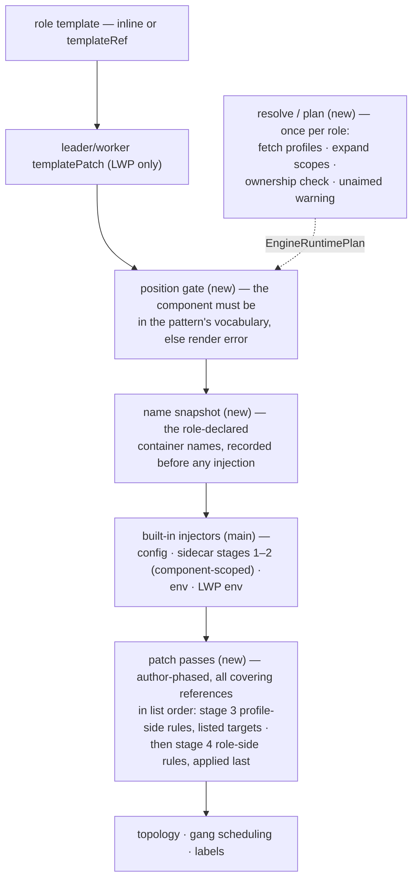

# KEP-531: Engine Runtime Profile Injection

<!-- toc -->
- [KEP-531: Engine Runtime Profile Injection](#kep-531-engine-runtime-profile-injection)
  - [Summary](#summary)
  - [Motivation](#motivation)
  - [Goals](#goals)
  - [Non-Goals](#non-goals)
  - [The ClusterEngineRuntimeProfile Model](#the-clusterengineruntimeprofile-model)
  - [Proposal](#proposal)
    - [Overview](#overview)
    - [Design Decisions](#design-decisions)
  - [Design Details](#design-details)
    - [Effective Component Set](#effective-component-set)
    - [Scope Ownership](#scope-ownership)
    - [Per-Dimension Gates](#per-dimension-gates)
    - [Consent and Trust](#consent-and-trust)
    - [Duplicate Delivery](#duplicate-delivery)
    - [Role-Side Patches](#role-side-patches)
    - [Patch Grammar](#patch-grammar)
    - [Application Order](#application-order)
    - [Render Pipeline](#render-pipeline)
    - [Validation Layer Split](#validation-layer-split)
  - [Compatibility Guarantees](#compatibility-guarantees)
  - [Risks and Mitigations](#risks-and-mitigations)
  - [Test Plan](#test-plan)
  - [Graduation Criteria](#graduation-criteria)
  - [Upgrade / Downgrade Strategy](#upgrade--downgrade-strategy)
  - [Feature Enablement and Rollback](#feature-enablement-and-rollback)
  - [Alternatives Considered](#alternatives-considered)
  - [Future Work](#future-work)
<!-- /toc -->

## Summary

Extend ClusterEngineRuntimeProfile (CERP) with `containerPatches` — a
list of RFC 6902 JSONPatch `add` operations, addressed by
container-relative RFC 6901 paths, each firing at the addresses the
referencing role consents to — and complete the reference-side
selection so a Role states, per `engineRuntimes` reference, where a
referenced profile applies:

- `component` (optional) names the **one** component of the role's
  pattern that the reference operates on — the rendered workload's
  `leader`/`worker`, one of the pattern's declared component names, or,
  under standalonePattern, the role's own name (the standalone
  component is named after the role; see Effective Component Set).
  Absent, the reference keeps main's compatible behavior: each pattern
  applies its own default injection scope — the leader only under
  leaderWorkerPattern (main skips sidecar injection for the worker
  template), every declared component under customComponentsPattern,
  the single role-named component under standalonePattern.
- `targetContainers` (optional) organizes the reference's container
  surface **per container**: one entry per container the reference
  touches, keyed by `name` — role-declared or profile-declared.
  Listing a name is the **consent**: the profile's `containerPatches`
  rules fire at that container. The entry's `extraPatches` carry the
  **role's** RFC 6902 patch rules for that same container, landing
  after the profile's. Both address through the one list: consent and
  the role's own patches sit in the same entry, so what happens to a
  container reads in one place, and removing the reference leaves no
  residue in the role template.

The allowed patch paths cover the four influence avenues on a Linux
process — its filesystem (volume mounts), its environment, its argv,
and its privileges (Linux capabilities) — expressed in a vocabulary any
JSON tooling already understands. The root allowlist is
side-asymmetric: the profile side may address only the shape-free
subset — env, volume mounts, and an outermost command wrap — while
argv surgery and capabilities are role-side-only roots, because only
the role author knows the container's command/args shape. The result
is a generic injection mechanism: rbg provides a capability set, and
plugins fit it. An
acceleration package (custom plugin for SGLang/vLLM), a telemetry
interposition library, or a C++ hook package plugs in by publishing a
profile — with rbg retaining zero knowledge of the plugin's internals
and the workload author contributing nothing beyond their own container
names.

## Motivation

ClusterEngineRuntimeProfile's published surface answers half the
problem: fragments — init containers, sidecars, volumes — reach the
rendered pod, and the legacy `containers` merge lets a role nudge
profile-declared containers with env and args. The other half was
never designed: a profile cannot touch the role's own containers, a
reference cannot say which component a runtime belongs to, and the one
customization grammar that exists is an imprecise full-object merge.
This KEP completes the model on the container dimension; the four
defects below are its symptoms, inventoried as issue #531.

The immediate driver is the plugin ecosystem growing around the
community inference engines. SGLang and vLLM are consumed today as
engine containers inside a larger rendered workload; the surrounding
ecosystem — acceleration packages, interposition libraries, kernel/data
accelerators — needs to place its artifacts into those workloads. The
operator publishing the plugin cannot write the workload, and the user
writing the workload does not know the plugin's internals. A
ClusterEngineRuntimeProfile is the meeting point: the plugin publisher
writes one profile, any RoleBasedGroup author references it by name.

Issue [#531](https://github.com/sgl-project/rbg/issues/531) inventories
the defects of the existing injection that this KEP answers:

1. **Pod-level injection is uncontrolled.** Referencing a profile means
   its init containers, sidecars and volumes land wherever the pattern
   happens to inject them — the leader template under
   leaderWorkerPattern, every declared component under
   customComponentsPattern — and a role cannot say "this runtime
   belongs to the worker component," for which main offers no path at
   all.
2. **The profile has no way to touch role-declared containers.** A
   profile author cannot add an env var or a volumeMount to the role's
   own engine container — the second delivery dimension of a profile
   does not exist.
3. **Role customization of profile containers is env/args-only**,
   expressed as full `corev1.Container` objects whose extra fields are
   silently ignored — an imprecise grammar for what is really a patch.
4. **The dormant `injectContainers []string`** predates any semantics;
   its shape cannot express the consent model this KEP needs.

Two motivations anchor the decisions below:

- **The reference is a toggle.** Everything profile-coupled — injected
  containers, legacy overrides, the role's own patches — is expressed
  through the `engineRuntimes` entry, so removing the entry removes it
  all and leaves no stray environment variables in the role template.
- **One-way declarations.** Only the role consumes the profile's
  content; the profile's own declarations never require the role's. The
  workload author configures the publisher's code (env, args, command,
  mounts); the publisher delivers resources into consented role
  containers. Role content flowing into a profile container — a secret,
  a model-cache PVC — is the role author's explicit, reviewable
  decision, the same trust decision as running any third-party image.

## Goals

- A role can scope one `engineRuntimes` reference to a single component
  of its pattern, with the absent-field default byte-identical to main.
- A profile can patch role-declared containers — env, volume mounts,
  and an outermost command wrap — at listed targets, using
  RFC 6902 `add` operations with container-relative RFC 6901 paths;
  argv surgery and Linux capabilities are role-side-only roots.
- A role can patch any container of the component — its own or the
  profile's — with the same rule format: one grammar, every
  role-authored modification expressed in the reference.
- The reference is a self-contained toggle: removal takes every
  modification it carried with it, leaving no residue in the role
  template.
- The legacy `containers` env/args merge keeps working unchanged,
  within the reference's component scope.
- Pre-existing objects render byte-for-byte identically to main.
- Validation is split: CEL at write time checks shape only;
  vocabularies and existence are decided at render time.

## Non-Goals

- A component opt-out of pod-level injection: deliberate non-injection
  remains inexpressible, exactly as on main.
- Multi-component targeting per reference: one reference names at most
  one component; multiple components are expressed as multiple
  references with the same `profileName`.
- Attaching semantics to `injectContainers`: it stays optional and
  inert, exactly as published on main, and is removed at the next API
  version boundary.
- Profile lifecycle — mutability, versioning, and how a profile change
  reaches existing workloads. The published `updateStrategy` field
  (`NoUpdate`/`RollingUpdate`, default `NoUpdate`, documented as "how
  profile changes affect existing pods") owns that surface, is
  accepted but never consumed by main's controller, and stays exactly
  as it is; activating it is future work outside this KEP.
- `replace`/`remove`/`test` patch operations: the grammar is `add`-only.
- Mutating the injected pod-level content (initContainers, sidecars,
  volumes) via
  the patch grammar — patches address containers only.
- Any pod-spec mutation of role templates: resources, probes, ports,
  `hostIPC`, `shareProcessNamespace`,
  `terminationGracePeriodSeconds`, `imagePullSecrets`, sysctls,
  `runtimeClassName` and kin stay with the role template author. A
  profile delivers containers, init containers and volumes; a `/dev/shm`
  enlargement is expressible today (an emptyDir `medium: Memory`
  volume plus a mount patch), but the pod-level fields themselves are
  out of reach from either side.
- Tuning a profile-injected container beyond the four patch avenues
  (its resources, `envFrom`, probes): the profile author sizes them;
  the consuming role's remedy is a republished profile, not a patch.
- Layering semantics — profile rules applying after the role's rules
  (env `$(VAR)` references to role-appended entries, argv positioned
  after role-inserted elements). Role patches land last — what the role
  writes lands where it is written — so the profile cannot claim
  positions ahead of role content; a profile whose command wrap must be
  outermost relies on the role author not prepending into a listed
  container, with a render-time event when positional shadowing occurs.
  The reserved `replace` op and any ordering change are the future seam.

## The ClusterEngineRuntimeProfile Model

ClusterEngineRuntimeProfile predates this KEP — it shipped on main with
no KEP of its own, so its design thinking is recorded here, once, as
the foundation the rest of this document builds on and as the reference
for future KEPs that touch the same surface.

**Why the object exists.** Engine-runtime concerns — an acceleration
package, a telemetry sidecar, an interposition library, a model-cache
volume — are orthogonal to a workload's own topology. Embedding them
in every role spec means every workload author copies machinery they
do not understand, and every publisher revision becomes a fleet-wide
edit. CERP extracts them into a cluster-scoped, independently
published object: the platform operator writes one profile, any
RoleBasedGroup author references it by name, and the workload author
contributes nothing beyond their own container names. One publisher,
many consumers — the shape that makes the publisher's revision one
edit and the consumer's adoption one line.

**The three fragments.** The spec carries `initContainers`,
`containers` and `volumes` — full corev1 objects, no reduced shapes.
Delivery is append-if-missing keyed by name at render: a name already
present — from the role's own template or an earlier reference — is
never appended twice, and the role's same-named declaration always
wins. Append, not merge, is deliberate: a merge needs ownership rules
for every field both sides might write; append needs only a name. The
same precedence on volumes is the **backing channel** — a
role-declared volume with a profile's volume name re-backs the
profile's mounts with the role's PVC or Secret (see Duplicate
Delivery).

**The consumption grammar.** A role references profiles through the
`engineRuntimes` list; each reference is a toggle. Pattern-scoped
defaults apply where a reference names no `component`: the leader only
under leaderWorkerPattern (main skips sidecar injection for the worker
template), every declared component under customComponentsPattern, the
single role-named component under standalonePattern. The legacy
`containers` field is the original role-customization channel — env
and args appended into profile-declared containers, written as full
`corev1.Container` objects whose extra fields are silently ignored —
an imprecise grammar for what was always a patch; this KEP's
`extraPatches` supersedes it with a precise one.

**Published but inert.** Two fields are accepted and never consumed:
`updateStrategy` (`NoUpdate`/`RollingUpdate`, default `NoUpdate`,
documented as "how profile changes affect existing pods") and
`injectContainers`. Their inertness is tolerated, not accidental: a
CRD schema is append-only within a published version, so a published
field may only be removed at a version boundary — `injectContainers`
is scheduled for exactly that — and `updateStrategy`'s future
activation composes with the render-time contract rather than
changing it (Profile Mutability).

**The philosophy, in four principles.**

1. **Mechanism, not data.** A profile carries machinery and zero
   workload data — no endpoints, no credentials, no bucket names.
   Every divergent datum stays in the role.
2. **One-way declarations.** Only the role consumes the profile; the
   profile's declarations never require the role's. The workload
   author configures the publisher's code; the publisher delivers
   resources into consented role containers.
3. **Render-time, not admission-time.** Stored objects stay exactly
   as their authors wrote them; every composition happens at render,
   is re-derivable, and fails before any pod is created. The profile
   itself has no status surface — everything observable about the
   delivery is in the rendered workload.
4. **Cluster scope is a trust decision.** The publisher is trusted
   like a cluster admin of every consuming namespace; RBAC on CERP
   writes is the gate, and this KEP's consent model is that premise
   extended to the role's own containers.

The remainder of this document completes this model on the container
dimension — the profile's reach into role-declared containers, the
role's precise hand on profile-declared ones — under the same four
principles.

## Proposal

### Overview

A ClusterEngineRuntimeProfile declares pod-level content — init
containers, sidecars and volumes — and, new, per-container patch rules.
A role's `engineRuntimes` entry references a
profile by `profileName` and, optionally, narrows the reference to one
`component` and organizes its container surface per container:
`targetContainers` entries, each the consent to the profile's patch
rules at that container and the carrier of the role's own patch rules
for it:

```yaml
apiVersion: workloads.x-k8s.io/v1alpha2
kind: RoleBasedGroup
spec:
  roles:
  - name: lg
    # ... other role fields omitted
    leaderWorkerPattern:
      template:
        spec:
          containers:
          - name: w
            image: w
    engineRuntimes:
    - profileName: vllm-runtime        # required; render-time resolution
      component: worker               # optional; absent = the pattern's default components
      targetContainers:               # optional; one entry per container this reference touches
      - name: w                       # role-declared; listing = consent to the profile's patches
        extraPatches:                 # the role's own patches for w — land after the profile's
        - jsonPatch: {op: add, path: /env/-, value: {name: TELEMETRY_ENDPOINT, value: 'sidecar:9090'}}
      - name: runtime-sidecar         # profile-declared; also receives the profile's patches, then the role's
        extraPatches:
        - jsonPatch: {op: add, path: /env/-, value: {name: FOO, value: bar}}
      containers:                     # legacy; unchanged
      - name: runtime-sidecar
        args: [--extra]
```

```yaml
apiVersion: workloads.x-k8s.io/v1alpha2
kind: ClusterEngineRuntimeProfile
metadata: {name: vllm-runtime}
spec:
  containers:
  - name: runtime-sidecar
    image: vllm/runtime:latest
  volumes: [...]
  containerPatches:                   # profile-side: target-less rules, each firing at every listed targetContainers address
  - jsonPatch: {op: add, path: /env/-, value: {name: NCCL_DEBUG, value: INFO}}
```

Go shape (reference side):

```go
type EngineRuntime struct {
	// +kubebuilder:validation:MinLength=1
	ProfileName string `json:"profileName"`

	// +optional
	// +kubebuilder:validation:MinLength=1
	Component string `json:"component,omitempty"`

	// +optional
	// +kubebuilder:validation:MinItems=1
	// +kubebuilder:validation:MaxItems=32
	// +listType=map
	// +listMapKey=name
	TargetContainers []EngineRuntimeTargetContainer `json:"targetContainers,omitempty"`

	// +optional
	Containers []corev1.Container `json:"containers,omitempty"`

	// Retained exactly as published on main: optional and inert. No
	// semantics are attached; removed at the next API version boundary.
	//
	// +optional
	InjectContainers []string `json:"injectContainers,omitempty"`
}
```

```go
type EngineRuntimeTargetContainer struct {
	// +kubebuilder:validation:MinLength=1
	// +kubebuilder:validation:MaxLength=63
	// +kubebuilder:validation:Pattern=`^[a-z0-9]([-a-z0-9]*[a-z0-9])?$`
	// +kubebuilder:validation:Required
	Name string `json:"name"`

	// +optional
	// +kubebuilder:validation:MinItems=1
	// +kubebuilder:validation:MaxItems=32
	// +listType=atomic
	ExtraPatches []ContainerPatch `json:"extraPatches,omitempty"`
}
```

`jsonPatch` is required inside every patch entry on both sides today —
plain OpenAPI validation, no CEL needed. A future patch format joins as
a sibling field, at which point the field relaxes to optional and a
real oneOf rule (`has(self.jsonPatch) != has(self.newFormat)`) takes
over; relaxing a required field is a compatible change. The map list
(`+listType=map`, keyed by `name`) makes the apiserver reject a
container listed twice at write time — for free, no CEL and no webhook
check.

The `component` field deliberately carries no pattern or length bound
beyond `MinLength=1` — it is a reference into a vocabulary defined
elsewhere, and that vocabulary is itself unmarked: `RoleSpec.Name`
and `InstanceComponent.Name` accept any non-empty string
(`rolebasedgroup_types.go`), and main's renderer passes both through
verbatim (`roleinstanceset_reconciler.go`). A reference field stricter
than the fields it references would refuse writable values: a
standalone role named `MyRole` renders today, so `component: MyRole`
must write. Existence is settled where this KEP already settles it —
the render-time position gate resolves the name against the pattern's
actual vocabulary — and lexical reality is enforced where those source
names are already enforced: pod creation, where component names land
in pod labels and, under customComponentsPattern, in pod names. The
container-name fields keep their DNS-label patterns: container names
are DNS labels validated by Kubernetes core, so that vocabulary is
exact, not approximate.

The profile side speaks the same RFC 6902 rule format with a different
addressing model: `spec.containerPatches []ContainerPatch` entries
are
**target-less** — each entry is `{jsonPatch}` and fires at every
listed `targetContainers` address of the referencing component. Both
sides' entries are the same shape — the addressing differs: the role
addresses
through the `targetContainers` entry name (its own patches land only
there), the profile addresses nowhere and fires at every listed
address. The split follows the knowledge asymmetry: the role author
knows container names (the template is theirs), so reference entries
name their targets; a cluster-scoped publisher cannot know consumer
container names, so the listed
entries are the only
addressing available to that side. A required `jsonPatch` today,
relaxed to a oneOf when a second patch format arrives, leaves room for
future patch formats without touching `jsonPatch`.

Go shape (the patch entry, shared verbatim by both sides — the shell
is the format selector, the operation is the format):

```go
// ContainerPatch is one ordered patch entry — the format-selection
// shell shared by both sides. Exactly one patch-format field is set,
// selected by optional sibling fields — the same variant-selection
// idiom as Pattern in RoleSpec and TemplateSource. Today `jsonPatch`
// is the only format and is required; a future format joins as a
// sibling field, `jsonPatch` relaxes to optional and a oneOf rule
// takes over — relaxing a required field is a compatible change.
type ContainerPatch struct {
	// +kubebuilder:validation:Required
	JSONPatch *ContainerJSONPatch `json:"jsonPatch"`
}

// ContainerJSONPatch is a single JSON Patch (RFC 6902) operation
// applied to a container at render time. `value` is deliberately
// schemaless at write time — loose at write, exact at consumption:
// the render pass unmarshals it strictly into the concrete corev1
// type the path implies. The path allowlist is enforced twice — the
// CEL prefix rule below for immediate write-time feedback, and a
// grammar re-check at render (segment boundaries, element-pointer
// shape) that a CEL string match cannot guarantee. Scoping the rule
// to this type is what lets a future patch format field join without
// rewriting the JSONPatch grammar.
//
// +kubebuilder:validation:XValidation:rule="self.path.startsWith('/command/') || self.path.startsWith('/args/') || self.path.startsWith('/env/') || self.path.startsWith('/volumeMounts/') || self.path.startsWith('/securityContext/capabilities/add/')",message="path must be an element pointer under /command, /args, /env, /volumeMounts or /securityContext/capabilities/add"
type ContainerJSONPatch struct {
	// Op is the patch operation. Only `add` is accepted today;
	// `replace` is reserved as a future enum value and rejected.
	// +kubebuilder:validation:Enum=add
	// +kubebuilder:validation:Required
	Op string `json:"op"`

	// Path is an RFC 6901 pointer relative to the rendered target
	// container: `/command/0` prepends an argv element, `/env/0`
	// inserts an env var at the head, `/volumeMounts/-` appends a
	// mount, `/securityContext/capabilities/add/-` appends a
	// capability. Whole-list paths are forbidden: `add` onto an
	// existing location replaces it, which would overwrite user
	// values.
	// +kubebuilder:validation:MinLength=1
	// +kubebuilder:validation:Required
	Path string `json:"path"`

	// Value is the JSON value the operation adds, in the shape of
	// the path's element: a string for /command, /args and
	// /securityContext/capabilities/add elements; a corev1.EnvVar
	// object for /env; a corev1.VolumeMount object for
	// /volumeMounts. Accepted as arbitrary JSON at write time and
	// unmarshaled into the element's concrete corev1 type at render
	// time; a mismatched shape is a render error attributed to the
	// patch author's object.
	// +kubebuilder:pruning:PreserveUnknownFields
	// +kubebuilder:validation:Schemaless
	// +kubebuilder:validation:Required
	Value runtime.RawExtension `json:"value"`
}
```

### Design Decisions

| # | Decision | Rationale |
|---|----------|-----------|
| D1 | One reference names **at most one** component. Multiple components are expressed as multiple references with the same `profileName`. | One reference = one scope keeps every rule local; bare container names need no qualified `component/container` form. |
| D2 | Absent `component` = the pattern's **default component set** (main's published behavior; it differs per pattern — leader-only under leaderWorkerPattern). | Byte-for-byte compatibility for pre-existing references; the default expansion is the compatibility mechanism. |
| D3 | Fresh field naming: `component`, `targetContainers` with per-entry `extraPatches` (reference side), `containerPatches` (profile side). `injectContainers` stays exactly as main published it: optional, inert, unread — removed at the next API version boundary. | The field never had semantics, so accepting it changes nothing. Rejecting non-empty values would tighten validation inside the already-published v1alpha2, the larger incompatibility. |
| D4 | The patch grammar is **shared and symmetric in shape**: every patch entry on both sides is a target-less `{jsonPatch}`. The addressing differs — a reference addresses through its `targetContainers` entry names (one entry per container: the consent, then the role's own `extraPatches` for that container), a profile-side entry fires at every listed address. The addressing models follow the knowledge asymmetry: the role knows container names, the cluster-scoped publisher cannot. | One grammar, one entry shape, two addressing models; the legacy `containers` append mechanism is retained for compatibility as the surface `containerPatches` enhances and eventually supersedes. |
| D5 | Deliberate non-injection of the profile's pod-level content remains **inexpressible**, exactly as on main. | Not a regression; an explicit opt-in can be added later without moving the absent-field default. |
| D6 | Same-`profileName` references own their **effective component sets** exclusively: any two whose sets intersect are a render error. A scoped reference's set is its named `component`; a compatibility-shape reference's set is the pattern's default — so the mix intersects under customComponentsPattern (broadcast) and standalonePattern, while leaderWorkerPattern leaves `component: worker` disjoint from the implicit `{leader}` — the one legal mix, byte-identical to its all-scoped spelling. The pure compatibility pair (both references lack `component`, no `targetContainers`) is exempt and keeps main's semantics verbatim, duplicate same-profile references included. | Scope ownership governs everything new; the compatibility path stays exactly as main published it. The rule fires only on combinations a named `component` makes expressible — no pre-existing spec can hold them, so the guarantee is forward-compatible by construction. |
| D7 | `targetContainers` **requires** `component`: the CEL cross-field rule `!has(self.targetContainers) || has(self.component)` rejects the list without a named component at write time. The entry-level `extraPatches` are structurally nested inside their entry, so they need no rule of their own — the one check covers the whole reference side. | Patch rules operate in an explicitly named scope. The implicit all-components expansion is exclusively the pod-level-injection compatibility path and never reaches the patch dimensions. |
| D8 | A `targetContainers` entry is the **consent and the address in one**: listing `name` triggers the profile's `containerPatches` at that container *and* fixes where the entry's own `extraPatches` land. There is no way to write role patches at a container while withholding the profile's — listing the name is the single toggle, and the coupling is accepted. | Removing the entry (or the whole reference) removes the profile's patches at that container, the legacy overrides and the role's own `extraPatches` together, leaving the role template untouched — one artifact, one revert. The coupling is the price of one entry doing both jobs; it is safe because role patches land last and win positionally (D10), so consent never weakens the role author's final word. The profile side gets the same simplicity from the other direction: it needs no addressing at all and fires at every listed entry. |
| D9 | **One-way declarations**: the profile's own declarations — its containers, volumes, env — render without requiring any role-declared content, so a cluster-scoped profile is self-contained and portable. An entry naming a **profile-declared** container is the channel for role content into that container: it receives the profile's `containerPatches` (uniformly with every other listed name) and then the entry's `extraPatches` with the full role-side root set (D11); the flow of role content into a profile container is the role author's decision, not a render error. | Only the profile's *own spec* carries the portability guarantee: it renders identically in any cluster regardless of who references it. Role-side patches ride the reference and vanish with it — the profile's spec never depends on them. Handing role content to a publisher-controlled image is the same trust decision as running any third-party image with that content (an API key, `HF_TOKEN`); the author, the secret owner and the consent-giver are the same party, and the legacy channels already carry this class of flow on main (`containers[].env` with `secretKeyRef` merged into profile containers; the role's same-named volume backing the profile's mounts). Treat publisher images as third-party code either way. |
| D10 | **Role patches land last**: the profile-side pass applies before the role-side pass — every reference covering the component, in `engineRuntimes` list order, in both passes — so what the role writes lands where it is written. Positional shadowing — a role-side insert landing ahead of a profile-side insert on the same container — emits a render-time event rather than failing. | The role author owns the rendered workload and can see the rendered result; a cluster-scoped publisher cannot claim absolute positions against content it cannot see. The cost is that interposition-outermost becomes a cooperation convention, not a structural guarantee. |
| D11 | The root allowlist is **side-asymmetric**: profile-side entries may address `/env`, `/volumeMounts`, and `/command/0` only; `/args` (any element), `/command/<i>` with `i > 0`, and `/securityContext/capabilities/add` are role-side-only roots, and a profile-side entry addressing one is a render error attributed to the profile. | The activation payload — which env names, mounts, and argv tokens turn the runtime on — is profile knowledge, but its vehicle must not require knowledge the publisher cannot have: the consumer's command/args split is role-private (kubelet concatenates both into one argv; where the split falls — `command` only, `command`+`args`, `bash -c` with the script in either field — is authoring convention, and the consumer's spec may not exist when the profile is written). `/env` and `/volumeMounts` are name-addressed and shape-free. `/command/0` is a boundary operation on the concatenated argv, identical under every shape — the profile side's only argv vehicle. `/args` and mid-command inserts are shape-blind: the same patch silently changes meaning across shapes (an append onto an `sh -c` container becomes the script's `$0`). `capabilities` is excluded for weight, not shape: a privilege grant does not ride a consent describable as env, mounts and wrap. Main never let a profile write role-container argv in any form — the legacy override loop admits profile-declared names only — so the split keeps the new grammar's grant close to main's precedent. |

## Design Details

### Effective Component Set

| pattern | `component` absent | `component` present |
|---|---|---|
| leaderWorkerPattern | `{leader}` | `{component}` |
| customComponentsPattern | all declared components | `{component}` |
| standalonePattern | the single implicit component | `{component}` — the component must equal the role's name, else render error |

The standalonePattern row deserves emphasis, because "implicit
component" is easy to misread as "unnamed component": KEP-173 defines
standalonePattern as **one component named after the role**
(`keps/173-enhanced-custom-components-pattern/README.md`), and main's
renderer implements exactly that —
`constructRoleInstanceTemplateFromStandalonePattern` builds the
component with `WithName(role.Name)`
(`pkg/reconciler/roleinstanceset_reconciler.go:493`). The standalone
component therefore **has a name, and it is the role's name**:
`component: <role name>` selects it, any other name fails the render
vocabulary check. Standalone is the modal single-pod serving shape
(the repo's canonical SGLang example is standalone), so this is the
path through which #531's headline scenario reaches most users.

The leaderWorkerPattern row records an asymmetry in main's renderer,
not a judgment of it: the worker template's injector chain omits the
sidecar stage outright (`roleinstanceset_reconciler.go` and
`lws_reconciler.go` both configure the worker pod reconciler without
it), so a reference without `component` never injects into the worker.
This KEP preserves that default verbatim — anything else would change
rendered output for pre-existing references. Naming
`component: worker` is therefore **new capability**, not a narrowing:
it reaches a component main's default never touches, and the KEP is
the first surface to make that reachable. The asymmetry also means a
profile whose consumers uniformly omit `component` can assume
leader-side delivery under leaderWorkerPattern; a component-scoped
reference is how that assumption is deliberately broken.

The absent-column expansion applies to pod-level injection (and the
legacy `containers` merge) only. `targetContainers` cannot appear without
`component`, so the patch dimensions always operate on the
single-component column — for a standalonePattern role, that column is
the role-named component above.

Terminology: the user-facing word is **component** (the rendered
workload entity); the internal resolver concept is `position` — the
Render Pipeline section below uses that implementation name.

### Scope Ownership

Each reference expands to its effective component set (the table
above), and ownership is enforced on that set: for one `profileName`,
any two references whose effective sets intersect are a render error.
The exemption is the **pure compatibility pair** — two references that
both lack `component` (no `targetContainers`; `containers` allowed) — which
keeps main's duplicate-reference semantics verbatim. The named-component
form of the rule is the familiar one (no two scoped references may
name the same component); the set form generalizes it to the mix.
A compatibility-shape reference implicitly covers the pattern's
default set, so under customComponentsPattern (broadcast) and
standalonePattern it intersects **every** scoped reference of the same
profile, and under leaderWorkerPattern it intersects a scoped
`component: leader` while leaving `component: worker` disjoint — the
one legal mix, byte-identical to its all-scoped spelling
(`component: leader` + `component: worker`). Forward compatibility is
structural: the rule fires only when a reference names `component`,
which no pre-existing spec contains, and the only same-profile
combination old data can hold — duplicates of compatibility-shape
references — sits inside the exemption. Consequences:

- Same-profile references never cover a component twice, except the
  exempted compatibility pair, whose coverage de-duplicates exactly
  as main's duplicate references do.
- Patch addresses cannot collide across same-profile references: only
  component-scoped references carry patches, and their scopes
  are disjoint.
- Every component-scoped consent and patch rule for a (profile,
  component) pair lives in exactly one reference.

### Per-Dimension Gates

| dimension | direction | gate | absent means |
|---|---|---|---|
| pod-level injection | profile → pod | `component` (scope) | the pattern's default component set (main behavior) |
| container patches | profile → containers of the named component | `targetContainers` (the listed names) | patches fire nowhere; if the profile declares `containerPatches`, a warning event is emitted and the render succeeds |
| role patches | role → any container of the component (role-declared or profile-declared) | the entry's `extraPatches` (expression) | nothing applies; no warning — writing the rules is the consent |

A `targetContainers` entry names exactly one rendered container of the
**named** component — role-declared or profile-declared. Both kinds
cover init containers: an entry may name a role-declared init container
as readily as a sidecar, and both patch passes address `containers` and
`initContainers` alike — the grammar distinguishes targets by name,
not by kind. The list is `+listType=map` keyed by `name`, so the apiserver rejects the same name
listed twice at write time, for free. A name resolving to a
profile-injected container is a render error; a name colliding with a
profile-declared container resolves to the role's own container and is
legal. The entry is the consent and the address in one (D8): the
profile's rules fire at every listed name, and the entry's own
`extraPatches` — for that same name — land after them.

### Consent and Trust

Consent is per container, all-or-nothing across the profile's entire
patch list: listing `engine` also consents its env additions, its
mounts and its command wrap. Refusing one rule of a profile is
the profile variant's job — the reference cannot cherry-pick payloads.
The grant is describable in one sentence — the profile may add env
entries and mounts to, and wrap the outermost command of, the named
containers — which is what the root split (D11) buys: no consented
rule's meaning depends on the consumer's command/args shape.

What consent does **not** gate: merely referencing a profile —
including in the compatibility shape — runs every profile-authored
container and mounts every profile volume, full `corev1.Container` and
`corev1.Volume` objects, so a publisher controls the securityContext
(`privileged: true`, hostPath) of its own injected containers with no
consent step at all. And an argv prepend into a consented engine
container is code execution in that container's context — its image,
its service account, its GPUs. `containerPatches` is a trust boundary
for a fraction of the surface; the profile reference itself is the
real one.

The trust premise follows from the object scopes: CERP is
cluster-scoped, and its publisher is trusted like a cluster admin of
every consuming namespace. Profile-side patch values may carry
`valueFrom.secretKeyRef` into the consuming namespace — the publisher
steering role-side content into consented role containers, a
consent-gated power. The converse — role content flowing into a
profile-declared container — is the role author's decision, not a
blocked channel: the patch author, the secret owner and the
consent-giver are the same party, the decision is the same one as
running any third-party image with that secret, and main already
carries the class of flow through two retained channels (the legacy
`containers[].env` merge appends role-side `secretKeyRef` values into
profile containers; a role-declared volume with the profile's volume
name backs the profile's mounts — see Duplicate Delivery). The
profile image runs the publisher's code either way: treat it as
third-party code. Role-side patches are not an escalation path for
the role author: they can already set any securityContext on their
own template containers, and profile containers run the publisher's
image either way.

Alpha guidance: grant CERP write verbs only to cluster-admin-
equivalent principals; a namespaced EngineRuntimeProfile variant is
the multi-tenant alternative and is future work.

### Duplicate Delivery

Referencing a profile twice — whether as repeated compatibility-shape
references, or as a compatibility-shape reference overlapping a
component-scoped one — can never inject duplicate
containers, init containers or volumes. Pod-level injection is
append-if-missing keyed by name: a name already present — from the
role's own template, an earlier reference of the same profile, or a
different profile — is never appended a second time, and the role's
own same-named container always wins. The same precedence on the
volume dimension is the **backing channel**: a role-declared volume
with the profile's volume name wins over the profile's same-named
one, so the profile's own volumeMounts — in its containers and in the
role containers it mounts into — read the role's volume. This is
deliberate main behavior (append-if-missing, role wins), retained
verbatim because the byte-for-byte compatibility path depends on it,
and it is the sanctioned way a role re-backs a profile's mounts with
its own PVC or Secret volume — a role-authored, reviewable decision
(D9); the same-name swap cannot become a render error without
changing main's rendered output. Patch volumeMount names resolve with
the same role-wins precedence. One hazard is deliberate: when **two
different profiles** declare the same container or volume name, the
earlier reference wins and the later profile's same-named entry is
skipped — a skipped container can be a control (telemetry, an
acceleration agent) the operator believes present, and reordering
`engineRuntimes` changes the winner; profile publishers should
prefix container and volume names to avoid collisions across
publishers. The skip is deterministic (the precedence chain above)
but not silent: a render-time warning event
(`EngineRuntimeNameCollision`) fires whenever a cross-profile skip
occurs. The patch dimensions handle
duplicates per field: env names resolve positionally per the Patch
Grammar rules; a volumeMount is an idempotent no-op only under the
Patch Grammar's full-field semantic equality (same name, mountPath and
every other field), a partial match being a render error; a duplicate
Linux capability is an idempotent no-op.
The one per-reference additive pass is the legacy `containers`
env/args merge: repeated references append their overrides once per
reference, exactly as on main — the exempted compatibility pair under
customComponentsPattern covers every component twice, and main's
duplicate-reference output is the result (pod-level delivery
de-duplicates; the legacy merge appends once per covering reference,
with the positional env rules of the patch grammar governing the
outcome). The overlapping mix — a compatibility-shape reference whose
default set covers a component a scoped reference of the same profile
names — never renders: it is the scope-ownership error above. The
disjoint mix (leaderWorkerPattern: implicit `{leader}` +
`component: worker`) renders byte-identically to its all-scoped
spelling.

### Role-Side Patches

The two sides are organized by **author**: the profile's
`spec.containerPatches` carries the publisher's rules (target-less
entries, firing at every listed address), while the role's rules live in
the `extraPatches` of its `targetContainers` entries — each entry both
names its target and consents to the profile's rules there (D8). An
entry name resolves against the role-declared names snapshotted before
injection plus the container names this reference's own profile
declares; anything else — a name injected only by a different reference
or profile — is a render error. A name the role's own template also
declares resolves to the role-owned container — the same precedence
that injection applies.

An entry name may be **role-declared** — the `extraPatches` are
coupled to the profile and disappear with the reference — or
**profile-declared** —
configuring the publisher's code with env, args, command or mounts.
Profile-declared targets include init containers — the legacy
`containers` merge silently no-ops for them (the override loop admits
init-container names but only ever scans the pod's `containers`
list); the patch grammar closes that gap, including the mounts main
could never deliver: a model-cache PVC or a log `emptyDir` is
role-declared content — the PVC name is role-private knowledge, the
mount target is the profile's container, and the role-side patch is
the only author holding both halves. Role content flowing into a
profile container is the role author's decision (D9): the patch
author, the secret owner and the consent-giver are the same party. A
patch's volumeMount names resolve against the rendered pod's volume
list with the same precedence injection applies — a role-declared
volume wins over a same-named profile one. Entries apply in list order, after the profile-side
pass — what the role writes lands where it is written. A patch adding
a name the target already carries is the **override gesture**: role
patches land last, so the entry wins the positional contest — the
same override the legacy `containers[].env` merge performs on main.
The mirror-image rule binds the profile side: a profile-side append
onto a role-owned name is the render error, because it would win the
same contest in the wrong direction.

### Patch Grammar

- Op: RFC 6902 `add` only. `replace`, `remove`, `test` are reserved for
  a future revision.
- Path: container-relative RFC 6901. The path space is an allowlist of
  exactly five roots, each addressed as a list element pointer —
  `<root>/<element>`, where `<element>` is `-` (append) or a numeric
  index (insert):

  | root | field | value |
  |---|---|---|
  | `/command` | `command` | string |
  | `/args` | `args` | string |
  | `/env` | `env` | corev1.EnvVar with a unique `name` |
  | `/volumeMounts` | `volumeMounts` | corev1.VolumeMount |
  | `/securityContext/capabilities/add` | `capabilities.add` | string |

  **The root allowlist is side-asymmetric (D11).** Profile-side
  entries may address `/env`, `/volumeMounts`, and `/command/0` only;
  a profile-side entry addressing `/args` (any element),
  `/command/<i>` with `i > 0`, or
  `/securityContext/capabilities/add` is a render error attributed to
  the profile — a write-time candidate like the other intra-object
  invariants. The rule follows where the knowledge sits: an entry's
  effect is a function of its content (profile knowledge — which argv
  tokens activate the runtime) and the target's shape (role
  knowledge). Kubelet concatenates `command` and `args` into one
  argv; where the split falls is an authoring convention the
  publisher cannot read. `/env` and `/volumeMounts` are
  name-addressed, shape-free. `/command/0` is a boundary operation
  on the concatenated argv — its effect is identical under every
  convention, which makes it the profile side's only argv vehicle:
  activation flags ride it as a wrap,
  `bash -c 'exec "$0" "$@" --flag'`, delivered as the multi-entry
  head insert (reverse order), whose `exec "$0" "$@"` re-splices the
  original process exactly. What the wrap cannot deliver — and
  `/args` could never deliver safely — is anything positional: a
  profile-side `/args/-` append onto an `sh -c` container with empty
  `args` becomes the script's `$0`, silently ignored; an `/args/0`
  head insert fails differently per shape. Role-side entries keep
  all five roots at any index: their author wrote the shape, so argv
  surgery there is ordinary first-party authoring risk — the same
  class as writing the `command` itself. Per-role divergent values —
  a flag or env value that differs between two referencing roles —
  cannot come from one static profile in any design; they are
  expressed as role-side patches or as published profile variants.
  With profile-side `/args` out of the grammar, an argv token has
  exactly one author, so the cross-side duplicate-flag question —
  which argv, unlike env, has no name semantics to resolve — never
  arises.

  An index inserts at that position — `/command/0` prepends, so
  multi-element head inserts are written in **reverse order**; `/env/0`
  head inserts also interact with `$(VAR)` references, which resolve
  against earlier entries only. An index past the list end is a render
  error (RFC 6902 does not extend a list by adding beyond it), and an
  index beyond machine integer range is likewise a render error, not a
  wraparound. Two
  deliberate deviations from strict RFC 6902 accommodate the common
  nil-field container shape: a missing target list is treated as empty
  where insertion is allowed, and intermediate struct members along an
  allowlisted path are created when absent — except `command` and
  `args`, where creating the list can silently discard image-defined
  process definitions, so render errors instead. The exact rule
  follows the Kubernetes entrypoint merge (containerd
  `WithProcessArgs`): when a container sets `command`, the image
  ENTRYPOINT **and** CMD are already ignored, so creating `args`
  discards nothing and is allowed — the repo's SGLang examples put
  the whole argv in `command` with no `args`, and a role-side
  `/args/-` append must render on that shape. Creating `args` is
  therefore an error only when the container sets neither `command`
  nor `args` (then the image ENTRYPOINT and CMD are both in effect,
  and a created `args` would replace the image CMD); creating
  `command` is always an error — it would replace the image ENTRYPOINT
  whatever else is set. The emptiness predicate is `len == 0`, which
  is also correct for an explicitly written empty array
  (`command: []`): the API's `omitempty` serialization and the CRI
  protocol's repeated fields do not distinguish nil from empty, so
  `[]` behaves exactly like unset. Whole-list paths (`/env`)
  and member addressing (`/env/name`) are rejected: `add` onto an
  existing location replaces it, which would overwrite user values.
  The element segment must be `-` or digits — no allowlisted token
  contains `~`, so RFC 6901 escape sequences never pass.
- Values are raw JSON, schema-less by design: write time accepts
  arbitrary JSON for the value (nothing validates its shape), and
  render time unmarshals it into the target field's corev1 type,
  rejecting a mismatched shape with the error attributed to the patch
  author.
- Duplicate env names resolve by position, not by refusal. Kubernetes
  applies a container's env list in order and the last same-named entry
  wins — the exact semantics main's legacy merge already relies on
  (`mergeEnvVars` → `dedupeEnvVarsPreserveLast`). The grammar adopts
  those semantics with ownership-drawn boundaries:
  - **Within one patch list** (either side), two entries creating the
    same env name are an error — the earlier one is a dead letter, so
    a duplicate is always a mistake. The check needs the value
    unmarshalled — code, not CEL — so at alpha the reference-side half
    rides the RoleBasedGroup validating webhook's shared check
    function, while the profile-side half fires at render with
    attribution to the patch author's object (the CERP has no
    write-time home for it; see Validation Layer Split).
  - **Profile-side rules may only default.** A profile entry for a
    name the target already carries must land *ahead* of the
    role-owned entry — `/env/0` head insert — so the role's later
    entry wins the positional contest. A profile-side `-` append onto
    a role-owned name is a render error: it would put the publisher's
    value after the role's, and profile content never wins a
    same-name contest with role content. The default is genuine
    across renders: effective while the role does not declare the
    name, superseded — inert, though visible in the rendered spec —
    once it does. Superseded-by-position is what a default *means*,
    which is why the head-insert branch is carved out of the blanket
    error rather than folded into it.
  - **Role-side rules may override.** They land last, so a same-named
    append wins by position — the same override the legacy
    `containers[].env` merge performs today, expressible in the new
    grammar now, without waiting for a `replace` op.
  - **Across profiles**, same-named entries resolve positionally, and
    the gesture decides the direction — the same hazard class as
    cross-profile container-name collisions: values are never merged,
    resolution is silent, prefixing names is the convention, and a
    warning event is future work. Appends (`-` tail insert) follow
    last-wins by reference order — the later reference's entry lands
    later, so it wins. `/env/0` defaults invert it: head-insert
    geometry puts the later reference's entry *ahead* of the earlier
    one (`[X₂, X₁]`), so the last same-named entry in the rendered
    list is the earlier reference's — the earlier reference's default
    wins. The application order plus the patch gesture, not author
    intent, picks the winner. The resolution direction of the append
    case is the opposite of the container dimension, where
    append-if-missing lets the earlier reference win — recorded as-is:
    the two dimensions' silent resolutions point different ways.
  - **The `RBG_` prefix is reserved.** An env name beginning `RBG_`
    belongs to the controller's own injection; a patch entry on
    either side creating one is a render error. This also protects
    names the controller does not inject yet — reserving the prefix
    today costs nothing and prevents a collision when a future
    controller version adds a variable.
  A volumeMount whose `(name, mountPath)` key matches an existing
  entry of the target container is an idempotent no-op only under
  **full semantic equality**: the unmarshalled `corev1.VolumeMount`
  structs must be equal — `readOnly`, `subPath`, `subPathExpr`,
  `mountPropagationMode`, `recursiveReadOnly` compared alongside the
  key, an absent field and an explicit zero value (`readOnly: false`,
  `subPath: ""`) counting as equal. A partial match — key equal, any
  other field different — is a render error attributed to the patch
  author's object, the CERP for profile-side entries and the role for
  role-side ones: an `add` op cannot modify the existing entry, so the
  only renderable output would be a duplicate mount entry, and core
  validation rejects duplicate mount paths at pod creation
  ("must be unique") far from the cause — the render-time rule is the
  apiserver's own uniqueness rule caught at the layer where the
  failure can name the offending object, the profile where the
  profile authored it. The key itself follows core volumeMount usage:
  the same volume `name` at a different `mountPath` is a legitimate
  second mount of one volume and a plain append; a `mountPath` already
  used by a different volume name is a render error — the kubelet
  resolves overlapping mount paths last-wins, a shadowing the merge
  refuses to create; two entries in one patch list creating the same
  key are an error, the same rule family as intra-list env-name
  duplicates. A capability already present is an idempotent no-op —
  a capability name has no secondary fields to diverge. Names pass
  through **verbatim, no normalization**: the renderer is neither
  stricter nor more magical than the target surface — a hand-written
  pod spec carrying the same name gets the same behavior — and the
  capability set drifts across kernel versions, so a render-time list
  check would falsely reject names newer kernels accept. The
  unknown-name policy is the runtime's, exactly as for corev1 pod
  specs — the apiserver performs no capability-name validation at all
  (core validation carries only the Windows-pod prohibition and the
  `allowPrivilegeEscalation=false` + `CAP_SYS_ADMIN` rule) — and the
  runtimes diverge: containerd matches case-insensitively
  (`SYS_ADMIN`, `sys_admin`) but **silently drops** `CAP_`/`cap_`-
  prefixed and unknown names, so the miss surfaces at runtime as
  EPERM; CRI-O normalizes all four forms and fails container creation
  on unknown names — upstream keeps this at the runtime layer
  (kubernetes#119569), so role authors must validate names against
  their runtime. One form hazard gets a render-time signal: a name
  not matching the canonical uppercase form `^[A-Z]+(_[A-Z]+)*$` —
  lowercase or prefixed — emits a warning event attributed to the
  role, not an error, because lowercase works on both runtimes and
  the prefixed form works on CRI-O; but the prefixed form silently
  drops the capability on containerd, the
  wrote-it-but-it-never-took-effect trap the event surfaces. The
  form check carries no list to drift — well-formed unknown names
  pass silently, only the runtime can judge them, and `ALL` and
  other runtime-interpreted names pass through as ordinary
  well-formed names.
  PodSecurity admission, if the consuming namespace enforces it, gates
  capability additions only when the rendered pod is created, which is
  a backstop against the resulting pod, not name validation.
- Override is scoped by author, not refused: a role-side append of an
  existing name overrides (the rule above), and a profile needing a
  different value for a role-owned name defaults ahead of it or
  publishes a variant. What no `add` — positional or not — can do is
  **join** values: the patch value is static JSON, written without
  sight of the target's current value. The reserved `replace` op and a
  future join op are the seams.
- PATH-like composition has a story in layers. Where the role owns the
  name, the role writes the composed value directly — a spec-declared
  key masks the image's per-key value anyway, so the image's entry is
  already out of play. Where the profile owns delivery, it contributes
  names it owns (`IK_SHIM_DIR=/opt/inference-kit/shims`) and a
  role-side patch appends the consuming entry —
  `PATH=$(IK_SHIM_DIR):/usr/local/nvidia/bin:…` — resolvable because
  role patches land last and kubelet `$(VAR)` expands against earlier
  entries in the rendered list, so role-appended values compose over
  profile-appended ones (the one-directional layering the Non-Goals
  pin down). Where the profile wants to default a name the role may
  override, it head-inserts `/env/0` and loses by position — the
  historical webhook's `IK_ALL` default, now expressible. What no
  render-time rule can reach is the **image's** ENV: `$(VAR)` expands
  only pod-spec entries, and a spec-declared key masks the image's
  value entirely, so "prepend to the CUDA image's `LD_LIBRARY_PATH`"
  is not a render-time goal at all. That case — #531's headline
  GPU-driver scenario — is served by a wrapper convention: a
  structured role-side head insert — `bash`, `-c`, then
  `export LD_LIBRARY_PATH=/opt/x:$LD_LIBRARY_PATH; exec "$0" "$@"`,
  the three entries written in reverse order — whose shell expansion
  happens *inside* the container after image ENV applies: `$0` is
  the original entrypoint and `$@` the original argv, so the `exec`
  re-splices the original process exactly under every command/args
  convention (a bare `exec "$@"` would drop the original
  `command[0]`), and by a future join op. The same wrap on the
  profile side is how a publisher delivers activation argv to every
  consented consumer once. Multi-plugin composition of one
  name (`LD_PRELOAD` from two profiles) follows the cross-profile
  last-wins rule above: the value is never merged — the role author
  composes it over the profiles' delivered names, or the wrapper
  does.
- `ContainerPatch` (the entry shell on both sides) carries one patch format: today `jsonPatch` is
  required — plain OpenAPI validation, no CEL; a future patch format
  joins as a sibling field, `jsonPatch` relaxes to optional and a true
  oneOf rule (`has(self.jsonPatch) != has(self.new)`) takes over, and
  the single ordered list preserves cross-format application order.
- List bounds: `MaxItems=32` on the new patch lists, per reference and
  per profile — new fields, so no compatibility surface is touched.
  The published lists (`roles`, `engineRuntimes`) carry **no new
  caps**: neither has `maxItems` on main, and capping them inside the
  already-published v1alpha2 would reject stored objects on any
  update for every RBG user — the same tightening D3 rejects for
  `injectContainers`. If the CEL cost budget is ever exceeded in
  practice, the remedy is restructuring checks into OpenAPI-native
  validation that does not count against it (`items:Pattern` for
  container names, an `Enum` for `op`, `+listType=set` on
  `extraPatches`, and the already-required `jsonPatch`; the reference's
  `targetContainers` already rejects duplicate names for free via
  `+listType=map`), verified
  against the oldest supported kube-apiserver (1.28) via envtest
  rather than estimated; capping published lists is not on that list.
  Patch values are
  expected small — a per-value size CEL rule is a beta candidate;
  until then object size is bounded only by the apiserver request
  limit.

### Application Order

Stages 1 and 2 are **interleaved per reference** — main's
`sidecar_builder.go` pass, unchanged: for each reference, in
`engineRuntimes` list order, its pod-level append is followed
immediately by that reference's legacy merge. A legacy override naming
a container the reference's own profile does not declare is skipped —
silently, with a V(1) log line (main's behavior) — including when a
later reference would inject it.

1. Pod-level injection — initContainers, sidecars, volumes,
   append-if-missing, per reference.
2. Legacy `containers` env/args merge — per reference, immediately
   after that reference's stage-1 append, within the reference's
   effective scope.
3. Profile-side `containerPatches` at the listed `targetContainers`
   addresses — the
   profile-side roots only (`/env`, `/volumeMounts`, `/command/0`) —
   for **every reference covering the component, in `engineRuntimes`
   list order**, each pass applying that profile's own patch list in
   order.
4. Role-side `extraPatches`, in the same reference order, each
   pass applying its own list in order — into the entry's container,
   all five roots at any index.

The two patch passes are phased by **author, not by reference**: stage
3 completes for every reference covering the component before stage 4
begins for any of them, and stage 4's passes run in the same list order.
Stages 1 and 2 stay interleaved per reference, as above — the phase
boundary sits only between the patch passes. Interleaving the patch
passes per reference would let a later reference's profile-side insert
land ahead of an earlier reference's role-side insert — the exact
direction D10 refuses — and the author boundary also keeps the
`engineRuntimes` list order from becoming a trading lever between the
two authors: reordering the list shifts both phases together, so the
role author can never buy priority for one author's insert over the
other's by reordering alone. Among profile-side `/command/0` inserts
the later reference's wrap lands outermost — head-insert geometry, the
same later-wins direction as cross-profile appended env — and the
role's wrap is outermost always. Positional overlaps inside stage 3
follow the cross-profile silent convention (a warning there is future
work), not the role-shadowing event of D10. Each stage-3 pass resolves
its role-owned checks against the role template and the pod-level
content of earlier references only — no pass sees another reference's
patches — and because role-owned names come from the snapshot taken
before any injection, check timing cannot change the outcome.

Role-side targets may overlap profile-side ones (a consented
role-declared container can receive both passes), so the fixed order
carries semantics: profile patches land **before** role patches, so
what the role writes lands where it is written — a role-side
`/command/0` insert is the rendered command's index 0, ahead of
anything the profile inserted. The ownership argument is the one the
rest of this KEP argues from: the role owns the rendered workload and
can see the rendered result, while a cluster-scoped publisher cannot
claim absolute positions against content it cannot see. The cost is
the interposition premise: a profile whose command wrap must be
outermost relies on the role author not prepending into a consented
container — a cooperation convention, not a structural guarantee — and
when a role-side positional insert lands ahead of a profile-side one
on the same container, a render-time event says so, so the shadowing
is never silent. Env overlaps resolve by the positional rules of the
Patch Grammar — the role side wins by landing last, the profile side
may only default ahead of role content, and cross-profile overlaps
resolve positionally with the gesture setting the direction (append:
later reference wins; default: earlier reference wins) — so no
overlap interacts
silently in the dangerous direction: profile content never beats role
content in a same-name contest. One consequence is deliberate: a
profile-added
env entry cannot use `$(VAR)` to reference a role-added entry (the
dependency would point backwards) — the role side gains the forward
direction: a role-added entry may reference a profile-appended one.
The reserved `replace` op and a future join op remain the seams. Within one
component, a later
reference sees the pod-level content earlier ones injected (but not
their patches).

The engine-runtime stages sit inside the role's full injector chain,
and their position is load-bearing. The built-in env injectors
(`InjectEnv`, `InjectLeaderWorkerSetEnv`) run after the sidecar stage
and deduplicate-and-reorder env entries (last-wins per name), covering
every container of the template — profile-injected ones included: the
RBG_* variables are the controller's own injection, a third
ownership class that is neither role nor profile content, so their
presence in a profile-declared container touches neither side's
declarations. The patch passes run **after** the built-in chain: a
patch-appended env entry routed through the built-in injection could be
silently dropped or reordered, whereas running last leaves the patch
grammar the only writer. The `RBG_` prefix is reserved accordingly:
the controller's injected variables are a third ownership class,
neither role nor profile content, and a patch entry on either side
creating an `RBG_`-prefixed name is a render error — a role-side
append would otherwise win by position and silently override the
controller's value. The controller-injected
`rbg-cluster-config` volume (stateful roles' discovery ConfigMap
mount) carries the same class and the same reservation: a patch entry
on either side adding a volumeMount naming it is a render error, so
neither author can steer publisher or role code at the controller's
own config surface.

Two further main behaviors are preserved verbatim because the
compatibility path depends on them: a legacy override naming an init
container of the profile is a silent no-op — the override loop scans
only the pod's `containers` list — and a worker template under
leaderWorkerPattern runs no sidecar stage at all unless a
component-scoped reference names it.

### Render Pipeline

Main's pod renderer already ran a chain per component template:
template resolution (inline `template` or `templateRef`; templateRef is
prohibited for LWS workloads), strategic-merge patches
(`leaderTemplatePatch`/`workerTemplatePatch` applied to a copy of the
resolved base template) and a four-injector pass — config volume,
engine-runtime sidecars, common env, LWP env — followed by
exclusive-topology affinities, gang-scheduling fields and the applied
labels/annotations. This KEP keeps that chain unchanged and adds its
extension points to it; the diagram below sketches the render flow and
where those points sit, with the details in the bullets after it:



`InjectSidecar` runs only where a reference's effective component set
contains the rendered component — under the absent-component default,
the leader only under leaderWorkerPattern — so the worker template
skips stages 1–2 entirely unless a reference names `component: worker`.

- **Template resolution and merge patches (unchanged).** The role's
  base template resolves once — inline or by `templateRef` — and, under
  leaderWorkerPattern, each of the leader and worker templates is a
  strategic-merge-patched copy of it. Everything the role author wrote
  in the template and the merge patches is in place before any
  engine-runtime stage sees it, so the name snapshot at the top of the
  per-template pass records exactly the role-declared containers after
  patching.
- **Resolve/plan (once per role, new).** `ResolveEngineRuntimes`
  fetches the referenced profiles, expands each reference to its
  effective component set, enforces scope ownership, and emits
  the unaimed-patch warning. Its output — the `EngineRuntimePlan`,
  keyed by component — is consumed by every rendered template; no
  profile is fetched or re-validated per template.
- **Per rendered template (new gating, retained core).** The position
  gate fails the render if the template's component is not in the
  role pattern's vocabulary — a pattern/workload-type mismatch would
  otherwise silently drop the engine runtime content. The
  role-declared container **and init-container** names are snapshotted
  after template resolution and merge patches — the ownership boundary
  for both passes:
  a `targetContainers` entry naming a role-declared name resolves to the
  role-owned container regardless of same-named profile declarations,
  and an entry naming a profile-declared container is resolvable only
  once that container's own injection (stages 1–2) has landed —
  profile-side rules fire at every listed entry either way.
  The built-in injector chain then runs — config, sidecar, env, LWP env
  — of which the sidecar stage runs main's logic scoped to the
  reference's effective components: pod-level append and legacy
  merge interleaved per reference. The two patch passes follow the
  fixed order above, after the
  built-in chain, phased by author: every covering reference's
  stage-3 pass (in `engineRuntimes` list order) completes before any
  stage-4 pass runs, and the stage-4 passes run in that same order.
  Any stage error fails the whole render
  with a warning event (`EngineRuntimeRenderFailed`) — no partially
  patched template is delivered.

### Profile Mutability

This KEP takes no position on profile lifecycle — whether a profile
may change, how it is versioned, or how a change reaches existing
workloads. That surface is already owned by the published
`updateStrategy` field (`NoUpdate`/`RollingUpdate`, default
`NoUpdate`, documented as "how profile changes affect existing
pods"), which main accepts and never consumes; activating it is
future work outside this KEP.

What this KEP does fix is the render-time contract. A profile is read
once per role render (`ResolveEngineRuntimes`), its content merges by
the rules above, and the merged result becomes part of the rendered
template — a profile change therefore never touches a running pod;
it lands through whatever update path exists, today only deliberate
workload updates. Whatever semantics a future `updateStrategy`
implementation chooses, it composes with this KEP rather than
conflicting with it: `updateStrategy` decides *when* a re-render
happens, this KEP decides *how* the content merges.

One position is rejected rather than deferred: immutability while
referenced. Rejecting updates to a stored profile that any RBG
references would render the published `RollingUpdate` enum value
meaningless, and rejecting updates to stored objects is a tightening
of the published surface — the same class of change D3 rejects for
`injectContainers` and the list bounds reject for `roles` and
`engineRuntimes`. Publishing a variant under a new name remains the
versioning escape available today.

### Validation Layer Split

CEL at write time checks shape and field presence only: the DNS-label
patterns on container names (`component` intentionally carries none —
its vocabulary is unmarked where it is defined), list bounds, the
`op` enum, the five-root path allowlist
(shared rule text and messages on
both the CERP and the reference side), and the cross-field presence
rule:

```go
// +kubebuilder:validation:XValidation:rule="self.all(p, !has(p.targetContainers) || has(p.component))",message="targetContainers requires component to be set"
EngineRuntimes []EngineRuntime `json:"engineRuntimes,omitempty"`
```

The rule shrinks to one term because the entry-level `extraPatches` are
structurally nested inside their `targetContainers` entry — gating the
list gates them — and `targetContainers` is `+listType=map` keyed by
`name`, so duplicate names are rejected by the apiserver for free.

The intra-object invariants split by authorship. The role-side three —
same-profile effective-set overlap, a standalonePattern `component`
other than the role's own
name, duplicate env-name creation within one entry's `extraPatches`
list — are profile-independent, so they ride the **existing**
RoleBasedGroup validating webhook
(`api/workloads/v1alpha2/rolebasedgroup_admission.go`, deployed with
`failurePolicy: Fail`) as one shared validation function invoked at
two call sites: the webhook reports them at write time as
synchronous, attributed errors, and the resolver re-runs the same
function on every pass as the authoritative gate. The backstop is
load-bearing: an uninstalled webhook configuration validates
nothing, and objects written during an old-controller window reach
the new renderer by reconcile, not by admission. Because both call
sites ship in the controller image, a controller-only rollback loses
the write-time and render checks together — the upgrade matrix's
semantics-follow-the-controller story absorbs this with no third
version carrier.

The profile-side half has no write-time home at alpha: the CERP has
no registered webhook, and its CEL can express the root rules but
not the unmarshalling the env-duplicate check needs. Duplicate
env-name creation within the profile's own lists and a profile-side
entry addressing a role-side-only root therefore stay at render;
tightening the CERP copy of the path allowlist to the profile-side
three roots is the beta candidate (the rule text then diverges
deliberately from the reference side), and registering a CERP webhook
for the env check is a declined new surface. The webhook already
reads objects (scaling-adapter replicas), but a profile read at
admission would be a stale answer by construction — the profile is
mutable, cluster-scoped, and creatable after the referencing Role —
so no cross-object check rides the webhook: existence, the target
containers and their ownership class, and the value shapes stay at
render by necessity. Render remains the sole authoritative gate; the
webhook is early feedback for the half of the invariants the Role's
own object can answer.

Everything about vocabularies and existence — the component name, the
target containers and their ownership class, the value shapes — is decided at render time, the authoritative gate. Render errors surface as
warning events; every error names the owning side and index (for
example, `role "lg" reference "vllm-runtime" targetContainers["w"].extraPatches[0] …`
versus `profile "vllm-runtime" containerPatches[2] …`), so the event
answers whose object to fix. The attribution prefix itself differs by
stage: resolver errors name the reference directly
(`role … reference "vllm-runtime" targetContainers["w"].extraPatches[i]`), while
in-pass patch errors name the referencing field
(`role … engineRuntimes["vllm-runtime"].targetContainers["w"].extraPatches[i]`) —
unifying the two shapes is a future cleanup, not a semantic. The
unaimed-patch case (the profile declares
`containerPatches` and a reference lists no `targetContainers`, one
warning per such reference) emits a warning event and succeeds.

### Version Serving and Conversion

CERP runs per-version schemas with a `None` conversion strategy and
carries `spec.containerPatches` in v1alpha2 only — no v1alpha1 CERP
patch field exists (one was briefly added by mistake and removed
again), so cross-version conversion is trivially lossless: the older
version predates the field. RBG converts through hand-written Hub
functions (`ConvertTo`/`ConvertFrom`), so the reference-side fields —
`component`, `targetContainers` with each entry's `extraPatches` —
mirror into v1alpha1 through the `convertEngineRuntimes` helpers in
both directions, alongside the pre-existing `injectContainers` and
`containers`. The write-time surface is thereby symmetric — the D7
rule and the entry-name DNS-label rule are generated into both
schemas — and round-trip losslessness through both Hub conversions is
pinned by envtest.

## Compatibility Guarantees

The four write-time scenarios for (`component`, `targetContainers`):

| # | `component` | `targetContainers` | behavior | guarantee |
|---|---|---|---|---|
| 1 | absent | absent | injection and legacy merge across the pattern's default components; no patches; warning event iff the profile declares `containerPatches` | **rendered output byte-for-byte identical to main** (see item 2 for the warning-only case) |
| 2 | set | absent | injection and legacy merge to the named component only; no patches; warning event iff the profile declares `containerPatches` | new capability — scope narrowing for components main's default reaches, scope extension for those it does not (`worker` under leaderWorkerPattern) |
| 3 | set | present | injection to the named component; the profile's `containerPatches` fire at every listed entry and each entry's `extraPatches` land after them | new capability — the full precise-targeting path |
| 4 | absent | present | apiserver rejects at write time (CEL rule) | impossible state, never reaches render |

1. **Pre-existing references are byte-for-byte stable.** References
   that set only `profileName` render identically to main. A profile that predates this KEP has no `containerPatches`,
   so no warning can fire on upgrade.
2. **Profile evolution is safe.** A profile that later adds
   `containerPatches` does not change any pre-existing reference's
   rendered output; the patches do not fire (absent consent) and one
   warning event per consent-less reference is emitted.
3. **The legacy `containers` mechanism is untouched.** Same merge,
   same call sites; its comments gain a supersession note pointing at
   `containerPatches`. The legacy merge follows the reference's scope:
   the pattern's default components when `component` is absent, the
   named component when
   set. Coexistence is ordered: legacy merge first, profile patches
   after, role patches last — the same positional order that resolves
   same-named env entries, so the override the legacy merge performs
   today (role wins, last-wins) keeps its exact outcome under the new
   grammar, with no conflict check to carve out: legacy-only
   duplicates never error.
4. **The dormant `injectContainers` field stays exactly as published.**
   Retained optional and inert in both schemas; values main accepted
   remain accepted, stored values persist untouched, and the field is
   removed at the next API version boundary. No user can lose behavior
   they had — the field never functioned.
5. **No published name is renamed.** `profileName` and `containers`
   keep their JSON keys; the three new fields are new keys.

## Risks and Mitigations

The adversary model: a compromised or malicious profile publisher, a
compromised registry image, or a compromised RBG author. The powers a
profile reference grants, and their mitigations:

| risk | mitigation |
|---|---|
| Referencing a profile runs publisher-authored containers and volumes with **no consent step** — including `privileged: true` securityContext and hostPath volumes on the profile's own containers (node-level blast radius). | CERP write RBAC restricted to cluster-admin-equivalent principals; PodSecurity admission in consuming namespaces is a backstop — a profile whose containers violate it fails at workload creation, not render. |
| An argv prepend into a listed engine container is code execution in that container's context (its image, service account, GPUs). | A `targetContainers` entry is an explicit, per-container, reviewable consent line in the role's spec; consent granularity beyond per-container is the profile variant (future work). |
| Secret channel: profile-side patch values read consuming-namespace Secrets via `valueFrom.secretKeyRef`, steering role content into listed role containers. | The trust premise (cluster-scoped publisher ≈ cluster admin) stated above; the `targetContainers` entry is the reviewable consent line. The reverse direction — role content flowing into a profile container — is role-authored on every channel (the entry's `extraPatches`, the legacy env merge, the same-name volume backing): the author, the secret owner and the consent-giver are the same party, the decision is the same as running any third-party image with that secret (D9), and it is reviewable in the role's spec rather than blocked. |
| Silent drops: an unknown capability name is dropped (runtime EPERM, no event); a cross-profile name collision skips a container. | Documented above; the cross-profile skip emits a render-time warning event (alpha); the unknown-name drop stays undetectable by design — the renderer holds no capability list, the runtime's EPERM is the signal, exactly as for hand-written pod specs. |

Render success is not workload creation: PodSecurity in the consuming
namespace is the last backstop, and the alpha is opt-in by RBAC.

## Test Plan

- **Unit tests**: resolver effective-set expansion per pattern — the
  leader-only absent-component default under leaderWorkerPattern
  included; scope-ownership errors — a scoped pair on one component,
  compatibility-plus-scoped overlap under each pattern
  (customComponentsPattern broadcast, standalonePattern,
  leaderWorkerPattern `component: leader`), the disjoint
  leaderWorkerPattern mix legal and byte-identical to its all-scoped
  spelling, and compatibility duplicates legal; each role-side invariant additionally rejected at admission by the
  shared validation function's webhook call site (create and update,
  the same attribution strings), with the resolver call site kept as
  the backstop for writes stored with the webhook bypassed;
  profile-injected target rejection; role-side unknown target;
  role-declared entry resolution (same-name precedence,
  cross-profile rejection, coupled consent); the cross-profile
  name-collision skip succeeding with its `EngineRuntimeNameCollision`
  warning event; role-side delivery of
  role-declared content into profile-declared containers — a
  model-cache PVC mounted into a profile init container, and a
  `secretKeyRef` env value injected into a profile container,
  rendering as role-authored decisions (D9) rather than errors;
  a patch volumeMount naming a role-declared volume winning over a
  same-named profile volume; volumeMount no-op equality — full-field
  match as a no-op with absent equal to explicit zero, partial match
  (same name and mountPath, differing readOnly/subPath/subPathExpr)
  as a render error attributed to the patch author's object, the same
  name at a different mountPath as a legal second mount, and an
  intra-list duplicate key as an error; the `rbg-cluster-config` volume mount
  rejected on both sides; positional env rules — intra-list
  duplicate env-name creation as an error, profile-side `/env/0`
  defaulting superseded by the role template's later same-named entry
  and effective when the template omits the name, profile-side `-`
  append onto a role-owned name as a render error, role-side
  same-named append winning (the legacy-override gesture),
  cross-profile same names resolving positionally — append gestures
  last-wins by reference order, `/env/0` default gestures with the
  earlier reference's value winning (`[X₂, X₁]` rendering),
  and `RBG_`-prefixed env names rejected on both sides;
  profile-side root violations (`/args`, `/command/<i>` with
  `i > 0`, `/securityContext/capabilities/add`) as render errors
  attributed to the profile; the structured `/command/0` wrap
  rendering identically under `command`-only, `command`+`args`,
  and both `bash -c` conventions; per-role divergent values via
  role-side patch and via profile variant;
  standalone `component: <role name>` resolving
  to the role-named component (a non-matching name erroring), including
  a role name outside the DNS-label grammar (mixed case) — the field's
  write-time markers mirror the unmarked source vocabulary, so the
  value writes and the render gate does the resolving;
  unaimed-patch warning event; overlapping positional inserts on one
  container (role-side insert lands ahead of the profile-side one, with
  the render-time shadowing event emitted); cross-reference phase
  ordering — a role-side insert carried by an earlier reference landing
  ahead of a later reference's profile-side insert (D10 across
  references), two profiles wrapping one container with the later
  reference's wrap outermost, and a stage-3 pass resolving role-owned
  checks without seeing any reference's patches; capability
  pass-through — names landing in `capabilities.add` verbatim with no
  normalization, the form warning on lowercase and `CAP_`-prefixed
  names (attributed to the role), and well-formed unknown names
  passing silently; path allowlist boundaries;
  element-pointer semantics (`-` append, index insert, past-the-end
  and out-of-int-range rejection; `/args` creation allowed when
  `command` is set, rejected when both are absent — with
  `command: []` counting as absent); CEL rule construction
  (path allowlist boundaries, scenario combinations).
- **envtest**: byte-for-byte upgrade tests — a `profileName`-only
  reference under each pattern renders identically to main (golden
  comparisons, encoding the leader-only default and the worker-side
  sidecar skip under leaderWorkerPattern), including duplicate
  same-profile references; CEL
  write-time acceptance/rejection of all four scenarios; full
  component-scoped render with each patch direction carrying rules;
  two references covering one component with patch directions
  distributed across them, rendering in the author-phased order;
  role-declared target firing and reference removal leaving no
  template residue; legacy `containers` + role-side
  `extraPatches` coexistence ordering and the role-side override
  matching main's legacy-merge outcome; duplicate `targetContainers`
  names rejected by the apiserver at write time (`+listType=map`);
  the same-name volume backing channel — a role-declared volume with
  the profile's volume name backing the profile's mounts — rendering
  identically to main;
  `component: worker` under leaderWorkerPattern delivering pod-level
  injection to the worker template for the first time.
- **e2e (cluster)**: a component-scoped reference injects into
  one component only; patch directions with rules on both sides fire
  on a live cluster.
- **envtest (upgrade/downgrade drills)**: a strict write against the
  pre-upgrade CRD schema rejected as an unknown field, a non-strict
  write pruned to the unscoped compatibility shape and resolving to
  the default component set (the write-time scope change pinned),
  including the pruning shape that surfaces — the pruned reference
  intersecting a surviving scoped reference of the same profile
  failing scope ownership at render; a
  `component: worker` reference with the field stripped resolving
  leader-only under leaderWorkerPattern (the downgrade hazard pinned);
  the cleanup drill — new-field references removed from the spec, the
  remaining spec rendering byte-for-byte as on main; objects written
  before the CRD upgrade rendering identically under the new
  controller (the golden comparisons above, cross-referenced).

**Documentation**: an API reference for the two field surfaces —
CERP `spec.containerPatches` and the reference's `component`/
`targetContainers` entries with their `extraPatches` — on the
project website, with the path grammar table and the reverse-order
wrap convention as the called-out examples, plus a migration note
from the legacy `containers` merge; the CRD Go doc comments remain
the normative field-level reference, emitted into the served schema
by `make manifests`.

## Graduation Criteria

Alpha (v0.9.0):

- [ ] Field surfaces landed: CERP `spec.containerPatches`; RBG
  `component`, `targetContainers` entries with `extraPatches`
  (v1alpha2 + v1alpha1 mirror via `convertEngineRuntimes`)
- [ ] CEL rules generated into both served schemas (the D7 one-term
  rule, the five-root path allowlist, the DNS-label entry-name rule)
- [ ] Shared validation function wired at both call sites
  (RoleBasedGroup webhook with `failurePolicy: Fail`, resolver
  backstop)
- [ ] Render passes in the fixed order (stage-3 profile passes before
  stage-4 role passes, `engineRuntimes` list order), errors
  attributed to the authoring object
- [ ] Warning events: `UnaimedContainerPatch`,
  `EngineRuntimeRenderFailed`, `EngineRuntimeNameCollision`, the
  capability form-hazard warning
- [ ] envtest suite green — unit, admission, render semantics,
  v1alpha1↔v1alpha2 round-trip conversion
- [ ] e2e: the appendix corpus applied against a cluster running the
  reworked API

## Upgrade / Downgrade Strategy

The feature ships as two independently versioned pieces: the CRD
schema (additive v1alpha2 fields plus their CEL rules) and the
controller image (the renderer). Every scenario below is a
combination of their versions, so the matrix is the whole story.

| controller | CRD | behavior |
|---|---|---|
| old | old | main, exactly. |
| new | old | The compatibility shape only: `profileName`-only references render identically to main. New fields cannot be stored — a strict client (server-side field validation, GA in 1.27; kubectl defaults to strict) is rejected with `unknown field`, the correct outcome; a non-strict client has `component` silently pruned and stores an active **unscoped** reference — the write-time scope change, same hazard and same mechanism as the CRD-downgrade row below. The controller itself never errors on the pruned field: `component` is optional, and the typed object simply lacks the field; where the pruned reference's default set intersects a surviving component-scoped reference of the same profile, scope ownership turns the silent change into a render error — the one pruning shape that surfaces. |
| old | new | Fields are storable but ignored: a `component: worker` reference silently degrades to the pattern's default component set (leader-only under leaderWorkerPattern — the injection moves from worker to leader; broadcast to all declared components under customComponentsPattern), and the new patch fields (`targetContainers`, `containerPatches`) on both sides are stored but never fire. **The most dangerous combination** — this is where a controller-only rollback lands. |
| new | new | Full semantics. |

**Upgrade: CRD first, controller second.** Nothing is required of an
existing cluster to preserve previous behavior — Compatibility
Guarantees #1 — and no pre-existing profile carries `containerPatches`,
so no warning can fire on upgrade. During the window (new CRD, old
controller) users must not write the new fields: doing so lands in
the old-controller row above. Adoption is per-workload — writing
`component` or `targetContainers` — never cluster-wide.

**Downgrade.** Running pods are untouched by any of this: the render
writes the workload template, and only a deliberate workload update
or re-render publishes the difference. Two rollback depths:

1. **Controller only (CRD retained):** the fields persist in storage,
   semantics are silently lost and scoped references silently change
   scope (the old-controller row). Re-upgrading the controller
   restores everything with no residue.
2. **Controller and CRD: clean up before downgrading.** Remove the
   references that use the new fields (or the whole `engineRuntimes`
   entry) from the Role specs and confirm no CERP carries
   `containerPatches`. The reason is that both failure modes are
   silent scope changes, not clean feature loss: the old controller
   ignores `component`, and once the CRD is rolled back, subsequent
   writes prune the field itself — a pruned scoped reference is not
   disabled but becomes a permanently unscoped active reference, so
   the scope change gets baked into storage.

A cluster whose references use only the compatibility shape can
downgrade at any depth, always safely, rendering identically to main.

**Version skew.** The feature is purely render-time and produces
standard pod specs, so kubelet and core-control-plane skew are
irrelevant. The only skew surface is the controller×CRD matrix above;
there is no cross-component coordination to sequence.

## Feature Enablement and Rollback

**How can this feature be enabled / disabled in a live cluster?**
Other — the controller implements no feature gates. Enablement is
installing the upgraded CRD schema and controller image; disablement
is reverting them, per the Upgrade / Downgrade Strategy above. The
effective alpha gate is RBAC on CERP writes plus the act of
referencing: a cluster that writes no new field sees no new behavior.
Deploying the alpha therefore carries one prerequisite — CERP write
verbs stay restricted to cluster-admin-equivalent principals, the
Consent and Trust premise; there is no in-API mitigation below that
trust level.
Enabling or disabling requires a rolling restart of the controller
(a custom operator, not a core control-plane component) and neither
node downtime nor reprovisioning.

**Does enabling the feature change any default behavior?** No.
A `profileName`-only reference renders byte-for-byte as on main
(Compatibility Guarantees #1), and the fields a pre-upgrade cluster
stores are exactly the fields the old renderer read.

**Can the feature be disabled once it has been enabled?** Yes, but
not for free. Disabling reverts the cluster to the old-controller
row of the matrix: a silent scope change for every scoped reference
and lost patch content for every workload using the new fields,
published at the next workload update or re-render. The safe
procedure is the downgrade cleanup above. Re-enablement is lossless
when the CRD was retained; after a CRD rollback the pruned specs must
be rewritten.

## Alternatives Considered

- **Admission-time MutatingWebhook.** An earlier revision injected at
  admission time. Rejected: render-time merge keeps the stored object
  authoritative and avoids a webhook availability dependency.
- **Typed per-avenue fields instead of inline RFC 6902.** Structured
  fields (`commandAppend`, `env: []corev1.EnvVar`, ...) would validate
  value shape at write time, but forfeit the standard grammar, the
  oneOf seam for future patch formats, and JSON tooling familiarity;
  the trade is schema-less values whose shape fails at render with
  author attribution.
- **Reference-side field model: two fields (`patchContainers` consent
  list + per-rule `containerPatches`) — consolidated into
  `targetContainers` with per-entry `extraPatches` (adopted).** An
  earlier revision of this KEP carried two reference-side fields: a
  `patchContainers []string` consent list that gated the profile's
  rules only, and a `containerPatches` list whose entries carried the
  role's own rules, each naming its target. Review proposed one
  `targetContainers` list instead — an entry per container the
  reference touches, the entry's `extraPatches` carrying the role's
  rules for that same container. Adopted, with one extension and one
  ruling. The **extension**: entries may name profile-declared
  containers as well as role-declared ones, so profile-container
  modification stays first-class in the grammar — the review's
  original shape would have left the legacy `containers` env/args
  merge as the only channel there, and that merge no-ops for init
  containers and cannot deliver mounts (D9's model-cache PVC case).
  The **ruling**: listing any name — role-declared or
  profile-declared — triggers the profile's `containerPatches` at
  that container too (D8); the coupling (writing `extraPatches`
  implies consent) is accepted because role patches land last and win
  positionally (D10), so consent never weakens the role author's
  final word. What the consolidation buys: one entry per container
  holding consent, profile delivery and the role's own rules in one
  reviewable place; duplicate-name rejection for free via
  `+listType=map`; a one-term CEL rule (D7); and a symmetric
  target-less `{jsonPatch}` entry shape on both sides (D4). What it
  costs: role patches on a role-declared container cannot be written
  without also consenting to the profile's patches at it — an
  acceptable trade, since patches on one's own template are otherwise
  better made by editing the template, and one coupled artifact gives
  one revert for everything profile-coupled. A target-less role-side
  grammar (rules riding the consent list without naming their
  targets, the `containers` pattern generalized) remains rejected:
  addressing and override are orthogonal, per-container granularity
  would lock to the consent list's shape, and the knowledge
  asymmetry (D4) selects named targets for the role.
- **A `containers []corev1.Container` extension.** Enriching the
  legacy merge grammar would keep its imprecise full-object shape; a
  patch grammar states intent exactly and stays a standard. Activating
  today-inert fields (`volumeMounts` and kin are accepted but ignored)
  would also change the rendered output of stored objects.
- **A symmetric root allowlist (both sides, all five roots).** The
  review's blocking case against it: a profile-side rule is
  target-less and the publisher cannot see how the consumer wrote the
  container — `command` only, `command` + `args`, or
  `sh -c "<script>"` — and in the `sh -c` shape an appended arg
  becomes the script's `$0`, silently ignored. A same-shape
  appendix-only relaxation (profile-side `/args/-` permitted, indexes
  still refused) keeps exactly that hazard. Also considered: the
  review's own suggestion of env/volumeMounts only on the profile
  side — adopted in direction, with one argued carve-out: the
  `/command/0` boundary wrap, whose effect is identical under every
  shape (kubelet concatenates `command` and `args`; the split is
  authoring convention), is kept as the profile side's only argv
  vehicle. Without it, activation argv (the flags that turn a runtime
  on) has no one-place, publisher-owned delivery channel — every
  referencing role would hand-copy the wrapper, and the
  one-publisher-many-consumers value collapses for the wrap scenario
  (#531's headline GPU-driver case). D11 records the split; the wrap
  is the deliberate deviation from the review's letter, within its
  principle (no silent shape-dependent behavior).

## Future Work

- An explicit opt-out of pod-level injection — an opt-in field
  added later; the absent-field default never moves.
- Removing the inert `injectContainers` field at the next API version
  boundary (v1alpha3 or the beta).
- Deprecating the legacy `containers` field once `containerPatches`
  covers its use cases.
- The reserved `replace` op, and a **join** op beside it — value-level
  concatenation for PATH-like names (`LD_LIBRARY_PATH`,
  `LD_PRELOAD`), the render-time composition no positional `add` can
  express; until then the wrapper convention and role-side
  composition over profile-delivered names are the story. A sugar op
  for the structured wrap (three entries today, reverse order) if
  its verbosity proves costly in practice.
- A warning for the silently skipped legacy override.
- A status condition for render outcomes — warning-class signals such
  as `UnaimedContainerPatch` on RoleBasedGroup conditions rather than
  transient events — if a queryable, persistent signal proves
  necessary; today every render outcome, failure and warning alike,
  is an event, matching main's pattern of conditions carrying runtime
  readiness only.
- A namespaced EngineRuntimeProfile variant, for multi-tenant
  clusters that cannot trust one cluster-scoped publisher.
- A pod-level patch pass, if a consumer for pod-spec mutation appears.

## Appendix: User Stories from the E2E Corpus

The feature branch carried an e2e suite (`test/e2e/kep531-cases`,
nine numbered cases) written against the pre-review grammar. This
appendix re-expresses each case under the final grammar so the
mechanisms read the way a user would state them. Two editorial notes
up front. First, identities are deliberately generic: the corpus
named concrete products, but the KEP records mechanisms, so every
product below is described by its role (a sidecar agent, a plugin
wheel, a launcher, a transport library) while every root, consent
field, and ordering behavior is the case as written — anonymization
is the only editorial change. Second, the corpus predates two
decisions: it uses profile-side `/args/0` and
`/securityContext/capabilities/add`, which the final grammar
reserves for the role side (D11), and its reference-side consent
lists predate the `targetContainers` consolidation — those uses are
re-expressed below in the final shapes and flagged. The suite's own
header is honest
provenance: none of the cases has yet been applied against a
cluster running the reworked engine runtime API.

1. **A metrics sidecar for the leader, nothing else.** The profile
   declares one sidecar container (an HTTP agent serving a metrics
   port) and one socket volume; the reference scopes it with
   `component: leader` and carries no `targetContainers`. Fragments
   inject into the leader only; the worker renders byte-identically;
   with no `containerPatches` in the profile there is no
   `UnaimedContainerPatch` warning. This is the fragments-only floor
   of the grammar.
2. **A pure-Python engine plugin, delivered as a wheel.** A carrier
   image volume holds the wheel; an initContainer `pip install
   --no-deps`-equivalent unpacks it into a shared emptyDir; the
   patches mount that directory read-only and prepend it to
   `PYTHONPATH` via `/env/-`. Both the leader and worker references
   list the same engine container in `targetContainers`; the role's own data is one
   feature-gate env differing per component. The engine discovers the
   plugin through entry-point metadata — the profile never learns the
   engine's identity.
3. **A runtime launcher wrapped around the engine command.** Wheel
   delivery as above, plus three reverse-order `/command/0` head
   inserts that render the original command as `[python, -m,
   <launcher-module>, <original tail...>]` — the structured wrap
   convention in its concrete form. The role seeds
   `securityContext.capabilities.add: []` (the empty list the
   append lands in) and an enable flag; the corpus appended a
   capability (`SYS_RESOURCE`) through the profile — a divergence:
   the final grammar reserves that root for the role side, so the
   append moves there. The launcher passes unrecognized commands
   through. The profile's `updateStrategy: RollingUpdate` is accepted
   but never consumed in this KEP (Non-Goals); a changed profile
   reaches running pods only through a workload update or re-render.
4. **A storage-transport interposition library with zero workload
   data in the profile.** The profile is mechanism only: an
   initContainer copies a preload library and its config into a
   shared volume; the patches mount it read-only, set `LD_PRELOAD`
   to the library, and point a config-path env at the config — all
   three identical across components. Every divergent datum (an
   enable flag that differs between leader and worker, the endpoint,
   region, and bucket coordinates) is role-owned via
   leader/workerTemplatePatch env entries — the zero-workload-data
   rule in practice. A data tier points the role's env at a real
   remote object-store bucket holding a model directory, with
   credentials supplied through `secretKeyRef`, never plaintext;
   the library stays inert without them.
5. **The full five-root bundle.** One profile exercising every root
   at once: `/command/0` (a head-inserted command word), `/args/0`,
   `/env/-`, `/volumeMounts/-`, and the capability append — the
   divergence: the corpus ran the last two from the profile side,
   and the final grammar reserves both for the role side, so the
   bundle splits: the profile keeps the command head-insert, the
   env append, and the volumeMount; the role owns the args
   head-insert and the capability append.
6. **The compatibility shape that warns.** A standalone role (the
   workload-type annotation) references the profile by `profileName`
   alone; the profile declares `containerPatches` (one env append),
   so fragments inject while the patches find no listed container.
   The render completes with an `UnaimedContainerPatch` warning
   event — a soft signal, not an error, because the compat shape is
   legal (D2: standalone expands to the single implicit component,
   and the profile's patches are dead letters at an unlisted
   reference).
7. **The render error that never reaches a pod.** A
   `targetContainers` entry naming `ghost` under
   `component: worker`: the render fails, no child
   workload is created, an `EngineRuntimeRenderFailed` warning event
   fires with the attributed error — the failure mode at the position
   gate, kept out of the API's write path.
8. **Stacking two profiles on one container.** Two profiles (an
   accelerator and a telemetry publisher), both scoped to the worker
   and both listing `engine` in `targetContainers`, listed in that order. The two
   `/env/0` head-inserts stack with the later-listed reference
   leftmost — the rendered env is `[telemetry, accelerator,
   original]` — both volumes mount, and scope ownership (D6)
   applies per profile: each profile's env wins its own name, and
   neither writes a name the other owns.
9. **The same profile, delivered differently to two components.**
   One profile referenced twice: `component: leader` with no
   `targetContainers` (fragments only — the volume reaches the
   leader) and
   `component: worker` with a `targetContainers` entry naming
   `engine` (fragments
   plus the env patch). The effective component sets are disjoint,
   which is exactly the legal shape D6 defines for a two-reference
   pair; the unlisted reference contributes its fragments and
   nothing else, with the warning event noting the unaimed patch.
