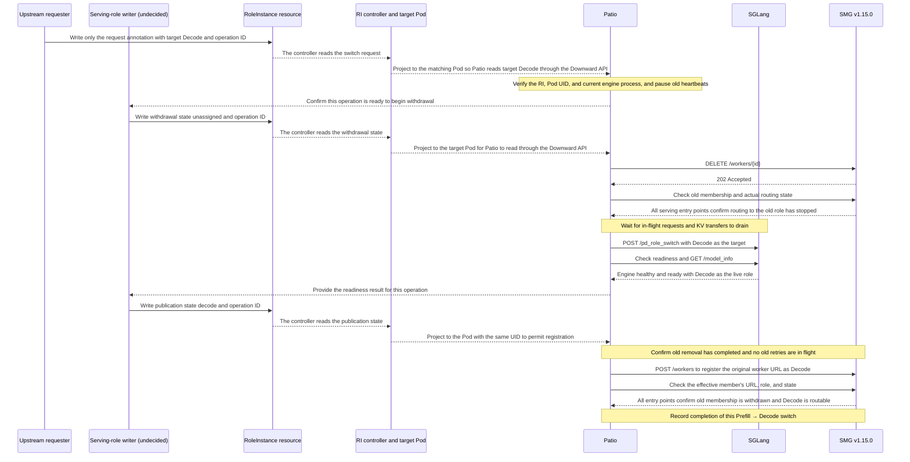

# KEP-541: Runtime Prefill/Decode Role Switching for PD-Disaggregated Inference

English | [简体中文](README.zh-CN.md)

<!-- toc -->

- [Release Signoff Checklist](#release-signoff-checklist)
- [Summary](#summary)
- [Motivation](#motivation)
    - [Goals](#goals)
    - [Non-Goals](#non-goals)
- [Proposal](#proposal)
    - [User Stories](#user-stories)
    - [Notes/Constraints/Caveats](#notesconstraintscaveats)
    - [Risks and Mitigations](#risks-and-mitigations)
- [Design Details](#design-details)
    - [The Contract](#the-contract)
    - [Declaring the Runtime Key](#declaring-the-runtime-key)
    - [Why Externally Written Values Survive](#why-externally-written-values-survive)
    - [Switch Flow](#switch-flow)
        - [How Router Membership Changes](#how-router-membership-changes)
    - [Switcher Placement](#switcher-placement)
    - [Test Plan](#test-plan)
        - [Prerequisite testing updates](#prerequisite-testing-updates)
        - [Unit tests](#unit-tests)
        - [Integration tests](#integration-tests)
        - [e2e tests](#e2e-tests)
    - [Graduation Criteria](#graduation-criteria)
        - [Alpha](#alpha)
        - [Beta](#beta)
        - [GA](#ga)
        - [Deprecation](#deprecation)
    - [Upgrade / Downgrade Strategy](#upgrade--downgrade-strategy)
    - [Version Skew Strategy](#version-skew-strategy)
- [Production Readiness Review Questionnaire](#production-readiness-review-questionnaire)
    - [Feature Enablement and Rollback](#feature-enablement-and-rollback)
    - [Rollout, Upgrade and Rollback Planning](#rollout-upgrade-and-rollback-planning)
    - [Monitoring Requirements](#monitoring-requirements)
    - [Dependencies](#dependencies)
    - [Scalability](#scalability)
    - [Troubleshooting](#troubleshooting)
- [Implementation History](#implementation-history)
- [Drawbacks](#drawbacks)
- [Alternatives](#alternatives)
    - [Request Delivery and RI Write-Back](#request-delivery-and-ri-write-back)
    - [First Supported Router and Integration Protocol](#first-supported-router-and-integration-protocol)
    - [Including the Annotation Fix in the First Slice](#including-the-annotation-fix-in-the-first-slice)
    - [Switcher Placement and Cross-Repository Responsibilities](#switcher-placement-and-cross-repository-responsibilities)
    - [Label Key and Enablement](#label-key-and-enablement)
    - [First Validation Deployment and Future Support Boundaries](#first-validation-deployment-and-future-support-boundaries)
- [Infrastructure Needed](#infrastructure-needed)

<!-- /toc -->

## Release Signoff Checklist

Items marked with (R) are required *prior to targeting this enhancement to a milestone or release*.

- [ ] (R) The enhancement issue is in the release milestone and links to the KEP directory (excluding the original PR that introduced the KEP)
- [ ] (R) KEP approvers have approved setting the KEP status to `implementable`
- [ ] (R) Design details are sufficiently documented
- [ ] (R) A test plan is in place
- [ ] (R) Graduation criteria are in place
- [ ] (R) Production readiness review is complete
- [ ] (R) Production readiness review is approved
- [ ] The Implementation History section is up to date for the current milestone
- [ ] User-facing documentation has been written
- [ ] Supporting materials are in place, including additional design documents, discussion links, relevant PRs or issues, and release notes

## Summary

SGLang `v0.5.23` allows an engine with a loaded model to switch between Prefill and Decode in supported configurations. RBG continues to use `rbg.workloads.x-k8s.io/role-name` to manage topology identity. A Pod in `pdmix-pool` can change its serving role while keeping its UID and workload membership. [SGLang v0.5.23][sglang-release] · [Original request in #541][issue-541]

This KEP, proposed in #596, describes a phased end-to-end design for role switching across RBG and the inference runtime. The first slice uses the existing RBG API and CRDs. It proposes fixing an in-place update bug that clears the entire annotation map when the last template annotation is removed, adding metadata regression tests, and providing a GPU-free v1alpha2 example. The first slice uses the existing native RoleInstance path and can be validated independently within RBG. [Joint design suggestion from diw-zw][review-co-design] · [Proposal author's public response][scope-reply]

The follow-up design proposes having the RoleInstance (RI) controller propagate the serving role to matching existing Pods. In the end-to-end example, Patio reads the Downward API projection and maintains worker membership through the explicit registration API of standalone SMG `v1.15.0`. Switching begins after confirming that the old pool has stopped dispatching and the engine has drained. The new role is published once the engine is ready. The operation is marked complete after every traffic-serving entry point confirms that it can route to the new member. The request representation, ownership of RI writes, first supported routing combination, and switcher placement are pending review. [Alternatives](#alternatives)

## Motivation

The prefill-to-decode capacity ratio a workload needs changes with its request mix. Long prompts with short answers require more prefill capacity. Short prompts with long generations require more decode capacity. Currently, changing the ratio requires tearing down engine instances and relaunching them with a different `--disaggregation-mode`. This reloads weights, reallocates the KV pool, and incurs a full cold start.

SGLang eliminates this overhead. The token KV pool is role-independent, and Prefill and Decode allocate the same KV memory structures. Switching tears down and rebuilds only a small set of role-specific disaggregation structures, then resumes the scheduler event loop for the new role. Upstream reports that weights, KV cache, CUDA Graphs, free GPU memory, and thread counts remained stable over 100 consecutive role switches.

The contract relies on two parts of the RBG prerelease `v0.9.0-alpha.5` implementation. [RBG v0.9.0-alpha.5][rbg-release]

1. When a RoleInstance creates a Pod, it gets labels and annotations from the component template. Steady-state reconciliation skips reapplying template metadata to existing Pods. [Pod creation][instance-core]
2. In-place metadata patches are generated from the **difference between the old and new ControllerRevisions**. That comparison uses the two revisions and excludes the live Pod. [`inplace_update_defaults.go`][pod-inplace-defaults]

The original issue asks for tests and documentation to establish these two behaviors. The existing envtest prototype covers some paths. Reproducing the removal of the final template annotation also shows that revision-based diffing alone is insufficient to preserve other annotations.

### Goals

1. Describe an end-to-end switch from the initial request to effective routing publication, defining the responsibilities of the RI, Pod, Patio, engine, and router, as well as observable safety conditions.
2. Use regression tests on the native RoleInstance path to establish the metadata contract for externally managed keys, and propose per-key deletion of annotations explicitly removed from the template.
3. Provide a reproducible GPU-free v1alpha2 example that demonstrates initial values from the Standalone template, external key ownership on a Pod with the same UID, and the result after Pod replacement.

### Non-Goals

1. The first slice uses the existing RBG API and CRDs. The request representation, continuous propagation, and interface changes for the full switch are evaluated in the joint design.
2. A higher-level component decides when to switch and which instance to select. Request draining, KV transfer, and the engine switch remain the responsibility of the runtime and engine.
3. Workload lifecycle, scheduling, and topology identity retain their existing semantics. First-slice validation uses local RBG regression tests and the documentation example. Live engine and router integration is deferred to a later phase.

## Proposal

The proposal uses the four-role topology from #541. The fixed roles continue to provide baseline capacity. Runtime switching changes only the serving identity of the target instance in `pdmix-pool`.

| Role | Meaning |
| --- | --- |
| `prefill` | Workload dedicated to prefill |
| `decode` | Workload dedicated to decode |
| `router` | Router and traffic entry point |
| `pdmix-pool` | Pool of engines that can switch roles |

The first slice verifies the RBG metadata contract. A full switch begins with a request for the workload's target role, proceeds through the runtime's engine operation, and completes after router confirmation. [Metadata contract](#the-contract) · [Test plan](#test-plan) · [Switch flow](#switch-flow) · [Component responsibilities](#switcher-placement)

### User Stories

#### Story 1

As an inference platform operator, I want to adjust the P:D ratio of a running deployment without cold-starting engines. That way, I can avoid reloading weights and a temporary drop in capacity when the distribution of prompt and generation lengths changes.

#### Story 2

As a runtime developer, I want to know how to obtain the requested target role, when I can publish the serving role, and how to resume the same operation after an interruption.

#### Story 3

As an RBG maintainer, I want tests to fail if someone introduces drift correction for existing Pods, because a seemingly reasonable change could silently break every deployment that relies on runtime role switching.

### Notes/Constraints/Caveats

#### Scope of `spec.roles[].labels` Propagation

RBG currently writes `spec.roles[].labels` to the RoleInstanceSet. The default Stateful path copies these labels when it creates an RI. Pod creation uses component-template metadata and instance identity keys. There is currently no contract for continuously projecting label changes from an existing RI to existing Pods. The first-slice example sets the initial value in the Pod template. Serving-role propagation in the joint design requires new controller behavior. [RoleInstanceSet labels][ris-labels] · [New RI creation][ri-labels] · [Pod creation][instance-core]

#### `unassigned` Describes Routing State, Independent of Engine Mode

An engine in the pool can start in Decode mode while its Pod's serving label remains `unassigned` during warmup. A serving-role selector can exclude the Pod. A Service that selects by topology can still match it. On Patio's main branch, Patio registers once the engine is ready, using the worker information from startup. Subsequent heartbeats reuse that information. The joint design requires waiting until the role for the current operation is authorized for publication before registering. [Patio startup and heartbeats on main][patio-startup]

#### Patio Injection and Workload Updates

`spec.roles[].engineRuntimes[].profileName` references a `ClusterEngineRuntimeProfile` to inject the Patio container and a Downward API volume during deployment. `ClusterEngineRuntimeProfile.spec.updateStrategy` is deprecated. The controller has never used it to trigger a rolling update. To change a referenced profile, publish a new one and migrate references according to the workload's update strategy. New Pods start as `unassigned` and can receive traffic only after the instance identity and engine state have been rechecked. [Runtime profile and update constraints][profile-doc] · [v1alpha2 injection example][engine-runtime-example]

#### Scale-down Does Not Account for a Pod's Serving Role

On the default Stateful path, reducing a role's replica count causes the RoleInstanceSet to delete entire RoleInstances with the highest ordinals first. [`newComponentPodGroup`][instance-core] handles component Pods within a single RoleInstance. Neither path adjusts the scale-down order based on the serving role. [Instance scale-down logic][stateful-scale]

For example, scaling `pdmix-pool` down from 8 consecutively numbered instances to 6 removes instances 6 and 7 first. If those happen to be the last two Prefill instances, the remaining pool loses its Prefill capacity. Before scaling down, operators or the external control plane should check the actual serving roles of the instances to be deleted, the remaining capacity, and any traffic that must first be withdrawn.

#### System Labels That Affect Pod Lifetime

RBG owns `controller-revision-hash`. If the controller cannot find a matching ControllerRevision after the label changes, it may recreate the Pod. The native RI path uses `rbg.workloads.x-k8s.io/component-id` to identify components. An unparseable value sends the Pod down the deletion path. The metadata contract in the first slice is scoped by actual key ownership. [Key ownership review][review-keys] · [Component identity parsing][instance-utils] · [Instance reconciliation][instance-scale]

#### Upstream Backend and Parallelism Constraints

Use an SGLang build that exposes the runtime switching API and enable it with `--enable-pd-role-switch`. The KV transfer backend must advertise `supports_role_switch` and implement the cleanup hook. The upstream end-to-end results used MoRI, a TP 8 MoE configuration, and AMD MI355X and MI300X GPUs. EP, DP attention, all-to-all, and other backend or hardware combinations must be verified in the intended deployment configuration. MoRI allocates its all-to-all dispatch buffers according to the startup role. [Upstream SGLang validation][sglang-pr]

### Risks and Mitigations

| Risk | Mitigation |
| --- | --- |
| In-place updates overwrite externally managed keys | Cover immediate writes, writes after the grace period, and revision-only updates with regression tests. When removing the last template annotation, verify per-key removal and confirm that the update completes. |
| New propagation behavior affects existing workloads | Project only the agreed switch request, serving-role key, and operation ID for participating instances. Verify that nonparticipating objects retain the same templates, revisions, and Pod UIDs across upgrades. |
| An entry point still dispatches new requests, or requests and KV transfers remain in flight | Confirm independently that the entry point has stopped dispatching and the engine has drained before calling the engine. |
| An old operation, process restart, or Pod replacement publishes a stale role | Bind the operation ID, RI UID, Pod UID, and process identity. On recovery, read the current role, health, and routing membership again. |
| Asynchronous withdrawal or an old heartbeat races with new registration | Use a single registration writer, pause retries from the old registration, and confirm deletion of the old entry before registering again. Effective admission to the pool is the completion condition. |
| Scale-down removes the last instance serving a role | Check the actual serving roles of the Stateful scale-down targets and the capacity remaining in the pool. |

## Design Details

### The Contract

**Externally managed keys in the first slice.** This contract covers custom labels and annotations owned by users or external components that RBG does not manage on the native RoleInstance path. RBG updates `controller-revision-hash` and its system keys under `rbg.workloads.x-k8s.io/`. [Key ownership review][review-keys]

| Event | Guaranteed behavior |
| --- | --- |
| Pod creation, or recreation of a Pod with the same name and a new UID | Initialize the Pod from the template in effect at creation. External values that existed only on the old Pod do not carry over. |
| Reconciliation or a supported in-place update for the same UID, with the corresponding template key unchanged | Preserve the external value on the existing Pod. This also applies when neither template version declares the key. |
| The new template explicitly adds, changes, or deletes a key | Apply the template change to that key and preserve other unchanged external keys. |

**Serving roles in later phases.** For participating instances, the RI controller is the sole writer of the agreed Pod serving-role key. It propagates the current operation and the serving role approved for publication to the existing Pod with the matching UID. Propagation updates only the agreed Pod metadata and preserves component templates, revisions, topology identity, and other independently managed keys. A new UID starts as `unassigned`, and any old operation is invalid for that UID. RBG continues to manage topology and lifecycle. In the explicit registration example, Patio executes the switch and maintains membership based on the authorization to publish the role. [Joint design review][review-co-design] · [Request delivery and RI write-back options](#request-delivery-and-ri-write-back)

### Declaring the Runtime Key

This GPU-free Standalone example verifies the first-slice contract for externally managed keys. Set the initial label under `metadata.labels` in the Pod template. The example key is for demonstration. The key and enablement mechanism for the joint design remain under review. [Label Key and Enablement](#label-key-and-enablement)

```yaml
apiVersion: workloads.x-k8s.io/v1alpha2
kind: RoleBasedGroup
metadata:
  name: sglang-pd
spec:
  roles:
    - name: pdmix-pool
      replicas: 1
      standalonePattern:
        template:
          metadata:
            labels:
              # Workload identity, referenced by the Services below.
              app: sglang-pd
              # Example user-managed label for the first slice.
              inference.workload.x-k8s.io/pd-role: unassigned
          spec:
            containers:
              - name: example
                image: registry.k8s.io/pause:3.10
```

Once the pool Pod exists, record its name and UID. Update one key with `kubectl label pod <pod-name> inference.workload.x-k8s.io/pd-role=prefill --overwrite`. The existing Pod keeps its UID and matches the Service selector below. Delete the Pod and wait for RBG to recreate it. The Pod with the new UID starts at `unassigned`. This example verifies metadata and selector matching without running an inference engine.

```yaml
apiVersion: v1
kind: Service
metadata:
  name: pd-prefill
spec:
  selector:
    app: sglang-pd
    inference.workload.x-k8s.io/pd-role: prefill
  ports:
    - port: 8000
      targetPort: 8000
```

Deployments that use fixed addresses or route through a Service VIP must separately verify the actual traffic path and PD bootstrap pairing. [Fixed-address example][pd-standalone] · [Service discovery review][review-discovery]

### Why Externally Written Values Survive

When the RI creates a Pod, it takes initial values from the component template. An in-place update generates a metadata patch from the template differences between the **old and new ControllerRevision** objects and applies it to a freshly read Pod. Immediate updates, the second write after the grace period, and `onlyUpdateRevision` all retry on concurrent conflicts. The regression test changes both the image and an explicit template key. It verifies that both changes take effect, exercising the Pod metadata write path. [Pod creation][instance-core] · [Patch generation][pod-inplace-defaults] · [Write path review][review-cheyang]

**Annotation defect proposed for the first slice.** A local envtest reproduction during development changed the image and removed the last template annotation. This produced `{"metadata":{"annotations":null}}` and cleared both external annotations and the in-place update state. The proposed patch lists only the keys removed from the old template, for example `{"metadata":{"annotations":{"example.com/template":null}}}`. RBG `v0.9.0-alpha.5` still uses the same patch generation path. The per-key merge semantics have been checked. Reproduction in envtest on the release version and regression testing of the fix are pending. Deferred patches saved before an upgrade still execute as recorded. [Patch generation][pod-inplace-defaults] · [Write after the grace period][pod-inplace]

### Switch Flow

This single-Pod Standalone RI example shows **one Prefill → Decode switch**, following the target Pod in `pdmix-pool` and its worker URL throughout. The instance initially serves Prefill traffic. The test environment has other available Prefill and Decode members. Patio registers explicitly with standalone SMG `v1.15.0` and is the sole registrar for the target worker URL. The example conveys the target role through an RI request annotation and a Downward API volume. The request carrier, requester authorization, and choice of serving-role writer remain under review. [SMG v1.15.0][smg-release] · [Joint design review][review-co-design] · [Request delivery and RI write-back options](#request-delivery-and-ri-write-back)



1. In the RI request annotation, the authorized upstream requester records `decode` as the target role along with the operation ID, RI UID, and target Pod UID. The RI controller projects the request into an annotation on the matching Pod. Patio reads the target role and operation ID through the Downward API volume and verifies the target identity. After locking the operation to the current engine process, Patio checks `/model_info` and effective membership to confirm the instance is serving Prefill, then pauses old automatic registration and retries. The serving-role writer records `unassigned` and the operation ID in the RI, and the RI controller projects them to the target Pod.
2. Patio verifies that the withdrawal signal in the volume matches the current request, then withdraws the target worker using its current ID. Wait until every serving entry point has stopped routing to it, then wait for already accepted requests and KV transfers to drain. If the associated Service or EndpointSlice participates in routing, also verify its old route has been withdrawn. [Drain review][review-drain]
3. Patio calls `POST /pd_role_switch` with `new_role=decode`. Supply `decode_cuda_graph_memory_gb` when Decode CUDA graph capture is needed for the first time. Record `success` and `safe_to_restore` from the response. Keep the instance withdrawn if the engine is still busy. On timeout, first check the original process's health and actual role. Confirm the switch by reading `/model_info` for `disaggregation_mode` and checking the readiness signal. The corresponding field in `/server_info` and its old alias `/get_server_info` comes from startup configuration. [Engine role switch in v0.5.23][engine-switch] · [Role lookup in v0.5.23][engine-live] · [Live role review][review-observe]
4. Patio verifies the engine result for this switch. The serving-role writer checks the current operation, RI UID, Pod UID, and engine process, then writes `decode` and the operation ID to the RI. The RI controller projects them to the Pod with the same UID. Patio can write with restricted permissions, or the control plane can verify Patio's report and write the value. Patio reads the publication authorization for this operation through the Downward API, confirms deletion of the old member has completed, and re-registers the original worker URL with `worker_type=decode`. [RI write-back options](#request-delivery-and-ri-write-back)
5. Query the routers that actually serve traffic. Record completion only after confirming the old member was withdrawn and the Decode member at the original worker URL can receive traffic. In integration testing, use request IDs and logs to show that the target Pod processed Decode traffic. Start a Decode → Prefill switch with a new operation ID and a valid bootstrap port. Confirm that the worker URL has left the Decode pool and the same Pod serves Prefill again and completes KV transfer.

**Recovery.** If Patio restarts after switching the engine while the RI still reads `unassigned`, first recover the same operation and verify the RI, Pod UID, current process, live role, and every serving entry point. If the same process is already healthy and serving Decode, resume publication or complete missing registrations. If an old retry has registered the old role first, withdraw the incorrect member. If an entry point cannot be verified, wait for recovery or confirm isolation before recording completion. Reject write-backs from stale operations. A new Pod UID or engine process invalidates the old result. Restore the old route only after confirming that the old role is healthy and the engine explicitly indicates that restoration is safe. [Engine rejection and recovery semantics][review-cheyang]

#### How Router Membership Changes

| Integration mode | Protocol and support boundaries |
| --- | --- |
| Standalone SMG `v1.15.0`, explicit registration | A 202 response to withdrawal or registration indicates asynchronous acceptance. Use `GET /workers/{id}` and `GET /workers` to verify URL, role, and state. If a repeated POST returns 409, continue observing a member whose creation is in progress, retain an already routable member with the correct role, and withdraw a member with the old role first. Standard PATCH cannot update the role. Confirm old removal is complete before registering the same URL again. [SMG v1.15.0 membership API][smg-v115-workers] · [SMG review][review-smg] |
| Standalone SMG `v1.15.0`, native Pod discovery | The watcher maintains membership using serving-role selectors. This mode requires separate verification of the two-stage withdrawal and re-entry, the Prefill port, and actual routing. [Pod discovery][smg-discovery] · [Port metadata][smg-discovery-ports] |
| SGLang `v0.5.23` `sgl-router` EndpointSlice discovery | Re-entry or a missing Prefill bootstrap port can trigger a new probe. The startup role from `/server_info` can override the discovered result. Supporting this mode requires identifying the upstream dependency for live role probing or adjusting the flow, and verifying re-entry, reprobes, and routing in both directions. [Reprobe source in v0.5.23][sgl-router-discovery] · [EndpointSlice review][review-discovery] |
| Existing fixed-address examples | Startup binds roles using `--prefill` and `--decode`, providing a fixed-topology comparison. [Standalone example][pd-standalone] · [LeaderWorker example][pd-lw] |

<<[UNRESOLVED First supported routing mode]>>
Before the KEP moves to `implementable`, identify the officially supported router, version, integration mode, and verifiable protocol for the first release. If EndpointSlice discovery is in scope, explain how the live role and Prefill port are handled. If the first release uses another mode, agree with the reviewer on the boundary for future EndpointSlice support. The explicit registration example is a design walkthrough. Live routing in both directions on the target deployment still needs validation. [First Supported Router and Integration Protocol](#first-supported-router-and-integration-protocol) · [Routing review][review-cheyang]
<<[/UNRESOLVED]>>

### Switcher Placement

| Component | Responsibility in the joint design |
| --- | --- |
| Upstream requester | Selects the instance and target role and submits the switch request. In this example, the requester's authorization covers only the RI request annotation. |
| Serving-role writer | Durably associates the operation ID, RI UID, Pod UID, and engine process. Advances an existing operation by validating and writing the withdrawal state and the engine-verified value for publication. |
| RBG RI controller | Manages topology and lifecycle and projects the current request, serving role, and operation ID to the existing Pod with the matching UID. Preserve templates, revisions, and Pod UIDs for nonparticipating objects across an upgrade. |
| Patio (explicit registration example) | Observes the projection through the Downward API. Coordinates the drain after routing stops, calls the engine API, and handles recovery. It is the sole writer of SMG membership for the URL. Volume updates can be delayed or skip intermediate states, so Patio reads again and verifies the current operation. |
| SGLang and router | SGLang performs the switch and reports the actual result. The router holds the members eligible for traffic, providing confirmation of withdrawal and pool admission. |

<<[UNRESOLVED Request carrier and RI write responsibility]>>
The request carrier, requester authorization, serving-role writer, label key, and enablement mechanism remain under review. Record the request and publication state separately, and validate permissions for each type of write at the interface. Once responsibilities are settled, verify whether existing metadata supports permission isolation, rejection of stale operations, and recovery after a restart. Then identify any controller or API changes. [Request delivery and RI write-back options](#request-delivery-and-ri-write-back) · [Switcher Placement and Cross-Repository Responsibilities](#switcher-placement-and-cross-repository-responsibilities) · [Label Key and Enablement](#label-key-and-enablement)
<<[/UNRESOLVED]>>

### Test Plan

- [x] We understand that maintainers of the relevant components may require updates to existing tests before accepting changes that implement this enhancement, to ensure the code is sufficiently reliable.

##### Prerequisite testing updates

For the first slice, `test/envtest/testutil` starts etcd, kube-apiserver, and the RBG controller. The envtest cases simulate the kubelet reporting container status and a new `ImageID`, then wait for `InPlaceUpdateReady=True`. The earlier prototype used the default immediate update strategy and did not wire in admission webhooks. It verified controller writes to existing Pods. Existing RBG mutating webhooks target RBG custom resources. [Source review][review-cheyang]

##### Unit tests

- Compare template metadata from the old and new revisions. Verify that unchanged keys are omitted from the patch and that additions, modifications, and deletions affect only their respective keys. Assert `MetaDataPatch == nil` when only the image changes. Exercise the metadata write path in a separate case that changes a template annotation.
- When the last template annotation is removed, test both an omitted annotation map and an empty map in the new template. Applying the patch must remove only the key dropped from the template and preserve externally managed annotations and in-place update state annotations.

##### Integration tests

**Existing evidence.** The development envtest prototype covered reconciliation, preservation of external annotations, and immediate in-place updates. In the test that updates the image and a template annotation, replacing the old template metadata with an empty `ObjectMeta` when generating the patch caused the external label assertion to fail. This mutation check covered that test case alone. Development testing also reproduced the removal of the entire map after deleting the last template annotation on the same Pod UID and used the patch library to verify per-key deletion semantics. These tests still need to be rerun against RBG `v0.9.0-alpha.5`.

**Remaining regression tests for the first slice.** After scale-out, verify that the original Pod UID and externally managed keys are preserved and that new replicas get their initial values from the template. After deleting and recreating a Pod with the same name, verify its new UID and initial template values. External annotations from the previous Pod must not carry over. When updating both the image and a template annotation, verify that both take effect on the same UID. Wait for the simulated kubelet status to advance, then recheck external keys. Also test the second write after the grace period, `onlyUpdateRevision`, and removal of the last template annotation. Verify the per-key fix for immediate updates and newly queued delayed updates, checking the state annotations during the update and the external keys after it completes.

**RI propagation still to be verified.** Test repeated reconciliations, concurrent in-place updates, stale operations, and replacement of a Pod with the same name and a new UID. Only the current Pod whose identity matches the operation may receive the value authorized for publication, with other externally managed keys preserved. For existing workloads that have not enabled the joint feature, compare rendered templates, RoleInstanceSet revisions, Pod revision hashes, and Pod UIDs before and after a controller upgrade. Verify that the upgrade triggers no workload rollout.

##### e2e tests

Once the community selects a router, version, and integration mode, verify Prefill → Decode → Prefill on the same Pod UID in a GPU environment with an engine and KV backend that support role switching. Verify that the old pool stops dispatching and that in-flight requests and KV transfers drain. Check the live engine role, readiness, the target worker membership at the entry points that handle traffic, and recovery from failure. Inspect EndpointSlices or effective worker membership according to the selected mode and use request IDs to verify inference results after switching and switching back. This is part of the later joint validation. The current evidence for the first slice comes from local metadata validation. [Router review][review-cheyang] · [Upstream engine validation][sglang-pr]

During evaluation, a fake engine can verify the conditions for stopping dispatch and readmitting the worker. Explicit registration with SMG `v1.15.0` in the switch flow is used for the walkthrough. The community still needs to choose the first deployment combination to test. [Switch flow](#switch-flow)

### Graduation Criteria

#### Alpha

- Maintainers accept the RBG metadata contract and confirm the scope of the first slice, including whether it contains the proposed annotation fix.
- Regression tests run in CI and cover immediate updates, the second write after the grace period, and revision-only updates. Each case must demonstrate that it detects overwritten external values.
- Publish the contract documentation and a v1alpha2 example that lets readers set initial values in a Pod template, modify custom keys on an existing Pod, and verify the initial values after recreation.

#### Beta

- The switcher selected by the community implements traffic withdrawal, draining, role switching, republication, and failure recovery with the required permissions.
- Bidirectional switching tests pass on a supported backend and verify agreement among the Pod serving-role label, the live engine role, and effective router pool membership.
- Document and test the edge case of changing a template value while the workload is running.
- Document the interaction between scale-in and role switching and explain how to preserve the role balance during scale-in.

#### GA

- At least two independent deployments use runtime switching throughout a full RBG release cycle. Evidence includes Pods in the pool carrying serving-role labels other than `unassigned` before and after an RBG upgrade, with no incidents of labels reverting to their original values reported in [#541][issue-541].
- Sustained runs on a supported backend reproduce stable switches back to the original role. CI reproduces the upstream result of 100 consecutive switches at least once.
- The selected switcher publishes switch success rate and switch duration metrics, and at least one operator uses them for alerting to demonstrate that the SLIs below are observed in practice.

#### Deprecation

The first slice uses the existing API, CRDs, and in-place update workflow. No fields or interfaces are scheduled for deprecation.

### Upgrade / Downgrade Strategy

The first slice uses the existing API and CRDs. The proposed per-key deletion fix applies to metadata patches newly generated by a controller version that includes the fix, covering immediate updates and newly queued delayed updates. Grace-period update plans queued before an upgrade still execute with the saved patch. Legacy whole-map deletion records lack the original set of template keys. After a downgrade, the controller generates new patches according to the older rules. Owners must restore already lost external values from their original sources.

For the later RI propagation design, upgrades should preserve templates, revisions, and Pod UIDs for workloads that have not enabled the feature. Component versions and enablement and disablement mechanisms for the joint design will be confirmed with the interface design. After pausing new switch requests, verify the stage of any in-flight operation. Before resuming dispatch, read the current Pod UID, engine process, and live role, then verify router membership at each entry point that handles traffic.

### Version Skew Strategy

The first-slice fix applies to the existing RBG API and CRDs. See the [Upgrade / Downgrade Strategy](#upgrade--downgrade-strategy) for patch compatibility. Verify versions and capabilities of RBG, the runtime, the engine, the KV backend, and the router for each actual deployment combination used by the joint design.

- The verified engine release baseline for switching is SGLang `v0.5.23` with `--enable-pd-role-switch` enabled and a KV transfer backend with `supports_role_switch`. Start operations only when the deployment supports switching. If the API call fails or the result is unclear after traffic withdrawal, keep traffic withdrawn and verify the actual state. [SGLang v0.5.23 switch endpoint][engine-switch]
- RBG and the selected switcher must use compatible operation records and serving-label propagation semantics. Recovery must identify completed stages from the operation ID, Pod UID, and current process. Fields or API changes needed for the full switch flow depend on the interface design.
- Router versions and integration modes determine withdrawal, retry, and membership confirmation semantics. Validate explicit registration or service discovery for each supported combination. Scope management API and probing behavior to the version that provides it. [Explicit registration review][review-smg] · [Discovery mode review][review-discovery]

## Production Readiness Review Questionnaire

### Feature Enablement and Rollback

The proposed annotation fix takes effect with the controller version that delivers it. How to enable the joint switching feature is still under review. Before disabling it, pause new switches, resolve in-flight operations, and confirm the serving state before removing the switcher. When re-enabling it, verify the current instance and router membership, then resume operations that remain valid. [Component responsibilities and enablement](#switcher-placement) · [Upgrade / Downgrade Strategy](#upgrade--downgrade-strategy)

### Rollout, Upgrade and Rollback Planning

Rollback signals for the first slice include loss of external annotations or update state annotations on the same Pod UID, and in-place updates that remain incomplete for an extended period. Patches queued before an upgrade still execute as stored. The full upgrade and rollback paths still need validation. [Upgrade / Downgrade Strategy](#upgrade--downgrade-strategy) · [Test Plan](#test-plan)

### Monitoring Requirements

Use the Pod UID and operation ID to correlate the publication label, the live role from `/model_info`, and membership at the entry points that handle traffic. Planned measurements include switch success rate, time spent in each stage, the number of instances withdrawn but not readmitted, and how long the engine role and router membership disagree. Set latency and timeout targets after measuring the selected deployment. [Switch completion criteria](#switch-flow)

### Dependencies

The joint switch flow uses the Kubernetes API and kubelet to project the serving role. It uses Patio, SGLang and a KV backend that support role switching, and a router that can confirm withdrawal and readmission. [Version Skew Strategy](#version-skew-strategy) · [Router support boundaries](#how-router-membership-changes)

### Scalability

The first slice uses existing update paths. The joint switch flow adds RI writes, Pod metadata updates, and calls to the engine and router. Call volume, latency, and resource overhead still need measurement in the selected integration mode.

### Troubleshooting

Use the operation ID and Pod UID to locate the first divergence across stopping dispatch, draining, switching the engine, projecting the label, and admission to the routing pool. If the state of the control plane or an entry point that handles traffic cannot be verified, pause the affected operations and keep traffic withdrawn. If metadata is lost, compare the old and new ControllerRevisions and inspect the actual patch. [Switching and recovery](#switch-flow) · [Metadata update path](#why-externally-written-values-survive)

## Implementation History

- 2026-11-17. Submitted the `provisional` KEP and the first-slice regression plan. [Original issue][issue-541]
- 2026-11-22. The public draft clarified the coverage of externally managed keys and the conditions for withdrawing traffic. It also proposed per-key deletion when the last template annotation is removed. [Metadata review][review-keys] · [Routing review][review-cheyang]
- 2026-11-25. The Chinese working draft added an end-to-end design spanning the RI, Patio, and the router, based on the review and the proposal author's response. The request representation, RI write ownership, and supported integrations remain open. [Joint design review][review-co-design] · [Scope confirmation][scope-reply]

## Drawbacks

- A complete switch coordinates several asynchronous components. The target instance temporarily leaves its serving pool. An unreachable router or a failed engine rebuild can extend that window.
- RBG, Patio, SGLang, and the router can be upgraded independently. Each supported combination needs separate verification of versions and membership protocols.
- Continuous RI propagation, persistent operation records, and restart recovery require new behavior. The chosen interface determines how to verify permissions, control-plane handoff, and the impact on existing workloads.

## Alternatives

### Request Delivery and RI Write-Back

Both options can use a request annotation on the RI. The upstream initiator records the operation ID, target role, RI UID, and target Pod UID. The RI controller projects the request to the matching Pod, and Patio reads it through a Downward API volume. The progress record binds the operation to the current engine process. The published role is represented separately. After receiving a `decode` request, the Pod can remain `prefill` before moving to `unassigned`. Once the engine is ready, the RI controller can project the authorized `decode` value for that operation to the same Pod. [Component responsibilities](#switcher-placement)

| RI write ownership | Trade-offs and recovery |
| --- | --- |
| Patio reports results and the control plane writes the RI | Patio reports readiness to withdraw and engine results over an authenticated channel. The control plane validates the active operation, UIDs, and engine process before writing the RI. Kubernetes write permissions stay in the control plane. This option needs a component that can durably accept and validate reports and handle duplicates. After restarting, Patio queries the accepted progress or resubmits the report under the same operation ID. [RI permissions in the RBG control plane][ri-rbac] |
| Patio writes to the target RI with restricted permissions | This removes the result handoff. Patio uses conditional updates to record withdrawal and publication, then rereads the RI after a restart to resume. Permissions must be limited to the target RI and the agreed keys, with checks to reject stale writes and prevent concurrent overwrites. Native RBAC can scope resources by name with `resourceNames`. Restricting individual keys requires an additional mechanism. The lifecycle acknowledgment proposal on Patio's main branch offers a design precedent. [Kubernetes RBAC][rbac-resource-names] · [Patio acknowledgment proposal on main][patio-lifecycle] |

Both options must resume the same operation if the engine is already serving Decode and the RI still shows `unassigned`. Before writing the missing publication value, verify the current engine process and effective membership. If an existing control-plane component can reliably validate reports and recover them, prefer keeping the control plane as the sole RI writer. First verify whether existing metadata supports authorization, conditional updates, and recovery. If write validation is the only gap, consider admission validation. If separate authorization or a typed status contract is required, consider a separate operation interface or new API fields and verify upgrade compatibility. [Switching and recovery](#switch-flow)

### First Supported Router and Integration Protocol

| Candidate integration | Adoption criteria and validation |
| --- | --- |
| Explicit registration with standalone SMG `v1.15.0` | Suitable for deployments that can designate one registrar per URL. The walkthrough uses Patio to pause old heartbeats and retries, issue DELETE, and confirm that new traffic has stopped and existing work has drained before switching. Once the engine is ready, publish the label. After confirming that deletion has completed, POST the member with its new role. Verify that the worker can receive traffic at every entry point. [Membership API][smg-v115-workers] · [Switch flow](#switch-flow) |
| Native Pod discovery with standalone SMG `v1.15.0` | The watcher is the only writer of membership for the URL. Withdraw from the old pool through `unassigned`, confirm that new traffic has stopped and existing work has drained, then switch the engine. When switching back to Prefill, publish the port metadata required by the watcher together with the target label. Verify that the same Pod joins the correct pool in both directions. [Pod discovery][smg-discovery] · [Port metadata][smg-discovery-ports] |
| SGLang `v0.5.23` `sgl-router` EndpointSlice discovery | Applies to deployments that follow the official RBG PD guide. Handle both re-probe paths, when a worker rejoins and when a Prefill bootstrap port is missing. Identify the upstream dependency for reading the live role or validate a replacement protocol. [Deployment guide][sgl-rbg-guide] · [Discovery review][review-discovery] |

The explicit registration path uses DELETE followed by POST. Withdraw the old member first, then verify dispatch suspension at the entry points and engine drain separately. Publish the target role label once the engine is ready. After the old member's deletion completes, re-register the original worker URL and verify admission to the target pool. [Switch flow](#switch-flow) · [SMG membership API][smg-v115-workers]

Full replacement through `PUT /workers/{id}` was tested with a single SMG `v1.15.0` HTTP PD router and fake workers. Using PUT for a role switch requires an independent mechanism to stop dispatch. The tested approach requires a controllable periodic probe and coordination of dispatch suspension and resumption at every entry point. The first version of the explicit registration path uses only the withdrawal and re-registration protocol above. [SMG full replacement][smg-put] · [Periodic probe configuration][smg-routing-probe]

Before the KEP becomes `implementable`, specify the first supported router, version, integration mode, and protocol. Agree with the reviewer on whether EndpointSlice support is included and the conditions for adding it later. [Routing review][review-cheyang]

### Including the Annotation Fix in the First Slice

Both options can deliver the RBG metadata regression suite and the GPU-free v1alpha2 example independently, using the existing API and CRD. Including the per-key deletion fix is recommended so the metadata contract covers removal of the last template annotation. If the fix is tracked separately, the first-slice documentation must describe the whole-map deletion exception, and the fix and its regression coverage are delivered separately. [Metadata defect and proposed fix](#why-externally-written-values-survive) · [Test plan](#test-plan)

### Switcher Placement and Cross-Repository Responsibilities

- **Patio sidecar.** Patio can read the request and published role from a volume and coordinate with the local engine. With explicit registration, a single component can handle startup registration, withdrawal, and re-registration. Verify that it can pause old writes, observe the actual traffic entry points, and resume after a restart. [Patio startup and heartbeat on main][patio-startup]
- **External switcher on the platform.** A platform that already observes live traffic and membership and can reach the target engine can coordinate switching centrally. Verify authentication, engine access, drain and membership confirmation, coordination with old heartbeats, and restart recovery. [Original issue][issue-541]

In both placements, the RI controller projects into the matching Pod. RI write ownership is chosen independently from the options above. Three other approaches provide a comparison. Having RBG call the engine directly couples the controller to the engine protocol and recovery logic. Recreating the Pod is a replacement path that reloads weights and reallocates the KV pool. Fixed roles are suitable for providing baseline capacity. Dynamic rebalancing requires the same loaded instance to change roles. [Joint design review][review-co-design] · [Fixed-address example][pd-standalone]

### Label Key and Enablement

An RBG-defined key reduces deployment configuration. Selectors that already depend on another key would need to migrate. Letting the workload author specify one key preserves existing selectors, provided the RI controller, Patio, and any router that selects on labels use the same validated key. Either choice can be enabled explicitly per role. Enablement can use existing configuration or a new field. Verify across upgrades that templates, revisions, and Pod UIDs stay the same for workloads that have not enabled the feature. [Original issue][issue-541] · [The contract](#the-contract)

### First Validation Deployment and Future Support Boundaries

Use the selected router, version, and integration mode for the first joint validation. Acceptance requires Prefill → Decode → Prefill on the same Pod UID with traceable requests. A fake engine can verify the routing protocol in advance. SGLang `v0.5.23` also offers `prepare_only` as a candidate preflight check. Use a target that differs from the current role and include the parameters for the real switch. A request for the current role may return before checking whether the engine is idle. Verify independently that dispatch has stopped and that in-flight requests and KV transfers have drained. Verify that the engine process can be identified within a single Pod UID. If multiple Pods per RI are supported, define UID binding, withdrawal, and publication for each member, as well as the completion condition for the group. [End-to-end tests](#e2e-tests) · [Engine preflight and idle checks][engine-switch]

## Infrastructure Needed

- **First RBG slice.** Use existing patch-level tests and envtest to pin the metadata contract. Verify the annotation fix if it is included. Deliver a GPU-free v1alpha2 example. The milestone is subject to maintainer confirmation.
- **Later joint validation.** Bidirectional acceptance requires a cluster with kubelet, a chosen router version, SGLang and a KV backend that support switching, GPU resources, and traceable live inference traffic. A fake engine can be used to validate label projection and membership changes in advance. [Test plan](#test-plan)

[rbg-release]: https://github.com/sgl-project/rbg/releases/tag/v0.9.0-alpha.5
[sglang-release]: https://github.com/sgl-project/sglang/releases/tag/v0.5.23
[issue-541]: https://github.com/sgl-project/rbg/issues/541
[sglang-pr]: https://github.com/sgl-project/sglang/pull/28403
[instance-scale]: https://github.com/sgl-project/rbg/blob/v0.9.0-alpha.5/pkg/reconciler/roleinstance/sync/instance_scale.go
[pod-inplace-defaults]: https://github.com/sgl-project/rbg/blob/v0.9.0-alpha.5/pkg/inplace/pod/inplaceupdate/inplace_update_defaults.go
[engine-runtime-example]: https://github.com/sgl-project/rbg/blob/v0.9.0-alpha.5/examples/basic/engine-runtime/engine-runtime-profile.yaml
[instance-core]: https://github.com/sgl-project/rbg/blob/v0.9.0-alpha.5/pkg/reconciler/roleinstance/core/instance_core.go
[instance-utils]: https://github.com/sgl-project/rbg/blob/v0.9.0-alpha.5/pkg/reconciler/roleinstance/utils/instance_utils.go
[pod-inplace]: https://github.com/sgl-project/rbg/blob/v0.9.0-alpha.5/pkg/inplace/pod/inplaceupdate/inplace_update.go
[pd-standalone]: https://github.com/sgl-project/rbg/blob/v0.9.0-alpha.5/examples/inference/pd-disagg-standalone.yaml
[pd-lw]: https://github.com/sgl-project/rbg/blob/v0.9.0-alpha.5/examples/inference/pd-disagg-leader-worker.yaml
[review-cheyang]: https://github.com/sgl-project/rbg/pull/596#pullrequestreview-5950426443
[review-discovery]: https://github.com/sgl-project/rbg/pull/596#discussion_r4608875131
[review-drain]: https://github.com/sgl-project/rbg/pull/596#discussion_r4599348128
[review-keys]: https://github.com/sgl-project/rbg/pull/596#discussion_r4599348121
[review-observe]: https://github.com/sgl-project/rbg/pull/596#discussion_r4608875141
[review-smg]: https://github.com/sgl-project/rbg/pull/596#discussion_r4608875123
[stateful-scale]: https://github.com/sgl-project/rbg/blob/v0.9.0-alpha.5/pkg/reconciler/roleinstanceset/statefulmode/stateful_instance_set_control.go#L493-L525
[review-co-design]: https://github.com/sgl-project/rbg/pull/596#issuecomment-7100569013
[scope-reply]: https://github.com/sgl-project/rbg/pull/596#issuecomment-7138032847
[ris-labels]: https://github.com/sgl-project/rbg/blob/v0.9.0-alpha.5/pkg/reconciler/roleinstanceset_reconciler.go#L344-L353
[ri-labels]: https://github.com/sgl-project/rbg/blob/v0.9.0-alpha.5/pkg/reconciler/roleinstanceset/statefulmode/stateful_instance_set_utils.go#L146-L170
[patio-startup]: https://github.com/rolebasedgroup/inference-engine-runtime/blob/main/src/patio/app.py#L98-L131
[profile-doc]: https://github.com/sgl-project/rbg/blob/v0.9.0-alpha.5/doc/features/engine-runtime.md#profile-mutability
[engine-switch]: https://github.com/sgl-project/sglang/blob/v0.5.23/python/sglang/srt/disaggregation/role_switch.py#L43-L146
[engine-live]: https://github.com/sgl-project/sglang/blob/v0.5.23/python/sglang/srt/entrypoints/http_server.py#L803-L887
[sgl-router-discovery]: https://github.com/sgl-project/sglang/blob/v0.5.23/sgl-router/src/workers/manager.rs#L526-L566
[smg-release]: https://github.com/smg-project/smg/releases/tag/v1.15.0
[smg-v115-workers]: https://github.com/smg-project/smg/blob/v1.15.0/model_gateway/src/worker/service.rs#L544-L776
[smg-put]: https://github.com/smg-project/smg/blob/v1.15.0/model_gateway/src/worker/service.rs#L599-L667
[smg-routing-probe]: https://github.com/smg-project/smg/blob/v1.15.0/model_gateway/src/main.rs#L1379-L1426
[smg-discovery]: https://github.com/smg-project/smg/blob/v1.15.0/e2e_test/discovery/kind/test_kind_discovery.py#L421-L434
[smg-discovery-ports]: https://github.com/smg-project/smg/blob/v1.15.0/model_gateway/src/service_discovery/kubernetes.rs#L461-L496
[sgl-rbg-guide]: https://github.com/sgl-project/sglang/blob/v0.5.23/docs/docs/references/multi_node_deployment/rbg_pd/deepseekv32_pd.mdx?plain=1#L485-L515
[ri-rbac]: https://github.com/sgl-project/rbg/blob/v0.9.0-alpha.5/config/rbac/role.yaml#L161-L179
[rbac-resource-names]: https://v1-34.docs.kubernetes.io/docs/reference/access-authn-authz/rbac/#referring-to-resources
[patio-lifecycle]: https://github.com/rolebasedgroup/inference-engine-runtime/blob/main/proposals/0014-event-handling-and-callback-mechanism/README.zh-CN.md#L261-L270
