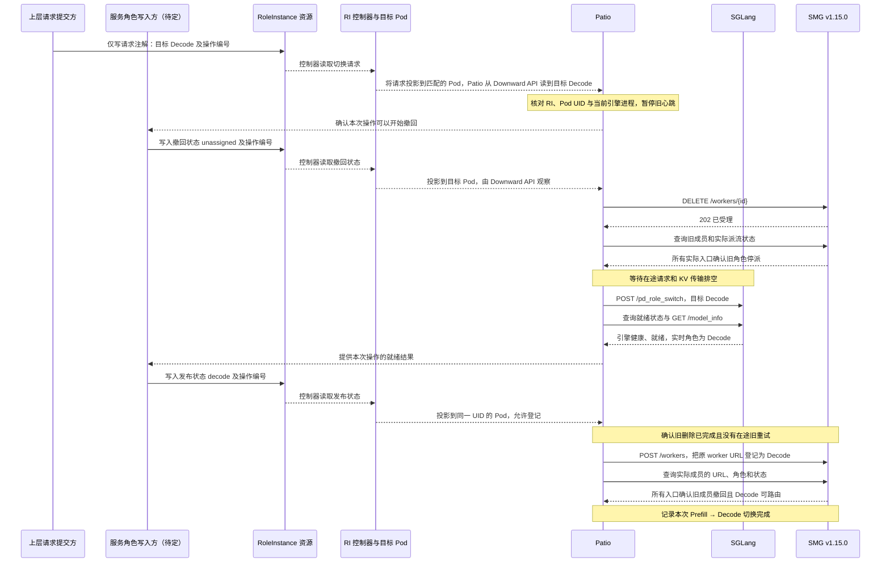

# KEP-541 面向 PD 分离推理的 Prefill/Decode 运行时角色切换

[English](README.md) | 简体中文

<!-- toc -->

- [发布签核清单](#发布签核清单)
- [摘要](#摘要)
- [动机](#动机)
    - [目标](#目标)
    - [非目标](#非目标)
- [提案](#提案)
    - [用户故事](#用户故事)
    - [说明、限制与注意事项](#说明限制与注意事项)
    - [风险与缓解措施](#风险与缓解措施)
- [设计细节](#设计细节)
    - [契约](#契约)
    - [声明运行时使用的键](#声明运行时使用的键)
    - [为什么外部写入的值能保留下来](#为什么外部写入的值能保留下来)
    - [切换流程](#切换流程)
        - [路由成员如何更新](#路由成员如何更新)
    - [切换执行器的部署位置](#切换执行器的部署位置)
    - [测试计划](#测试计划)
        - [测试的前置调整](#测试的前置调整)
        - [单元测试](#单元测试)
        - [集成测试](#集成测试)
        - [端到端测试](#端到端测试)
    - [阶段晋级标准](#阶段晋级标准)
        - [Alpha](#alpha)
        - [Beta](#beta)
        - [GA](#ga)
        - [弃用](#弃用)
    - [升级与降级策略](#升级与降级策略)
    - [版本偏差策略](#版本偏差策略)
- [生产就绪性评审问卷](#生产就绪性评审问卷)
    - [启用与回退特性](#启用与回退特性)
    - [发布、升级与回退规划](#发布升级与回退规划)
    - [监控要求](#监控要求)
    - [依赖项](#依赖项)
    - [可扩展性](#可扩展性)
    - [故障排查](#故障排查)
- [实施历史](#实施历史)
- [缺点](#缺点)
- [备选方案](#备选方案)
    - [请求如何送达，谁写回 RI](#请求如何送达谁写回-ri)
    - [首版 router 与接入协议](#首版-router-与接入协议)
    - [首期是否纳入注解修复](#首期是否纳入注解修复)
    - [执行器落点与跨仓分工](#执行器落点与跨仓分工)
    - [标签键与启用入口](#标签键与启用入口)
    - [首个实测部署与后续支持边界](#首个实测部署与后续支持边界)
- [所需基础设施](#所需基础设施)

<!-- /toc -->

## 发布签核清单

带有 (R) 的项目必须在*将此增强项列入某个里程碑或发布版本之前*完成。

- [ ] (R) 增强项 issue 已纳入发布里程碑，并链接到 KEP 目录（不是最初提交 KEP 的 PR）
- [ ] (R) KEP 审批人已同意将 KEP 状态设为 `implementable`
- [ ] (R) 已充分记录设计细节
- [ ] (R) 已制定测试计划
- [ ] (R) 已制定阶段晋级标准
- [ ] (R) 已完成生产就绪评审
- [ ] (R) 生产就绪评审已获批准
- [ ] “实施历史”一节已按当前里程碑更新
- [ ] 已编写面向用户的文档
- [ ] 已备齐支撑材料，包括补充设计文档、讨论链接、相关 PR 或 issue 以及发布说明等

## 摘要

SGLang `v0.5.23` 在支持的配置上允许已加载模型的引擎在 Prefill 和 Decode 之间切换。RBG 继续用 `rbg.workloads.x-k8s.io/role-name` 管理拓扑身份，`pdmix-pool` 中的 Pod 则可以在保持自身 UID 和归属的情况下改变服务角色。[SGLang v0.5.23][sglang-release] · [#541 原始需求][issue-541]

本 KEP 在 #596 中描述 RBG 与推理 runtime 的端到端切换设计，分批实施。首期沿用现有 RBG API 和 CRD，提议修复原地更新删除最后一个模板注解时的整表误删，并交付元数据回归和无 GPU 的 v1alpha2 示例。首期依据现有原生 RoleInstance 路径，可以在 RBG 内独立验收。[diw-zw 的联合设计建议][review-co-design] · [提案作者的公开回复][scope-reply]

后续拟由 RoleInstance（RI）控制器向匹配的存量 Pod 传播服务角色。端到端示例由 Patio 读取 Downward API 投影，并通过独立 SMG `v1.15.0` 的显式注册接口维护成员。旧池确认停派且引擎排空后才切换，引擎就绪后发布新角色，所有实际派流入口确认新成员可路由才记录完成。请求载体、RI 写入职责、首版路由组合和执行器落点待评审。[备选方案](#备选方案)

## 动机

适合某种工作负载的预填充与解码容量比例会随请求构成变化。提示词长而回答短时，需要更多预填充容量。提示词短而生成内容长时，需要更多解码容量。目前，要调整这个比例，就得销毁引擎实例，再用不同的 `--disaggregation-mode` 重新启动，随之重新加载权重、重新分配 KV 池，并承担一次完整的冷启动开销。

SGLang 消除了这项开销。token KV 池与角色无关，预填充和解码分配相同的 KV 内存结构。切换时仅需销毁并重建少量角色专属的分离模式数据结构，随后重新分派调度器事件循环。上游报告显示，连续切换角色 100 次后，权重、KV 缓存、CUDA Graph、GPU 空闲显存和线程数指标均保持平稳。

这项契约基于 RBG 预发布版 `v0.9.0-alpha.5` 的两处实现。[RBG v0.9.0-alpha.5][rbg-release]

1. RoleInstance 创建 Pod 时从组件模板获取标签与注解。稳态调谐不会把模板元数据重新应用到存量 Pod 上。[创建逻辑][instance-core]
2. 原地更新的元数据补丁根据**新旧 ControllerRevision 的差异**生成，比较的是两个版本，而非当前 Pod 和模板（[`inplace_update_defaults.go`][pod-inplace-defaults]）。

原 issue 希望用测试和文档固定这两项行为。已有 envtest 原型覆盖了部分路径；删除最后一个模板注解的复现，也说明仅比较版本差异仍不足以保证其他注解得到保留。

### 目标

1. 给出一次从切换请求到路由实际发布的端到端设计，定义 RI、Pod、Patio、引擎和 router 的职责及可观察的安全条件。
2. 在原生 RoleInstance 路径上用回归测试固定外部自管键的元数据契约，并提议逐键删除明确移除的模板注解。
3. 提供可复现的无 GPU v1alpha2 示例，演示 Standalone 模板初值、同一 UID 上的外部自管键和重建后的结果。

### 非目标

1. 首期沿用现有 RBG API 和 CRD。完整切换的请求载体、持续传播和接口变更在联合设计中评估。
2. 由上层决定何时切换和选择哪个实例。请求排空、KV 传输和引擎切换继续归 runtime 和引擎处理。
3. 工作负载的生命周期、调度和拓扑身份保持现有语义。首期验收以 RBG 本地回归与文档示例为准，真实引擎与路由在后续联调。

## 提案

采用 #541 的四角色拓扑。固定角色继续提供基础容量，运行时切换只改变 `pdmix-pool` 中目标实例的服务身份。

| 角色 | 含义 |
| --- | --- |
| `prefill` | 固定执行预填充的工作负载 |
| `decode` | 固定执行解码的工作负载 |
| `router` | 路由及流量入口 |
| `pdmix-pool` | 可切换角色的引擎池 |

首期验证 RBG 的元数据契约。完整切换从工作负载的目标角色请求开始，经 runtime 完成引擎操作，由 router 确认后完成。[元数据契约](#契约) · [测试计划](#测试计划) · [切换流程](#切换流程) · [组件职责](#切换执行器的部署位置)

### 用户故事

#### 故事 1

作为推理平台的运维人员，我希望能调整运行中部署的 P:D 比例，无需冷启动引擎。这样，即使请求中提示词和生成内容的长度分布发生变化，也能避免重新加载权重和容量短时下滑。

#### 故事 2

作为 runtime 开发者，我希望知道从哪里取得本次切换目标、何时可以发布服务角色，以及在执行中断后如何恢复同一次操作。

#### 故事 3

作为 RBG 维护者，我希望一旦有人引入针对存量 Pod 的偏差纠正逻辑，测试就会失败，避免一项看似合理的变更悄然破坏所有依赖运行时切换的部署。

### 说明、限制与注意事项

#### `spec.roles[].labels` 的传播范围

当前 RBG 将 `spec.roles[].labels` 写到 RoleInstanceSet。默认 Stateful 路径创建 RI 时复制这些标签。Pod 创建时使用组件模板的元数据与实例身份键。给存量 RI 改标签目前没有持续投影到存量 Pod 的契约。首期示例在 Pod 模板中设置初值，联合设计中的服务角色传播是新增的控制器行为。[RoleInstanceSet 标签][ris-labels] · [新 RI 创建][ri-labels] · [Pod 创建][instance-core]

#### `unassigned` 表示路由状态，不是引擎模式

池内引擎可以以 Decode 模式启动，Pod 的服务标签在预热时保持 `unassigned`。服务角色选择器可以排除该 Pod，按拓扑选 Pod 的 Service 仍可能匹配它。Patio 主干在引擎就绪后用启动时的 worker 信息登记，后续心跳复用该信息。联合设计要求等待本次角色获准发布后再登记。[Patio 主干启动与心跳][patio-startup]

#### Patio 注入与工作负载更新

`spec.roles[].engineRuntimes[].profileName` 引用 `ClusterEngineRuntimeProfile`，用于在部署时注入 Patio 容器和 Downward API 卷。`ClusterEngineRuntimeProfile.spec.updateStrategy` 已弃用，控制器从未用它触发滚动更新。需要变更已被引用的 profile 时，发布新 profile 并按工作负载策略迁移引用。新 Pod 从 `unassigned` 开始，重新核对实例身份和引擎状态后才能接流。[运行时配置与变更边界][profile-doc] · [v1alpha2 注入示例][engine-runtime-example]

#### 缩容时无法识别哪些 Pod 正在提供哪类服务

默认 Stateful 路径下，缩减角色副本会让 RoleInstanceSet 优先删除高序号的整个 RoleInstance。[`newComponentPodGroup`][instance-core] 处理的是同一个 RoleInstance 内的组件 Pod。两处都不会根据服务角色调整缩容顺序。[实例缩容逻辑][stateful-scale]

例如，将 `pdmix-pool` 从 8 个连续编号的实例缩到 6 个，序号 6 和 7 的实例会先被移除。若最后两个 Prefill 恰好在这两个实例上，剩余池会失去 Prefill 容量。缩容前，运维人员或外部控制面应核对待删除实例的实时角色、剩余容量以及需要预先撤回的流量。

#### 哪些系统标签会影响 Pod 的存续

`controller-revision-hash` 由 RBG 维护。更新后找不到匹配的 ControllerRevision 可能触发 Pod 重建。`rbg.workloads.x-k8s.io/component-id` 在原生 RI 路径用于识别组件，无法解析的值会使 Pod 进入删除路径。首期元数据契约按键的实际归属限定范围。[键归属评审][review-keys] · [组件身份解析][instance-utils] · [实例调谐][instance-scale]

#### 上游后端和并行策略的限制

需使用包含运行时切换接口且启用 `--enable-pd-role-switch` 的 SGLang 构建。KV 传输后端须声明 `supports_role_switch` 并实现清理钩子。上游报告的端到端结果使用 MoRI、TP 8 的 MoE 配置和 AMD MI355X、MI300X。EP、DP attention、all-to-all 及其他后端或硬件组合，须用实际部署的配置验证。MoRI 的 all-to-all 分发缓冲区按启动角色分配。[SGLang 上游验证][sglang-pr]

### 风险与缓解措施

| 风险 | 缓解措施 |
| --- | --- |
| 原地更新覆盖外部自管键 | 回归覆盖立即写入、宽限期后的写入和仅推进 revision。删除最后一个模板注解时验证逐键移除，并检查更新完成。 |
| 新传播行为影响既有工作负载 | 只为参与切换的实例投影约定的切换请求、服务角色键及操作标识。验证升级前后的未参与对象保持相同的模板、revision 和 Pod UID。 |
| 入口仍派新请求，或仍有请求和 KV 在途 | 分别确认入口停派和引擎排空，再调用引擎。 |
| 旧操作、进程重启或 Pod 重建后发布了陈旧角色 | 绑定操作编号、RI UID、Pod UID 和进程身份。恢复时重读当前角色、健康和路由成员。 |
| 异步撤回或旧心跳与新登记并发 | 保持注册写入方唯一，暂停旧重试，确认旧删除结束后重新登记。实际入池作为完成条件。 |
| 缩容移除某一角色的最后一个实例 | 核对 Stateful 缩容目标 RI 的实际服务角色和池内剩余容量。 |

## 设计细节

### 契约

**首期外部自管键。** 本契约适用于原生 RoleInstance 路径中由用户或外部组件负责、且 RBG 不管理的自定义标签和注解。控制器维护的 `controller-revision-hash` 和 `rbg.workloads.x-k8s.io/` 下的系统键由 RBG 更新。[键归属评审][review-keys]

| 事件 | 可依赖的行为 |
| --- | --- |
| 创建 Pod，或同名 Pod 以新 UID 重建 | 从当时的模板初始化。只存在于旧 Pod 的外部值不会继承。 |
| 同一 UID 经历调谐或受支持的原地更新，模板里的对应键未变 | 保留存量 Pod 上的外部值。两版模板均未声明该键时也适用。 |
| 新模板显式新增、修改或删除某键 | 对该键应用模板差异，保留其他未变化的外部键。 |

**后续服务角色。** 对参与切换的实例，由 RI 控制器独占约定 Pod 服务角色键的写入，并将当前操作及获准发布的服务角色传播到匹配 UID 的存量 Pod。传播只更新约定的 Pod 元数据，保留组件模板、revision、拓扑身份和其他自管键。新 UID 从 `unassigned` 起步，旧操作对该 UID 失效。RBG 继续负责拓扑与生命周期。显式注册示例由 Patio 执行切换并按发布许可维护成员。[联合设计评审][review-co-design] · [请求与 RI 写回选项](#请求如何送达谁写回-ri)

### 声明运行时使用的键

以下无 GPU 的 Standalone 示例验证首期外部自管键契约。初始标签位于 Pod 模板的 `metadata.labels`。示例中的键名供练习，联合设计中的键名与启用方式仍在评审。[标签键与启用入口](#标签键与启用入口)

```yaml
apiVersion: workloads.x-k8s.io/v1alpha2
kind: RoleBasedGroup
metadata:
  name: sglang-pd
spec:
  roles:
    - name: pdmix-pool
      replicas: 1
      standalonePattern:
        template:
          metadata:
            labels:
              # Workload identity, referenced by the Services below.
              app: sglang-pd
              # Example user-managed label for the first slice.
              inference.workload.x-k8s.io/pd-role: unassigned
          spec:
            containers:
              - name: example
                image: registry.k8s.io/pause:3.10
```

等池内 Pod 创建后，记录其名称和 UID，用 `kubectl label pod <pod-name> inference.workload.x-k8s.io/pd-role=prefill --overwrite` 修改一个键。存量 Pod 仍是同一个 UID，符合下面 Service 的选择条件。删除该 Pod 并等待 RBG 补建，新 UID 的初值将是 `unassigned`。这个示例验证元数据与选择条件，未运行推理引擎。

```yaml
apiVersion: v1
kind: Service
metadata:
  name: pd-prefill
spec:
  selector:
    app: sglang-pd
    inference.workload.x-k8s.io/pd-role: prefill
  ports:
    - port: 8000
      targetPort: 8000
```

使用固定地址或经 Service VIP 寻址的部署需单独验证实际派流路径和 PD bootstrap 配对。[固定示例][pd-standalone] · [服务发现评审][review-discovery]

### 为什么外部写入的值能保留下来

RI 创建 Pod 时从组件模板取初值。原地更新根据**新旧 ControllerRevision** 的模板差异生成元数据补丁，再将补丁应用到最新读取的 Pod。立即更新、宽限期后的第二次写入和 `onlyUpdateRevision` 都有并发冲突重试。回归测试同时改变镜像和明确的模板键，用两者均生效证明 Pod 元数据写入路径经过测试。[Pod 创建][instance-core] · [补丁生成][pod-inplace-defaults] · [写入路径核查][review-cheyang]

**首期拟修复的注解缺陷。** 开发期间的本地 envtest 复现了在更换镜像、删除最后一个模板注解时生成 `{"metadata":{"annotations":null}}`，导致外部注解和原地更新状态一起消失。拟在补丁生成时只列出旧模板移除的键，例如 `{"metadata":{"annotations":{"example.com/template":null}}}`。RBG `v0.9.0-alpha.5` 仍使用同一补丁生成路径。逐键补丁的合并语义已核对，发布版 envtest 复现及修复回归仍待完成。升级前保存的延迟补丁仍按已有内容执行。[补丁生成][pod-inplace-defaults] · [宽限期写入][pod-inplace]

### 切换流程

以下以单 Pod Standalone RI 为例，演示**一次 Prefill → Decode 切换**，全程跟踪 `pdmix-pool` 中的目标 Pod 及其 worker URL。实例起初以 Prefill 接流，测试环境有其他可用的 Prefill 和 Decode 成员。示例使用 Patio 向独立 SMG `v1.15.0` 显式注册，Patio 是目标 worker URL 的唯一注册方。示例用 RI 请求注解和 Downward API 卷传递目标角色。请求载体、提交方的授权方式和服务角色写入方仍待评审。[SMG v1.15.0][smg-release] · [联合设计评审][review-co-design] · [请求与 RI 写回选项](#请求如何送达谁写回-ri)



1. 获授权的上层提交方在 RI 请求注解中记录目标 `decode`、操作编号、RI UID 和目标 Pod UID。RI 控制器将请求投影到匹配的 Pod 注解，Patio 通过 Downward API 卷读取目标角色及操作编号，并核对目标身份。锁定当前引擎进程后，Patio 用 `/model_info` 及实际成员确认实例正在提供 Prefill，暂停旧自动登记和重试。服务角色写入方向 RI 写入本次 `unassigned` 和操作标识，由 RI 控制器投影到目标 Pod。
2. Patio 确认卷中的撤回信号与当前请求对应后，按目标 worker 的当前 ID 撤回其成员登记。每个实际入口都停派后，再等已接收的请求及 KV 传输排空。相关 Service 或 EndpointSlice 参与派流时，也要确认其旧路径已经撤出。[摘流评审][review-drain]
3. Patio 调用 `POST /pd_role_switch`，设置 `new_role=decode`。需要首次捕获 Decode CUDA graph 时提供 `decode_cuda_graph_memory_gb`。记录响应中的 `success` 和 `safe_to_restore`。若引擎仍忙则保持摘流，超时后先查原进程的健康与实际角色。通过 `/model_info` 的 `disaggregation_mode` 及就绪信号确认切换。`/server_info` 及旧别名 `/get_server_info` 的该字段来自启动配置。[v0.5.23 引擎切换][engine-switch] · [v0.5.23 角色查询][engine-live] · [实时角色评审][review-observe]
4. Patio 核验本次切换的引擎结果。服务角色写入方核对当前操作、RI UID、Pod UID 和引擎进程，再把 `decode` 和操作标识写入 RI，由 RI 控制器投影到同一 UID 的 Pod。写入方有两种候选，由 Patio 受限写入，或由控制面核验 Patio 的报告后写入。Patio 从 Downward API 读到本次发布许可，确认旧删除已结束后，以原 worker URL 和 `worker_type=decode` 重新登记。[RI 写回方案](#请求如何送达谁写回-ri)
5. 查询实际派流的 router，确认旧成员已撤回，原 worker URL 对应的 Decode 成员可接流，才记录完成。联调时以请求 ID 和日志证明目标 Pod 处理了 Decode。用新的操作编号发起一次 Decode → Prefill 切换，并提供有效的 bootstrap port。确认该 worker URL 已退出 Decode 池，且同一个 Pod 重新处理 Prefill 并完成 KV 传输。

**恢复。** Patio 在引擎已切换而 RI 仍为 `unassigned` 时重启，应先恢复同一操作，核对 RI、Pod UID、当前进程、实时角色和各实际入口。若同一进程已处于健康的 Decode 状态，继续发布或补齐缺失登记。旧重试抢先登记了旧角色时，先撤回错误成员。有入口无法核验时，等它恢复或确认隔离后再记完成。拒绝过期操作的写回，新 Pod UID 或新进程使旧结果失效。只有确认旧角色仍健康且引擎明确允许恢复，才恢复旧路由。[引擎拒绝与恢复语义][review-cheyang]

#### 路由成员如何更新

| 接入模式 | 协议与支持边界 |
| --- | --- |
| 独立 SMG `v1.15.0` 显式注册 | 撤回和登记的 202 表示异步受理。用 `GET /workers/{id}` 和 `GET /workers` 核对 URL、角色和状态。重复 POST 返回 409 时，创建中的成员继续观测，已经可路由的正确成员保留，旧角色成员先撤回。普通 PATCH 无法更新角色。旧删除确认完成后才能重新登记同一 URL。[SMG v1.15.0 成员接口][smg-v115-workers] · [SMG 评审][review-smg] |
| 独立 SMG `v1.15.0` 原生 Pod 发现 | 由 watcher 按服务角色选择器维护成员。这条模式需要单独验证两段式退出与重入、Prefill 端口及实际派流。[Pod 发现][smg-discovery] · [端口元数据][smg-discovery-ports] |
| SGLang `v0.5.23` 的 `sgl-router` EndpointSlice 发现 | 重入或缺少 Prefill bootstrap port 时可能重新探测，用 `/server_info` 的启动角色覆盖发现结果。覆盖该模式时须明确实时角色探测的上游依赖或调整流程，并验证重入、重探测及双向派流。[v0.5.23 重新探测源码][sgl-router-discovery] · [EndpointSlice 评审][review-discovery] |
| 现有固定地址示例 | 启动时按 `--prefill`、`--decode` 绑定角色，作为固定拓扑对照。[Standalone 示例][pd-standalone] · [LeaderWorker 示例][pd-lw] |

<<[UNRESOLVED 首版路由支持]>>
进入 `implementable` 前须明确首版正式支持的 router、版本和接入模式及可验证协议。若覆盖 EndpointSlice，须说明实时角色与 Prefill 端口的处理。若首版采用其他模式，须就 EndpointSlice 的后续支持边界与 reviewer 对齐。显式注册示例用于设计走查，目标部署的真实双向流量仍待验证。[首版 router 与接入协议](#首版-router-与接入协议) · [路由评审][review-cheyang]
<<[/UNRESOLVED]>>

### 切换执行器的部署位置

| 组件 | 联合设计职责 |
| --- | --- |
| 上层请求提交方 | 指定实例和目标角色，提交切换请求。示例中经授权只写 RI 请求注解，不写服务角色状态。 |
| 服务角色写入方 | 持久关联操作编号、RI UID、Pod UID 和引擎进程，跟进已有操作，验证并写入撤回状态和经引擎确认的发布值，不发起新请求。 |
| RBG 的 RI 控制器 | 管理拓扑与生命周期，将当前请求、服务角色和操作标识投影到匹配 UID 的存量 Pod。升级前后要保护未参与对象的模板、revision 和 Pod UID。 |
| Patio（显式注册示例） | 通过 Downward API 观察投影，协调停派后的排空、引擎 API 和恢复。对该 URL 独占 SMG 成员的写入。卷可能延迟或跳过中间更新，Patio 重新读取并校验当前操作。 |
| SGLang 与 router | SGLang 执行并报告真实切换结果。router 保存实际可派流成员，供撤回与入池确认。 |

<<[UNRESOLVED 请求载体与 RI 写入职责]>>
请求载体、提交方的授权方式、服务角色写入方、标签键名与启用入口待评审。请求与发布状态分开记录，两类写入的权限须在接口中分别校验。选定分工后，验证现有 metadata 能否支持权限隔离、拒绝过期操作和重启恢复，再明确控制器或 API 的改动。[请求与 RI 写回选项](#请求如何送达谁写回-ri) · [执行器落点与跨仓分工](#执行器落点与跨仓分工) · [标签键与启用入口](#标签键与启用入口)
<<[/UNRESOLVED]>>

### 测试计划

- [x] 我们理解，在提交实现此增强所需的改动前，相关组件的负责人可能会要求更新现有测试，以确保代码足够可靠。

##### 测试的前置调整

首期使用 `test/envtest/testutil` 启动 etcd、kube-apiserver 和 RBG 控制器。envtest 中由测试模拟 kubelet 上报容器状态及新的 `ImageID`，并等待 `InPlaceUpdateReady=True`。历史原型使用默认的立即更新策略，且未接入准入 webhook。原型验证的是控制器写入存量 Pod 的行为，现有 RBG 变更型 webhook 的目标为 RBG 自定义资源。[源码核查][review-cheyang]

##### 单元测试

- 对比新旧 revision 的模板元数据，验证未变键不进入补丁，新增、修改或删除只影响相应的键。仅改镜像时断言 `MetaDataPatch == nil`，另用实际更改模板注解的场景验证元数据写入路径。
- 针对最后一个模板注解被移除的情况，分别验证新模板省略注解和使用空映射。应用补丁后，只有模板所移除的键消失，外部自管注解与原地更新状态注解都保留。

##### 集成测试

**已有证据。** 开发期间的 envtest 原型覆盖调谐、外部注解保留和立即原地更新。在更新镜像和模板注解的用例中，将补丁生成时的旧模板元数据替换为空 `ObjectMeta`，外部标签断言随即失败。此变异只覆盖该用例。开发期间也复现了同一 Pod UID 上删除最后一个模板注解导致的整表清空，并用补丁库验证逐键删除的合并行为。上述测试待在 RBG `v0.9.0-alpha.5` 复跑。

**待补的首期回归。** 扩容后验证原 UID 和外部自管键保留、新副本取得模板初值。删除并补建同名 Pod 后验证新 UID 及模板初值，旧 Pod 的外部注解不继承。更新镜像和模板注解时核对两者都在同一 UID 上生效，等待模拟的 kubelet 状态推进，再核对外部键。另测宽限期后的第二次写入、`onlyUpdateRevision` 和最后一个模板注解被删除的场景。逐键修复要覆盖立即更新和新生成的延迟更新，并检查更新过程中的状态注解及完成后的外部键。

**待验证的 RI 传播。** 验证重复调谐、并发原地更新、过期操作和同名 Pod 换 UID。只允许向身份匹配的当前 Pod 投影本次操作的发布值，保留其他自管键。对尚未启用联合功能的既有工作负载，对照控制器升级前后的渲染模板、RoleInstanceSet revision、Pod revision hash 与 UID，确认升级不会触发工作负载滚动。

##### 端到端测试

社区选定 router、版本及接入模式后，在 GPU 环境用支持角色切换的引擎与 KV 后端验证同一 Pod UID 的 Prefill → Decode → Prefill。核对旧池停派、在途请求和 KV 排空、引擎实时角色及就绪状态、实际入口的目标成员和故障恢复。按所选模式检查 EndpointSlice 或有效 worker 成员，并用请求 ID 核对切换与切回后的推理结果。这是后续联合验收，首期已有证据来自本地元数据验证。[路由评审][review-cheyang] · [上游引擎验证][sglang-pr]

选型时可用假引擎验证停派与重新入池条件。切换流程中的 SMG `v1.15.0` 显式注册用于走查，首个实测组合待社区确定。[切换流程](#切换流程)

### 阶段晋级标准

#### Alpha

- 维护者认可 RBG 侧的元数据契约并确认首期范围，包括所提注解修复是否一并交付。
- 回归测试在 CI 运行，覆盖立即更新、宽限期后的第二次写入和仅推进 revision 三处写入，并证明各用例能发现外部值被覆盖。
- 交付契约文档和 v1alpha2 示例，读者可以设置 Pod 模板初值，修改存量 Pod 的自定义键，并核对重建后的初值。

#### Beta

- 由社区选定的执行器实现摘流、排空、切换、重新发布和失败恢复，并具备所需权限。
- 在支持的后端上通过双向切换测试，确认 Pod 服务角色标签、实时引擎角色及实际路由池一致。
- 已记录并测试运行期间修改模板值这一边界情形。
- 已记录缩容与角色切换的相互影响，并明确如何在缩容时维持角色配比。

#### GA

- 至少两个独立部署在一个完整的 RBG 发布周期中使用运行时切换。证据包括：RBG 升级前后，池中的 Pod 都带有值不为 `unassigned` 的服务角色标签，且 [#541][issue-541] 没有收到标签被恢复原值的事件报告。
- 在受支持的后端上持续运行，复现切回原角色的稳定性。CI 至少一次复现上游连续切换 100 次的结果。
- 所选执行器已公开切换成功率和切换耗时指标，并且至少一家运维方将它们用于告警，使下文的 SLI 得到实际观测。

#### 弃用

首期涉及现有 API、CRD 和原地更新流程，目前未计划弃用字段或接口。

### 升级与降级策略

首期沿用现有 API 和 CRD。逐键删除修复拟作用于修复版本新生成的元数据补丁，覆盖立即执行和新排队的延迟更新。升级前已排队的宽限期计划仍按保存的补丁执行，旧的整表删除记录缺少原模板键集合。降级到旧版后，控制器会按旧规则生成新补丁。已经丢失的外部值由其所有者从原来源重新写入。

对于后续 RI 传播设计，升级应保留未启用工作负载的模板、revision 和 Pod UID。联合方案的组件版本和启停方式随接口设计确认。停止接收新的切换请求后，须核验在途操作所处阶段。恢复派流前，读取当前 Pod UID、引擎进程和实时角色，并核对每个实际入口的路由成员。

### 版本偏差策略

首期修复适用于 RBG 现有 API 和 CRD，补丁兼容边界见[升级与降级策略](#升级与降级策略)。联合方案需按实际组合核对 RBG、runtime、引擎、KV 后端和 router 的版本与能力。

- 执行切换以 SGLang `v0.5.23` 为已核对的引擎发布基线，启用 `--enable-pd-role-switch`，且 KV 传输后端具备 `supports_role_switch` 能力。不支持切换时不启动操作。撤回后遇到接口失败或切换结果不明，保持摘流并核实实际状态。[SGLang v0.5.23 切换接口][engine-switch]
- RBG 与选定的执行器须使用兼容的操作记录和服务标签传播语义。恢复时须能根据操作编号、Pod UID 和当前进程判断已完成阶段。完整切换所需的字段或 API 变更随接口方案确定。
- Router 的版本与接入方式决定撤回、重试和成员确认语义。按支持组合验证显式注册或服务发现的协议，避免将某个版本的管理 API 或探测行为用于其他版本。[显式注册评审][review-smg] · [发现模式评审][review-discovery]

## 生产就绪性评审问卷

### 启用与回退特性

拟议的注解修复随控制器版本生效。联合切换的启用方式待评审。停用前暂停新的切换，处置在途操作并确认服务状态，再撤下执行器。重新启用时核对当前实例及路由成员，再接续仍然有效的操作。[组件职责与启用方式](#切换执行器的部署位置) · [升级与降级策略](#升级与降级策略)

### 发布、升级与回退规划

首期回退信号包括同一 Pod UID 上外部注解或更新状态注解丢失，以及原地更新长时间无法完成。升级前已排队的补丁仍按原内容执行。完整升级与回退路径待验证。[升级与降级策略](#升级与降级策略) · [测试计划](#测试计划)

### 监控要求

用 Pod UID 和操作编号关联发布标签、`/model_info` 的实时角色和实际派流入口的成员状态。拟观测切换成功率、各阶段耗时、撤回后未接回的实例数，以及引擎角色与路由成员不一致的持续时间。延迟与超时目标按选定部署实测后确定。[切换完成条件](#切换流程)

### 依赖项

联合切换通过 Kubernetes API 和 kubelet 投影服务角色，使用 Patio、支持切换的 SGLang 与 KV 后端，以及能确认撤回和接纳的 router。[版本偏差策略](#版本偏差策略) · [路由支持边界](#路由成员如何更新)

### 可扩展性

首期沿用现有更新路径。联合切换增加 RI 写入、Pod 元数据更新和引擎与 router 调用。调用量、延迟和资源开销待按实际接入模式测量。

### 故障排查

按操作编号和 Pod UID 定位停派、排空、引擎切换、标签投影和路由入池中最先出现分歧的一步。控制面或实际入口状态无法核实时，暂停受影响的操作并保持摘流。元数据丢失时核对新旧 ControllerRevision 与实际补丁。[切换与恢复](#切换流程) · [元数据更新路径](#为什么外部写入的值能保留下来)

## 实施历史

- 2026-11-17，提交 `provisional` 的 KEP 与首期回归计划。[原始需求][issue-541]
- 2026-11-22，公开稿补充外部自管键与实际摘流条件，并提出最后一个模板注解的逐键删除修复。[元数据评审][review-keys] · [路由评审][review-cheyang]
- 2026-11-25，中文工作稿根据评审与提案作者的回复补充 RI、Patio 和 router 的端到端设计。完整切换的请求载体、写入职责和支持组合仍待确认。[联合设计评审][review-co-design] · [提案范围确认][scope-reply]

## 缺点

- 完整切换需要多个异步组件协同。切换期间目标实例暂时离开服务池，Router 失联或引擎重建失败时可能延长这一窗口。
- RBG、Patio、SGLang 和 router 可以独立升级，各支持组合需要单独验证版本和成员协议。
- RI 持续传播、操作持久化和重启恢复需要新增行为。权限、控制面交接和对既有工作负载的影响按最终选定的接口验收。

## 备选方案

### 请求如何送达，谁写回 RI

两案可共用 RI 请求注解。上层记录操作编号、目标角色、RI UID 和目标 Pod UID，RI 控制器投影到匹配的 Pod，由 Patio 通过 Downward API 卷读取。进度记录关联当前引擎进程，发布角色另行表达。收到 `decode` 请求后，Pod 可先维持 `prefill`，再进入 `unassigned`。引擎就绪后才允许发布对应操作的 `decode`，由 RI 控制器投影到同一 Pod。[组件职责](#切换执行器的部署位置)

| RI 写入分工 | 取舍与恢复方式 |
| --- | --- |
| Patio 回报，控制面写 RI | Patio 经认证通道报告撤回准备和引擎结果，控制面核验活动操作、UID 和引擎进程后写 RI。Kubernetes 写权限留在控制面。需确定能持久接收、核验和处理重复报告的组件。Patio 重启后查询已接受的进度，或用同一操作编号补报。[RBG 控制面的 RI 权限][ri-rbac] |
| Patio 受限写目标 RI | 省去结果回传。Patio 通过条件更新记录撤回和发布阶段，重启后重读 RI 并接续。需要把权限限制到目标 RI 和约定的键，拒绝过期写入并防止并发覆盖。原生 RBAC 的 `resourceNames` 可以约束对象范围，键级约束需额外机制。Patio 主干的生命周期回执提案可作设计参考。[Kubernetes RBAC][rbac-resource-names] · [Patio 主干回执提案][patio-lifecycle] |

两案均须在引擎已为 Decode、RI 仍为 `unassigned` 时恢复同一操作，核对引擎进程和实际成员，再补写发布值。已有控制面能可靠核验并恢复报告时，可优先保留控制面单写。先验证现有 metadata 能否满足授权、条件更新和恢复。若只缺写入校验，可评估准入校验。若需要独立授权或类型化状态契约，再评估独立操作接口或新的 API 字段，并验证其升级兼容。[切换与恢复](#切换流程)

### 首版 router 与接入协议

| 接入候选 | 采用条件与验证重点 |
| --- | --- |
| 独立 SMG `v1.15.0` 显式注册 | 适合能为每个 URL 指定唯一注册方的部署。走查使用 Patio 停止旧心跳和重试，DELETE 后确认实际停派并排空，再切换。引擎就绪后发布标签，旧删除确认完成后按新角色 POST。核验各入口实际可路由。[成员接口][smg-v115-workers] · [切换流程](#切换流程) |
| 独立 SMG `v1.15.0` 原生 Pod 发现 | 由 watcher 独占该 URL 的成员更新。先通过 `unassigned` 退出旧池，确认实际停派和排空，再切换引擎。切回 Prefill 时与目标标签一并发布 watcher 所需的端口元数据，验证同一 Pod 在两个方向均入对池。[Pod 发现][smg-discovery] · [端口元数据][smg-discovery-ports] |
| SGLang `v0.5.23` 的 `sgl-router` EndpointSlice 发现 | 适用于沿官方 RBG PD 指南部署的场景。需要处理成员重入和缺少 Prefill bootstrap port 两条重新探测路径，明确读取实时角色的上游依赖或验证替代协议。[部署指南][sgl-rbg-guide] · [发现评审][review-discovery] |

显式注册路径采用 DELETE + POST。先撤回旧成员，分别确认实际入口停派和引擎排空。引擎就绪后发布目标角色标签，待旧删除完成，再用原 worker URL 重新登记并确认实际入池。[切换流程](#切换流程) · [SMG 成员接口][smg-v115-workers]

完整 `PUT /workers/{id}` 已在单个 SMG `v1.15.0` HTTP PD router 与假 worker 上验证过。把 PUT 用于角色切换需要独立的停派机制。已验证的探针方案还要求部署提供可控的周期探针，并协调各入口的停派和恢复。首版显式注册只采用上面的撤回和重新登记协议。[SMG 完整替换][smg-put] · [周期探针配置][smg-routing-probe]

进入 `implementable` 前须确定首版 router、版本、接入方式与协议，并与 reviewer 确认 EndpointSlice 同期支持或后续纳入的条件。[路由评审][review-cheyang]

### 首期是否纳入注解修复

两案都可独立交付 RBG 元数据回归与无 GPU 的 v1alpha2 示例，沿用现有 API 和 CRD。建议同时交付逐键删除修复，使元数据契约覆盖删除最后一个模板注解的场景。若修复单独跟进，首期文档须写明整表删除的例外，对应的修复和回归另行交付。[元数据缺陷与拟议修复](#为什么外部写入的值能保留下来) · [测试计划](#测试计划)

### 执行器落点与跨仓分工

- **Patio sidecar。** 可从卷读取请求和发布值，与本地引擎协调。显式注册时可在同一组件管理启动登记、撤回和重注册。须验证暂停旧写入、观测实际入口和重启接续。[Patio 主干启动与心跳][patio-startup]
- **平台侧外部执行器。** 若平台已有实际流量与成员观测，并能访问目标引擎，可集中管理切换。须验证认证和引擎访问、排空与成员确认、旧心跳协调及重启恢复。[原始需求][issue-541]

两案都由 RI 控制器向匹配 Pod 投影，RI 写入分工按前述方案单独选择。另有三种对照。RBG 直接调用引擎会把引擎协议和恢复逻辑耦合到控制器。重建 Pod 可作为替换路径，代价是重新加载权重和分配 KV 池。固定角色适合保留基础容量，需要动态调配时仍须支持同一已加载实例换角色。[联合设计评审][review-co-design] · [固定地址示例][pd-standalone]

### 标签键与启用入口

RBG 约定固定键可减少部署配置，已依赖其他键的选择器需要迁移。允许工作负载作者指定一个键可沿用已有选择器，前提是 RI 控制器、Patio 和依赖标签的 router 共用经过校验的键。两案都可独立选择按角色显式启用。启用入口可评估现有配置或新增字段，升级时须验证未启用对象的模板、revision 和 Pod UID 保持一致。[原始需求][issue-541] · [契约](#契约)

### 首个实测部署与后续支持边界

首套联合实测按选定的 router、版本和接入方式安排，以同一 Pod UID 的 Prefill → Decode → Prefill 及可追溯请求作为验收。可用假引擎提前验证路由协议。SGLang `v0.5.23` 的 `prepare_only` 可评估为辅助预检，使用与当前角色不同的目标并带上正式切换的参数。同角色请求可能在空闲检查之前返回，停派、在途请求和 KV 排空须独立确认。另需验证同一 Pod UID 内的引擎进程身份。若纳入多 Pod RI，须明确每个成员的 UID 绑定、撤回、发布及整组完成条件。[端到端测试](#端到端测试) · [引擎预检与空闲检查][engine-switch]

## 所需基础设施

- **首期 RBG。** 用现有补丁级测试和 envtest 固定元数据契约，若纳入注解修复则一并验证。交付无 GPU 的 v1alpha2 示例。里程碑由维护者确认。
- **后续联合验证。** 完整双向验收需要带 kubelet 的集群、选定版本的 router、具备切换能力的 SGLang 与 KV 后端，以及 GPU 和可追溯的实际推理流量。可用假引擎提前验证标签投影和路由成员变化。[测试计划](#测试计划)

[rbg-release]: https://github.com/sgl-project/rbg/releases/tag/v0.9.0-alpha.5
[sglang-release]: https://github.com/sgl-project/sglang/releases/tag/v0.5.23
[issue-541]: https://github.com/sgl-project/rbg/issues/541
[sglang-pr]: https://github.com/sgl-project/sglang/pull/28403
[instance-scale]: https://github.com/sgl-project/rbg/blob/v0.9.0-alpha.5/pkg/reconciler/roleinstance/sync/instance_scale.go
[pod-inplace-defaults]: https://github.com/sgl-project/rbg/blob/v0.9.0-alpha.5/pkg/inplace/pod/inplaceupdate/inplace_update_defaults.go
[engine-runtime-example]: https://github.com/sgl-project/rbg/blob/v0.9.0-alpha.5/examples/basic/engine-runtime/engine-runtime-profile.yaml
[instance-core]: https://github.com/sgl-project/rbg/blob/v0.9.0-alpha.5/pkg/reconciler/roleinstance/core/instance_core.go
[instance-utils]: https://github.com/sgl-project/rbg/blob/v0.9.0-alpha.5/pkg/reconciler/roleinstance/utils/instance_utils.go
[pod-inplace]: https://github.com/sgl-project/rbg/blob/v0.9.0-alpha.5/pkg/inplace/pod/inplaceupdate/inplace_update.go
[pd-standalone]: https://github.com/sgl-project/rbg/blob/v0.9.0-alpha.5/examples/inference/pd-disagg-standalone.yaml
[pd-lw]: https://github.com/sgl-project/rbg/blob/v0.9.0-alpha.5/examples/inference/pd-disagg-leader-worker.yaml
[review-cheyang]: https://github.com/sgl-project/rbg/pull/596#pullrequestreview-5950426443
[review-discovery]: https://github.com/sgl-project/rbg/pull/596#discussion_r4608875131
[review-drain]: https://github.com/sgl-project/rbg/pull/596#discussion_r4599348128
[review-keys]: https://github.com/sgl-project/rbg/pull/596#discussion_r4599348121
[review-observe]: https://github.com/sgl-project/rbg/pull/596#discussion_r4608875141
[review-smg]: https://github.com/sgl-project/rbg/pull/596#discussion_r4608875123
[stateful-scale]: https://github.com/sgl-project/rbg/blob/v0.9.0-alpha.5/pkg/reconciler/roleinstanceset/statefulmode/stateful_instance_set_control.go#L493-L525
[review-co-design]: https://github.com/sgl-project/rbg/pull/596#issuecomment-7100569013
[scope-reply]: https://github.com/sgl-project/rbg/pull/596#issuecomment-7138032847
[ris-labels]: https://github.com/sgl-project/rbg/blob/v0.9.0-alpha.5/pkg/reconciler/roleinstanceset_reconciler.go#L344-L353
[ri-labels]: https://github.com/sgl-project/rbg/blob/v0.9.0-alpha.5/pkg/reconciler/roleinstanceset/statefulmode/stateful_instance_set_utils.go#L146-L170
[patio-startup]: https://github.com/rolebasedgroup/inference-engine-runtime/blob/main/src/patio/app.py#L98-L131
[profile-doc]: https://github.com/sgl-project/rbg/blob/v0.9.0-alpha.5/doc/features/engine-runtime.md#profile-mutability
[engine-switch]: https://github.com/sgl-project/sglang/blob/v0.5.23/python/sglang/srt/disaggregation/role_switch.py#L43-L146
[engine-live]: https://github.com/sgl-project/sglang/blob/v0.5.23/python/sglang/srt/entrypoints/http_server.py#L803-L887
[sgl-router-discovery]: https://github.com/sgl-project/sglang/blob/v0.5.23/sgl-router/src/workers/manager.rs#L526-L566
[smg-release]: https://github.com/smg-project/smg/releases/tag/v1.15.0
[smg-v115-workers]: https://github.com/smg-project/smg/blob/v1.15.0/model_gateway/src/worker/service.rs#L544-L776
[smg-put]: https://github.com/smg-project/smg/blob/v1.15.0/model_gateway/src/worker/service.rs#L599-L667
[smg-routing-probe]: https://github.com/smg-project/smg/blob/v1.15.0/model_gateway/src/main.rs#L1379-L1426
[smg-discovery]: https://github.com/smg-project/smg/blob/v1.15.0/e2e_test/discovery/kind/test_kind_discovery.py#L421-L434
[smg-discovery-ports]: https://github.com/smg-project/smg/blob/v1.15.0/model_gateway/src/service_discovery/kubernetes.rs#L461-L496
[sgl-rbg-guide]: https://github.com/sgl-project/sglang/blob/v0.5.23/docs/docs/references/multi_node_deployment/rbg_pd/deepseekv32_pd.mdx?plain=1#L485-L515
[ri-rbac]: https://github.com/sgl-project/rbg/blob/v0.9.0-alpha.5/config/rbac/role.yaml#L161-L179
[rbac-resource-names]: https://v1-34.docs.kubernetes.io/docs/reference/access-authn-authz/rbac/#referring-to-resources
[patio-lifecycle]: https://github.com/rolebasedgroup/inference-engine-runtime/blob/main/proposals/0014-event-handling-and-callback-mechanism/README.zh-CN.md#L261-L270
